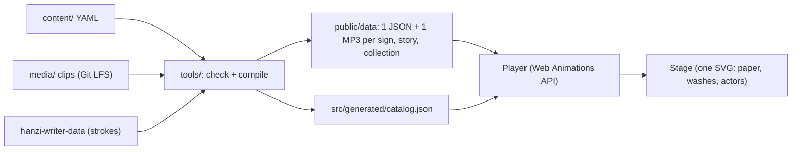

# etym.si — demos (throwaway prototypes)

These demos exist to make the plan concrete before we write the real spec. **They are prototypes:** expect the real app to be rebuilt properly once we agree on the direction.

| Demo | Route | What it shows |
|---|---|---|
| 🎭 Evolution Theater | `#/theater/<system>/<id>` (e.g. `#/theater/han/马`) | Any sign going **picture → oracle bone → bronze → seal → clerical → regular → simplified**, with the live animation script shown beside it — and a **real artifact** for each stage |
| 🎬 Story Time | `#/story/<collection>/<story>` | Film-style scenes where glyphs act as characters (Units 1–2 = the film's opening) |
| 🐢 Learn | `#/learn/<collection>`, `#/lesson/<collection>/<lesson>` | Duolingo-style path: lessons, 6 mini-game types, XP / stars / streak, unit story nodes |
| 📒 Sticker Book | `#/book/<collection>` | Every learned sign becomes a sticker; tap to replay its evolution |

Old links keep working: `#/theater/马`, `#/story/3`, `#/learn`, `#/lesson/u1-l1` and `#/book` resolve against the default system (`han`) and collection (`film-36`), and progress saved by earlier versions is migrated on first load.

## Run

```bash
npm ci
git lfs pull                 # narration clips (media/clips) are stored in Git LFS
npm run dev                  # compiles content/, then serves on 127.0.0.1:3636
npm test                     # unit + golden parity tests (no browser)
npm run build                # content --strict, type checks, Vite, file budget → dist/
npm run test:e2e             # Playwright smoke on the production build (127.0.0.1 only)
npm run preview:lan          # serves dist/ on the LAN IP (see package.json)
node scripts/shoot.mjs all   # headless screenshots + console/CSP error check (127.0.0.1 only)
```

Content lives in `../content/` (YAML) and `../media/` (audio); see [`content/README.md`](../content/README.md) for the formats, the authoring commands (`npm run new`, `ingest:glyphs`, `ingest:photos`, `tts`, `check`) and how to add signs, writing systems and UI languages.

Pushes to `main` are tested, built and deployed to Cloudflare Pages by `.github/workflows/deploy.yml` (secrets: `CLOUDFLARE_API_TOKEN`, `CLOUDFLARE_ACCOUNT_ID`; one-time setup: `npx wrangler pages project create etym-si --production-branch=main`).

## How it works



- **Script-based animation** — every animation is a plain JSON list of steps (`draw`, `swap`, `picture`, `rotate`, `wash`, `move`, `tag`, `say`, …) defined once in `shared/steps.ts`. Evolution scripts are generated at build time from each sign's forms and story beats; stories are authored in YAML. The same scripts could drive a native renderer in a future mobile app.
- **Drawing** — historical glyphs are sketched (outline dash animation) then inked; regular script is animated in real stroke order using medians clipped by stroke outlines.
- **Pictures** — original SVG illustrations (`picture.svg` in each sign's YAML, sanitized at build time and rebuilt with `createElementNS`) aligned to each oracle glyph; animals rotate upright because oracle script writes them standing on their tails.
- **Audio** — each bundle's narration is one MP3 with a byte section per language; the player range-fetches only the active section into a Blob URL and seeks to the clip. Lines without a clip fall back to device speech.

## Real artifacts

Each stage in the theater shows the object the writing lived on, labelled with an honesty level:

| Badge | Meaning | Example |
|---|---|---|
| ✔ Copied from this very object | our glyph was traced from the photographed object | 田 ← oracle bone *Heji* 6057 (National Museum of China); 雨 ← Da Yu ding; 门 ← Hu ding rubbing |
| 📖 Found in this text | the character is in this text; photo shows the text | seal forms ← *Shuowen Jiezi*; 水 ← Shuihudi Qin slips “Eighteen Qin Statutes”; 20 chars in the *Thousand Character Classic* |
| 🔍 This character is written on it | verified transcription / museum description | 月 (五月) on a Zheng scapula; 鹿 on the YH127 turtle shell; 舍 visible on Zhiyong’s page |
| 📷 A real object from that time | same kind and era, clearly marked as an example | other oracle-bone / bronze glyphs |

Provenance comes from each Commons glyph file's `{{ACClicense}}` source field (e.g. `鐵180.2 合5216`, `大盂鼎 … taken from 雩`, `睡.秦4`), captured by `npm run ingest:glyphs`. Photos are fetched by `npm run ingest:photos` (CC0 / public domain / CC BY / CC BY-SA only; credits in the generated `CREDITS.md`). *Thousand Character Classic* lines were matched against the full text on Wikisource. Which card a stage shows is decided at build time by `tools/compile/cards.ts` from the artifact, source and stage templates in `content/`.

## Data & licensing

- Historical glyphs: Wikimedia Commons *Ancient Chinese characters project* — **public domain** (see the generated `CREDITS.md`).
- Regular-script strokes: `hanzi-writer-data` — Arphic Public License (shipped as `licenses/ARPHICPL.TXT`; credits in the generated `CREDITS.md`).
- Narration: Microsoft Edge neural voices via `edge-tts`, recorded once per line into `media/clips/`.
- Inspired by 《三十六个字》 (Shanghai Animation Film Studio, 1984); no frames or drawings from the film are used.

## Security / privacy notes

- Static site, no backend, no accounts; progress lives only in `localStorage` and is schema-validated on load.
- No `innerHTML`: all DOM/SVG is built with `createElement(NS)` + `textContent`; glyph path data is regex-validated, picture SVGs are allowlist-sanitized at build time, and fetched bundles are re-checked before use.
- Strict CSP (`script-src 'self'`, `style-src 'self'`, `media-src 'self' blob:`, no inline/eval, no third-party origins) injected at build; Cloudflare Pages sends it plus `frame-ancestors 'none'`, `X-Frame-Options`, `nosniff`, `Referrer-Policy` and `Permissions-Policy` from the generated `_headers` (the preview server sends the same headers).
- Speech is pre-recorded; device voices (preferring on-device ones) are used only for a line that has no clip, so no text reaches cloud TTS at runtime.
- TODO(licensing): edge-tts uses Microsoft Edge's Read Aloud service, whose terms for production use are unclear; consider Azure AI Speech (same voices) before launch. Switching means adding the provider to `scripts/tts.py` (its key read only from an environment variable) and changing the voices in `content/config.yaml`; the new keys make every line be recorded once more, then never again.
