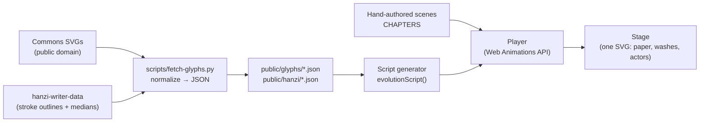

# etym.si — demos (throwaway prototypes)

These demos exist to make the plan concrete before we write the real spec. **They are prototypes:** expect the real app to be rebuilt properly once we agree on the direction.

| Demo | Route | What it shows |
|---|---|---|
| 🎭 Evolution Theater | `#/theater/<char>` | Any of the 36 characters from 《三十六个字》 (1984) going **picture → oracle bone → bronze → seal → clerical → regular → simplified**, with the live animation script shown beside it |
| 🎬 Story Time | `#/story/1`, `#/story/2` | Film-style scenes where glyphs act as characters (Units 1–2 = the film's opening) |
| 🐢 Learn | `#/learn`, `#/lesson/<id>` | Duolingo-style path for Units 1–2: lessons, 6 mini-game types, XP / stars / streak, unit story nodes |
| 📒 Sticker Book | `#/book` | Every learned character becomes a sticker; tap to replay its evolution |

## Run

```bash
npm ci
npm run glyphs        # (optional) re-fetch/normalize glyph data from Wikimedia Commons
npm run build
npm run preview:lan   # serves dist/ on the LAN IP (see package.json)
node scripts/shoot.mjs all   # headless screenshots + console/CSP error check (127.0.0.1 only)
```

## How it works



- **Script-based animation** — every animation is a plain JSON list of steps (`draw`, `swap`, `picture`, `rotate`, `wash`, `move`, `tag`, `say`, …) in `src/engine/script.ts`. Scripts are either generated from glyph data (evolution) or hand-authored (stories). The same scripts could drive a native renderer in a future mobile app.
- **Drawing** — historical glyphs are sketched (outline dash animation) then inked; regular script is animated in real stroke order using medians clipped by stroke outlines.
- **Pictures** — original SVG illustrations (`src/pictures.ts`) aligned to each oracle glyph; animals rotate upright because oracle script writes them standing on their tails.

## Data & licensing

- Historical glyphs: Wikimedia Commons *Ancient Chinese characters project* — **public domain** (see `CREDITS.md`).
- Regular-script strokes: `hanzi-writer-data` — Arphic Public License (`public/hanzi/ARPHICPL.TXT`).
- Inspired by 《三十六个字》 (Shanghai Animation Film Studio, 1984); no frames or drawings from the film are used.

## Security / privacy notes

- Static site, no backend, no accounts; progress lives only in `localStorage` and is schema-validated on load.
- No `innerHTML`: all DOM/SVG is built with `createElement(NS)` + `textContent`; glyph path data is regex-validated.
- Strict CSP (`script-src 'self'`, `style-src 'self'`, no inline/eval, no third-party origins) injected at build; the preview server also sends `X-Frame-Options`, `nosniff`, `Referrer-Policy`, `Permissions-Policy`.
- TODO(security): GitHub Pages cannot send response headers (`frame-ancestors`, `X-Frame-Options`); revisit when choosing production hosting.
- TODO(privacy): speech uses device voices (preferring on-device ones); ship pre-recorded audio in the real app so no text reaches cloud TTS.
