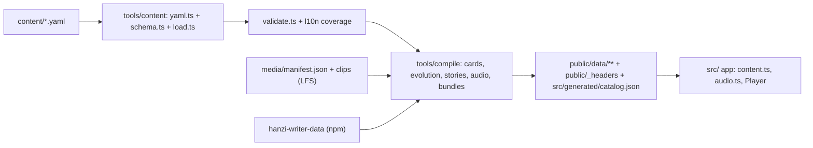
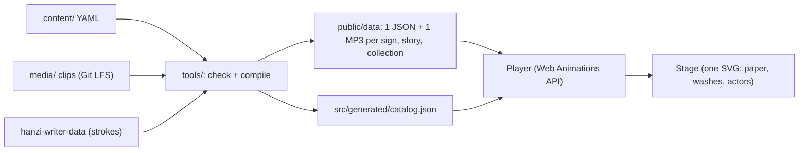

# Content Foundation Implementation Plan

> **For agentic workers:** REQUIRED SUB-SKILL: Use superpowers:subagent-driven-development (recommended) or superpowers:executing-plans to implement this plan task-by-task. Steps use checkbox (`- [ ]`) syntax for tracking.

**Goal:** Move every piece of etym.si content (36 signs, 6 stories, artifact cards, pictures, UI strings, 546 narration clips) out of TypeScript into a validated, script-agnostic `content/` + `media/` tree that compiles to a static API (1 JSON + 1 MP3 per sign/story/collection), with today's behaviour proven unchanged by golden tests; then deploy it from GitHub Actions and integrate the staged first-500 collection (about 466 new signs) with the new tools.

**Architecture:** YAML in `content/` is loaded with a strict YAML/Zod loader, cross-checked, and compiled by Node tools (`demos/tools/`) into hashed bundles under `demos/public/data/` plus an inlined catalog (`demos/src/generated/`). Artifact cards are resolved from artifact/source/stage templates, evolution scripts are generated once at build time, and narration clips (content-addressed masters in Git LFS) are packed into one MP3 per bundle with one byte section per voice; the browser range-fetches only its section into a Blob URL. The app becomes a pure player of compiled data.

**Tech Stack:** Node 24 (native TS type stripping), TypeScript 7.0.2, Vite 8.3.5, `yaml@2.9.1`, `zod@4.6.7`, `@types/node@24.19.2`, Playwright 1.63.0 (headless Chromium), Python 3 (`edge-tts`, Pillow) for network ingest only, Git LFS, GitHub Actions + Cloudflare Pages (`wrangler pages deploy`).

**Spec:** `docs/superpowers/specs/2026-10-25-content-foundation-design.md` (approved). Read it before starting any task; this plan argues from it.

## Global Constraints

- Work only in the worktree `/home/kevin/etym-si/website/.worktrees/content-foundation` (branch `content-foundation`). Never touch `/home/kevin/etym-si/website` (main checkout; it serves the LAN preview).
- Node 24 (`.node-version` = `24`; local Node is v24.0.1). Tools and tests are `.ts` files run directly by `node`: relative imports use `.ts` extensions, erasable syntax only (no `enum`, `namespace`, parameter properties, `import x = require()`), `import type` for type-only imports.
- Keep pinned versions: TypeScript 7.0.2, Vite 8.3.5, Playwright 1.63.0, hanzi-writer 3.7.3, hanzi-writer-data 2.0.1.
- New dev dependencies, exact versions, nothing else: `yaml@2.9.1`, `zod@4.6.7`, `@types/node@24.19.2`. The dependency scanner is unavailable on this machine; skip it.
- Strict CSP everywhere: `default-src 'self'; script-src 'self'; style-src 'self'; img-src 'self' data:; font-src 'self'; connect-src 'self'; media-src 'self' blob:; object-src 'none'; base-uri 'none'; form-action 'none'`, plus `frame-ancestors 'none'` in HTTP headers. `blob:` appears only in `media-src`.
- No `innerHTML` / `outerHTML` / `insertAdjacentHTML` writes, no inline `style="…"` attributes (CSSOM only), no `eval` / `new Function` in the app; all text goes through `textContent` / text nodes.
- No third-party runtime calls: the app fetches only its own origin.
- Zero network in the build: `npm run content`, `npm run check`, `npm run build` make no network calls and need no secrets. Only `ingest:glyphs`, `ingest:photos` and `tts` use the network, and only allowlisted hosts (`commons.wikimedia.org`, `upload.wikimedia.org`, `thumb.wikimedia.org` for photos, the edge-tts endpoint).
- Every server started by a test or tool listens on `127.0.0.1` only. Chromium is launched via `launchChromium()` (env `CHROMIUM_PATH`, else `/home/kevin/.cache/ms-playwright/chromium-1234/chrome-linux64/chrome` when it exists, else Playwright's default). Playwright's bundled browser is not installed locally.
- Artifact honesty labels (`exact` ✔ / `book` 📖 / `appears` 🔍 / `example` 📷) and every card text stay exactly as today (golden parity).
- Tests run with `node --test`: `npm test` (unit + parity, no browser) and `npm run test:e2e` (Chromium).
- Compiler outputs go only to gitignored paths: `demos/public/data/`, `demos/public/_headers`, `demos/public/CREDITS.md`, `demos/public/licenses/`, `demos/src/generated/`.
- YAML: 1.2 core schema, no explicit or custom tags, duplicate keys rejected, alias count capped at 50; warnings are errors.
- Diagnostic format: `<repo-relative file>:<line>:<col> <path>: <message>`, e.g. `content/systems/han/signs/马.yaml:14:5 story.hook.zh-Hant: missing translation (falls back to zh-Hans)`.
- Budget: the build fails above 18,000 files in `dist/`, any file over 24 MiB, or any Git LFS pointer file among inputs or outputs.
- Locales: `en` (base), `zh-Hans` (fallback `en`), `zh-Hant` (fallback `zh-Hans`, audio from `zh-Hans`). Audio sections: `en`, `zh`.
- Voices: `narr-en` = edge-tts `en-US-AvaMultilingualNeural` rate `-4%`; `narr-zh` = `zh-CN-XiaoxiaoNeural` rate `-6%`; `pron-zh` = `zh-CN-XiaoxiaoNeural` rate `-15%`.
- Clip key = full sha256 hex of `provider|voice|rate|spokenText` (UTF-8). Masters: `media/clips/<key>.mp3` (Git LFS); index: `media/manifest.json` (plain git).
- MP3: MPEG-2 Layer III, 24 kHz, 48 kbps, mono, every frame header `FF F3 64 C4`, 144 bytes = 24 ms; silent frame = that header + 140 zero bytes; 10 silent frames (240 ms) follow every packed clip.
- IDs: sign key `<system>/<id>` (han id = simplified form; composites like `发-髮` / `后-後` allowed); collection `film-36`; lesson ids `film-36/u1-l1`; legacy routes `#/theater/马`, `#/story/3`, `#/lesson/u1-l1` keep working.
- Commit at every "Commit" step with the message given.

---

## How the pieces fit



## File structure

Paths are relative to the repo root (the worktree). `demos/` holds the app and the tools.

| Path | Responsibility | Task |
|---|---|---|
| `demos/tools/paths.ts` | Absolute paths (repo, content, media, public, generated, golden, tmp) | 1 |
| `demos/tsconfig.tools.json` | Type-check `tools/`, `shared/`, `tests/` (nodenext, erasable syntax only) | 1 |
| `demos/tests/helpers/browser.ts` | `launchChromium()` | 1 |
| `demos/tools/golden/capture.ts` | One-off: record today's outputs via Vite dev + Chromium (deleted in Task 8) | 1 |
| `demos/tests/golden/*.json` | Frozen pre-migration outputs (committed) | 1 |
| `demos/shared/l10n.ts` | `L10n` type, locale-id pattern | 2 |
| `demos/shared/steps.ts` | THE step vocabulary: Zod schemas + inferred `Step` / `StoryStep` types | 2 |
| `demos/shared/svg-tree.ts` | `SvgNode` type + picture allowlist `checkSvgTree()` (build + runtime) | 2 |
| `demos/shared/sel.ts` | `selKey()` for glyph tables (no zod) | 2 |
| `demos/tools/content/yaml.ts` | Safe YAML read + node location | 2 |
| `demos/tools/content/diagnostics.ts` | `Diags`, `formatDiagnostic`, Zod issue reporting | 2 |
| `demos/tools/content/schema.ts` | All Zod content schemas (`makeSchemas(locales)`) + inferred types | 2 |
| `demos/tools/content/load.ts` | `loadContent(root, diags)` → `ContentSet` | 2 |
| `demos/tools/content/lookup.ts` | Key/stage/text helpers | 2 |
| `demos/tools/content/l10n.ts` | Fallback chains, `complete()`, coverage | 2 |
| `demos/tools/content/svg.ts` | Strict SVG parser, `sanitizePicture()`, pretty printer | 2 |
| `demos/tools/content/validate.ts` | Cross-reference checks | 2 |
| `demos/tools/content/json-schema.ts` + `demos/tools/write-json-schema.ts` | Generated `content/_schema/*.schema.json` | 2 |
| `demos/tools/check.ts` | `npm run check [-- --strict]` | 2 (extended 7) |
| `content/config.yaml` | Locales, voices, published collections, budget | 2 |
| `demos/tests/fixtures/content-egyptian/**` | One-sign Egyptian system (test only) | 2 |
| `demos/tools/audio/clip-key.ts` | `clipKey()`, `spokenText()`, legacy edge names | 3 |
| `demos/tools/audio/media.ts` | `media/manifest.json` read/write | 3 |
| `demos/tools/content/forms-writer.ts` | Rewrite only the `forms:` node of a sign file | 3 |
| `demos/tools/migrate/import-glyphs.ts` | Reusable CLI: legacy glyph JSON dir → `forms:` sections | 3 |
| `demos/tools/migrate/film36.ts` | One-off migration of the film corpus (deleted in Task 11) | 3 |
| `content/**`, `media/**` | Migrated content and clips | 3 |
| `demos/shared/bundle-types.ts` | Every compiled format (catalog, bundles, cards, audio index) | 4 |
| `demos/tools/compile/template.ts` | Placeholder filling | 4 |
| `demos/tools/compile/cards.ts` | Artifact-card resolver | 4 |
| `demos/tests/parity/normalize.ts` | Legacy → new shape normalizers for golden comparison | 4 |
| `demos/tools/compile/evolution.ts` | `evolutionScript()` generator | 5 |
| `demos/tools/compile/stories.ts` | Story macro expansion, qualification, step validation, glyph tables | 5 |
| `demos/tools/compile/glyph-data.ts` | Forms + stroke data (hanzi-writer-data adapter) | 5 |
| `demos/tools/audio/pack.ts` | Frame checks, silent frames, section packer | 6 |
| `demos/tools/audio/clips.ts` | Attach `clip` keys to steps, collect sections, coverage | 6 |
| `demos/shared/csp.ts` | CSP + security headers (Vite + `_headers`) | 7 |
| `demos/tools/compile/site.ts` | Assemble all bundles, catalog, `_headers`, credits | 7 |
| `demos/tools/compile/output.ts` | Hash names, safe paths, write outputs | 7 |
| `demos/tools/compile/budget.ts` + `demos/tools/check-dist.ts` | File budget + LFS pointer guard | 7 |
| `demos/tools/build-content.ts` | `npm run content` | 7 |
| `demos/shared/bundle-check.ts` | Light runtime re-check of fetched bundles | 8 |
| `demos/src/content.ts` | Catalog + bundle loading for the app | 8 |
| `demos/src/picture.ts` | Rebuild picture trees with `createElementNS` | 8 |
| `demos/src/ui/mascot.ts` | Gugu (moved out of `pictures.ts`) | 11 |
| `demos/src/audio.ts` | Section range-fetch, clip playback, device-speech fallback | 9 |
| `demos/src/play-source.ts` | Glyph/label/picture/audio sources for the Player | 10 |
| `demos/src/route.ts` | Pure hash-route parser incl. legacy aliases | 10 |
| `demos/src/progress-migrate.ts` | Pure progress v1 → v2 migration | 11 |
| `demos/tools/ingest/{python,glyphs,photos}.ts`, `demos/scripts/{commons_glyphs,commons_photos,tts}.py` | Ingest from content job lists: Node builds jobs and validates results, Python only fetches | 12 |
| `demos/tools/content/credit-writer.ts` | Rewrite only the `credit:` node of an artifact file | 12 |
| `demos/tools/tts.ts`, `demos/tools/new-sign.ts` | `npm run tts` (missing clips only), `npm run new` (sign skeleton) | 12 |
| `.github/workflows/deploy.yml`, `.node-version`, `content/README.md` | Deploy + docs | 13 |
| `content/systems/han/signs/*.yaml` (new), `content/collections/first-500/` | Merged from `content/han-500`, forms imported, narration recorded | 14 |

## Conventions used by every task

- Commands run from `demos/` unless a step says otherwise: `cd /home/kevin/etym-si/website/.worktrees/content-foundation/demos`.
- "Repo root" = `/home/kevin/etym-si/website/.worktrees/content-foundation`.
- Type-check tools with `npm run typecheck:tools`; type-check the app with `npm run typecheck` (from Task 7 on it regenerates `src/generated/` first).
- JSON written by tools: `JSON.stringify(value, null, 1) + '\n'` for committed files, compact `JSON.stringify(value)` for bundles.
- Golden normalization (the only differences allowed between `tests/golden/*.json` and compiled output): Tri keys `zhs`/`zht` → `zh-Hans`/`zh-Hant`; glyph selectors and `tag` steps rename `char: '马'` → `sign: 'han/马'`; `picture.pic: '马'` → `'han/马'`; compiled `say` steps carry an added `clip` (dropped before comparing); cards drop `disp`, keep `form: { stage, index }` for today's `hist`, compare photos by file stem (`artifacts/heji6057.jpg` and `data/photos/heji6057.<hash>.jpg` both → `heji6057`), and fill the runtime token `{shown}` with the display form of the script being compared; lessons gain the `film-36/` id prefix and `chars` → `signs` (with `han/` prefix); units `chars` → `signs`.

---

### Task 1: Golden capture of today's outputs

**Files:**
- Modify: `demos/package.json` (dev dependency, scripts)
- Modify: `demos/.gitignore`
- Create: `demos/tsconfig.tools.json`
- Create: `demos/tools/paths.ts`
- Create: `demos/tests/helpers/browser.ts`
- Create: `demos/tools/golden/capture.ts`
- Create (generated, committed): `demos/tests/golden/{chars,stories,evolution,cards,pictures,chapters,strings,stages,units}.json`
- Test: `demos/tests/unit/golden.test.ts`

**Interfaces:**
- Consumes: today's modules, loaded in the page by URL: `/src/engine/scripts.ts` (`evolutionScript`, `CHAPTERS`), `/src/data/chars.ts` (`CHARS`, `UNITS`, `LESSONS`, `displayChar`), `/src/glyphs.ts` (`loadGlyph`), `/src/data/artifacts.ts` (`artifactFor`), `/src/pictures.ts` (`PICTURES`), `/src/i18n.ts` (`STR`), `/src/data/stages.ts` (`STAGES`, `VARIANT_NOTE`), `/src/data/char-stories.ts` (`CHAR_STORIES`).
- Produces:
  - `tools/paths.ts`: `DEMOS`, `REPO`, `CONTENT_DIR`, `MEDIA_DIR`, `PUBLIC_DIR`, `GENERATED_DIR`, `GOLDEN_DIR`, `TMP_DIR: string`; `rel(abs: string): string` (repo-relative, `/` separators).
  - `tests/helpers/browser.ts`: `chromiumPath(): string | undefined`, `launchChromium(args?: string[]): Promise<Browser>`.
  - Golden JSON shapes (Tri = `{ en, zhs, zht }`):
    - `chars.json`: `CharInfo[]` (`char, trad, pinyin, meaning, fact`).
    - `stories.json`: `Record<char, { topic, hook, rotate?, early?, turn?, closer }>`.
    - `evolution.json`: `Record<char, { full: LegacyStep[]; compact: LegacyStep[] }>`.
    - `cards.json`: `Record<char, { simp: CardEvent[]; trad: CardEvent[] }>`, `CardEvent = { stage: string; index: number; card: null | { kind, img, img2?, marks?, form?: { stage, index }, disp, title, text, source? } }` — one event per theater stage event: `picture` (when the sign has a picture), each historical form in order, `regular`, `simplified` (when trad ≠ simp).
    - `pictures.json`: `Record<char, { rotate: number; ambient: string | null; svg: string }>` (`XMLSerializer` output of `build()`).
    - `chapters.json`: `{ unit, title, topic, script }[]`; `strings.json`: `STR`; `stages.json`: `{ stages, variantNotes }`; `units.json`: `{ units, lessons }`.

- [ ] **Step 1: Install the Node type definitions and add tool scaffolding**

```bash
cd /home/kevin/etym-si/website/.worktrees/content-foundation/demos
npm install --save-dev --save-exact @types/node@24.19.2
```

Edit `demos/package.json` `scripts` so it reads exactly:

```json
  "scripts": {
    "glyphs": "python3 scripts/fetch-glyphs.py",
    "dev": "vite --host 127.0.0.1 --port 3636",
    "build": "tsc --noEmit && vite build",
    "preview:lan": "vite preview --host 172.17.197.51 --port 3636 --strictPort",
    "shoot": "node scripts/shoot.mjs",
    "test": "node --test \"tests/unit/**/*.test.ts\" \"tests/parity/**/*.test.ts\"",
    "test:e2e": "node --test --test-concurrency=1 \"tests/e2e/**/*.test.ts\"",
    "typecheck:tools": "tsc --noEmit -p tsconfig.tools.json",
    "golden": "node tools/golden/capture.ts"
  },
```

Append to `demos/.gitignore`:

```gitignore
tests/.tmp/
```

Create `demos/tsconfig.tools.json`:

```json
{
  "compilerOptions": {
    "target": "ES2023",
    "module": "nodenext",
    "moduleResolution": "nodenext",
    "lib": ["ES2023", "DOM", "DOM.Iterable"],
    "types": ["node"],
    "strict": true,
    "noEmit": true,
    "allowImportingTsExtensions": true,
    "erasableSyntaxOnly": true,
    "verbatimModuleSyntax": true,
    "resolveJsonModule": true,
    "skipLibCheck": true,
    "noUnusedLocals": true,
    "noUnusedParameters": true
  },
  "include": ["tools", "shared", "tests"]
}
```

Create `demos/tools/paths.ts`:

```ts
// Absolute paths used by every tool and test. Content and media live at the repo root, next to demos/.
import path from 'node:path';

export const DEMOS = path.resolve(import.meta.dirname, '..');
export const REPO = path.resolve(DEMOS, '..');
export const CONTENT_DIR = path.join(REPO, 'content');
export const MEDIA_DIR = path.join(REPO, 'media');
export const PUBLIC_DIR = path.join(DEMOS, 'public');
export const GENERATED_DIR = path.join(DEMOS, 'src', 'generated');
export const GOLDEN_DIR = path.join(DEMOS, 'tests', 'golden');
export const TMP_DIR = path.join(DEMOS, 'tests', '.tmp');

/** Repo-relative path with forward slashes (used in diagnostics). */
export function rel(abs: string): string {
  return path.relative(REPO, abs).split(path.sep).join('/');
}
```

Create `demos/tests/helpers/browser.ts`:

```ts
// Headless Chromium for tests and tools. Playwright's bundled browser is not installed on the dev machine,
// so prefer CHROMIUM_PATH, then the locally downloaded build, then Playwright's default (CI).
import { existsSync } from 'node:fs';
import { chromium, type Browser } from 'playwright';

const LOCAL_CHROME = '/home/kevin/.cache/ms-playwright/chromium-1234/chrome-linux64/chrome';

export function chromiumPath(): string | undefined {
  if (process.env.CHROMIUM_PATH) return process.env.CHROMIUM_PATH;
  return existsSync(LOCAL_CHROME) ? LOCAL_CHROME : undefined;
}

export function launchChromium(args: string[] = []): Promise<Browser> {
  return chromium.launch({ executablePath: chromiumPath(), args });
}
```

- [ ] **Step 2: Write the failing test**

Create `demos/tests/unit/golden.test.ts`:

```ts
import { test } from 'node:test';
import assert from 'node:assert/strict';
import { readFileSync } from 'node:fs';
import path from 'node:path';
import { GOLDEN_DIR } from '../../tools/paths.ts';

const read = (name: string) => JSON.parse(readFileSync(path.join(GOLDEN_DIR, `${name}.json`), 'utf8'));

test('golden snapshots cover the whole film corpus', () => {
  const chars = read('chars') as { char: string; trad: string }[];
  assert.equal(chars.length, 36);
  const evolution = read('evolution');
  for (const c of chars) {
    assert.ok(evolution[c.char].full.length > 5, `full script for ${c.char}`);
    assert.ok(evolution[c.char].compact.length > 3, `compact script for ${c.char}`);
  }
  const cards = read('cards');
  assert.equal(Object.keys(cards).length, 36);
  const oracle田 = cards['田'].simp.find((e: { stage: string }) => e.stage === 'oracle');
  assert.equal(oracle田.card.kind, 'exact');
  const reg = (script: string) => cards['鸟'][script].find((e: { stage: string }) => e.stage === 'regular').card;
  assert.match(reg('simp').text.en, /^鸟 is one of/);
  assert.match(reg('trad').text.en, /^鳥 is one of/);
  assert.equal(read('chapters').length, 6);
  assert.equal(Object.keys(read('pictures')).length, 12);
  assert.equal(read('stages').stages.length, 7);
  const units = read('units');
  assert.equal(units.units.length, 6);
  assert.equal(units.lessons.length, 30);
  assert.equal(read('strings').tagline.en, 'Where Chinese characters come from');
  assert.equal(Object.keys(read('stories')).length, 36);
});
```

- [ ] **Step 3: Run it to verify it fails**

Run: `node --test tests/unit/golden.test.ts`
Expected: FAIL with `ENOENT: no such file or directory, open '…/tests/golden/chars.json'`.

- [ ] **Step 4: Write the capture tool**

Create `demos/tools/golden/capture.ts`:

```ts
// One-off: record today's behaviour before anything changes (spec §10 "Golden parity").
// Starts a Vite dev server on 127.0.0.1 (no config file, no HMR), opens a same-origin page in headless Chromium,
// dynamically imports the CURRENT modules and serializes their outputs into tests/golden/*.json.
import { mkdirSync, writeFileSync } from 'node:fs';
import path from 'node:path';
import { createServer } from 'vite';
import { DEMOS, GOLDEN_DIR } from '../paths.ts';
import { launchChromium } from '../../tests/helpers/browser.ts';

const PORT = 3690;

/** Runs inside the page. Module specifiers are passed as data so TypeScript does not try to resolve them. */
async function captureInPage(urls: Record<string, string>): Promise<Record<string, unknown>> {
  const load = (u: string) => import(/* @vite-ignore */ u);
  const [scripts, chars, glyphs, artifacts, pictures, i18n, stages, stories] = await Promise.all([
    load(urls.scripts), load(urls.chars), load(urls.glyphs), load(urls.artifacts),
    load(urls.pictures), load(urls.i18n), load(urls.stages), load(urls.stories),
  ]);
  const ser = new XMLSerializer();
  const evolution: Record<string, unknown> = {};
  const cards: Record<string, unknown> = {};
  const pics: Record<string, unknown> = {};
  for (const info of chars.CHARS) {
    const ch: string = info.char;
    const doc = await glyphs.loadGlyph(ch);
    evolution[ch] = { full: scripts.evolutionScript(doc), compact: scripts.evolutionScript(doc, { compact: true }) };
    const pic = pictures.PICTURES[ch];
    const events: { stage: string; hist: unknown }[] = [];
    if (pic) events.push({ stage: 'picture', hist: undefined });
    for (const st of doc.stages) events.push({ stage: st.stage, hist: st });
    events.push({ stage: 'regular', hist: undefined });
    if (doc.trad !== doc.char) events.push({ stage: 'simplified', hist: undefined });
    const perScript: Record<string, unknown> = {};
    for (const script of ['simp', 'trad']) {
      const disp = chars.displayChar(info, script);
      const seen: Record<string, number> = {};
      perScript[script] = events.map(({ stage, hist }) => {
        const index = seen[stage] ?? 0;
        seen[stage] = index + 1;
        const ref = artifacts.artifactFor(ch, stage, hist, disp);
        if (!ref) return { stage, index, card: null };
        const form = ref.hist
          ? { stage: ref.hist.stage, index: doc.stages.filter((s: { stage: string }) => s.stage === ref.hist.stage).indexOf(ref.hist) }
          : undefined;
        return { stage, index, card: { kind: ref.kind, img: ref.img, img2: ref.img2, marks: ref.marks, form, disp: ref.disp, title: ref.title, text: ref.text, source: ref.source } };
      });
    }
    cards[ch] = perScript;
    if (pic) pics[ch] = { rotate: pic.rotate, ambient: pic.ambient ?? null, svg: ser.serializeToString(pic.build()) };
  }
  return {
    chars: chars.CHARS, stories: stories.CHAR_STORIES, evolution, cards, pictures: pics, chapters: scripts.CHAPTERS,
    strings: i18n.STR, stages: { stages: stages.STAGES, variantNotes: stages.VARIANT_NOTE }, units: { units: chars.UNITS, lessons: chars.LESSONS },
  };
}

const server = await createServer({
  root: DEMOS, configFile: false, appType: 'custom', logLevel: 'error',
  server: { host: '127.0.0.1', port: PORT, strictPort: true, hmr: false, watch: null },
});
await server.listen();
const browser = await launchChromium();
try {
  const page = await browser.newPage();
  const pageErrors: string[] = [];
  page.on('pageerror', (e) => pageErrors.push(e.message));
  await page.goto(`http://127.0.0.1:${PORT}/glyphs/index.json`); // any same-origin page that does not boot the app
  const out = await page.evaluate(captureInPage, {
    scripts: '/src/engine/scripts.ts', chars: '/src/data/chars.ts', glyphs: '/src/glyphs.ts', artifacts: '/src/data/artifacts.ts',
    pictures: '/src/pictures.ts', i18n: '/src/i18n.ts', stages: '/src/data/stages.ts', stories: '/src/data/char-stories.ts',
  });
  if (pageErrors.length) throw new Error(`page errors during capture:\n${pageErrors.join('\n')}`);
  mkdirSync(GOLDEN_DIR, { recursive: true });
  for (const [name, value] of Object.entries(out)) {
    writeFileSync(path.join(GOLDEN_DIR, `${name}.json`), JSON.stringify(value, null, 1) + '\n');
  }
  console.log(`golden: wrote ${Object.keys(out).length} files to ${GOLDEN_DIR}`);
} finally {
  await browser.close();
  await server.close();
}
```

- [ ] **Step 5: Run the capture, then the test**

Run: `npm run golden && node --test tests/unit/golden.test.ts && npm run typecheck:tools`
Expected: `golden: wrote 9 files …`, then `pass 1`, then no type errors. The capture takes ~2 s; `cards.json` is ~360 KB, `evolution.json` ~220 KB.

- [ ] **Step 6: Commit**

```bash
git add package.json package-lock.json .gitignore tsconfig.tools.json tools/paths.ts tools/golden/capture.ts tests/helpers/browser.ts tests/unit/golden.test.ts tests/golden
git commit -m "test: record golden snapshots of today's scripts, cards, pictures and strings"
```

---

### Task 2: Schemas, safe YAML loader, validator, JSON Schemas, Egyptian fixture

**Files:**
- Modify: `demos/package.json` (dev dependencies, scripts `check`, `schema`)
- Create: `demos/shared/l10n.ts`, `demos/shared/steps.ts`, `demos/shared/svg-tree.ts`, `demos/shared/sel.ts`
- Create: `demos/tools/content/yaml.ts`, `diagnostics.ts`, `schema.ts`, `load.ts`, `lookup.ts`, `l10n.ts`, `svg.ts`, `validate.ts`, `json-schema.ts`
- Create: `demos/tools/write-json-schema.ts`, `demos/tools/check.ts`
- Create: `content/config.yaml`, `content/_schema/*.schema.json` (generated, committed)
- Create: `demos/tests/fixtures/content-egyptian/{config.yaml,ui.yaml,systems/egyptian/system.yaml,systems/egyptian/signs/G17.yaml,collections/egypt-demo/collection.yaml}`
- Create: `demos/tests/helpers/fixture.ts`
- Test: `demos/tests/unit/yaml.test.ts`, `demos/tests/unit/schema.test.ts`, `demos/tests/unit/validate.test.ts`, `demos/tests/unit/svg.test.ts`, `demos/tests/unit/json-schema.test.ts`

**Interfaces:**
- Consumes: `tools/paths.ts` (`CONTENT_DIR`, `DEMOS`, `TMP_DIR`, `rel`).
- Produces:
  - `shared/l10n.ts`: `type L10n = Record<string, string>`, `LOCALE_ID: RegExp`.
  - `shared/steps.ts`: `ACTOR`, `SIGN_REF`, `STAGE_ID: RegExp`; `type LeafStep`, `type Step = LeafStep | { do: 'together'; steps: Step[] }`, `type StoryStep = LeafStep | { do: 'together'; steps: StoryStep[] } | { narrate: L10n } | { tagSay: { actor: string; sign: string; dx?: number; dy?: number } }`, `type GlyphSel = { sign: string; stage: string; index?: number }`, `type StepOf<K extends Step['do']>`; `makeStepSchemas(L10n?): { Step: z.ZodType<Step>; StoryStep: z.ZodType<StoryStep> }`. The app may only `import type` from this file.
  - `shared/svg-tree.ts`: `type SvgNode = [tag: string, attrs: Record<string, string>, children: SvgNode[]]`, `PATH_D`, `TRANSFORM: RegExp`, `checkSvgTree(nodes: SvgNode[]): string | null`.
  - `shared/sel.ts`: `selKey(sel: { sign: string; stage: string; index?: number }): string` → `"han/草|seal|0"`.
  - `tools/content/yaml.ts`: `interface YamlFile { abs; file; text; doc: Document; lines: LineCounter; data: unknown }`, `parseYamlText(abs, text, diags): YamlFile | null`, `readYaml(abs, diags): YamlFile | null`, `locate(y, path): { line; col }`, `MAX_ALIASES = 50`.
  - `tools/content/diagnostics.ts`: `type PathSeg = string | number`, `interface Diagnostic { severity: 'error' | 'warning'; file; line; col; path; message }`, `class Diags { list; error(where, path, msg); warn(where, path, msg); errors; warnings; lines(): string[] }`, `formatPath(path)`, `formatDiagnostic(d)`, `reportZod(diags, y, error, prefix?)`.
  - `tools/content/schema.ts`: `ConfigSchema`; `makeSchemas(locales)` → `{ L10n, Ext, Ui, System, Sign, Artifact, Source, Collection, Story }`; types `Config, Ui, System, Stage, StageExample, Sign, Form, JourneyEntry, Artifact, Occurrence, Source, Collection, Unit, Story`; regexes `SLUG, QUALIFIED_STAGE, QUALIFIED_SIGN, TEXT_SCRIPT, VAR_NAME, COMMONS_TITLE, LICENSES`.
  - `tools/content/load.ts`: `interface Doc<T> { y: YamlFile; data: T }`, `SignDoc` (`+ system: string; key: string; ext?`), `SystemDoc` (`+ signs: Map<id, SignDoc>`), `ArtifactDoc` (`+ photoAbs`), `StoryDoc` (`+ order`), `CollectionDoc` (`+ stories: Map<id, StoryDoc>`), `interface ContentSet { root; locales: string[]; config: Doc<Config>; ui: Doc<Ui>; systems; artifacts; sources: Map<string, Doc<Source>>; collections }`, `loadContent(root, diags): ContentSet | null`.
  - `tools/content/lookup.ts`: `splitKey(key)`, `qualify(ref, system)`, `signByKey(content, key)`, `stageOf(content, qualifiedStage)`, `systemStage(sys, id)`, `primaryText(sys, sign)`, `primaryReading(sys, sign)`, `pronounceText(sys, sign)`, `journeyEntries(sys, sign): { stage; form; variants }[]`.
  - `tools/content/l10n.ts`: `fallbackChain(content, locale)`, `pick(content, text, locale)`, `complete(content, text): L10n`, `isL10n(content, v)`, `checkCoverage(content, diags, strict)`.
  - `tools/content/svg.ts`: `parseSvg(text): SvgNode`, `serializeSvg(node, indent?): string`, `sanitizePicture(svgText): { ok: true; tree: SvgNode[] } | { ok: false; error: string }`, `wrapPicture(tree): string`.
  - `tools/content/validate.ts`: `validateContent(content, diags, { strict })`.
  - `tools/content/json-schema.ts`: `renderJsonSchemas(locales): Map<string, string>` (file name → text).
  - `tests/helpers/fixture.ts`: `EGYPT_FIXTURE`, `fixtureCopy(files?, from?): string`, `loadFixture(dir, strict?): { content; diags }`.

- [ ] **Step 1: Install the YAML and schema libraries**

```bash
npm install --save-dev --save-exact yaml@2.9.1 zod@4.6.7
```

Add to `demos/package.json` `scripts` (keep the existing ones):

```json
    "check": "node tools/check.ts",
    "schema": "node tools/write-json-schema.ts",
```

- [ ] **Step 2: Write the failing tests**

Create `demos/tests/helpers/fixture.ts`:

```ts
// Temporary content directories for loader/validator tests (copied from a fixture, then patched).
import { cpSync, mkdirSync, mkdtempSync, writeFileSync } from 'node:fs';
import path from 'node:path';
import { DEMOS, TMP_DIR } from '../../tools/paths.ts';
import { Diags } from '../../tools/content/diagnostics.ts';
import { loadContent, type ContentSet } from '../../tools/content/load.ts';
import { validateContent } from '../../tools/content/validate.ts';

export const EGYPT_FIXTURE = path.join(DEMOS, 'tests', 'fixtures', 'content-egyptian');

export function fixtureCopy(files: Record<string, string> = {}, from = EGYPT_FIXTURE): string {
  mkdirSync(TMP_DIR, { recursive: true });
  const dir = mkdtempSync(path.join(TMP_DIR, 'content-'));
  cpSync(from, dir, { recursive: true });
  for (const [relPath, text] of Object.entries(files)) {
    const abs = path.join(dir, relPath);
    mkdirSync(path.dirname(abs), { recursive: true });
    writeFileSync(abs, text);
  }
  return dir;
}

export function loadFixture(dir: string, strict = false): { content: ContentSet | null; diags: Diags } {
  const diags = new Diags();
  const content = loadContent(dir, diags);
  if (content) validateContent(content, diags, { strict });
  return { content, diags };
}
```

Create `demos/tests/unit/yaml.test.ts`:

```ts
import { test } from 'node:test';
import assert from 'node:assert/strict';
import { Diags, formatDiagnostic } from '../../tools/content/diagnostics.ts';
import { parseYamlText } from '../../tools/content/yaml.ts';
import { REPO } from '../../tools/paths.ts';

const parse = (text: string) => {
  const diags = new Diags();
  const y = parseYamlText(`${REPO}/content/x.yaml`, text, diags);
  return { y, diags };
};

test('plain YAML parses to data', () => {
  const { y, diags } = parse('id: 马\ntext: { Hans: 马, Hant: 馬 }\n');
  assert.equal(diags.list.length, 0);
  assert.deepEqual(y?.data, { id: '马', text: { Hans: '马', Hant: '馬' } });
});

test('duplicate keys are rejected with a line number', () => {
  const { y, diags } = parse('a: 1\nb: 2\na: 3\n');
  assert.equal(y, null);
  assert.equal(diags.errors.length, 1);
  assert.match(formatDiagnostic(diags.errors[0]), /^content\/x\.yaml:3:1 Map keys must be unique/);
});

test('explicit and custom tags are rejected', () => {
  assert.equal(parse('a: !!binary aGk=\n').y, null);
  assert.equal(parse('a: !foo bar\n').y, null);
  assert.equal(parse('a: !!str 5\n').y, null);
});

test('alias bombs are rejected', () => {
  const bomb = 'a: &a [x,x,x,x,x,x,x,x,x]\nb: &b [*a,*a,*a,*a,*a,*a,*a,*a,*a]\nc: &c [*b,*b,*b,*b,*b,*b,*b,*b,*b]\nd: [*c,*c,*c,*c,*c,*c,*c,*c,*c]\n';
  const { y, diags } = parse(bomb);
  assert.equal(y, null);
  assert.match(diags.errors[0].message, /alias/i);
});
```

Create `demos/tests/unit/schema.test.ts`:

```ts
import { test } from 'node:test';
import assert from 'node:assert/strict';
import { readFileSync } from 'node:fs';
import { EGYPT_FIXTURE, fixtureCopy, loadFixture } from '../helpers/fixture.ts';
import { formatDiagnostic } from '../../tools/content/diagnostics.ts';

const G17 = 'systems/egyptian/signs/G17.yaml';
const base = readFileSync(`${EGYPT_FIXTURE}/${G17}`, 'utf8');

test('the Egyptian fixture loads and validates cleanly', () => {
  const { content, diags } = loadFixture(EGYPT_FIXTURE, true);
  assert.deepEqual(diags.lines(), []);
  const sys = content!.systems.get('egyptian')!;
  assert.equal(sys.signs.get('G17')!.key, 'egyptian/G17');
  assert.deepEqual(sys.signs.get('G17')!.ext, { kind: 'uniliteral', sound: 'm' });
});

test('unknown keys are errors located at file:line:col', () => {
  const dir = fixtureCopy({ [G17]: base.replace('meaning:', 'meanin:') });
  const lines = loadFixture(dir).diags.lines();
  assert.ok(lines.some((l) => /signs\/G17\.yaml:\d+:\d+ meanin: unknown key "meanin"/.test(l)), lines.join('\n'));
});

test('unknown locale keys are errors; missing translations are warnings, errors in strict mode', () => {
  const unknown = fixtureCopy({ [G17]: base.replace('zh-Hant: 貓頭鷹', 'zh-Hanz: 貓頭鷹') });
  assert.ok(loadFixture(unknown).diags.lines().some((l) => l.includes('meaning.zh-Hanz: unknown key')));
  const missing = fixtureCopy({ [G17]: base.replace(', zh-Hant: 貓頭鷹', '') });
  const lax = loadFixture(missing).diags;
  assert.equal(lax.errors.length, 0);
  assert.ok(lax.warnings.some((d) => formatDiagnostic(d).includes('meaning.zh-Hant: missing translation (falls back to zh-Hans)')));
  assert.ok(loadFixture(missing, true).diags.errors.length > 0);
});

test('values are range-checked', () => {
  const dir = fixtureCopy({ [G17]: base.replace('box: [0, 0, 100, 100]', 'box: [0, 0, -5, 100]') });
  assert.ok(loadFixture(dir).diags.errors.some((d) => d.path.startsWith('forms[0].box')));
});

test('optional sign fields: status, sources (https only), origin', () => {
  const ok = fixtureCopy({ [G17]: `${base}sources:\n  - { title: Gardiner sign list, url: 'https://en.wikipedia.org/wiki/Gardiner%27s_sign_list' }\n` });
  assert.equal(loadFixture(ok).diags.errors.length, 0);
  const bad = fixtureCopy({ [G17]: `${base}sources:\n  - { title: x, url: 'http://example.com' }\n` });
  assert.ok(loadFixture(bad).diags.errors.some((d) => d.message.includes('https')));
});
```

Create `demos/tests/unit/validate.test.ts`:

```ts
import { test } from 'node:test';
import assert from 'node:assert/strict';
import { readFileSync } from 'node:fs';
import { EGYPT_FIXTURE, fixtureCopy, loadFixture } from '../helpers/fixture.ts';

const read = (p: string) => readFileSync(`${EGYPT_FIXTURE}/${p}`, 'utf8');
const G17 = 'systems/egyptian/signs/G17.yaml';
const COLL = 'collections/egypt-demo/collection.yaml';
const msgs = (dir: string, strict = false) => loadFixture(dir, strict).diags.errors.map((d) => `${d.path}: ${d.message}`);

test('sign ids must match the file name and the system id rule', () => {
  assert.ok(msgs(fixtureCopy({ [G17]: read(G17).replace('id: G17', 'id: G18') })).some((m) => m.includes('must match the file name')));
  assert.ok(msgs(fixtureCopy({ 'systems/egyptian/signs/g17x.yaml': read(G17).replace('id: G17', 'id: g17x') })).some((m) => m.includes('does not match the egyptian sign id rule')));
});

test('collections must reference existing signs, at most once per collection', () => {
  assert.ok(msgs(fixtureCopy({ [COLL]: read(COLL).replace('signs: [G17]', 'signs: [G17, G99]') })).some((m) => m.includes('unknown sign egyptian/G99')));
  const twice = read(COLL) + `  - title: { en: Again, zh-Hans: 再来, zh-Hant: 再來 }\n    signs: [G17]\n`;
  assert.ok(msgs(fixtureCopy({ [COLL]: twice })).some((m) => m.includes('already appears in unit 1')));
});

test('every journey stage needs a form', () => {
  const noDemotic = read(G17).replace(/  - stage: demotic[\s\S]*$/, '');
  assert.ok(msgs(fixtureCopy({ [G17]: noDemotic })).some((m) => m.includes('journey stage demotic has no form')));
});

test('artifacts need their photo and a credit', () => {
  const art = [
    'id: owl-stela', 'stage: egyptian.hieroglyph', 'title: { en: An owl on a stela }',
    'image: { file: owl-stela.jpg, commons: "File:Owl stela.jpg" }', 'occurrences:', '  - sign: egyptian/G17', '    marks: [{ box: [0.1, 0.1, 0.2, 0.2] }]', '',
  ].join('\n');
  const errs = msgs(fixtureCopy({ 'artifacts/owl-stela.yaml': art }));
  assert.ok(errs.some((m) => m.includes('photo file owl-stela.jpg is missing')));
  assert.ok(errs.some((m) => m.includes('credit section missing')));
  const outside = art.replace('[0.1, 0.1, 0.2, 0.2]', '[0.9, 0.1, 0.2, 0.2]');
  assert.ok(msgs(fixtureCopy({ 'artifacts/owl-stela.yaml': outside })).some((m) => m.includes('within 0–1')));
});

test('pictures must pass the SVG sanitizer', () => {
  const pic = `picture:\n  rotate: 0\n  svg: |\n    <svg xmlns="http://www.w3.org/2000/svg" viewBox="0 0 300 300"><g onclick="x"/></svg>\n`;
  assert.ok(msgs(fixtureCopy({ [G17]: read(G17).replace('journey:', `${pic}journey:`) })).some((m) => m.includes('attribute onclick is not allowed')));
});
```

Create `demos/tests/unit/svg.test.ts`:

```ts
import { test } from 'node:test';
import assert from 'node:assert/strict';
import { parseSvg, sanitizePicture, serializeSvg, wrapPicture } from '../../tools/content/svg.ts';

const wrap = (inner: string) => `<svg xmlns="http://www.w3.org/2000/svg" viewBox="0 0 300 300">${inner}</svg>`;

test('accepts shapes, presentation attributes, animation classes and data-part', () => {
  const r = sanitizePicture(wrap('<g class="pic pic-sun" data-part="door-left"><path d="M0 0 L10 10Z" fill="#e8453c" stroke-width="7"/><circle cx="1" cy="2" r="3" opacity="0.5"/></g>'));
  assert.equal(r.ok, true);
  assert.deepEqual(r.ok && r.tree, [['g', { class: 'pic pic-sun', 'data-part': 'door-left' }, [['path', { d: 'M0 0 L10 10Z', fill: '#e8453c', 'stroke-width': '7' }, []], ['circle', { cx: '1', cy: '2', r: '3', opacity: '0.5' }, []]]]]);
});

test('rejects scripts, event handlers, href, style, url() and foreign elements', () => {
  for (const [inner, why] of [
    ['<script/>', 'element <script> is not allowed'],
    ['<script>alert(1)</script>', 'text content is not allowed'],
    ['<g onclick="x"/>', 'attribute onclick is not allowed'],
    ['<g style="fill:red"/>', 'attribute style is not allowed'],
    ['<path d="M0 0" fill="url(#a)"/>', 'attribute fill="url(#a)" is not allowed'],
    ['<image href="x.png"/>', 'element <image> is not allowed'],
    ['<use href="#a"/>', 'element <use> is not allowed'],
    ['<foreignObject/>', 'element <foreignObject> is not allowed'],
    ['<g><!-- hi --></g>', 'comments, doctypes and processing instructions are not allowed'],
    ['<g data-part="Bad Part"/>', 'attribute data-part="Bad Part" is not allowed'],
    ['<path data-part="x" d="M0 0"/>', 'attribute data-part is not allowed on <path>'],
  ] as const) {
    const r = sanitizePicture(wrap(inner));
    assert.equal(r.ok, false, inner);
    assert.ok(!r.ok && r.error.includes(why), `${inner} → ${!r.ok && r.error}`);
  }
  assert.equal(sanitizePicture('<svg viewBox="0 0 300 300"><g/></svg>').ok, false); // missing xmlns
});

test('pretty printing round-trips', () => {
  const tree = parseSvg(wrap('<g class="pic"><rect x="1" y="2" width="3" height="4" rx="1"/></g>'))[2];
  assert.deepEqual(parseSvg(wrapPicture(tree))[2], tree);
  assert.equal(serializeSvg(tree[0]), '<g class="pic"><rect x="1" y="2" width="3" height="4" rx="1"/></g>');
});
```

Create `demos/tests/unit/json-schema.test.ts`:

```ts
import { test } from 'node:test';
import assert from 'node:assert/strict';
import { readFileSync } from 'node:fs';
import path from 'node:path';
import { renderJsonSchemas } from '../../tools/content/json-schema.ts';
import { CONTENT_DIR } from '../../tools/paths.ts';

test('content/_schema is up to date (run npm run schema)', () => {
  for (const [name, text] of renderJsonSchemas(['en', 'zh-Hans', 'zh-Hant'])) {
    assert.equal(readFileSync(path.join(CONTENT_DIR, '_schema', name), 'utf8'), text, name);
  }
});
```

- [ ] **Step 3: Run the tests to verify they fail**

Run: `npm test`
Expected: FAIL — `Cannot find module '…/tools/content/diagnostics.ts'` (and the fixture is missing).

- [ ] **Step 4: Write the shared modules**

Create `demos/shared/l10n.ts`:

```ts
/** A localized string: locale id → text. Content may omit non-base locales; compiled bundles carry every locale. */
export type L10n = Record<string, string>;

/** BCP 47 subset used here: language plus optional ISO 15924 script, e.g. en, zh-Hans. */
export const LOCALE_ID = /^[a-z]{2,3}(-[A-Z][a-z]{3})?$/;
```

Create `demos/shared/sel.ts`:

```ts
/** Key of a glyph selector in a glyph table (story bundles). Kept free of zod so the app can import it. */
export function selKey(sel: { sign: string; stage: string; index?: number }): string {
  return `${sel.sign}|${sel.stage}|${sel.index ?? 0}`;
}
```

Create `demos/shared/steps.ts`:

```ts
// The animation step vocabulary. THIS is the one place to add a step type: add a member to LEAF below.
// Tools validate story YAML with these schemas at runtime; the app imports only the inferred types
// (`import type`), so zod never reaches the browser bundle.
import { z } from 'zod';
import type { L10n } from './l10n.ts';

export const ACTOR = /^[a-z][a-z0-9]{0,23}$/;
export const SIGN_REF = /^([a-z][a-z0-9-]{0,31}\/)?[^/\s]{1,32}$/;
export const STAGE_ID = /^[a-z][a-z0-9-]{0,31}$/;
const EASE = /^(linear|ease|ease-in|ease-out|ease-in-out|cubic-bezier\(\s*-?[\d.]+\s*,\s*-?[\d.]+\s*,\s*-?[\d.]+\s*,\s*-?[\d.]+\s*\))$/;
const anyL10n: z.ZodType<L10n> = z.record(z.string(), z.string());

function leafSchemas(L10n: z.ZodType<L10n>) {
  const Actor = z.string().regex(ACTOR, 'actor ids are lowercase letters and digits');
  const Coord = z.number().min(-2000).max(3000);
  const XY = z.tuple([Coord, Coord]);
  const Ms = z.number().min(0).max(600000);
  const Offset = z.number().min(-2000).max(2000);
  const Size = z.number().min(1).max(3000);
  const Color = z.string().regex(/^#[0-9a-fA-F]{6}$/, 'colors are #rrggbb');
  const SignRef = z.string().regex(SIGN_REF, 'signs are <id> or <system>/<id>');
  const StageRef = z.string().regex(STAGE_ID);
  const GlyphSel = z.strictObject({ sign: SignRef, stage: StageRef, index: z.number().int().min(0).max(23).optional() });
  const Clip = z.record(z.string(), z.string().regex(/^[0-9a-f]{64}$/));
  const LEAF = [
    z.strictObject({ do: z.literal('place'), actor: Actor, at: XY, size: Size, back: z.boolean().optional() }),
    z.strictObject({ do: z.literal('picture'), actor: Actor, pic: SignRef, ms: Ms.optional() }),
    z.strictObject({ do: z.literal('rotate'), actor: Actor, deg: z.number().min(-720).max(720), target: z.enum(['picture', 'all']).optional(), ms: Ms.optional() }),
    z.strictObject({ do: z.literal('draw'), actor: Actor, glyph: GlyphSel, ms: Ms.optional(), color: Color.optional() }),
    z.strictObject({ do: z.literal('show'), actor: Actor, glyph: GlyphSel, color: Color.optional() }),
    z.strictObject({ do: z.literal('swap'), actor: Actor, glyph: GlyphSel, ms: Ms.optional(), color: Color.optional() }),
    z.strictObject({ do: z.literal('clearPicture'), actor: Actor, ms: Ms.optional() }),
    z.strictObject({ do: z.literal('wash'), actor: Actor, color: Color, size: Size.optional(), w: Size.optional(), h: Size.optional(), opacity: z.number().min(0).max(1).optional(), ms: Ms.optional(), dx: Offset.optional(), dy: Offset.optional() }),
    z.strictObject({ do: z.literal('move'), actor: Actor, to: XY, ms: Ms, gait: z.enum(['walk', 'hop', 'fly', 'swim', 'gallop']).optional(), ease: z.string().regex(EASE).optional() }),
    z.strictObject({ do: z.literal('ambient'), actor: Actor, motion: z.enum(['bob', 'sway', 'pulse', 'flicker', 'flow', 'float', 'none']) }),
    z.strictObject({ do: z.literal('fade'), actor: Actor, to: z.number().min(0).max(1), ms: Ms.optional() }),
    z.strictObject({ do: z.literal('scale'), actor: Actor, to: z.number().min(0.01).max(20), ms: Ms.optional() }),
    z.strictObject({ do: z.literal('remove'), actor: Actor, ms: Ms.optional() }),
    z.strictObject({ do: z.literal('bg'), tone: z.enum(['paper', 'dawn', 'dusk', 'night']), ms: Ms.optional() }),
    z.strictObject({ do: z.literal('stage'), stage: StageRef, variant: StageRef.optional() }),
    z.strictObject({ do: z.literal('caption'), text: L10n.nullable() }),
    z.strictObject({ do: z.literal('tag'), actor: Actor, sign: SignRef, hold: Ms.optional(), dx: Offset.optional(), dy: Offset.optional() }),
    // lang 'zh' = the sign's pronunciation voice (legacy name kept for golden parity); 'ui' = narration in the UI language.
    z.strictObject({ do: z.literal('say'), text: z.union([L10n, z.string().min(1).max(600)]), lang: z.enum(['zh', 'ui']), wait: z.boolean().optional(), silent: z.boolean().optional(), clip: Clip.optional() }),
    z.strictObject({ do: z.literal('wait'), ms: Ms }),
  ] as const;
  return { LEAF, LeafStep: z.discriminatedUnion('do', [...LEAF]), GlyphSel, Actor, SignRef, Offset };
}

const plain = leafSchemas(anyL10n);
export type LeafStep = z.infer<typeof plain.LeafStep>;
export type GlyphSel = z.infer<typeof plain.GlyphSel>;
export type Step = LeafStep | { do: 'together'; steps: Step[] };
export type StoryStep =
  | LeafStep
  | { do: 'together'; steps: StoryStep[] }
  | { narrate: L10n }
  | { tagSay: { actor: string; sign: string; dx?: number; dy?: number } };
export type StepOf<K extends Step['do']> = Extract<Step, { do: K }>;

export interface StepSchemas {
  Step: z.ZodType<Step>;
  StoryStep: z.ZodType<StoryStep>;
}

/** Build the step schemas with a locale-aware L10n schema (content) or a loose one (default). */
export function makeStepSchemas(L10n: z.ZodType<L10n> = anyL10n): StepSchemas {
  const { LEAF, Actor, SignRef, Offset } = leafSchemas(L10n);
  const Step: z.ZodType<Step> = z.lazy(() =>
    z.discriminatedUnion('do', [...LEAF, z.strictObject({ do: z.literal('together'), steps: z.array(Step).min(1).max(40) })]));
  const Narrate = z.strictObject({ narrate: L10n });
  const TagSay = z.strictObject({ tagSay: z.strictObject({ actor: Actor, sign: SignRef, dx: Offset.optional(), dy: Offset.optional() }) });
  const StoryStep: z.ZodType<StoryStep> = z.lazy(() =>
    z.union([z.discriminatedUnion('do', [...LEAF, z.strictObject({ do: z.literal('together'), steps: z.array(StoryStep).min(1).max(40) })]), Narrate, TagSay]));
  return { Step, StoryStep };
}
```

Create `demos/shared/svg-tree.ts`:

```ts
// Picture SVGs are stored as a JSON tree and rebuilt with createElementNS (never parsed from markup in the app).
// This allowlist runs at build time (sanitizer) and again in the browser before touching the DOM.
export type SvgNode = [tag: string, attrs: Record<string, string>, children: SvgNode[]];

const NUM = /^-?(\d+\.?\d*|\.\d+)(e[-+]?\d+)?$/i;
export const PATH_D = /^[MmLlHhVvCcSsQqTtAaZz0-9eE\s,.+-]*$/;
export const TRANSFORM = /^\s*((matrix|translate|scale|rotate|skewX|skewY)\(\s*[-+0-9.eE\s,]*\)\s*)+$/;
const POINTS = /^[-+0-9.eE\s,]*$/;
const PAINT = /^(none|currentColor|#[0-9a-fA-F]{3}|#[0-9a-fA-F]{6})$/;
const DASH = /^(none|[0-9.]+([\s,]+[0-9.]+)*)$/;
const CLASS = /^pic(-[a-z0-9]+)*( pic(-[a-z0-9]+)*)*$/; // animation hooks only (see pictures.css)
const PART = /^[a-z][a-z0-9-]{0,31}$/; // reserved for rigged parts (future `pose` step)

const PRESENTATION: Record<string, RegExp> = {
  fill: PAINT, stroke: PAINT, 'stroke-width': NUM, 'stroke-linecap': /^(butt|round|square)$/, 'stroke-linejoin': /^(miter|round|bevel)$/,
  'stroke-dasharray': DASH, 'stroke-dashoffset': NUM, 'stroke-opacity': NUM, 'fill-opacity': NUM, opacity: NUM,
  'fill-rule': /^(nonzero|evenodd)$/, transform: TRANSFORM, class: CLASS,
};
const OWN: Record<string, Record<string, RegExp>> = {
  g: { 'data-part': PART },
  path: { d: PATH_D },
  circle: { cx: NUM, cy: NUM, r: NUM },
  ellipse: { cx: NUM, cy: NUM, rx: NUM, ry: NUM },
  rect: { x: NUM, y: NUM, width: NUM, height: NUM, rx: NUM, ry: NUM },
  line: { x1: NUM, y1: NUM, x2: NUM, y2: NUM },
  polyline: { points: POINTS },
  polygon: { points: POINTS },
};

/** null when every node passes the allowlist, otherwise a human-readable reason. */
export function checkSvgTree(nodes: SvgNode[], depth = 0): string | null {
  if (depth > 24) return 'picture is nested too deeply';
  if (!Array.isArray(nodes)) return 'malformed picture tree';
  for (const n of nodes) {
    if (!Array.isArray(n) || n.length !== 3 || typeof n[0] !== 'string' || typeof n[1] !== 'object' || !Array.isArray(n[2])) return 'malformed picture node';
    const [tag, attrs, kids] = n;
    const own = OWN[tag];
    if (!own) return `element <${tag}> is not allowed`;
    for (const [k, v] of Object.entries(attrs)) {
      if (typeof v !== 'string' || v.length > 40000) return `bad value for ${k}`;
      const re = PRESENTATION[k] ?? own[k];
      if (!re) return `attribute ${k} is not allowed on <${tag}>`;
      if (!re.test(v)) return `attribute ${k}="${v.slice(0, 40)}" is not allowed`;
    }
    if (tag !== 'g' && kids.length) return `<${tag}> cannot have children`;
    const err = checkSvgTree(kids, depth + 1);
    if (err) return err;
  }
  return null;
}
```

- [ ] **Step 5: Write the YAML reader and diagnostics**

Create `demos/tools/content/diagnostics.ts`:

```ts
// Build diagnostics: `content/systems/han/signs/马.yaml:14:5 story.hook.zh-Hant: missing translation (falls back to zh-Hans)`.
import type { z } from 'zod';
import { locate, type YamlFile } from './yaml.ts';

export type Severity = 'error' | 'warning';
export type PathSeg = string | number;
export interface Diagnostic { severity: Severity; file: string; line: number; col: number; path: string; message: string }

export function formatPath(path: readonly PathSeg[]): string {
  return path.reduce<string>((s, seg) => (typeof seg === 'number' ? `${s}[${seg}]` : s ? `${s}.${seg}` : seg), '');
}

export function formatDiagnostic(d: Diagnostic): string {
  return `${d.file}:${d.line}:${d.col} ${d.path ? `${d.path}: ` : ''}${d.message}`;
}

export class Diags {
  readonly list: Diagnostic[] = [];

  error(where: YamlFile | string, path: readonly PathSeg[], message: string): void { this.add('error', where, path, message); }
  warn(where: YamlFile | string, path: readonly PathSeg[], message: string): void { this.add('warning', where, path, message); }

  add(severity: Severity, where: YamlFile | string, path: readonly PathSeg[], message: string): void {
    const at = typeof where === 'string' ? { line: 1, col: 1 } : locate(where, path);
    this.list.push({ severity, file: typeof where === 'string' ? where : where.file, line: at.line, col: at.col, path: formatPath(path), message });
  }

  get errors(): Diagnostic[] { return this.list.filter((d) => d.severity === 'error'); }
  get warnings(): Diagnostic[] { return this.list.filter((d) => d.severity === 'warning'); }

  /** Errors first, then warnings, each formatted. */
  lines(): string[] { return [...this.errors, ...this.warnings].map(formatDiagnostic); }
}

type Issue = z.core.$ZodIssue;

/** Report every Zod issue at its YAML location. Unions report only the branch the author most likely meant. */
export function reportZod(diags: Diags, y: YamlFile, error: z.ZodError, prefix: readonly PathSeg[] = []): void {
  for (const issue of flatten(error.issues, [])) {
    const path = [...prefix, ...issue.path.filter((p): p is PathSeg => typeof p !== 'symbol')];
    if (issue.code === 'unrecognized_keys') for (const k of issue.keys) diags.error(y, [...path, k], `unknown key "${k}"`);
    else diags.error(y, path, issue.message);
  }
}

function flatten(issues: readonly Issue[], base: readonly PropertyKey[]): Issue[] {
  const out: Issue[] = [];
  for (const raw of issues) {
    const issue = { ...raw, path: [...base, ...raw.path] } as Issue;
    if (issue.code === 'invalid_union' && issue.errors.length) {
      const score = (branch: readonly Issue[]) =>
        branch.some((i) => (i.code === 'invalid_union' && i.errors.length === 0) || (i.code === 'unrecognized_keys' && i.path.length === 0)) ? 1 : 0;
      const depth = (branch: readonly Issue[]) => Math.max(0, ...branch.map((i) => i.path.length));
      const best = issue.errors.reduce((a, b) => (score(b) < score(a) || (score(b) === score(a) && depth(b) > depth(a)) ? b : a));
      out.push(...flatten(best, issue.path));
    } else out.push(issue);
  }
  return out;
}
```

Create `demos/tools/content/yaml.ts`:

```ts
// Safe YAML: 1.2 core schema, no tags, unique keys, no merge keys, aliases capped. Warnings are errors.
import { readFileSync } from 'node:fs';
import { LineCounter, parseDocument, visit, type Document } from 'yaml';
import { rel } from '../paths.ts';
import type { Diags, PathSeg } from './diagnostics.ts';

export const MAX_ALIASES = 50;

export interface YamlFile {
  abs: string;
  file: string; // repo-relative, for messages
  text: string;
  doc: Document;
  lines: LineCounter;
  data: unknown;
}

export function parseYamlText(abs: string, text: string, diags: Diags): YamlFile | null {
  const file = rel(abs);
  const lines = new LineCounter();
  const doc = parseDocument(text, {
    lineCounter: lines, schema: 'core', customTags: [], uniqueKeys: true, merge: false, strict: true, version: '1.2', prettyErrors: false,
  });
  let ok = true;
  const fail = (message: string, offset: number) => {
    ok = false;
    const p = lines.linePos(offset);
    diags.list.push({ severity: 'error', file, line: p.line, col: p.col, path: '', message });
  };
  for (const e of [...doc.errors, ...doc.warnings]) fail(e.message.split('\n')[0], e.pos[0]);
  visit(doc, {
    Node(_key, node) {
      const tag = (node as { tag?: string }).tag;
      if (tag) fail(`explicit YAML tags are not allowed (${tag})`, node.range?.[0] ?? 0);
    },
  });
  if (!ok) return null;
  let data: unknown;
  try {
    data = doc.toJS({ maxAliasCount: MAX_ALIASES });
  } catch (e) {
    fail(`${(e as Error).message} (alias limit ${MAX_ALIASES})`, 0);
    return null;
  }
  return { abs, file, text, doc, lines, data };
}

export function readYaml(abs: string, diags: Diags): YamlFile | null {
  return parseYamlText(abs, readFileSync(abs, 'utf8'), diags);
}

/** Line/column of the deepest existing node on `path` (missing keys point at their parent). */
export function locate(y: YamlFile, path: readonly PathSeg[]): { line: number; col: number } {
  for (let n = path.length; n >= 0; n--) {
    const node = n === 0 ? y.doc.contents : y.doc.getIn(path.slice(0, n), true);
    const range = (node as { range?: [number, number, number] } | null | undefined)?.range;
    if (range) {
      const p = y.lines.linePos(range[0]);
      return { line: p.line, col: p.col };
    }
  }
  return { line: 1, col: 1 };
}
```

- [ ] **Step 6: Write the schemas**

Create `demos/tools/content/schema.ts`:

```ts
// Strict Zod schemas for every content file (spec §9): unknown keys are errors, numbers are ranged,
// strings are capped, colors are #rrggbb. Locale keys come from config.yaml, hence makeSchemas(locales).
import { z } from 'zod';
import { LOCALE_ID, type L10n } from '../../shared/l10n.ts';
import { makeStepSchemas, SIGN_REF, STAGE_ID } from '../../shared/steps.ts';
import { PATH_D, TRANSFORM } from '../../shared/svg-tree.ts';

export const SLUG = /^[a-z0-9][a-z0-9-]{0,63}$/;
export const QUALIFIED_STAGE = /^[a-z][a-z0-9-]{0,31}\.[a-z][a-z0-9-]{0,31}$/;
export const QUALIFIED_SIGN = /^[a-z][a-z0-9-]{0,31}\/[^/\s]{1,32}$/;
export const TEXT_SCRIPT = /^[A-Z][a-z]{3}$/; // ISO 15924, e.g. Hans, Hant, Egyp
export const VAR_NAME = /^[a-z][A-Za-z0-9]{0,31}$/;
export const COMMONS_TITLE = /^File:[^\n|#<>[\]{}]{1,200}$/;
export const LICENSES = /^(Public domain|CC0|CC BY-SA [34]\.0|CC BY [34]\.0)$/;

const str = (max: number) => z.string().min(1).max(max);
const slug = z.string().regex(SLUG, 'ids are lowercase letters, digits and dashes');
const color = z.string().regex(/^#[0-9a-fA-F]{6}$/, 'colors are #rrggbb');
const stageId = z.string().regex(STAGE_ID, 'stage ids are lowercase letters, digits and dashes');
const textScript = z.string().regex(TEXT_SCRIPT, 'text scripts are ISO 15924 codes such as Hans');
const varName = z.string().regex(VAR_NAME);
const scheme = z.string().regex(/^[a-z][a-z0-9]{0,15}$/);
const signRef = z.string().regex(SIGN_REF, 'signs are <id> or <system>/<id>');
const unit = z.number().min(0).max(1);
const regexSource = z.string().min(1).max(300).refine((s) => {
  try { new RegExp(s, 'u'); return true; } catch { return false; }
}, 'not a valid regular expression');

export const ConfigSchema = z.strictObject({
  locales: z.array(z.strictObject({
    id: z.string().regex(LOCALE_ID), lang: z.string().regex(LOCALE_ID), section: z.string().regex(/^[a-z]{2,8}$/),
    fallback: z.string().regex(LOCALE_ID).optional(), audioFrom: z.string().regex(LOCALE_ID).optional(),
  })).min(1).max(20),
  narration: z.record(z.string().regex(/^[a-z]{2,8}$/), z.string().regex(SLUG)),
  voices: z.record(z.string().regex(SLUG), z.strictObject({
    provider: z.enum(['edge-tts']),
    voice: z.string().regex(/^[a-z]{2,3}-[A-Z]{2}-[A-Za-z]+Neural$/),
    rate: z.string().regex(/^[+-]\d{1,2}%$/),
    normalize: z.array(z.strictObject({ find: z.string().min(1).max(200), replace: z.string().max(200), literal: z.boolean().optional() })).max(50).optional(),
  })),
  collections: z.array(slug).min(1).max(50),
  audio: z.strictObject({ gapMs: z.number().int().min(24).max(2400) }),
  budget: z.strictObject({ maxFiles: z.number().int().min(100).max(20000), maxFileMiB: z.number().min(1).max(25) }),
});

export function makeSchemas(locales: readonly string[]) {
  const [base, ...others] = locales;
  const L10n = (max = 600): z.ZodType<L10n> =>
    z.strictObject({ [base]: str(max), ...Object.fromEntries(others.map((l) => [l, str(max).optional()])) }) as unknown as z.ZodType<L10n>;
  const { StoryStep } = makeStepSchemas(L10n(600));
  const mark = z.strictObject({ box: z.tuple([unit, unit, unit, unit]), label: L10n(200).optional() })
    .refine((m) => m.box[2] > 0 && m.box[3] > 0 && m.box[0] + m.box[2] <= 1 && m.box[1] + m.box[3] <= 1, 'mark boxes must stay within 0–1 and have a size');
  const tpl = z.strictObject({ title: L10n(160), text: L10n(800) });

  const Ext = z.record(varName, z.union([str(120), z.number(), z.boolean()]));
  const Ui = z.strictObject({ strings: z.record(z.string().regex(/^[a-z][A-Za-z0-9]{0,39}$/), L10n(300)) });

  const StageExample = z.strictObject({
    when: z.strictObject({ variant: stageId.optional(), note: z.literal(true).optional() }).optional(),
    kind: z.enum(['book', 'example']).optional(),
    artifact: slug, title: L10n(160), text: L10n(800),
  });
  const Stage = z.strictObject({
    id: stageId, kind: z.enum(['picture', 'paths', 'strokes']), icon: str(8), color, name: L10n(60), era: L10n(160),
    commonsVariants: z.array(stageId).min(1).max(8).optional(),
    turn: z.boolean().optional(),      // the evolution story's "turn" beat may be told here
    quiz: z.boolean().optional(),      // false: leave out of the put-in-order quiz
    script: textScript.optional(),     // strokes stages: which text form's stroke data to draw
    derivedFrom: textScript.optional(),// shown only when text[script] differs from text[derivedFrom]
    intro: L10n(300).optional(),       // narration for a derived stage; {from} and {to} are filled in
    examples: z.array(StageExample).max(10).optional(),
  });
  const System = z.strictObject({
    id: slug, name: L10n(60), signNoun: L10n(30), signId: regexSource,
    textScripts: z.array(textScript).min(1).max(4),
    readings: z.record(scheme, z.strictObject({ primary: z.boolean().optional() })),
    pronounce: z.strictObject({ voice: slug, from: z.string().regex(/^text\.[A-Z][a-z]{3}$/) }).optional(),
    ingest: z.strictObject({ glyphs: z.enum(['commons-acc']).optional(), strokes: z.enum(['hanzi-writer-data']).optional() }),
    journeyForm: textScript.optional(),
    defaultJourney: z.array(stageId).min(1).max(12).optional(),
    variantNotes: z.record(stageId, L10n(60)).optional(),
    noteFragments: z.record(varName, z.strictObject({ match: regexSource, text: L10n(300) })).optional(),
    stages: z.array(Stage).min(1).max(16),
  });

  const glyphPath = z.strictObject({
    d: z.string().min(1).max(40000).regex(PATH_D, 'path data has unexpected characters'),
    t: z.string().max(400).regex(TRANSFORM, 'transform must be a list of SVG transform functions').optional(),
    mode: z.enum(['stroke', 'knockout']).optional(),
    w: z.number().min(0).max(100).optional(),
    rule: z.literal('evenodd').optional(),
  });
  const Form = z.strictObject({
    stage: stageId, form: str(8), variant: stageId,
    commons: z.string().regex(COMMONS_TITLE).optional(),
    provenance: z.strictObject({ period: z.string().max(20), code: z.string().max(12), note: z.string().max(120) }).optional(),
    box: z.tuple([z.number().min(-10000).max(10000), z.number().min(-10000).max(10000), z.number().gt(0).max(20000), z.number().gt(0).max(20000)]),
    paths: z.array(glyphPath).min(1).max(200),
  });
  const JourneyEntry = z.union([stageId, z.strictObject({ stage: stageId, form: str(8).optional(), variants: z.array(stageId).min(1).max(8).optional() })]);
  const Sign = z.strictObject({
    id: z.string().min(1).max(32).regex(/^[^/\s]+$/),
    status: z.enum(['draft', 'reviewed']).optional(),
    text: z.record(textScript, str(8)),
    readings: z.record(scheme, str(40)),
    meaning: L10n(80),
    fact: L10n(600),
    origin: z.strictObject({
      type: z.enum(['pictogram', 'ideogram', 'compound-ideogram', 'phono-semantic', 'loan', 'uncertain']),
      parts: z.array(z.strictObject({ char: str(8), role: z.enum(['meaning', 'sound', 'shape']), gloss: L10n(120).optional() })).max(8).optional(),
    }).optional(),
    sources: z.array(z.strictObject({ title: str(200), url: z.string().max(300).regex(/^https:\/\/[^\s<>"]+$/, 'source urls must be https') })).max(10).optional(),
    story: z.strictObject({ topic: L10n(120), hook: L10n(600), rotate: L10n(600).optional(), early: L10n(600).optional(), turn: L10n(600).optional(), closer: L10n(600) }).optional(),
    picture: z.strictObject({ rotate: z.number().int().min(-180).max(180), ambient: z.enum(['glow', 'flow', 'sway', 'flap', 'bob']).optional(), svg: z.string().min(20).max(200000) }).optional(),
    journey: z.union([z.literal('default'), z.array(JourneyEntry).max(12)]),
    cards: z.record(stageId, z.strictObject({ kind: z.enum(['exact', 'book', 'appears', 'example']), artifact: slug, artifact2: slug.optional(), marks: z.array(mark).max(10).optional(), title: L10n(160), text: L10n(800) })).optional(),
    forms: z.array(Form).max(24).optional(), // generated by ingest; do not edit by hand
  });

  const Occurrence = z.strictObject({
    sign: z.string().regex(QUALIFIED_SIGN, 'occurrences name signs as <system>/<id>'),
    phrase: L10n(300).optional(), text: L10n(800).optional(), marks: z.array(mark).max(10).optional(),
  });
  const Artifact = z.strictObject({
    id: slug,
    kind: z.enum(['bone', 'shell', 'vessel', 'rubbing', 'slips', 'manuscript', 'book', 'photo']).optional(),
    stage: z.string().regex(QUALIFIED_STAGE, 'stages are <system>.<stage>'),
    title: L10n(160),
    aliases: z.array(str(40)).max(10).optional(),
    image: z.strictObject({ file: z.string().regex(/^[a-z0-9][a-z0-9-]{0,63}\.(jpg|png)$/), commons: z.string().regex(COMMONS_TITLE) }),
    related: z.array(slug).max(4).optional(),
    occurrences: z.array(Occurrence).max(500).optional(),
    templates: z.strictObject({
      exact: z.strictObject({ title: L10n(160).optional(), text: L10n(800) }).optional(),
      appears: z.strictObject({ title: L10n(160).optional(), text: L10n(800).optional() }).optional(),
    }).optional(),
    credit: z.strictObject({ // generated by `npm run ingest:photos`
      author: str(160), license: z.string().regex(LICENSES), page: z.string().regex(/^https:\/\/commons\.wikimedia\.org\/wiki\/\S+$/),
      width: z.number().int().min(1).max(4000), height: z.number().int().min(1).max(4000),
    }).optional(),
  });

  const Source = z.strictObject({
    id: slug, stage: z.string().regex(QUALIFIED_STAGE), title: L10n(160),
    match: regexSource.optional(),
    entries: z.record(str(40), z.strictObject({ name: L10n(120), artifact: slug.optional(), vars: z.record(varName, L10n(200)).optional() })).optional(),
    fragments: z.record(varName, L10n(300)).optional(),
    lines: z.array(z.strictObject({ text: z.record(textScript, str(60)), gloss: L10n(300) })).max(2000).optional(),
    photo: slug,
    templates: z.strictObject({ book: tpl.optional(), example: tpl.optional(), quote: tpl.optional() }),
  });

  const Unit = z.strictObject({
    n: z.number().int().min(1).max(9999).optional(),
    title: L10n(120), color: color.optional(), playable: z.boolean().optional(),
    signs: z.array(signRef).min(1).max(60),
    story: slug.optional(),
    lessons: z.array(z.strictObject({ id: slug, kind: z.enum(['learn', 'review', 'story']), signs: z.array(signRef).min(1).max(12).optional() })).min(1).max(30).optional(),
  });
  const Collection = z.strictObject({
    id: slug, system: slug, title: L10n(120),
    featured: z.array(signRef).max(12).optional(),
    units: z.array(Unit).min(1).max(1000),
  });
  const Story = z.strictObject({ id: slug, title: L10n(120), topic: L10n(160), cast: z.array(signRef).min(1).max(60), script: z.array(StoryStep).min(1).max(600) });

  return { L10n, Ext, Ui, System, Sign, Artifact, Source, Collection, Story, Stage, StageExample, Form, JourneyEntry, Occurrence, Unit };
}

type S = ReturnType<typeof makeSchemas>;
export type Config = z.infer<typeof ConfigSchema>;
export type Ui = z.infer<S['Ui']>;
export type System = z.infer<S['System']>;
export type Stage = z.infer<S['Stage']>;
export type StageExample = z.infer<S['StageExample']>;
export type Sign = z.infer<S['Sign']>;
export type Form = z.infer<S['Form']>;
export type JourneyEntry = z.infer<S['JourneyEntry']>;
export type Artifact = z.infer<S['Artifact']>;
export type Occurrence = z.infer<S['Occurrence']>;
export type Source = z.infer<S['Source']>;
export type Collection = z.infer<S['Collection']>;
export type Unit = z.infer<S['Unit']>;
export type Story = z.infer<S['Story']>;
```

- [ ] **Step 7: Write the loader, lookups and localization helpers**

Create `demos/tools/content/load.ts`:

```ts
// Reads content/ into a ContentSet. Every file is parsed with the safe YAML reader and its strict schema;
// problems become diagnostics (file:line:col) instead of exceptions, so one bad file never hides the others.
import { existsSync, readdirSync, statSync } from 'node:fs';
import path from 'node:path';
import type { z } from 'zod';
import { rel } from '../paths.ts';
import { type Diags, reportZod } from './diagnostics.ts';
import { readYaml, type YamlFile } from './yaml.ts';
import { ConfigSchema, makeSchemas, type Artifact, type Collection, type Config, type Sign, type Source, type Story, type System, type Ui } from './schema.ts';

export interface Doc<T> { y: YamlFile; data: T }
export interface SignDoc extends Doc<Sign> { system: string; key: string; ext?: Record<string, string | number | boolean> }
export interface SystemDoc extends Doc<System> { signs: Map<string, SignDoc> }
export interface ArtifactDoc extends Doc<Artifact> { photoAbs: string }
export interface StoryDoc extends Doc<Story> { order: number }
export interface CollectionDoc extends Doc<Collection> { stories: Map<string, StoryDoc> }
export interface ContentSet {
  root: string;
  locales: string[];
  config: Doc<Config>;
  ui: Doc<Ui>;
  systems: Map<string, SystemDoc>;
  artifacts: Map<string, ArtifactDoc>;
  sources: Map<string, Doc<Source>>;
  collections: Map<string, CollectionDoc>;
}

const yamlFiles = (dir: string): string[] => (existsSync(dir) ? readdirSync(dir).filter((f) => f.endsWith('.yaml')).sort() : []);
const subdirs = (dir: string): string[] =>
  existsSync(dir) ? readdirSync(dir).filter((f) => !f.startsWith('.') && !f.startsWith('_') && statSync(path.join(dir, f)).isDirectory()).sort() : [];
const stem = (f: string) => f.replace(/\.yaml$/, '');

function parseDoc<T>(diags: Diags, abs: string, schema: z.ZodType<T>): Doc<T> | null {
  if (!existsSync(abs)) { diags.error(rel(abs), [], 'file is missing'); return null; }
  const y = readYaml(abs, diags);
  if (!y) return null;
  const r = schema.safeParse(y.data);
  if (!r.success) { reportZod(diags, y, r.error); return null; }
  return { y, data: r.data };
}

function idMatches(diags: Diags, y: YamlFile, id: string, expected: string, what: string): void {
  if (id !== expected) diags.error(y, ['id'], `id "${id}" must match the ${what} "${expected}"`);
}

export function loadContent(root: string, diags: Diags): ContentSet | null {
  const config = parseDoc(diags, path.join(root, 'config.yaml'), ConfigSchema);
  if (!config) return null;
  const locales = config.data.locales.map((l) => l.id);
  const S = makeSchemas(locales);
  const ui = parseDoc(diags, path.join(root, 'ui.yaml'), S.Ui);
  if (!ui) return null;
  const content: ContentSet = { root, locales, config, ui, systems: new Map(), artifacts: new Map(), sources: new Map(), collections: new Map() };

  for (const id of subdirs(path.join(root, 'systems'))) {
    const dir = path.join(root, 'systems', id);
    const sys = parseDoc(diags, path.join(dir, 'system.yaml'), S.System);
    if (!sys) continue;
    idMatches(diags, sys.y, sys.data.id, id, 'folder name');
    const doc: SystemDoc = { ...sys, signs: new Map() };
    content.systems.set(id, doc);
    for (const f of yamlFiles(path.join(dir, 'signs'))) {
      const y = readYaml(path.join(dir, 'signs', f), diags);
      if (!y) continue;
      const raw: Record<string, unknown> = y.data && typeof y.data === 'object' && !Array.isArray(y.data) ? { ...(y.data as Record<string, unknown>) } : {};
      let ext: SignDoc['ext'];
      if (id in raw) { // system-specific extension block, e.g. `egyptian: { kind: uniliteral, sound: m }`
        const e = S.Ext.safeParse(raw[id]);
        if (e.success) ext = e.data; else reportZod(diags, y, e.error, [id]);
        delete raw[id];
      }
      const r = S.Sign.safeParse(raw);
      if (!r.success) { reportZod(diags, y, r.error); continue; }
      idMatches(diags, y, r.data.id, stem(f), 'file name');
      doc.signs.set(r.data.id, { y, data: r.data, system: id, key: `${id}/${r.data.id}`, ext });
    }
  }
  for (const f of yamlFiles(path.join(root, 'artifacts'))) {
    const a = parseDoc(diags, path.join(root, 'artifacts', f), S.Artifact);
    if (!a) continue;
    idMatches(diags, a.y, a.data.id, stem(f), 'file name');
    content.artifacts.set(a.data.id, { ...a, photoAbs: path.join(root, 'artifacts', a.data.image.file) });
  }
  for (const f of yamlFiles(path.join(root, 'sources'))) {
    const s = parseDoc(diags, path.join(root, 'sources', f), S.Source);
    if (!s) continue;
    idMatches(diags, s.y, s.data.id, stem(f), 'file name');
    content.sources.set(s.data.id, s);
  }
  for (const id of subdirs(path.join(root, 'collections'))) {
    const dir = path.join(root, 'collections', id);
    const c = parseDoc(diags, path.join(dir, 'collection.yaml'), S.Collection);
    if (!c) continue;
    idMatches(diags, c.y, c.data.id, id, 'folder name');
    const doc: CollectionDoc = { ...c, stories: new Map() };
    content.collections.set(id, doc);
    for (const f of yamlFiles(path.join(dir, 'stories'))) {
      const s = parseDoc(diags, path.join(dir, 'stories', f), S.Story);
      if (!s) continue;
      const m = /^(\d{2})-(.+)\.yaml$/.exec(f);
      if (!m) { diags.error(s.y, [], 'story files are named NN-<id>.yaml'); continue; }
      idMatches(diags, s.y, s.data.id, m[2], 'file name');
      doc.stories.set(s.data.id, { ...s, order: Number(m[1]) });
    }
  }
  return content;
}
```

Create `demos/tools/content/lookup.ts`:

```ts
// Small lookups shared by the validator and the compiler.
import type { ContentSet, SignDoc, SystemDoc } from './load.ts';
import type { Stage } from './schema.ts';

export function splitKey(key: string): [system: string, id: string] {
  const i = key.indexOf('/');
  return [key.slice(0, i), key.slice(i + 1)];
}

/** `马` in a han collection → `han/马`; already-qualified refs pass through. */
export function qualify(ref: string, system: string): string {
  return ref.includes('/') ? ref : `${system}/${ref}`;
}

export function signByKey(content: ContentSet, key: string): SignDoc | undefined {
  const [system, id] = splitKey(key);
  return content.systems.get(system)?.signs.get(id);
}

export function systemStage(sys: SystemDoc, id: string): Stage | undefined {
  return sys.data.stages.find((s) => s.id === id);
}

/** `han.bronze` → the han system and its bronze stage. */
export function stageOf(content: ContentSet, qualified: string): { system: SystemDoc; stage: Stage } | undefined {
  const [sysId, stageId] = qualified.split('.');
  const system = content.systems.get(sysId);
  const stage = system && systemStage(system, stageId);
  return system && stage ? { system, stage } : undefined;
}

/** The form used in card texts (`{sign}`): the first text script (han: Hans). */
export function primaryText(sys: SystemDoc, sign: SignDoc): string {
  return sign.data.text[sys.data.textScripts[0]] ?? Object.values(sign.data.text)[0];
}

export function primaryReading(sys: SystemDoc, sign: SignDoc): string {
  const schemes = Object.entries(sys.data.readings);
  const scheme = (schemes.find(([, r]) => r.primary) ?? schemes[0])?.[0];
  return scheme ? sign.data.readings[scheme] ?? '' : '';
}

/** Text spoken by the system's pronunciation voice, or undefined when the system has none. */
export function pronounceText(sys: SystemDoc, sign: SignDoc): string | undefined {
  const from = sys.data.pronounce?.from;
  return from ? sign.data.text[from.slice('text.'.length)] : undefined;
}

/** Resolved journey: what ingest looks for and what the validator expects in `forms:`. */
export function journeyEntries(sys: SystemDoc, sign: SignDoc): { stage: string; form: string; variants: string[] }[] {
  const defaultForm = sign.data.text[sys.data.journeyForm ?? sys.data.textScripts[0]] ?? sign.data.id;
  const raw = sign.data.journey === 'default' ? (sys.data.defaultJourney ?? []) : sign.data.journey;
  return raw.map((e) => {
    const entry = typeof e === 'string' ? { stage: e } : e;
    const variants = entry.variants ?? systemStage(sys, entry.stage)?.commonsVariants ?? [entry.stage];
    return { stage: entry.stage, form: entry.form ?? defaultForm, variants };
  });
}
```

Create `demos/tools/content/l10n.ts`:

```ts
// Locale fallback (config.yaml) and translation coverage. Compiled bundles always carry every locale.
import type { L10n } from '../../shared/l10n.ts';
import type { Diags, PathSeg } from './diagnostics.ts';
import type { ContentSet } from './load.ts';
import type { YamlFile } from './yaml.ts';

const chains = new WeakMap<ContentSet, Map<string, string[]>>();

export function fallbackChain(content: ContentSet, locale: string): string[] {
  let memo = chains.get(content);
  if (!memo) { memo = new Map(); chains.set(content, memo); }
  const hit = memo.get(locale);
  if (hit) return hit;
  const chain: string[] = [];
  let cur: string | undefined = locale;
  while (cur && !chain.includes(cur)) {
    chain.push(cur);
    cur = content.config.data.locales.find((l) => l.id === cur)?.fallback;
  }
  if (!chain.includes(content.locales[0])) chain.push(content.locales[0]);
  memo.set(locale, chain);
  return chain;
}

export function pick(content: ContentSet, text: L10n, locale: string): string {
  for (const l of fallbackChain(content, locale)) if (text[l] !== undefined) return text[l];
  throw new Error(`text has no ${content.locales[0]} value`);
}

export function complete(content: ContentSet, text: L10n): L10n {
  return Object.fromEntries(content.locales.map((l) => [l, pick(content, text, l)]));
}

export function isL10n(content: ContentSet, v: unknown): v is L10n {
  if (!v || typeof v !== 'object' || Array.isArray(v)) return false;
  const keys = Object.keys(v);
  return keys.includes(content.locales[0]) && keys.every((k) => content.locales.includes(k) && typeof (v as Record<string, unknown>)[k] === 'string');
}

function walk(content: ContentSet, y: YamlFile, v: unknown, path: PathSeg[], diags: Diags, strict: boolean): void {
  if (isL10n(content, v)) {
    for (const l of content.locales) {
      if (v[l] !== undefined) continue;
      const next = fallbackChain(content, l).find((x) => x !== l && v[x] !== undefined);
      diags.add(strict ? 'error' : 'warning', y, [...path, l], `missing translation (falls back to ${next})`);
    }
    return;
  }
  if (Array.isArray(v)) v.forEach((x, i) => walk(content, y, x, [...path, i], diags, strict));
  else if (v && typeof v === 'object') for (const [k, x] of Object.entries(v)) walk(content, y, x, [...path, k], diags, strict);
}

/** Every localized string in every file; missing locales are warnings (errors with --strict). */
export function checkCoverage(content: ContentSet, diags: Diags, strict: boolean): void {
  const docs = [
    content.ui,
    ...[...content.systems.values()].flatMap((s) => [s, ...s.signs.values()]),
    ...content.artifacts.values(), ...content.sources.values(),
    ...[...content.collections.values()].flatMap((c) => [c, ...c.stories.values()]),
  ];
  for (const d of docs) walk(content, d.y, d.data, [], diags, strict);
}
```

- [ ] **Step 8: Write the SVG parser/sanitizer**

Create `demos/tools/content/svg.ts`:

```ts
// Strict parser for picture SVG blocks: elements and quoted attributes only. Comments, doctypes, processing
// instructions, CDATA, text content and non-XML entities are rejected outright; the allowlist does the rest.
import { checkSvgTree, type SvgNode } from '../../shared/svg-tree.ts';

const ENTITIES: Record<string, string> = { amp: '&', lt: '<', gt: '>', quot: '"', apos: "'" };
const SVG_NS = 'http://www.w3.org/2000/svg';

export function parseSvg(text: string): SvgNode {
  let i = 0;
  const fail = (msg: string): never => { throw new Error(`${msg} (at offset ${i})`); };
  const ws = () => { while (i < text.length && /\s/.test(text[i])) i++; };
  const name = (): string => {
    const m = /^[A-Za-z][A-Za-z0-9:-]*/.exec(text.slice(i, i + 64));
    if (!m) return fail('expected a name');
    i += m[0].length;
    return m[0];
  };
  const value = (): string => {
    const q = text[i];
    if (q !== '"' && q !== "'") return fail('expected a quoted attribute value');
    const end = text.indexOf(q, i + 1);
    if (end < 0) return fail('unterminated attribute value');
    const raw = text.slice(i + 1, end);
    i = end + 1;
    if (raw.includes('<')) return fail('"<" inside an attribute value');
    return raw.replace(/&([a-z]+);/g, (m, e: string) => ENTITIES[e] ?? fail(`entity ${m} is not allowed`));
  };
  const element = (): SvgNode => {
    if (text[i] !== '<') return fail('expected "<"');
    i++;
    if (text[i] === '!' || text[i] === '?') return fail('comments, doctypes and processing instructions are not allowed');
    const tag = name();
    const attrs: Record<string, string> = {};
    for (;;) {
      ws();
      if (text.startsWith('/>', i)) { i += 2; return [tag, attrs, []]; }
      if (text[i] === '>') { i++; break; }
      const k = name();
      ws();
      if (text[i] !== '=') return fail('expected "="');
      i++;
      ws();
      if (k in attrs) return fail(`duplicate attribute ${k}`);
      attrs[k] = value();
    }
    const kids: SvgNode[] = [];
    for (;;) {
      ws();
      if (i >= text.length) return fail(`<${tag}> is never closed`);
      if (text.startsWith('</', i)) {
        i += 2;
        const close = name();
        if (close !== tag) return fail(`</${close}> does not close <${tag}>`);
        ws();
        if (text[i] !== '>') return fail('expected ">"');
        i++;
        return [tag, attrs, kids];
      }
      if (text[i] !== '<') return fail('text content is not allowed');
      kids.push(element());
    }
  };
  ws();
  const root = element();
  ws();
  if (i !== text.length) fail('unexpected content after the root element');
  return root;
}

const esc = (v: string) => v.replace(/&/g, '&amp;').replace(/"/g, '&quot;').replace(/</g, '&lt;');

/** Compact (indent < 0) or pretty markup. Attribute order is preserved. */
export function serializeSvg(node: SvgNode, indent = -1, depth = 0): string {
  const [tag, attrs, kids] = node;
  const pad = indent < 0 ? '' : ' '.repeat(indent * depth);
  const a = Object.entries(attrs).map(([k, v]) => ` ${k}="${esc(v)}"`).join('');
  if (!kids.length) return `${pad}<${tag}${a}/>`;
  const nl = indent < 0 ? '' : '\n';
  return `${pad}<${tag}${a}>${nl}${kids.map((k) => serializeSvg(k, indent, depth + 1)).join(nl)}${nl}${pad}</${tag}>`;
}

/** The `picture.svg` block for a tree: a 300×300 root with two-space indentation. */
export function wrapPicture(tree: SvgNode[]): string {
  return serializeSvg(['svg', { xmlns: SVG_NS, viewBox: '0 0 300 300' }, tree], 2) + '\n';
}

export function sanitizePicture(svgText: string): { ok: true; tree: SvgNode[] } | { ok: false; error: string } {
  let root: SvgNode;
  try { root = parseSvg(svgText); } catch (e) { return { ok: false, error: (e as Error).message }; }
  const [tag, attrs, kids] = root;
  if (tag !== 'svg' || attrs.xmlns !== SVG_NS || attrs.viewBox !== '0 0 300 300' || Object.keys(attrs).length !== 2) {
    return { ok: false, error: `the root must be exactly <svg xmlns="${SVG_NS}" viewBox="0 0 300 300">` };
  }
  if (!kids.length) return { ok: false, error: 'the picture is empty' };
  const err = checkSvgTree(kids);
  return err ? { ok: false, error: err } : { ok: true, tree: kids };
}
```

- [ ] **Step 9: Write the cross-reference validator**

Create `demos/tools/content/validate.ts`:

```ts
// Cross-reference checks (spec §9). Schema problems were reported by the loader; this file checks that
// everything referenced exists and that tool-maintained sections agree with what authors declared.
import { existsSync } from 'node:fs';
import type { Diags } from './diagnostics.ts';
import { checkCoverage } from './l10n.ts';
import type { ArtifactDoc, CollectionDoc, ContentSet, Doc, SignDoc, SystemDoc } from './load.ts';
import { journeyEntries, qualify, signByKey, stageOf, systemStage } from './lookup.ts';
import type { Source } from './schema.ts';
import { sanitizePicture } from './svg.ts';

export function validateContent(content: ContentSet, diags: Diags, opts: { strict: boolean }): void {
  validateConfig(content, diags);
  for (const sys of content.systems.values()) validateSystem(content, sys, diags);
  for (const a of content.artifacts.values()) validateArtifact(content, a, diags);
  for (const s of content.sources.values()) validateSource(content, s, diags);
  for (const c of content.collections.values()) validateCollection(content, c, diags);
  checkCoverage(content, diags, opts.strict);
}

function validateConfig(content: ContentSet, diags: Diags): void {
  const { y, data } = content.config;
  const ids = new Set(content.locales);
  data.locales.forEach((l, i) => {
    if (i === 0 && l.fallback) diags.error(y, ['locales', i, 'fallback'], 'the first (base) locale cannot have a fallback');
    if (l.fallback && !ids.has(l.fallback)) diags.error(y, ['locales', i, 'fallback'], `unknown locale ${l.fallback}`);
    if (l.audioFrom && !ids.has(l.audioFrom)) diags.error(y, ['locales', i, 'audioFrom'], `unknown locale ${l.audioFrom}`);
    if (!data.narration[l.section]) diags.error(y, ['locales', i, 'section'], `no narration voice for section ${l.section}`);
  });
  for (const [section, voice] of Object.entries(data.narration)) {
    if (!data.voices[voice]) diags.error(y, ['narration', section], `unknown voice ${voice}`);
  }
  for (const [id, v] of Object.entries(data.voices)) {
    (v.normalize ?? []).forEach((r, i) => {
      if (r.literal) return;
      try { new RegExp(r.find, 'gu'); } catch { diags.error(y, ['voices', id, 'normalize', i, 'find'], 'not a valid regular expression'); }
    });
  }
  data.collections.forEach((c, i) => { if (!content.collections.has(c)) diags.error(y, ['collections', i], `unknown collection ${c}`); });
  for (const c of content.collections.values()) {
    if (!data.collections.includes(c.data.id)) diags.warn(c.y, ['id'], `collection ${c.data.id} is not published (add it to config.yaml collections)`);
  }
}

function validateSystem(content: ContentSet, sys: SystemDoc, diags: Diags): void {
  const { y, data } = sys;
  const scripts = new Set(data.textScripts);
  const seen = new Set<string>();
  data.stages.forEach((st, i) => {
    if (seen.has(st.id)) diags.error(y, ['stages', i, 'id'], `duplicate stage ${st.id}`);
    seen.add(st.id);
    if (st.kind === 'strokes' && (!st.script || !scripts.has(st.script))) diags.error(y, ['stages', i, 'script'], 'strokes stages need a script from textScripts');
    if (st.derivedFrom && !scripts.has(st.derivedFrom)) diags.error(y, ['stages', i, 'derivedFrom'], `unknown text script ${st.derivedFrom}`);
    (st.examples ?? []).forEach((ex, j) => {
      if (!content.artifacts.has(ex.artifact)) diags.error(y, ['stages', i, 'examples', j, 'artifact'], `unknown artifact ${ex.artifact}`);
    });
  });
  if (data.journeyForm && !scripts.has(data.journeyForm)) diags.error(y, ['journeyForm'], `unknown text script ${data.journeyForm}`);
  (data.defaultJourney ?? []).forEach((s, i) => {
    if (systemStage(sys, s)?.kind !== 'paths') diags.error(y, ['defaultJourney', i], `${s} is not a paths stage`);
  });
  if (data.pronounce) {
    if (!content.config.data.voices[data.pronounce.voice]) diags.error(y, ['pronounce', 'voice'], `unknown voice ${data.pronounce.voice}`);
    if (!scripts.has(data.pronounce.from.slice('text.'.length))) diags.error(y, ['pronounce', 'from'], `unknown text script in ${data.pronounce.from}`);
  }
  for (const sign of sys.signs.values()) validateSign(content, sys, sign, diags);
}

function validateSign(content: ContentSet, sys: SystemDoc, sign: SignDoc, diags: Diags): void {
  const { y, data } = sign;
  if (!new RegExp(sys.data.signId, 'u').test(data.id)) diags.error(y, ['id'], `"${data.id}" does not match the ${sys.data.id} sign id rule ${sys.data.signId}`);
  for (const s of sys.data.textScripts) if (!data.text[s]) diags.error(y, ['text', s], 'missing');
  for (const s of Object.keys(data.text)) if (!sys.data.textScripts.includes(s)) diags.error(y, ['text', s], `not a text script of ${sys.data.id}`);
  for (const r of Object.keys(data.readings)) if (!sys.data.readings[r]) diags.error(y, ['readings', r], `${sys.data.id} has no reading scheme ${r}`);
  if (data.journey === 'default' && !sys.data.defaultJourney) diags.error(y, ['journey'], `${sys.data.id} has no defaultJourney`);
  if (Array.isArray(data.journey)) data.journey.forEach((e, i) => {
    const stage = typeof e === 'string' ? e : e.stage;
    if (systemStage(sys, stage)?.kind !== 'paths') diags.error(y, ['journey', i], `${stage} is not a paths stage of ${sys.data.id}`);
  });
  const forms = data.forms ?? [];
  forms.forEach((f, i) => {
    if (systemStage(sys, f.stage)?.kind !== 'paths') diags.error(y, ['forms', i, 'stage'], `${f.stage} is not a paths stage of ${sys.data.id}`);
  });
  const fix = `run npm run ingest:glyphs -- ${sign.key}`;
  const journey = journeyEntries(sys, sign);
  if (Array.isArray(data.journey)) {
    journey.forEach((e, i) => {
      const f = forms[i];
      if (!f || f.stage !== e.stage) diags.error(y, ['journey', i], `journey stage ${e.stage} has no form (${fix})`);
      else if (f.form !== e.form) diags.error(y, ['forms', i, 'form'], `form ${f.form} does not match the journey's ${e.form} (${fix})`);
    });
    if (forms.length > journey.length) diags.error(y, ['forms', journey.length], `form without a journey entry (${fix})`);
  } else {
    const order = journey.map((e) => e.stage);
    let last = -1;
    forms.forEach((f, i) => {
      const at = order.indexOf(f.stage);
      if (at < last) diags.error(y, ['forms', i, 'stage'], `${f.stage} is out of journey order (${fix})`);
      last = Math.max(last, at);
    });
  }
  if (data.picture) {
    const r = sanitizePicture(data.picture.svg);
    if (!r.ok) diags.error(y, ['picture', 'svg'], r.error);
  }
  for (const [stage, card] of Object.entries(data.cards ?? {})) {
    if (!systemStage(sys, stage)) diags.error(y, ['cards', stage], `unknown stage ${stage}`);
    for (const k of ['artifact', 'artifact2'] as const) {
      const id = card[k];
      if (id && !content.artifacts.has(id)) diags.error(y, ['cards', stage, k], `unknown artifact ${id}`);
    }
  }
}

function validateArtifact(content: ContentSet, a: ArtifactDoc, diags: Diags): void {
  const { y, data } = a;
  if (!stageOf(content, data.stage)) diags.error(y, ['stage'], `unknown stage ${data.stage}`);
  if (!existsSync(a.photoAbs)) diags.error(y, ['image', 'file'], `photo file ${data.image.file} is missing next to the YAML`);
  if (!data.credit) diags.error(y, ['image'], `credit section missing (run npm run ingest:photos -- ${data.id})`);
  (data.related ?? []).forEach((r, i) => { if (!content.artifacts.has(r)) diags.error(y, ['related', i], `unknown artifact ${r}`); });
  const seen = new Set<string>();
  (data.occurrences ?? []).forEach((o, i) => {
    if (!signByKey(content, o.sign)) diags.error(y, ['occurrences', i, 'sign'], `unknown sign ${o.sign}`);
    if (seen.has(o.sign)) diags.error(y, ['occurrences', i, 'sign'], `${o.sign} is listed twice`);
    seen.add(o.sign);
  });
}

function validateSource(content: ContentSet, s: Doc<Source>, diags: Diags): void {
  const { y, data } = s;
  const where = stageOf(content, data.stage);
  if (!where) diags.error(y, ['stage'], `unknown stage ${data.stage}`);
  if (!content.artifacts.has(data.photo)) diags.error(y, ['photo'], `unknown artifact ${data.photo}`);
  const entries = Object.entries(data.entries ?? {});
  for (const [k, e] of entries) if (e.artifact && !content.artifacts.has(e.artifact)) diags.error(y, ['entries', k, 'artifact'], `unknown artifact ${e.artifact}`);
  const needsBook = entries.some(([, e]) => e.artifact);
  const needsExample = (!!data.match && !entries.length) || entries.some(([, e]) => !e.artifact);
  if (needsBook && !data.templates.book) diags.error(y, ['templates'], 'entries with their own artifact need a book template');
  if (needsExample && !data.templates.example) diags.error(y, ['templates'], 'this source needs an example template');
  if (data.lines?.length && !data.templates.quote) diags.error(y, ['templates'], 'quotable lines need a quote template');
  if (where) (data.lines ?? []).forEach((l, i) => {
    for (const k of Object.keys(l.text)) if (!where.system.data.textScripts.includes(k)) diags.error(y, ['lines', i, 'text', k], `not a text script of ${where.system.data.id}`);
  });
}

function validateCollection(content: ContentSet, c: CollectionDoc, diags: Diags): void {
  const { y, data } = c;
  if (!content.systems.has(data.system)) { diags.error(y, ['system'], `unknown system ${data.system}`); return; }
  const where = new Map<string, number>();
  const numbers = new Set<number>();
  data.units.forEach((u, ui) => {
    const n = u.n ?? ui + 1;
    if (numbers.has(n)) diags.error(y, ['units', ui, 'n'], `duplicate unit number ${n}`);
    numbers.add(n);
    const unitSigns = new Set<string>();
    u.signs.forEach((ref, si) => {
      const key = qualify(ref, data.system);
      if (!signByKey(content, key)) diags.error(y, ['units', ui, 'signs', si], `unknown sign ${key}`);
      const prev = where.get(key);
      if (prev !== undefined) diags.error(y, ['units', ui, 'signs', si], `${key} already appears in unit ${prev} of this collection`);
      else where.set(key, n);
      unitSigns.add(key);
    });
    if (u.story && !c.stories.has(u.story)) diags.error(y, ['units', ui, 'story'], `unknown story ${u.story}`);
    const lessonIds = new Set<string>();
    (u.lessons ?? []).forEach((l, li) => {
      if (lessonIds.has(l.id)) diags.error(y, ['units', ui, 'lessons', li, 'id'], `duplicate lesson ${l.id}`);
      lessonIds.add(l.id);
      if (l.kind === 'story' && !u.story) diags.error(y, ['units', ui, 'lessons', li, 'kind'], 'a story lesson needs a unit story');
      (l.signs ?? []).forEach((ref, si) => {
        if (!unitSigns.has(qualify(ref, data.system))) diags.error(y, ['units', ui, 'lessons', li, 'signs', si], `${ref} is not in this unit`);
      });
    });
  });
  (data.featured ?? []).forEach((ref, i) => { if (!signByKey(content, qualify(ref, data.system))) diags.error(y, ['featured', i], `unknown sign ${ref}`); });
  const used = new Set(data.units.map((u) => u.story).filter(Boolean));
  for (const st of c.stories.values()) {
    if (!used.has(st.data.id)) diags.warn(st.y, ['id'], `story ${st.data.id} is not linked from any unit`);
    st.data.cast.forEach((ref, i) => { if (!signByKey(content, qualify(ref, data.system))) diags.error(st.y, ['cast', i], `unknown sign ${qualify(ref, data.system)}`); });
  }
}
```

- [ ] **Step 10: Write the JSON Schema generator and the check CLI**

Create `demos/tools/content/json-schema.ts`:

```ts
// Editor autocomplete: content/_schema/*.schema.json, generated from the Zod schemas (spec §2, §9).
import { z } from 'zod';
import { ConfigSchema, makeSchemas } from './schema.ts';

export function renderJsonSchemas(locales: readonly string[]): Map<string, string> {
  const S = makeSchemas(locales);
  const all: Record<string, z.ZodType> = {
    config: ConfigSchema, ui: S.Ui, system: S.System, sign: S.Sign, artifact: S.Artifact, source: S.Source, collection: S.Collection, story: S.Story,
  };
  const out = new Map<string, string>();
  for (const [name, schema] of Object.entries(all)) {
    const json = z.toJSONSchema(schema, { target: 'draft-2020-12', io: 'input', unrepresentable: 'any' });
    out.set(`${name}.schema.json`, JSON.stringify(json, null, 2) + '\n');
  }
  return out;
}
```

Create `demos/tools/write-json-schema.ts`:

```ts
// npm run schema — regenerate content/_schema/*.schema.json from the Zod schemas.
import { mkdirSync, writeFileSync } from 'node:fs';
import path from 'node:path';
import { CONTENT_DIR } from './paths.ts';
import { renderJsonSchemas } from './content/json-schema.ts';

const dir = path.join(CONTENT_DIR, '_schema');
mkdirSync(dir, { recursive: true });
for (const [name, text] of renderJsonSchemas(['en', 'zh-Hans', 'zh-Hant'])) writeFileSync(path.join(dir, name), text);
console.log(`schema: wrote ${dir}`);
```

Create `demos/tools/check.ts`:

```ts
// npm run check [-- --strict] [--content DIR] — validate content without writing anything.
import path from 'node:path';
import { parseArgs } from 'node:util';
import { CONTENT_DIR } from './paths.ts';
import { Diags } from './content/diagnostics.ts';
import { loadContent } from './content/load.ts';
import { validateContent } from './content/validate.ts';

const { values } = parseArgs({ options: { strict: { type: 'boolean', default: false }, content: { type: 'string' } } });
const diags = new Diags();
const content = loadContent(path.resolve(values.content ?? CONTENT_DIR), diags);
if (content) validateContent(content, diags, { strict: values.strict ?? false });
for (const line of diags.lines()) console.log(line);
console.log(`check: ${diags.errors.length} error(s), ${diags.warnings.length} warning(s)`);
process.exitCode = diags.errors.length ? 1 : 0;
```

- [ ] **Step 11: Write the site config and the Egyptian fixture**

Create `content/config.yaml` (repo root):

```yaml
# yaml-language-server: $schema=_schema/config.schema.json
# Site-wide settings: locales, narration voices, published collections and the Cloudflare Pages file budget.
locales:
  - { id: en, lang: en, section: en }
  - { id: zh-Hans, lang: zh-Hans, section: zh, fallback: en }
  - { id: zh-Hant, lang: zh-Hant, section: zh, fallback: zh-Hans, audioFrom: zh-Hans }
narration: # audio section → voice that reads narration lines in it
  en: narr-en
  zh: narr-zh
voices:
  narr-en:
    provider: edge-tts
    voice: en-US-AvaMultilingualNeural
    rate: '-4%'
    normalize: # spoken-text rules, in order: JS regex with flags "gu", or a plain replacement when literal; the result is trimmed
      - { find: '\s*艹(?![\p{L}\p{N}_])', replace: '' }
      - { find: '\s*氵(?![\p{L}\p{N}_])', replace: '' }
      - { find: '\s*虍(?![\p{L}\p{N}_])', replace: '' }
      - { find: '\s*宀(?![\p{L}\p{N}_])', replace: '' }
      - { find: '\s*犭(?![\p{L}\p{N}_])', replace: '' }
      - { find: '\s*厂(?![\p{L}\p{N}_])', replace: '' }
      - { find: '\s*口(?![\p{L}\p{N}_])', replace: '' }
      - { find: '—', replace: ', ', literal: true }
      - { find: '…', replace: '... ', literal: true }
      - { find: '\s+', replace: ' ' }
  narr-zh:
    provider: edge-tts
    voice: zh-CN-XiaoxiaoNeural
    rate: '-6%'
    normalize:
      - { find: '草字头“艹”', replace: '草字头', literal: true }
      - { find: '“艹”', replace: '草字头', literal: true }
      - { find: '”虍', replace: '”', literal: true }
      - { find: '屋顶“宀”', replace: '宝盖头', literal: true }
      - { find: '反犬旁“犭”', replace: '反犬旁', literal: true }
      - { find: '山崖“厂”', replace: '山崖厂字头', literal: true }
      - { find: '“厂”', replace: '厂字头', literal: true }
  pron-zh:
    provider: edge-tts
    voice: zh-CN-XiaoxiaoNeural
    rate: '-15%'
collections: [film-36] # published, in display order; the first is the default
audio: { gapMs: 240 }
budget: { maxFiles: 18000, maxFileMiB: 24 }
```

Create `demos/tests/fixtures/content-egyptian/config.yaml` (same locales and voices as the site, its own collection list):

```yaml
locales:
  - { id: en, lang: en, section: en }
  - { id: zh-Hans, lang: zh-Hans, section: zh, fallback: en }
  - { id: zh-Hant, lang: zh-Hant, section: zh, fallback: zh-Hans, audioFrom: zh-Hans }
narration:
  en: narr-en
  zh: narr-zh
voices:
  narr-en: { provider: edge-tts, voice: en-US-AvaMultilingualNeural, rate: '-4%' }
  narr-zh: { provider: edge-tts, voice: zh-CN-XiaoxiaoNeural, rate: '-6%' }
  pron-zh: { provider: edge-tts, voice: zh-CN-XiaoxiaoNeural, rate: '-15%' }
collections: [egypt-demo]
audio: { gapMs: 240 }
budget: { maxFiles: 18000, maxFileMiB: 24 }
```

Create `demos/tests/fixtures/content-egyptian/ui.yaml`:

```yaml
strings:
  tagline: { en: Where writing comes from, zh-Hans: 文字从哪里来, zh-Hant: 文字從哪裡來 }
```

Create `demos/tests/fixtures/content-egyptian/systems/egyptian/system.yaml`:

```yaml
# Test fixture only: proves the pipeline is not tied to Chinese. Not shipped.
id: egyptian
name: { en: Egyptian hieroglyphs, zh-Hans: 埃及象形文字, zh-Hant: 埃及象形文字 }
signNoun: { en: hieroglyph, zh-Hans: 象形符号, zh-Hant: 象形符號 }
signId: '^[A-Z]{1,2}[0-9]{1,3}[a-z]?$'
textScripts: [Egyp]
readings: { translit: { primary: true } }
ingest: {}
stages:
  - id: hieroglyph
    kind: paths
    icon: 𓂀
    color: '#c9824a'
    name: { en: Hieroglyphs, zh-Hans: 圣书体, zh-Hant: 聖書體 }
    era: { en: '~5,000 years ago · carved on temple walls', zh-Hans: 约5000年前 · 刻在神庙墙上, zh-Hant: 約5000年前 · 刻在神廟牆上 }
  - id: hieratic
    kind: paths
    icon: 📜
    color: '#3f9b8f'
    name: { en: Hieratic, zh-Hans: 僧侣体, zh-Hant: 僧侶體 }
    era: { en: 'Quick brush writing on papyrus', zh-Hans: 写在纸莎草上的快写体, zh-Hant: 寫在紙莎草上的快寫體 }
  - id: demotic
    kind: paths
    icon: ✒️
    color: '#7a8b2e'
    name: { en: Demotic, zh-Hans: 世俗体, zh-Hant: 世俗體 }
    era: { en: '~2,600 years ago · everyday writing', zh-Hans: 约2600年前 · 日常书写, zh-Hant: 約2600年前 · 日常書寫 }
```

Create `demos/tests/fixtures/content-egyptian/systems/egyptian/signs/G17.yaml`:

```yaml
id: G17 # Gardiner code
status: draft
text: { Egyp: 𓅓 }
readings: { translit: m }
meaning: { en: owl, zh-Hans: 猫头鹰, zh-Hant: 貓頭鷹 }
fact:
  en: The owl hieroglyph stands for the sound m.
  zh-Hans: 猫头鹰这个象形符号代表读音 m。
  zh-Hant: 貓頭鷹這個象形符號代表讀音 m。
origin: { type: pictogram }
egyptian: { kind: uniliteral, sound: m }
journey:
  - { stage: hieroglyph }
  - { stage: hieratic }
  - { stage: demotic }
forms:
  - stage: hieroglyph
    form: 𓅓
    variant: hieroglyph
    box: [0, 0, 100, 100]
    paths:
      - d: M50 12 C68 12 78 26 78 44 L78 80 C78 88 70 92 62 92 L38 92 C30 92 22 88 22 80 L22 44 C22 26 32 12 50 12 Z
      - d: M32 38 A6 6 0 1 0 44 38 A6 6 0 1 0 32 38 Z M56 38 A6 6 0 1 0 68 38 A6 6 0 1 0 56 38 Z
        mode: knockout
  - stage: hieratic
    form: 𓅓
    variant: hieratic
    box: [0, 0, 100, 100]
    paths:
      - d: M30 85 C30 50 35 25 50 20 C65 25 70 50 70 85
        mode: stroke
        w: 8
  - stage: demotic
    form: 𓅓
    variant: demotic
    box: [0, 0, 100, 100]
    paths:
      - d: M25 70 C40 40 60 40 75 70
        mode: stroke
        w: 8
```

Create `demos/tests/fixtures/content-egyptian/collections/egypt-demo/collection.yaml`:

```yaml
id: egypt-demo
system: egyptian
title: { en: Hieroglyph test, zh-Hans: 象形文字测试, zh-Hant: 象形文字測試 }
units:
  - title: { en: Birds, zh-Hans: 鸟, zh-Hant: 鳥 }
    color: '#c9824a'
    signs: [G17]
```

- [ ] **Step 12: Generate the JSON Schemas and run the tests**

Run: `npm run schema && npm test && npm run typecheck:tools`
Expected: `schema: wrote …/content/_schema`, all unit tests PASS (golden, yaml, schema, validate, svg, json-schema), no type errors. Then `npm run check -- --content tests/fixtures/content-egyptian --strict` prints `check: 0 error(s), 0 warning(s)`.

If a validate test fails because a message differs, fix the code (the messages in the tests are the contract used by later tasks and `content/README.md`).

- [ ] **Step 13: Commit**

```bash
cd /home/kevin/etym-si/website/.worktrees/content-foundation
git add content/config.yaml content/_schema demos/package.json demos/package-lock.json demos/shared demos/tools/content demos/tools/check.ts demos/tools/write-json-schema.ts demos/tests/fixtures demos/tests/helpers/fixture.ts demos/tests/unit
git commit -m "feat(content): strict YAML loader, schemas, validator, JSON Schemas and Egyptian fixture"
```

---

### Task 3: Migrate the film corpus to YAML and the clips to content-addressed masters

**Files:**
- Create: `demos/tools/audio/clip-key.ts`, `demos/tools/audio/media.ts`
- Create: `demos/tools/content/forms-writer.ts`
- Create: `demos/tools/migrate/import-glyphs.ts` (reusable CLI, kept), `demos/tools/migrate/film36.ts` (one-off, deleted in Task 11)
- Create (hand-written, verbatim below): `content/systems/han/system.yaml`, `content/sources/{heji,bronze-vessels,shuihudi,qianziwen}.yaml`, `content/artifacts/{dayu-ding,dayu-inscription,heji6057,hu-ding-rubbing,mawangdui,qin-laws,qin-legal,qin-rishu,qin-slips,shuowen,yh127-plastron,zheng-scapula,zhiyong}.yaml`
- Create (generated by `film36.ts`, committed): `content/ui.yaml`, `content/systems/han/signs/*.yaml` (36), `content/collections/film-36/collection.yaml`, `content/collections/film-36/stories/0{1..6}-*.yaml`, `content/artifacts/*.jpg` (13, copied), `media/clips/*.mp3` (546, LFS), `media/manifest.json`
- Create: `demos/tests/fixtures/legacy-glyphs/G17.json`
- Test: `demos/tests/unit/clip-key.test.ts`, `demos/tests/unit/forms-writer.test.ts`, `demos/tests/unit/import-glyphs.test.ts` (kept), `demos/tests/unit/migrate-film36.test.ts` (deleted in Task 11)

**Interfaces:**
- Consumes: Task 2 (`ConfigSchema`, `Form`, `loadContent`, `validateContent`, `Diags`, `parseSvg`, `wrapPicture`, `sanitizePicture`, `fixtureCopy`, `loadFixture`), Task 1 golden files and paths.
- Produces:
  - `tools/audio/clip-key.ts`: `type Voice = Config['voices'][string]`, `clipKey(provider, voice, rate, spoken): string` (64 hex), `spokenText(voice, text): string`, `voiceClip(voice, text): { key; spoken }`, `legacyClipName(lang: 'en' | 'zh', spoken): string`.
  - `tools/audio/media.ts`: `FRAME_BYTES = 144`, `FRAME_MS = 24`, `interface ClipInfo { provider; voice; rate; text; bytes; ms }`, `interface MediaManifest { v: 1; clips: Record<string, ClipInfo> }`, `readMediaManifest(mediaDir)`, `writeMediaManifest(mediaDir, m)`, `clipPath(mediaDir, key)`, `clipMs(bytes)`.
  - `tools/content/forms-writer.ts`: `FORMS_MARKER`, `writeForms(yamlText, forms: Form[]): string`.
  - `tools/migrate/import-glyphs.ts`: `LegacyGlyphDoc`, `commonsTitleFromUrl(src)`, `isLegacyGlyphDoc(v)`, `formsFromLegacy(doc): Form[]`, `findSignFile(signsDir, stem, doc)`, `importGlyphDir({ dir, contentDir, system, dryRun? }): { written: string[]; unmatched: string[]; invalid: string[] }`; CLI `node tools/migrate/import-glyphs.ts <dir> [--content DIR] [--system han] [--dry-run]`.
  - `tools/migrate/film36.ts`: `KNOWN_ORPHANS`, `mapLegacyClips(config, legacyManifest, legacyDir): { mapped: MappedClip[]; orphans: string[] }`, `tri(t)`; CLI `node tools/migrate/film36.ts`.
  - Content ids used later: signs `han/<char>`; stories `sunrise-in-the-valley`, `galloping-across-the-meadow`, `casting-the-net`, `shelter-under-the-cliff`, `grandpa-chases-the-tiger`, `home-under-the-crescent-moon` (units 1–6); artifacts and sources as listed above.

> [!IMPORTANT]
> Clips are **copied** to `media/clips/<key>.mp3` here and the legacy `demos/public/tts/` files are deleted in Task 11, when the legacy player stops reading them; the net effect is the ruled rename (identical bytes, identical Git LFS objects, zero re-synthesis) while every intermediate commit keeps working. 546 of the 547 legacy files are mapped and proven; `en-edb5022de1af.mp3` is referenced by no manifest entry and its text cannot be recovered from any committed source, so it is listed in `KNOWN_ORPHANS` and not carried over. Photos are copied the same way (`demos/public/artifacts/` is deleted in Task 11).

- [ ] **Step 1: Write the failing tests**

Create `demos/tests/fixtures/legacy-glyphs/G17.json`:

```json
{
 "char": "𓅓",
 "trad": "𓅓",
 "stages": [
  { "stage": "hieroglyph", "form": "𓅓", "variant": "hieroglyph", "src": "https://commons.wikimedia.org/wiki/File%3AHiero_G17.svg", "prov": { "period": "", "code": "", "note": "test note" }, "box": [0, 0, 100, 100], "paths": [{ "d": "M10 10 L90 90 L10 90 Z" }] },
  { "stage": "hieratic", "form": "𓅓", "variant": "hieratic", "src": "https://commons.wikimedia.org/wiki/File%3AHieratic_G17.svg", "box": [0, 0, 100, 100], "paths": [{ "d": "M30 85 C30 50 70 50 70 85", "mode": "stroke", "w": 8 }] },
  { "stage": "demotic", "form": "𓅓", "variant": "demotic", "src": "https://commons.wikimedia.org/wiki/File%3ADemotic_G17.svg", "box": [0, 0, 100, 100], "paths": [{ "d": "M25 70 C40 40 60 40 75 70", "mode": "stroke", "w": 8 }] }
 ],
 "hanzi": []
}
```

Create `demos/tests/unit/clip-key.test.ts`:

```ts
import { test } from 'node:test';
import assert from 'node:assert/strict';
import { readFileSync } from 'node:fs';
import path from 'node:path';
import { parse } from 'yaml';
import { clipKey, legacyClipName, spokenText } from '../../tools/audio/clip-key.ts';
import { ConfigSchema } from '../../tools/content/schema.ts';
import { CONTENT_DIR } from '../../tools/paths.ts';

const config = ConfigSchema.parse(parse(readFileSync(path.join(CONTENT_DIR, 'config.yaml'), 'utf8')));

test('clip keys are sha256 over provider|voice|rate|text', () => {
  assert.equal(clipKey('edge-tts', 'zh-CN-XiaoxiaoNeural', '-15%', '马'), '9b9a9ac5ec51443b0b49b67b12fb3818d785fcdfcf61139c914a9232406f22ca');
});

test('spoken text follows the per-voice rules in config.yaml', () => {
  assert.equal(spokenText(config.voices['narr-en'], '石 shows a rock (口) at the foot of a cliff (厂).'), '石 shows a rock () at the foot of a cliff ().');
  assert.equal(spokenText(config.voices['narr-en'], 'In the yard beside the cottage, a plump little pig — 豕 — sniffs for acorns…'),
    'In the yard beside the cottage, a plump little pig , 豕 , sniffs for acorns...');
  assert.equal(spokenText(config.voices['narr-zh'], '上面是草字头“艹”，下面'), '上面是草字头，下面');
  assert.equal(spokenText(config.voices['pron-zh'], ' 马 '), '马');
});

test('legacy names reproduce scripts/fetch-tts.py', () => {
  assert.equal(legacyClipName('zh', '马'), 'zh-54f7965c13a5.mp3');
  assert.equal(legacyClipName('en', '石 shows a rock () at the foot of a cliff ().'), 'en-a5094a4d624e.mp3');
});
```

Create `demos/tests/unit/forms-writer.test.ts`:

```ts
import { test } from 'node:test';
import assert from 'node:assert/strict';
import { parse } from 'yaml';
import { writeForms } from '../../tools/content/forms-writer.ts';
import type { Form } from '../../tools/content/schema.ts';

const SRC = '# keep this comment\nid: 马 # and this one\ntext: { Hans: 马, Hant: 馬 }\njourney: default\n';
const FORM: Form = {
  stage: 'oracle', form: '馬', variant: 'oracle', commons: 'File:馬-oracle.svg',
  provenance: { period: 'shang', code: 'j22174', note: '' }, box: [0, 0, 300, 300], paths: [{ d: 'M1 2 L3 4Z' }],
};

test('adds the generated forms section at the bottom and keeps comments', () => {
  const out = writeForms(SRC, [FORM]);
  assert.ok(out.startsWith('# keep this comment\nid: 马 # and this one\n'), out);
  assert.match(out, /\n# ── generated by `npm run ingest:glyphs`; do not edit below ──\nforms:\n/);
  assert.match(out, /box: \[ 0, 0, 300, 300 \]/);
  assert.deepEqual((parse(out) as { forms: unknown }).forms, [FORM]);
});

test('replaces an existing forms section and is stable', () => {
  const once = writeForms(SRC, [FORM]);
  const twice = writeForms(once, [{ ...FORM, variant: 'bronze' }]);
  assert.equal((parse(twice) as { forms: Form[] }).forms[0].variant, 'bronze');
  assert.equal(twice.match(/generated by/g)?.length, 1);
  assert.equal(writeForms(twice, (parse(twice) as { forms: Form[] }).forms), twice);
});
```

Create `demos/tests/unit/import-glyphs.test.ts`:

```ts
import { test } from 'node:test';
import assert from 'node:assert/strict';
import { mkdtempSync, readFileSync, writeFileSync } from 'node:fs';
import path from 'node:path';
import { commonsTitleFromUrl, importGlyphDir } from '../../tools/migrate/import-glyphs.ts';
import { DEMOS, TMP_DIR } from '../../tools/paths.ts';
import { fixtureCopy, loadFixture } from '../helpers/fixture.ts';

const LEGACY = path.join(DEMOS, 'tests', 'fixtures', 'legacy-glyphs');
const G17 = 'systems/egyptian/signs/G17.yaml';

test('commons titles are decoded from Python-quoted URLs', () => {
  assert.equal(commonsTitleFromUrl('https://commons.wikimedia.org/wiki/File%3A%E9%A6%AC-oracle.svg'), 'File:馬-oracle.svg');
  assert.equal(commonsTitleFromUrl('https://commons.wikimedia.org/wiki/File%3AHiero_G17.svg'), 'File:Hiero G17.svg');
});

test('legacy glyph JSON becomes the forms section of the matching sign', () => {
  const content = fixtureCopy();
  const signFile = path.join(content, G17);
  writeFileSync(signFile, readFileSync(signFile, 'utf8').replace(/\nforms:[\s\S]*$/, '\n'));
  const r = importGlyphDir({ dir: LEGACY, contentDir: content, system: 'egyptian' });
  assert.deepEqual(r, { written: ['G17.yaml'], unmatched: [], invalid: [] });
  const { content: set, diags } = loadFixture(content, true);
  assert.deepEqual(diags.lines(), []);
  const forms = set!.systems.get('egyptian')!.signs.get('G17')!.data.forms!;
  assert.equal(forms.length, 3);
  assert.equal(forms[0].commons, 'File:Hiero G17.svg');
  assert.equal(forms[0].provenance?.note, 'test note');
  assert.equal(forms[1].paths[0].mode, 'stroke');
});

test('unmatched and malformed files are reported, nothing is written in a dry run', () => {
  const dir = mkdtempSync(path.join(TMP_DIR, 'glyphs-'));
  writeFileSync(path.join(dir, 'G99.json'), readFileSync(path.join(LEGACY, 'G17.json'), 'utf8').replaceAll('𓅓', '𓅜'));
  writeFileSync(path.join(dir, 'bad.json'), '{"char": 1}');
  const content = fixtureCopy();
  const before = readFileSync(path.join(content, G17), 'utf8');
  const r = importGlyphDir({ dir, contentDir: content, system: 'egyptian', dryRun: true });
  assert.deepEqual(r, { written: [], unmatched: ['G99.json'], invalid: ['bad.json'] });
  assert.equal(readFileSync(path.join(content, G17), 'utf8'), before);
});
```

Create `demos/tests/unit/migrate-film36.test.ts` (one-off; deleted in Task 11 with its inputs):

```ts
import { test } from 'node:test';
import assert from 'node:assert/strict';
import { createHash } from 'node:crypto';
import { readFileSync } from 'node:fs';
import path from 'node:path';
import { clipPath, readMediaManifest } from '../../tools/audio/media.ts';
import { Diags } from '../../tools/content/diagnostics.ts';
import { loadContent } from '../../tools/content/load.ts';
import { parseSvg, sanitizePicture } from '../../tools/content/svg.ts';
import { validateContent } from '../../tools/content/validate.ts';
import { formsFromLegacy } from '../../tools/migrate/import-glyphs.ts';
import { KNOWN_ORPHANS, mapLegacyClips, tri } from '../../tools/migrate/film36.ts';
import { CONTENT_DIR, DEMOS, GOLDEN_DIR, MEDIA_DIR } from '../../tools/paths.ts';

const golden = (n: string) => JSON.parse(readFileSync(path.join(GOLDEN_DIR, `${n}.json`), 'utf8'));
const diags = new Diags();
const content = loadContent(CONTENT_DIR, diags)!;
if (content) validateContent(content, diags, { strict: true });
const han = content.systems.get('han')!;
const sha = (b: Buffer) => createHash('sha256').update(b).digest('hex');

test('migrated content validates cleanly in strict mode', () => {
  assert.deepEqual(diags.lines(), []);
});

test('every film character became a reviewed sign with the same texts', () => {
  const stories = golden('stories');
  for (const c of golden('chars')) {
    const s = han.signs.get(c.char)!.data;
    assert.deepEqual(s.text, { Hans: c.char, Hant: c.trad });
    assert.equal(s.readings.pinyin, c.pinyin);
    assert.deepEqual(s.meaning, tri(c.meaning));
    assert.deepEqual(s.fact, tri(c.fact));
    assert.equal(s.status, 'reviewed');
    const st = stories[c.char];
    for (const beat of ['topic', 'hook', 'rotate', 'early', 'turn', 'closer'] as const) {
      assert.deepEqual(s.story?.[beat], st[beat] ? tri(st[beat]) : undefined, `${c.char} ${beat}`);
    }
  }
});

test('forms are the legacy glyph data, unchanged', () => {
  for (const c of golden('chars')) {
    const legacy = JSON.parse(readFileSync(path.join(DEMOS, 'public', 'glyphs', `${c.char}.json`), 'utf8'));
    assert.deepEqual(han.signs.get(c.char)!.data.forms ?? [], formsFromLegacy(legacy), c.char);
  }
});

test('pictures round-trip through the sanitizer', () => {
  for (const [ch, p] of Object.entries<{ svg: string; rotate: number }>(golden('pictures'))) {
    const pic = han.signs.get(ch)!.data.picture!;
    assert.equal(pic.rotate, p.rotate);
    const r = sanitizePicture(pic.svg);
    const g = parseSvg(p.svg);
    delete g[1].xmlns;
    assert.ok(r.ok);
    assert.deepEqual(r.ok && r.tree, [g], ch);
  }
});

test('every referenced legacy clip is mapped and copied byte-for-byte', () => {
  const legacyDir = path.join(DEMOS, 'public', 'tts');
  const legacy = JSON.parse(readFileSync(path.join(DEMOS, 'src', 'data', 'tts-manifest.json'), 'utf8'));
  const { mapped, orphans } = mapLegacyClips(content.config.data, legacy, legacyDir);
  assert.equal(mapped.length, 546);
  assert.deepEqual(orphans, KNOWN_ORPHANS);
  const manifest = readMediaManifest(MEDIA_DIR);
  assert.equal(Object.keys(manifest.clips).length, 546);
  for (const m of mapped) {
    assert.equal(manifest.clips[m.key]?.text, m.spoken);
    assert.equal(sha(readFileSync(clipPath(MEDIA_DIR, m.key))), sha(readFileSync(path.join(legacyDir, m.legacy))), m.legacy);
  }
});

test('six stories, one per unit', () => {
  const film = content.collections.get('film-36')!;
  assert.deepEqual([...film.stories.keys()].sort(), ['casting-the-net', 'galloping-across-the-meadow', 'grandpa-chases-the-tiger', 'home-under-the-crescent-moon', 'shelter-under-the-cliff', 'sunrise-in-the-valley']);
  assert.deepEqual(film.data.units.map((u) => u.story), ['sunrise-in-the-valley', 'galloping-across-the-meadow', 'casting-the-net', 'shelter-under-the-cliff', 'grandpa-chases-the-tiger', 'home-under-the-crescent-moon']);
});
```

- [ ] **Step 2: Run them to verify they fail**

Run: `node --test tests/unit/clip-key.test.ts tests/unit/forms-writer.test.ts tests/unit/import-glyphs.test.ts tests/unit/migrate-film36.test.ts`
Expected: FAIL with `Cannot find module '…/tools/audio/clip-key.ts'`.

- [ ] **Step 3: Write the clip-key, media and forms-writer modules**

Create `demos/tools/audio/clip-key.ts`:

```ts
// Content-addressed narration clips (spec §5): key = sha256(provider|voice|rate|spokenText).
// A line is synthesized once ever; changing voice, rate or provider changes the key and re-records it once.
import { createHash } from 'node:crypto';
import type { Config } from '../content/schema.ts';

export type Voice = Config['voices'][string];

const sha256 = (s: string) => createHash('sha256').update(s, 'utf8').digest('hex');

export function clipKey(provider: string, voice: string, rate: string, spoken: string): string {
  return sha256(`${provider}|${voice}|${rate}|${spoken}`);
}

/** Apply the voice's normalization rules from config.yaml in order, then trim. */
export function spokenText(voice: Voice, text: string): string {
  let s = text;
  for (const r of voice.normalize ?? []) {
    s = r.literal ? s.split(r.find).join(r.replace) : s.replace(new RegExp(r.find, 'gu'), r.replace);
  }
  return s.trim();
}

export function voiceClip(voice: Voice, text: string): { key: string; spoken: string } {
  const spoken = spokenText(voice, text);
  return { key: clipKey(voice.provider, voice.voice, voice.rate, spoken), spoken };
}

/** The name the retired scripts/fetch-tts.py gave a clip. Only used to prove the migration. */
export function legacyClipName(lang: 'en' | 'zh', spoken: string): string {
  return `${lang}-${sha256(`${lang}:${spoken}`).slice(0, 12)}.mp3`;
}
```

Create `demos/tools/audio/media.ts`:

```ts
// media/manifest.json lists every synthesized clip (plain git); the MP3 masters live in media/clips/ (Git LFS).
import { existsSync, mkdirSync, readFileSync, writeFileSync } from 'node:fs';
import path from 'node:path';

export const FRAME_BYTES = 144; // MPEG-2 Layer III, 24 kHz, 48 kbps, mono
export const FRAME_MS = 24;

export interface ClipInfo { provider: string; voice: string; rate: string; text: string; bytes: number; ms: number }
export interface MediaManifest { v: 1; clips: Record<string, ClipInfo> }

export const clipPath = (mediaDir: string, key: string): string => path.join(mediaDir, 'clips', `${key}.mp3`);
export const clipMs = (bytes: number): number => (bytes / FRAME_BYTES) * FRAME_MS;
const manifestPath = (mediaDir: string) => path.join(mediaDir, 'manifest.json');

export function readMediaManifest(mediaDir: string): MediaManifest {
  const p = manifestPath(mediaDir);
  if (!existsSync(p)) return { v: 1, clips: {} };
  const m = JSON.parse(readFileSync(p, 'utf8')) as MediaManifest;
  if (m.v !== 1 || !m.clips || typeof m.clips !== 'object') throw new Error(`${p}: unsupported manifest format`);
  return m;
}

export function writeMediaManifest(mediaDir: string, m: MediaManifest): void {
  const clips = Object.fromEntries(Object.entries(m.clips).sort(([a], [b]) => (a < b ? -1 : 1)));
  mkdirSync(mediaDir, { recursive: true });
  writeFileSync(manifestPath(mediaDir), JSON.stringify({ v: 1, clips }, null, 1) + '\n');
}
```

Create `demos/tools/content/forms-writer.ts`:

```ts
// Tools own exactly one node of a sign file: `forms:` (always last, under a marker comment).
// Everything else, comments included, is preserved by editing the YAML document instead of the text.
import { isMap, isScalar, isSeq, parseDocument, visit, type Scalar } from 'yaml';
import type { Form } from './schema.ts';

export const FORMS_MARKER = ' ── generated by `npm run ingest:glyphs`; do not edit below ──';

export function writeForms(yamlText: string, forms: Form[]): string {
  const doc = parseDocument(yamlText, { version: '1.2', uniqueKeys: true });
  if (doc.errors.length) throw new Error(doc.errors[0].message);
  const map = doc.contents;
  if (!isMap(map)) throw new Error('a sign file must be a YAML mapping');
  const at = map.items.findIndex((p) => isScalar(p.key) && p.key.value === 'forms');
  if (at >= 0) map.items.splice(at, 1);
  const pair = doc.createPair('forms', forms);
  visit(pair.value as never, {
    Pair(_, p) {
      const k = isScalar(p.key) ? p.key.value : undefined;
      if (k === 'box' && isSeq(p.value)) p.value.flow = true;
      if (k === 'provenance' && isMap(p.value)) p.value.flow = true;
    },
  });
  (pair.key as Scalar).commentBefore = FORMS_MARKER;
  map.items.push(pair as never); // a created Pair is not typed as a parsed node, but it stringifies the same
  return doc.toString({ lineWidth: 0 });
}
```

- [ ] **Step 4: Write the reusable glyph importer**

Create `demos/tools/migrate/import-glyphs.ts`:

```ts
// Reusable CLI: legacy Commons glyph JSON (the format of the old demos/public/glyphs/<char>.json) → the `forms:`
// section of the matching sign files. Used for the film-36 migration and for staged batches such as
// staging/han-500/glyphs. Composite ids work: `后-後.json` updates `后-後.yaml`.
// Usage: node tools/migrate/import-glyphs.ts <dir> [--content DIR] [--system han] [--dry-run]
import { existsSync, readdirSync, readFileSync, writeFileSync } from 'node:fs';
import path from 'node:path';
import { fileURLToPath } from 'node:url';
import { parseArgs } from 'node:util';
import { parse } from 'yaml';
import { CONTENT_DIR } from '../paths.ts';
import { writeForms } from '../content/forms-writer.ts';
import type { Form } from '../content/schema.ts';

export interface LegacyPath { d: string; t?: string; mode?: 'stroke' | 'knockout'; w?: number; rule?: 'evenodd' }
export interface LegacyStage {
  stage: string; form: string; variant: string; src?: string;
  box: [number, number, number, number]; paths: LegacyPath[];
  prov?: { period?: string; code?: string; note?: string };
}
export interface LegacyGlyphDoc { char: string; trad: string; stages: LegacyStage[] }

export function commonsTitleFromUrl(src: string | undefined): string | undefined {
  const m = src ? /^https:\/\/commons\.wikimedia\.org\/wiki\/(.+)$/.exec(src) : null;
  return m ? decodeURIComponent(m[1]).replaceAll('_', ' ') : undefined;
}

export function isLegacyGlyphDoc(v: unknown): v is LegacyGlyphDoc {
  const o = v as LegacyGlyphDoc;
  return !!o && typeof o.char === 'string' && typeof o.trad === 'string' && Array.isArray(o.stages)
    && o.stages.every((s) => s && typeof s.stage === 'string' && typeof s.form === 'string' && typeof s.variant === 'string'
      && Array.isArray(s.box) && s.box.length === 4 && Array.isArray(s.paths) && s.paths.every((p) => p && typeof p.d === 'string'));
}

export function formsFromLegacy(doc: LegacyGlyphDoc): Form[] {
  return doc.stages.map((s) => {
    const commons = commonsTitleFromUrl(s.src);
    return {
      stage: s.stage, form: s.form, variant: s.variant,
      ...(commons ? { commons } : {}),
      provenance: { period: s.prov?.period ?? '', code: s.prov?.code ?? '', note: s.prov?.note ?? '' },
      box: s.box,
      paths: s.paths.map((p) => ({
        d: p.d, ...(p.t ? { t: p.t } : {}), ...(p.mode ? { mode: p.mode } : {}), ...(p.w !== undefined ? { w: p.w } : {}), ...(p.rule ? { rule: p.rule } : {}),
      })),
    };
  });
}

/** The sign file for a glyph doc: same stem first, else the single sign whose Hans/Hant texts match. */
export function findSignFile(signsDir: string, stem: string, doc: LegacyGlyphDoc): string | null {
  const direct = path.join(signsDir, `${stem}.yaml`);
  if (existsSync(direct)) return direct;
  const hits = readdirSync(signsDir).filter((f) => f.endsWith('.yaml')).filter((f) => {
    const text = (parse(readFileSync(path.join(signsDir, f), 'utf8')) as { text?: Record<string, string> } | null)?.text ?? {};
    return text.Hans === doc.char && (text.Hant ?? text.Hans) === doc.trad;
  });
  return hits.length === 1 ? path.join(signsDir, hits[0]) : null;
}

export interface ImportReport { written: string[]; unmatched: string[]; invalid: string[] }

export function importGlyphDir(opts: { dir: string; contentDir: string; system: string; dryRun?: boolean }): ImportReport {
  const signsDir = path.join(opts.contentDir, 'systems', opts.system, 'signs');
  const report: ImportReport = { written: [], unmatched: [], invalid: [] };
  for (const f of readdirSync(opts.dir).filter((x) => x.endsWith('.json') && x !== 'index.json').sort()) {
    let doc: unknown;
    try { doc = JSON.parse(readFileSync(path.join(opts.dir, f), 'utf8')); } catch { doc = null; }
    if (!isLegacyGlyphDoc(doc)) { report.invalid.push(f); continue; }
    const file = findSignFile(signsDir, f.replace(/\.json$/, ''), doc);
    if (!file) { report.unmatched.push(f); continue; }
    const next = writeForms(readFileSync(file, 'utf8'), formsFromLegacy(doc));
    if (!opts.dryRun) writeFileSync(file, next);
    report.written.push(path.basename(file));
  }
  return report;
}

function main(): void {
  const { values, positionals } = parseArgs({
    allowPositionals: true,
    options: { content: { type: 'string' }, system: { type: 'string', default: 'han' }, 'dry-run': { type: 'boolean', default: false } },
  });
  if (positionals.length !== 1) {
    console.error('usage: node tools/migrate/import-glyphs.ts <dir> [--content DIR] [--system han] [--dry-run]');
    process.exit(2);
  }
  const dryRun = values['dry-run'] ?? false;
  const r = importGlyphDir({ dir: path.resolve(positionals[0]), contentDir: path.resolve(values.content ?? CONTENT_DIR), system: values.system ?? 'han', dryRun });
  console.log(`import-glyphs: ${r.written.length} sign file(s) updated${dryRun ? ' (dry run)' : ''}`);
  for (const f of r.unmatched) console.log(`  no sign file for ${f}`);
  for (const f of r.invalid) console.log(`  not a legacy glyph document: ${f}`);
  if (r.unmatched.length || r.invalid.length) process.exitCode = 1;
}

if (process.argv[1] && path.resolve(process.argv[1]) === fileURLToPath(import.meta.url)) main();
```

- [ ] **Step 5: Write the one-off film migration**

Create `demos/tools/migrate/film36.ts`:

```ts
// ONE-OFF migration of the film corpus (spec §12 phase 3). Inputs: tests/golden/*.json (Task 1), the legacy glyph
// JSON, photos and narration clips. Outputs: content/ (ui, 36 signs, collection, 6 stories, photos) and media/.
// The hand-written system/source/artifact YAML must exist first. Deleted in Task 11 together with its inputs.
import { copyFileSync, mkdirSync, readdirSync, readFileSync, statSync, writeFileSync } from 'node:fs';
import path from 'node:path';
import { fileURLToPath } from 'node:url';
import { Document, isMap, isScalar, isSeq, parse, Scalar, visit } from 'yaml';
import { CONTENT_DIR, DEMOS, GOLDEN_DIR, MEDIA_DIR } from '../paths.ts';
import { clipKey, legacyClipName, spokenText, type Voice } from '../audio/clip-key.ts';
import { clipMs, clipPath, writeMediaManifest, type MediaManifest } from '../audio/media.ts';
import { writeForms } from '../content/forms-writer.ts';
import { ConfigSchema, type Config } from '../content/schema.ts';
import { parseSvg, wrapPicture } from '../content/svg.ts';
import { formsFromLegacy, type LegacyGlyphDoc } from './import-glyphs.ts';

type Tri = { en: string; zhs: string; zht: string };
type LegacyStep = Record<string, unknown> & { do: string };
interface LegacyChar { char: string; trad: string; pinyin: string; meaning: Tri; fact: Tri }
interface LegacyStory { topic: Tri; hook: Tri; rotate?: Tri; early?: Tri; turn?: Tri; closer: Tri }
interface LegacyPicture { rotate: number; ambient: string | null; svg: string }
interface LegacyChapter { unit: number; title: Tri; topic: Tri; script: LegacyStep[] }
interface LegacyUnit { n: number; title: Tri; chars: string[]; color: string; playable: boolean }

export const tri = (t: Tri) => ({ en: t.en, 'zh-Hans': t.zhs, 'zh-Hant': t.zht });
const isTri = (v: unknown): v is Tri => !!v && typeof v === 'object' && 'zhs' in v;
const golden = <T>(name: string): T => JSON.parse(readFileSync(path.join(GOLDEN_DIR, `${name}.json`), 'utf8')) as T;
const LEGACY = {
  glyphs: path.join(DEMOS, 'public', 'glyphs'), photos: path.join(DEMOS, 'public', 'artifacts'),
  clips: path.join(DEMOS, 'public', 'tts'), ttsManifest: path.join(DEMOS, 'src', 'data', 'tts-manifest.json'),
};
/** In public/tts but referenced by no manifest entry; its text is unknown, so it cannot be keyed. */
export const KNOWN_ORPHANS = ['en-edb5022de1af.mp3'];
const FEATURED = ['日', '马', '山', '鸟', '象', '木']; // the home-page teaser list in src/screens/home.ts
const DEFAULT_JOURNEY = ['oracle', 'bronze', 'seal', 'clerical'];
/** fetch-glyphs.py OVERRIDES whose Commons variant lists differ from the stage defaults. */
const LEGACY_VARIANTS: Record<string, Record<string, string[]>> = { 网: { clerical: ['clerical', 'slip', 'silk'] }, 花: { bronze: ['bronze'] } };
const LOCALES = new Set(['en', 'zh-Hans', 'zh-Hant']);

/** Short scalar maps (and the listed sequences) in flow style; long texts stay in block style. */
function stylize(doc: Document, flowSeqKeys: string[]): void {
  visit(doc, {
    Map(_, map) {
      const keys = map.items.map((p) => (isScalar(p.key) ? String(p.key.value) : ''));
      const values = map.items.map((p) => p.value);
      const short = values.every((v) => isScalar(v) && String(v.value).length <= 48);
      if (short && (keys.every((k) => LOCALES.has(k)) || keys.length <= 6)) map.flow = true;
    },
    Pair(_, pair) {
      if (isSeq(pair.value) && isScalar(pair.key) && flowSeqKeys.includes(String(pair.key.value))) pair.value.flow = true;
    },
  });
}

/** Story steps: one line per step unless it carries a narration text. */
function stylizeStory(doc: Document): void {
  visit(doc, {
    Map(_, map) {
      const get = (k: string) => map.items.find((p) => isScalar(p.key) && p.key.value === k)?.value;
      const hasText = map.items.some((p) => isMap(p.value) && p.value.items.some((q) => isScalar(q.key) && LOCALES.has(String(q.key.value))));
      const isStep = get('do') !== undefined && (get('do') as Scalar).value !== 'together';
      const isTagSay = map.items.some((p) => isScalar(p.key) && p.key.value === 'tagSay');
      if (isStep && !hasText) map.flow = true;
      if (isTagSay) for (const p of map.items) if (isMap(p.value)) p.value.flow = true;
    },
    Pair(_, pair) {
      if (isSeq(pair.value) && isScalar(pair.key) && pair.key.value === 'cast') pair.value.flow = true;
    },
  });
}

const dump = (doc: Document, schema: string) => `# yaml-language-server: $schema=${schema}\n${doc.toString({ lineWidth: 0 })}`;
export const slug = (s: string) => s.toLowerCase().replace(/[^a-z0-9]+/g, '-').replace(/^-|-$/g, '');

export function pictureSvg(markup: string): string {
  const g = parseSvg(markup);
  delete g[1].xmlns;
  return wrapPicture([g]);
}

export function journeyFor(ch: string, glyph: LegacyGlyphDoc): 'default' | (string | { stage: string; form?: string; variants?: string[] })[] {
  const variants = LEGACY_VARIANTS[ch] ?? {};
  const st = glyph.stages;
  const isDefault = st.length === DEFAULT_JOURNEY.length && st.every((s, i) => s.stage === DEFAULT_JOURNEY[i] && s.form === glyph.trad) && !Object.keys(variants).length;
  if (isDefault) return 'default';
  return st.map((s) => {
    const form = s.form === glyph.trad ? undefined : s.form;
    const v = variants[s.stage];
    return form || v ? { stage: s.stage, ...(form ? { form } : {}), ...(v ? { variants: v } : {}) } : s.stage;
  });
}

export function signYaml(c: LegacyChar, story: LegacyStory | undefined, pic: LegacyPicture | undefined, glyph: LegacyGlyphDoc): string {
  const beats = story && {
    topic: tri(story.topic), hook: tri(story.hook),
    ...(story.rotate ? { rotate: tri(story.rotate) } : {}), ...(story.early ? { early: tri(story.early) } : {}),
    ...(story.turn ? { turn: tri(story.turn) } : {}), closer: tri(story.closer),
  };
  const doc = new Document({
    id: c.char, status: 'reviewed', text: { Hans: c.char, Hant: c.trad }, readings: { pinyin: c.pinyin },
    meaning: tri(c.meaning), fact: tri(c.fact),
    ...(beats ? { story: beats } : {}),
    ...(pic ? { picture: { rotate: pic.rotate, ...(pic.ambient ? { ambient: pic.ambient } : {}), svg: pictureSvg(pic.svg) } } : {}),
    journey: journeyFor(c.char, glyph),
  });
  stylize(doc, ['journey']);
  const svg = doc.getIn(['picture', 'svg'], true);
  if (isScalar(svg)) svg.type = Scalar.BLOCK_LITERAL;
  return writeForms(dump(doc, '../../../_schema/sign.schema.json'), formsFromLegacy(glyph));
}

export function uiYaml(strings: Record<string, Tri>): string {
  const doc = new Document({ strings: Object.fromEntries(Object.entries(strings).map(([k, v]) => [k, tri(v)])) });
  stylize(doc, []);
  return dump(doc, '_schema/ui.schema.json');
}

export function collectionYaml(units: LegacyUnit[], storyIds: Map<number, string>): string {
  const doc = new Document({
    id: 'film-36', system: 'han',
    title: { en: 'Thirty-Six Characters', 'zh-Hans': '三十六个字', 'zh-Hant': '三十六個字' },
    featured: FEATURED,
    units: units.map((u) => ({ n: u.n, title: tri(u.title), color: u.color, playable: u.playable, signs: u.chars, ...(storyIds.has(u.n) ? { story: storyIds.get(u.n) } : {}) })),
  });
  stylize(doc, ['featured', 'signs']);
  return dump(doc, '../../_schema/collection.schema.json');
}

const sameJson = (a: unknown, b: unknown) => JSON.stringify(a) === JSON.stringify(b);

/** Legacy steps → story YAML steps: caption+say pairs become `narrate`, tag+say pairs become `tagSay`. */
export function foldSteps(steps: LegacyStep[]): unknown[] {
  const out: unknown[] = [];
  for (let i = 0; i < steps.length; i++) {
    const s = steps[i];
    const n = steps[i + 1];
    if (s.do === 'caption' && isTri(s.text) && n && n.do === 'say' && n.lang === 'ui' && n.wait === true && Object.keys(n).length === 4 && sameJson(s.text, n.text)) {
      out.push({ narrate: tri(s.text) });
      i++;
      continue;
    }
    out.push(foldOne(s));
  }
  return out;
}

function foldOne(s: LegacyStep): unknown {
  if (s.do === 'together') {
    const kids = s.steps as LegacyStep[];
    const [a, b] = kids;
    if (kids.length === 2 && a.do === 'tag' && b.do === 'say' && typeof a.dx === 'number' && typeof a.dy === 'number' && Object.keys(a).length === 5
      && b.lang === 'zh' && b.text === a.char && Object.keys(b).length === 3) {
      return { tagSay: { actor: a.actor, sign: a.char, ...(a.dx ? { dx: a.dx } : {}), ...(a.dy ? { dy: a.dy } : {}) } };
    }
    return { do: 'together', steps: foldSteps(kids) };
  }
  const o: Record<string, unknown> = { ...s };
  if (isTri(o.text)) o.text = tri(o.text);
  if (o.glyph && typeof o.glyph === 'object') {
    const { char, ...rest } = o.glyph as Record<string, unknown>;
    o.glyph = { sign: char, ...rest };
  }
  if (s.do === 'tag') {
    const { char, do: kind, actor, ...more } = o;
    return { do: kind, actor, sign: char, ...more };
  }
  return o;
}

export function storyYaml(ch: LegacyChapter, id: string): string {
  const script = foldSteps(ch.script);
  const cast: string[] = [];
  const walk = (steps: unknown[]) => steps.forEach((x) => {
    const s = x as { glyph?: { sign: string }; tagSay?: { sign: string }; do?: string; sign?: string; steps?: unknown[] };
    const ref = s.glyph?.sign ?? s.tagSay?.sign ?? (s.do === 'tag' ? s.sign : undefined);
    if (ref && !cast.includes(ref)) cast.push(ref);
    if (s.steps) walk(s.steps);
  });
  walk(script);
  const doc = new Document({ id, title: tri(ch.title), topic: tri(ch.topic), cast, script });
  stylize(doc, ['cast']);
  stylizeStory(doc);
  return dump(doc, '../../../_schema/story.schema.json');
}

export interface MappedClip { legacy: string; key: string; voiceId: string; spoken: string; bytes: number }

/** Proves every referenced legacy clip by reproducing its old name from the new spoken-text rules, then keys it. */
export function mapLegacyClips(config: Config, legacy: { en: Record<string, string>; zh: Record<string, string> }, legacyDir: string): { mapped: MappedClip[]; orphans: string[] } {
  const voice = (id: string): Voice => {
    const v = config.voices[id];
    if (!v) throw new Error(`config.yaml has no voice ${id}`);
    return v;
  };
  const mapped = new Map<string, MappedClip>();
  const failures: string[] = [];
  const add = (file: string, voiceId: string, spoken: string) => {
    const v = voice(voiceId);
    mapped.set(file, { legacy: file, key: clipKey(v.provider, v.voice, v.rate, spoken), voiceId, spoken, bytes: statSync(path.join(legacyDir, file)).size });
  };
  for (const [raw, file] of Object.entries(legacy.en)) {
    const spoken = spokenText(voice('narr-en'), raw);
    if (legacyClipName('en', spoken) === file) add(file, 'narr-en', spoken);
    else failures.push(`${file} ← ${raw.slice(0, 50)}`);
  }
  const groups = new Map<string, string[]>(); // zh-Hant texts reuse the zh-Hans clip, so group raw texts by file
  for (const [raw, file] of Object.entries(legacy.zh)) groups.set(file, [...(groups.get(file) ?? []), raw]);
  for (const [file, raws] of groups) {
    const hit = raws
      .map((raw) => {
        const voiceId = [...raw.trim()].length === 1 ? 'pron-zh' : 'narr-zh';
        return { voiceId, spoken: spokenText(voice(voiceId), raw) };
      })
      .find((h) => legacyClipName('zh', h.spoken) === file);
    if (hit) add(file, hit.voiceId, hit.spoken);
    else failures.push(`${file} ← ${raws[0].slice(0, 50)}`);
  }
  if (failures.length) throw new Error(`legacy clips whose text no longer reproduces their name:\n${failures.join('\n')}`);
  const orphans = readdirSync(legacyDir).filter((f) => f.endsWith('.mp3') && !mapped.has(f)).sort();
  if (!sameJson(orphans, KNOWN_ORPHANS)) throw new Error(`unexpected unreferenced legacy clips: ${orphans.join(', ')}`);
  if (new Set([...mapped.values()].map((m) => m.key)).size !== mapped.size) throw new Error('two legacy clips map to the same key');
  return { mapped: [...mapped.values()], orphans };
}

function writeClips(config: Config, mapped: MappedClip[], legacyDir: string, mediaDir: string): void {
  mkdirSync(path.join(mediaDir, 'clips'), { recursive: true });
  const manifest: MediaManifest = { v: 1, clips: {} };
  for (const m of mapped) {
    const v = config.voices[m.voiceId];
    copyFileSync(path.join(legacyDir, m.legacy), clipPath(mediaDir, m.key));
    manifest.clips[m.key] = { provider: v.provider, voice: v.voice, rate: v.rate, text: m.spoken, bytes: m.bytes, ms: clipMs(m.bytes) };
  }
  writeMediaManifest(mediaDir, manifest);
}

function main(): void {
  const config = ConfigSchema.parse(parse(readFileSync(path.join(CONTENT_DIR, 'config.yaml'), 'utf8')));
  const chars = golden<LegacyChar[]>('chars');
  const stories = golden<Record<string, LegacyStory>>('stories');
  const pictures = golden<Record<string, LegacyPicture>>('pictures');
  const chapters = golden<LegacyChapter[]>('chapters');
  const units = golden<{ units: LegacyUnit[] }>('units').units;

  const signsDir = path.join(CONTENT_DIR, 'systems', 'han', 'signs');
  mkdirSync(signsDir, { recursive: true });
  for (const c of chars) {
    const glyph = JSON.parse(readFileSync(path.join(LEGACY.glyphs, `${c.char}.json`), 'utf8')) as LegacyGlyphDoc;
    writeFileSync(path.join(signsDir, `${c.char}.yaml`), signYaml(c, stories[c.char], pictures[c.char], glyph));
  }
  writeFileSync(path.join(CONTENT_DIR, 'ui.yaml'), uiYaml(golden<Record<string, Tri>>('strings')));

  const collDir = path.join(CONTENT_DIR, 'collections', 'film-36');
  mkdirSync(path.join(collDir, 'stories'), { recursive: true });
  const storyIds = new Map<number, string>();
  chapters.forEach((ch, i) => {
    const id = slug(ch.title.en);
    storyIds.set(ch.unit, id);
    writeFileSync(path.join(collDir, 'stories', `${String(i + 1).padStart(2, '0')}-${id}.yaml`), storyYaml(ch, id));
  });
  writeFileSync(path.join(collDir, 'collection.yaml'), collectionYaml(units, storyIds));

  mkdirSync(path.join(CONTENT_DIR, 'artifacts'), { recursive: true });
  for (const f of readdirSync(LEGACY.photos).filter((x) => x.endsWith('.jpg'))) copyFileSync(path.join(LEGACY.photos, f), path.join(CONTENT_DIR, 'artifacts', f));

  const legacy = JSON.parse(readFileSync(LEGACY.ttsManifest, 'utf8'));
  const { mapped, orphans } = mapLegacyClips(config, legacy, LEGACY.clips);
  writeClips(config, mapped, LEGACY.clips, MEDIA_DIR);
  console.log(`film36: ${chars.length} signs, ${chapters.length} stories, ${mapped.length} clips; not carried over: ${orphans.join(', ')}`);
}

if (process.argv[1] && path.resolve(process.argv[1]) === fileURLToPath(import.meta.url)) main();
```

- [ ] **Step 6: Create the hand-written content files verbatim**

These files were generated from the legacy tables in `src/data/artifacts.ts` / `src/data/stages.ts` and checked against today's `artifactFor()` output for all 36 characters × both scripts (304 card events, zero differences). Copy them exactly; the card parity test in Task 4 is the safety net, and if it ever reports a difference, fix the YAML (never the golden file) using `src/data/artifacts.ts` as the source of truth.

Create `content/systems/han/system.yaml`:

```yaml
# yaml-language-server: $schema=../../_schema/system.schema.json
id: han
name: { en: Chinese characters, zh-Hans: 汉字, zh-Hant: 漢字 }
signNoun: { en: character, zh-Hans: 字, zh-Hant: 字 }
signId: ^\p{Script=Han}(-\p{Script=Han})?$
textScripts: [ Hans, Hant ]
readings:
  pinyin: { primary: true }
pronounce: { voice: pron-zh, from: text.Hans }
ingest: { glyphs: commons-acc, strokes: hanzi-writer-data }
journeyForm: Hant
defaultJourney: [ oracle, bronze, seal, clerical ]
variantNotes:
  slip: { en: from bamboo slips, zh-Hans: 出自竹简, zh-Hant: 出自竹簡 }
  silk: { en: from silk manuscripts, zh-Hans: 出自帛书, zh-Hant: 出自帛書 }
  clerical-han: { en: Han dynasty, zh-Hans: 汉代, zh-Hant: 漢代 }
  clerical: { en: Han dynasty, zh-Hans: 汉代, zh-Hant: 漢代 }
  bronze-shang: { en: Shang dynasty bronze, zh-Hans: 商代金文, zh-Hant: 商代金文 }
noteFragments:
  takenFrom:
    match: taken from (?<component>\S)
    text:
      en: " (it is the {sign} part of the character {component})"
      zh-Hans: （取自“{component}”字里的“{sign}”）
      zh-Hant: （取自「{component}」字裡的「{sign}」）
  firstBook:
    match: ^鐵
    text:
      en: " It was first printed in 1903 in “Tieyun Canggui”, the very first book of oracle bones!"
      zh-Hans: 它最早印在1903年的《铁云藏龟》里——第一本甲骨文的书！
      zh-Hant: 它最早印在1903年的《鐵雲藏龜》裡——第一本甲骨文的書！
stages:
  - id: picture
    kind: picture
    icon: 🖍️
    color: "#f5b82e"
    name: { en: Picture, zh-Hans: 图画, zh-Hant: 圖畫 }
    era: { en: Drawn from life · what ancient eyes saw, zh-Hans: 照着眼前事物画成, zh-Hant: 照著眼前事物畫成 }
  - id: oracle
    kind: paths
    icon: 🐢
    color: "#c9824a"
    name: { en: Oracle bone script, zh-Hans: 甲骨文, zh-Hant: 甲骨文 }
    era:
      en: ~3,200 years ago · carved on turtle shells & bones
      zh-Hans: 约3200年前 · 刻在龟甲和兽骨上
      zh-Hant: 約3200年前 · 刻在龜甲和獸骨上
    commonsVariants: [ oracle ]
    examples:
      - when: { note: true }
        artifact: heji6057
        title: { en: "Copied from oracle bone {note}", zh-Hans: "描自甲骨 {note}", zh-Hant: "描自甲骨 {note}" }
        text:
          en: This {sign} was copied from a real oracle bone (catalogue {note}). The photo shows another bone from the same time.
          zh-Hans: 这个“{sign}”描自一片真正的甲骨（编号 {note}）。照片是同一时代的另一块牛骨。
          zh-Hant: 這個「{sign}」描自一片真正的甲骨（編號 {note}）。照片是同一時代的另一塊牛骨。
      - artifact: heji6057
        title: { en: Oracle bones, zh-Hans: 甲骨, zh-Hant: 甲骨 }
        text:
          en: Oracle bone script was carved on ox bones and turtle shells like this one, to ask about rain, harvests and hunting.
          zh-Hans: 甲骨文刻在这样的牛骨和龟甲上，用来占卜下雨、收成和打猎。
          zh-Hant: 甲骨文刻在這樣的牛骨和龜甲上，用來占卜下雨、收成和打獵。
  - id: bronze
    kind: paths
    icon: 🔔
    color: "#3f9b8f"
    name: { en: Bronze script, zh-Hans: 金文, zh-Hant: 金文 }
    era: { en: "~3,000 years ago · cast on bronze pots & bells", zh-Hans: 约3000年前 · 铸在青铜器上, zh-Hant: 約3000年前 · 鑄在青銅器上 }
    commonsVariants: [ bronze, bronze-shang ]
    examples:
      - artifact: dayu-ding
        title: { en: Bronze vessels, zh-Hans: 青铜器, zh-Hant: 青銅器 }
        text:
          en: Bronze script was cast into bronze cauldrons and bowls like this one, the Da Yu ding, about 3,000 years ago.
          zh-Hans: 金文是铸在青铜器上的文字，就像这件约3000年前的大盂鼎。
          zh-Hant: 金文是鑄在青銅器上的文字，就像這件約3000年前的大盂鼎。
  - id: seal
    kind: paths
    icon: 🏯
    color: "#e8453c"
    name: { en: Seal script, zh-Hans: 篆书, zh-Hant: 篆書 }
    era:
      en: ~2,200 years ago · the First Emperor made one writing for all
      zh-Hans: 约2200年前 · 秦始皇统一文字
      zh-Hant: 約2200年前 · 秦始皇統一文字
    commonsVariants: [ seal ]
    turn: true
    examples:
      - kind: book
        artifact: shuowen
        title: { en: Shuowen Jiezi (說文解字), zh-Hans: 《说文解字》, zh-Hant: 《說文解字》 }
        text:
          en: "Seal forms like this were collected in the Shuowen Jiezi, China’s first great character dictionary (about 100 CE). It explained 9,353 characters! Photo: a page from Xu Xuan’s edition."
          zh-Hans: 这样的篆书收录在《说文解字》里——中国第一部重要的字典（约公元100年），一共解释了9353个字！照片是徐铉校订本的一页。
          zh-Hant: 這樣的篆書收錄在《說文解字》裡——中國第一部重要的字典（約公元100年），一共解釋了9353個字！照片是徐鉉校訂本的一頁。
  - id: clerical
    kind: paths
    icon: 🎋
    color: "#7a8b2e"
    name: { en: Clerical script, zh-Hans: 隶书, zh-Hant: 隸書 }
    era:
      en: ~2,000 years ago · quick brush writing on bamboo & silk
      zh-Hans: 约2000年前 · 写在竹简和帛上的毛笔字
      zh-Hant: 約2000年前 · 寫在竹簡和帛上的毛筆字
    commonsVariants: [ clerical-han, clerical, slip, silk ]
    turn: true
    examples:
      - when: { variant: slip }
        artifact: qin-slips
        title: { en: Bamboo slips, zh-Hans: 竹简, zh-Hant: 竹簡 }
        text:
          en: Around 2,200 years ago, people wrote with brushes on strips of bamboo like these, tied together into scrolls.
          zh-Hans: 约2200年前，人们用毛笔在这样的竹片上写字，再用绳子编成一卷。
          zh-Hant: 約2200年前，人們用毛筆在這樣的竹片上寫字，再用繩子編成一卷。
      - when: { variant: silk }
        artifact: mawangdui
        title: { en: Han silk manuscript (Mawangdui), zh-Hans: 马王堆帛书, zh-Hant: 馬王堆帛書 }
        text:
          en: This {sign} comes from Han-dynasty brush writing on silk, like this manuscript from the Mawangdui tombs (2nd century BCE).
          zh-Hans: 这个“{sign}”来自汉代的毛笔字（写在丝绸上），就像这份马王堆出土的帛书（公元前2世纪）。
          zh-Hant: 這個「{sign}」來自漢代的毛筆字（寫在絲綢上），就像這份馬王堆出土的帛書（公元前2世紀）。
      - artifact: mawangdui
        title: { en: Han silk manuscript (Mawangdui), zh-Hans: 马王堆帛书, zh-Hant: 馬王堆帛書 }
        text:
          en: This {sign} comes from Han-dynasty brush writing, like this manuscript from the Mawangdui tombs (2nd century BCE).
          zh-Hans: 这个“{sign}”来自汉代的毛笔字，就像这份马王堆出土的帛书（公元前2世纪）。
          zh-Hant: 這個「{sign}」來自漢代的毛筆字，就像這份馬王堆出土的帛書（公元前2世紀）。
  - id: regular
    kind: strokes
    icon: 🖌️
    color: "#3a2e2a"
    name: { en: Regular script, zh-Hans: 楷书, zh-Hant: 楷書 }
    era: { en: "~1,800 years ago → today", zh-Hans: 约1800年前到今天, zh-Hant: 約1800年前到今天 }
    script: Hant
    examples:
      - artifact: zhiyong
        title: { en: Thousand Character Classic (千字文), zh-Hans: 《千字文》, zh-Hant: 《千字文》 }
        text:
          en: "Regular script became the standard way to write. Photo: Zhiyong’s Thousand Character Classic, about 1,400 years old."
          zh-Hans: 楷书成了写字的标准。照片是约1400年前智永写的《千字文》。
          zh-Hant: 楷書成了寫字的標準。照片是約1400年前智永寫的《千字文》。
  - id: simplified
    kind: strokes
    icon: ✨
    color: "#4aa3df"
    name: { en: Simplified, zh-Hans: 简体字, zh-Hant: 簡體字 }
    era: { en: "1950s · fewer strokes, easier to write", zh-Hans: 1950年代 · 笔画更少，更好写, zh-Hant: 1950年代 · 筆畫更少，更好寫 }
    script: Hans
    derivedFrom: Hant
    intro:
      en: In modern simplified writing, {from} is written {to}.
      zh-Hans: 在现代简化字里，“{from}”写作“{to}”。
      zh-Hant: 在現代簡化字裡，「{from}」寫作「{to}」。
```

Create `content/sources/heji.yaml`:

```yaml
# yaml-language-server: $schema=../_schema/source.schema.json
id: heji
stage: han.oracle
title: { en: "Heji: the big catalogue of oracle bones (甲骨文合集)", zh-Hans: 《甲骨文合集》, zh-Hant: 《甲骨文合集》 }
match: 合(?<number>\d+)
photo: heji6057
templates:
  example:
    title: { en: "Copied from oracle bone No. {number}", zh-Hans: "描自甲骨文合集 {number} 号", zh-Hant: "描自甲骨文合集 {number} 號" }
    text:
      en: This {sign} was copied from oracle bone No. {number} in the big catalogue of oracle bones (甲骨文合集).{firstBook} The photo shows another bone from the same time.
      zh-Hans: 这个“{sign}”描自《甲骨文合集》第{number}号甲骨。{firstBook}照片是同一时代的另一块牛骨。
      zh-Hant: 這個「{sign}」描自《甲骨文合集》第{number}號甲骨。{firstBook}照片是同一時代的另一塊牛骨。
```

Create `content/sources/bronze-vessels.yaml`:

```yaml
# yaml-language-server: $schema=../_schema/source.schema.json
id: bronze-vessels
stage: han.bronze
title: { en: Inscribed bronze vessels, zh-Hans: 有铭文的青铜器, zh-Hant: 有銘文的青銅器 }
entries:
  師虎簋:
    name: { en: Shi Hu gui, zh-Hans: 师虎簋, zh-Hant: 師虎簋 }
    vars:
      kind: { en: a bronze food bowl, zh-Hans: 青铜食器, zh-Hant: 青銅食器 }
      years: { en: "2,900", zh-Hans: "2900", zh-Hant: "2900" }
  沈子它簋蓋:
    name: { en: lid of the Shenzi Ta gui, zh-Hans: 沈子它簋盖, zh-Hant: 沈子它簋蓋 }
    vars:
      kind: { en: a bronze food bowl, zh-Hans: 青铜食器, zh-Hant: 青銅食器 }
      years: { en: "3,000", zh-Hans: "3000", zh-Hant: "3000" }
  田農鼎:
    name: { en: Tian Nong ding, zh-Hans: 田农鼎, zh-Hant: 田農鼎 }
    vars:
      kind: { en: a bronze cauldron, zh-Hans: 青铜鼎, zh-Hant: 青銅鼎 }
      years: { en: "3,000", zh-Hans: "3000", zh-Hant: "3000" }
  父丁孤竹罍:
    name: { en: Fu Ding Guzhu lei, zh-Hans: 父丁孤竹罍, zh-Hant: 父丁孤竹罍 }
    vars:
      kind: { en: a bronze wine jar, zh-Hans: 青铜酒器, zh-Hant: 青銅酒器 }
      years: { en: "3,000", zh-Hans: "3000", zh-Hant: "3000" }
  彔伯:
    name: { en: lid of Lord Lu’s gui, zh-Hans: 彔伯簋盖, zh-Hant: 彔伯 }
    vars:
      kind: { en: a bronze food bowl, zh-Hans: 青铜食器, zh-Hant: 青銅食器 }
      years: { en: "2,900", zh-Hans: "2900", zh-Hant: "2900" }
  師酉簋:
    name: { en: Shi You gui, zh-Hans: 师酉簋, zh-Hant: 師酉簋 }
    vars:
      kind: { en: a bronze food bowl, zh-Hans: 青铜食器, zh-Hant: 青銅食器 }
      years: { en: "2,900", zh-Hans: "2900", zh-Hant: "2900" }
  魚爵:
    name: { en: Yu jue, zh-Hans: 鱼爵, zh-Hant: 魚爵 }
    vars:
      kind: { en: a bronze wine cup, zh-Hans: 青铜酒杯, zh-Hant: 青銅酒杯 }
      years: { en: "3,000", zh-Hans: "3000", zh-Hant: "3000" }
  麥方鼎:
    name: { en: Mai square ding, zh-Hans: 麦方鼎, zh-Hant: 麥方鼎 }
    vars:
      kind: { en: a bronze cauldron, zh-Hans: 青铜鼎, zh-Hant: 青銅鼎 }
      years: { en: "3,000", zh-Hans: "3000", zh-Hant: "3000" }
  龜父丙鼎:
    name: { en: Gui Fu Bing ding, zh-Hans: 龟父丙鼎, zh-Hant: 龜父丙鼎 }
    vars:
      kind: { en: a bronze cauldron, zh-Hans: 青铜鼎, zh-Hant: 青銅鼎 }
      years: { en: "3,000", zh-Hans: "3000", zh-Hant: "3000" }
  羊作父乙卣:
    name: { en: Yang you, zh-Hans: 羊作父乙卣, zh-Hant: 羊作父乙卣 }
    vars:
      kind: { en: a bronze wine bucket, zh-Hans: 青铜酒器, zh-Hant: 青銅酒器 }
      years: { en: "3,000", zh-Hans: "3000", zh-Hant: "3000" }
photo: dayu-ding
fragments:
  tracedFrom:
    en: "Our {sign} glyph was traced from the {name} ({key}). "
    zh-Hans: 动画里的“{sign}”描自{name}。
    zh-Hant: 動畫裡的「{sign}」描自{name}。
templates:
  example:
    title: { en: "Copied from the {name}", zh-Hans: "描自{name}", zh-Hant: "描自{name}" }
    text:
      en: This {sign} was copied from the writing on the {name} ({key}){takenFrom}, {kind} from about {years} years ago. The photo shows the Da Yu ding, another bronze from that time.
      zh-Hans: 这个“{sign}”描自{name}{takenFrom}，它是约{years}年前的{kind}。照片是同时代的大盂鼎。
      zh-Hant: 這個「{sign}」描自{name}{takenFrom}，它是約{years}年前的{kind}。照片是同時代的大盂鼎。
```

Create `content/sources/shuihudi.yaml`:

```yaml
# yaml-language-server: $schema=../_schema/source.schema.json
id: shuihudi
stage: han.clerical
title: { en: Shuihudi Qin bamboo slips (睡虎地秦简), zh-Hans: 睡虎地秦简, zh-Hant: 睡虎地秦簡 }
match: ^睡\.(?<entry>日甲|秦|法|語|雜|為|封)(?<number>\d+)(背)?
entries:
  秦:
    name: { en: Eighteen Qin Statutes, zh-Hans: 秦律十八种, zh-Hant: 秦律十八種 }
    artifact: qin-laws
  法:
    name: { en: Questions and Answers on the Law, zh-Hans: 法律答问, zh-Hant: 法律答問 }
    artifact: qin-legal
  日甲:
    name: { en: "Daybook A, an almanac of lucky days", zh-Hans: 日书甲种, zh-Hant: 日書甲種 }
    artifact: qin-rishu
  語:
    name: { en: A Governor’s Letter, zh-Hans: 语书, zh-Hant: 語書 }
  雜:
    name: { en: Miscellaneous Qin Statutes, zh-Hans: 秦律杂抄, zh-Hant: 秦律雜抄 }
  為:
    name: { en: The Way of Being an Official, zh-Hans: 为吏之道, zh-Hant: 為吏之道 }
  封:
    name: { en: Models for Investigations, zh-Hans: 封诊式, zh-Hant: 封診式 }
photo: qin-slips
templates:
  book:
    title: &a1 { en: "Qin bamboo slip: “{name}”", zh-Hans: "睡虎地秦简《{name}》", zh-Hant: "睡虎地秦簡《{name}》" }
    text:
      en: "This {sign} was copied from bamboo slip No. {number} of “{name}”, written with brush and ink around 217 BCE and found in 1975 in a Qin official’s tomb at Shuihudi. Photo: slips of this same text."
      zh-Hans: 这个“{sign}”描自睡虎地秦简《{name}》第{number}简，约公元前217年用毛笔写成，1975年在一位秦朝官吏的墓中出土。照片就是这部竹简。
      zh-Hant: 這個「{sign}」描自睡虎地秦簡《{name}》第{number}簡，約公元前217年用毛筆寫成，1975年在一位秦朝官吏的墓中出土。照片就是這部竹簡。
  example:
    title: *a1
    text:
      en: "This {sign} was copied from bamboo slip No. {number} of “{name}”, written with brush and ink around 217 BCE and found in 1975 in a Qin official’s tomb at Shuihudi. Photo: Qin bamboo slips."
      zh-Hans: 这个“{sign}”描自睡虎地秦简《{name}》第{number}简，约公元前217年用毛笔写成，1975年在一位秦朝官吏的墓中出土。照片是秦代竹简。
      zh-Hant: 這個「{sign}」描自睡虎地秦簡《{name}》第{number}簡，約公元前217年用毛筆寫成，1975年在一位秦朝官吏的墓中出土。照片是秦代竹簡。
```

Create `content/sources/qianziwen.yaml`:

```yaml
# yaml-language-server: $schema=../_schema/source.schema.json
id: qianziwen
stage: han.regular
title: { en: Thousand Character Classic (千字文), zh-Hans: 《千字文》, zh-Hant: 《千字文》 }
lines:
  - text: { Hans: 日月盈昃, Hant: 日月盈昃 }
    gloss: { en: The sun sets and the moon grows full., zh-Hans: 太阳偏西，月亮圆了又缺。, zh-Hant: 太陽偏西，月亮圓了又缺。 }
  - text: { Hans: 金生丽水, Hant: 金生麗水 }
    gloss: { en: Gold is found in the Li River., zh-Hans: 金子出产在丽水。, zh-Hant: 金子出產在麗水。 }
  - text: { Hans: 林皋幸即, Hant: 林皋幸即 }
    gloss:
      en: Wise people gladly retire to the woods by the water.
      zh-Hans: 高兴地退隐到山林水边。
      zh-Hant: 高興地退隱到山林水邊。
  - text: { Hans: 化被草木, Hant: 化被草木 }
    gloss: { en: Kindness reaches even the grass and the trees., zh-Hans: 仁德的教化连草木都受到了。, zh-Hant: 仁德的教化連草木都受到了。 }
  - text: { Hans: 鸟官人皇, Hant: 鳥官人皇 }
    gloss:
      en: "The Bird Officials and the Human Emperor: a legendary king named his officials after birds!"
      zh-Hans: 传说中用鸟名做官名的少昊，和人皇。
      zh-Hant: 傳說中用鳥名做官名的少昊，和人皇。
  - text: { Hans: 篮笋象床, Hant: 籃筍象床 }
    gloss:
      en: Bamboo baskets and a bed decorated with ivory (elephant tusk).
      zh-Hans: 竹编的器具，象牙装饰的床。
      zh-Hant: 竹編的器具，象牙裝飾的床。
  - text: { Hans: 鸡田赤城, Hant: 雞田赤城 }
    gloss: { en: "Jitian and Chicheng, faraway frontier towns.", zh-Hans: 鸡田和赤城，都是边塞的地名。, zh-Hant: 雞田和赤城，都是邊塞的地名。 }
  - text: { Hans: 夫唱妇随, Hant: 夫唱婦隨 }
    gloss: { en: "One sings and the other joins in: a happy home.", zh-Hans: 夫妻和睦。, zh-Hant: 夫妻和睦。 }
  - text: { Hans: 史鱼秉直, Hant: 史魚秉直 }
    gloss: { en: Shi Yu (“Historian Fish”) always told the truth., zh-Hans: 史鱼为人正直。, zh-Hant: 史魚為人正直。 }
  - text: { Hans: 云腾致雨, Hant: 雲騰致雨 }
    gloss: { en: Clouds rise up and bring the rain., zh-Hans: 云气升腾，就下起雨来。, zh-Hant: 雲氣升騰，就下起雨來。 }
  - text: { Hans: 昆池碣石, Hant: 昆池碣石 }
    gloss:
      en: Kunming Lake and Jieshi (“Stone Tablet”) Mountain.
      zh-Hans: 昆明池和碣石山。
      zh-Hant: 昆明池和碣石山。
  - text: { Hans: 龙师火帝, Hant: 龍師火帝 }
    gloss:
      en: The Dragon Master and the Fire Emperor, two legendary rulers.
      zh-Hans: 传说中的龙师伏羲和火帝神农。
      zh-Hant: 傳說中的龍師伏羲和火帝神農。
  - text: { Hans: 丙舍傍启, Hant: 丙舍傍啟 }
    gloss: { en: Side halls open next to the palace., zh-Hans: 宫殿旁边的配殿打开着。, zh-Hant: 宮殿旁邊的配殿打開著。 }
  - text: { Hans: 诗赞羔羊, Hant: 詩讚羔羊 }
    gloss: { en: The Book of Songs praises the lambs., zh-Hans: 《诗经》里有赞美羔羊的诗。, zh-Hant: 《詩經》裡有讚美羔羊的詩。 }
  - text: { Hans: 雁门紫塞, Hant: 雁門紫塞 }
    gloss:
      en: Wild Goose Gate and the Purple Wall (the Great Wall).
      zh-Hans: 雁门关和长城。
      zh-Hant: 雁門關和長城。
  - text: { Hans: 犹子比儿, Hant: 猶子比兒 }
    gloss:
      en: Treat your nephews and nieces like your own children.
      zh-Hans: 对待侄子要像对待自己的孩子一样。
      zh-Hant: 對待姪子要像對待自己的孩子一樣。
  - text: { Hans: 女慕贞洁, Hant: 女慕貞絜 }
    gloss: { en: Women admire goodness., zh-Hans: 女子敬慕美好的品德。, zh-Hant: 女子敬慕美好的品德。 }
photo: zhiyong
templates:
  quote:
    title: { en: Thousand Character Classic (千字文), zh-Hans: 《千字文》, zh-Hant: 《千字文》 }
    text:
      en: "{shown} is one of the 1,000 characters in the Thousand Character Classic, a poem children learned from for more than 1,400 years: “{line.Hant}”, {gloss} Photo: Zhiyong’s copy, about 1,400 years old."
      zh-Hans: “{shown}”是《千字文》一千个字里的一个，一千四百多年来孩子们都用它识字：“{line.Hans}”——{gloss}照片是约1400年前智永写的《千字文》。
      zh-Hant: 「{shown}」是《千字文》一千個字裡的一個，一千四百多年來孩子們都用它識字：「{line.Hant}」——{gloss}照片是約1400年前智永寫的《千字文》。
```

Create `content/artifacts/dayu-ding.yaml`:

```yaml
# yaml-language-server: $schema=../_schema/artifact.schema.json
id: dayu-ding
kind: vessel
stage: han.bronze
title: { en: The Da Yu ding (大盂鼎), zh-Hans: 大盂鼎, zh-Hant: 大盂鼎 }
image: { file: dayu-ding.jpg, commons: File:Western Zhou bronze ding.jpg }
credit:
  author: Gary Todd
  license: CC0
  page: https://commons.wikimedia.org/wiki/File%3AWestern_Zhou_bronze_ding.jpg
  width: 900
  height: 600
```

Create `content/artifacts/dayu-inscription.yaml`:

```yaml
# yaml-language-server: $schema=../_schema/artifact.schema.json
id: dayu-inscription
kind: rubbing
stage: han.bronze
title: { en: The Da Yu ding (大盂鼎), zh-Hans: 大盂鼎铭文, zh-Hant: 大盂鼎銘文 }
aliases: [ 大盂鼎 ]
image: { file: dayu-inscription.jpg, commons: File:Da Yu ding inscription.jpg }
related: [ dayu-ding ]
occurrences:
  - sign: han/雨
    phrase:
      en: in the character 雩 (a rain-prayer ritual), which appears three times
      zh-Hans: 在“雩”（祈雨祭祀）字里出现了三次
      zh-Hant: 在「雩」（祈雨祭祀）字裡出現了三次
    marks:
      - box: [ 0.714, 0.285, 0.038, 0.033 ]
        label: { en: "雨 at the top of 雩 (column 5: “雩殷正百辟”)", zh-Hans: 第5行“雩”字上半部的“雨”（“雩殷正百辟”）, zh-Hant: 第5行「雩」字上半部的「雨」（「雩殷正百辟」） }
      - box: [ 0.836, 0.704, 0.039, 0.035 ]
        label: { en: "雨 at the top of 雩 (column 3: “在雩御事”)", zh-Hans: 第3行“雩”字上半部的“雨”（“在雩御事”）, zh-Hant: 第3行「雩」字上半部的「雨」（「在雩御事」） }
      - box: [ 0.331, 0.356, 0.033, 0.031 ]
        label: { en: "雨 at the top of 雩 (column 13: “雩我其遹省”)", zh-Hans: 第13行“雩”字上半部的“雨”（“雩我其遹省”）, zh-Hant: 第13行「雩」字上半部的「雨」（「雩我其遹省」） }
  - sign: han/田
    phrase: { en: "in “殷邊侯、田” (column 5, right above 雩)", zh-Hans: 在第5行的“殷边侯、田”里（就在“雩”字正上方）, zh-Hant: 在第5行的「殷邊侯、田」裡（就在「雩」字正上方） }
    marks:
      - box: [ 0.714, 0.241, 0.034, 0.031 ]
        label: { en: 田 in “殷邊侯、田” (column 5), zh-Hans: 第5行“殷边侯、田”里的“田”, zh-Hant: 第5行「殷邊侯、田」裡的「田」 }
  - sign: han/马
    phrase:
      en: in “錫車馬” — the king rewarded Yu with a chariot and horses (column 14)
      zh-Hans: 在第14行的“锡车马”（赏赐车和马）里
      zh-Hant: 在第14行的「錫車馬」（賞賜車和馬）裡
    marks:
      - box: [ 0.27, 0.798, 0.036, 0.05 ]
        label: { en: "馬 (“horse”) right under 車 (“chariot”), column 14", zh-Hans: 第14行“车”字正下方的“马”, zh-Hant: 第14行「車」字正下方的「馬」 }
  - sign: han/夫
    phrase:
      en: in “六百又五十又九夫” (659 men) and “千又五十夫” (1,050 men) in columns 15–16
      zh-Hans: 在第15、16行的“六百又五十又九夫”和“千又五十夫”里
      zh-Hant: 在第15、16行的「六百又五十又九夫」和「千又五十夫」裡
    marks:
      - box: [ 0.197, 0.675, 0.032, 0.05 ]
        label: { en: 夫 (“men”) in “六百又五十又九夫” — 659 men (column 15), zh-Hans: 第15行“六百又五十又九夫”（659人）里的“夫”, zh-Hant: 第15行「六百又五十又九夫」（659人）裡的「夫」 }
      - box: [ 0.148, 0.672, 0.031, 0.05 ]
        label: { en: "夫 (“men”) in “千又五十夫” — 1,050 men (column 16)", zh-Hans: 第16行“千又五十夫”（1050人）里的“夫”, zh-Hant: 第16行「千又五十夫」（1050人）裡的「夫」 }
  - sign: han/月
    phrase:
      en: in the opening words “隹九月” — in the ninth month (column 1)
      zh-Hans: 在第1行开头的“隹九月”（在九月）里
      zh-Hant: 在第1行開頭的「隹九月」（在九月）裡
    marks:
      - box: [ 0.933, 0.176, 0.031, 0.054 ]
        label: { en: "月 (“month”) in “隹九月” (column 1, 3rd character)", zh-Hans: 第1行第3个字：“隹九月”里的“月”, zh-Hant: 第1行第3個字：「隹九月」裡的「月」 }
templates:
  exact:
    title: { en: The Da Yu ding (大盂鼎), zh-Hans: 大盂鼎, zh-Hant: 大盂鼎 }
    text:
      en: This {sign} was copied from the Da Yu ding{takenFrom}, a giant bronze cauldron cast about 3,000 years ago. Look at the red circles on this ink rubbing of its inscription!
      zh-Hans: 这个“{sign}”描自大盂鼎{takenFrom}。大盂鼎是约3000年前铸造的大青铜鼎，看拓片上的红圈！大盂鼎现藏中国国家博物馆。
      zh-Hant: 這個「{sign}」描自大盂鼎{takenFrom}。大盂鼎是約3000年前鑄造的大青銅鼎，看拓片上的紅圈！大盂鼎現藏中國國家博物館。
  appears:
    text:
      en: "{tracedFrom}You can also spot {sign} circled in red on this ink rubbing of the Da Yu ding (about 3,000 years old), {phrase}!"
      zh-Hans: "{tracedFrom}在这张约3000年前的大盂鼎铭文拓片上，你也能在红圈里找到“{sign}”字——就{phrase}！"
      zh-Hant: "{tracedFrom}在這張約3000年前的大盂鼎銘文拓片上，你也能在紅圈裡找到「{sign}」字——就{phrase}！"
credit:
  author: User:Mountain
  license: Public domain
  page: https://commons.wikimedia.org/wiki/File%3ADa_Yu_ding_inscription.jpg
  width: 861
  height: 900
```

Create `content/artifacts/heji6057.yaml`:

```yaml
# yaml-language-server: $schema=../_schema/artifact.schema.json
id: heji6057
kind: bone
stage: han.oracle
title: { en: Oracle bone No. 6057 (Heji), zh-Hans: 甲骨文合集 6057 号, zh-Hant: 甲骨文合集 6057 號 }
aliases: [ 合6057 ]
image:
  file: heji6057.jpg
  commons: File:Shang Inscribed Ox Scapula (for divination).jpg
occurrences:
  - sign: han/田
    marks:
      - box: [ 0.418, 0.766, 0.052, 0.036 ]
        label:
          en: 田 (“field”) in “侵我西鄙田” — invaded the fields on our western border
          zh-Hans: “侵我西鄙田”（侵犯我们西边的农田）里的“田”
          zh-Hant: 「侵我西鄙田」（侵犯我們西邊的農田）裡的「田」
templates:
  exact:
    text:
      en: This very ox bone! The {sign} you just saw (circled in red) was copied right from it. It is about 3,200 years old and lives in the National Museum of China.
      zh-Hans: 就是这块牛骨！刚才的“{sign}”（红圈处）就是从它上面描下来的。它已经约3200岁了，现藏中国国家博物馆。
      zh-Hant: 就是這塊牛骨！剛才的「{sign}」（紅圈處）就是從它上面描下來的。它已經約3200歲了，現藏中國國家博物館。
credit:
  author: Gary Lee Todd
  license: CC0
  page: https://commons.wikimedia.org/wiki/File%3AShang_Inscribed_Ox_Scapula_%28for_divination%29.jpg
  width: 860
  height: 900
```

Create `content/artifacts/hu-ding-rubbing.yaml`:

```yaml
# yaml-language-server: $schema=../_schema/artifact.schema.json
id: hu-ding-rubbing
kind: rubbing
stage: han.bronze
title: { en: The Hu ding (曶鼎), zh-Hans: 曶鼎, zh-Hant: 曶鼎 }
aliases: [ 曶鼎 ]
image: { file: hu-ding-rubbing.jpg, commons: File:沈韵初旧藏曶鼎铭拓片 cutter.jpg }
occurrences:
  - sign: han/门
    marks:
      - box: [ 0.118, 0.152, 0.039, 0.053 ]
        label: { en: 門 (“gate”) in “于王參門” — at the King’s Three Gates, zh-Hans: “于王参门”（在周王的三门）里的“门”, zh-Hant: 「于王參門」（在周王的三門）裡的「門」 }
templates:
  exact:
    text:
      en: This {sign} (circled in red) was copied from the Hu ding, a bronze cauldron from about 2,900 years ago. The cauldron itself is lost — only ink rubbings of its writing survive, like this one!
      zh-Hans: 这个“{sign}”（红圈处）描自曶鼎，一件约2900年前的青铜鼎。鼎本身已经失传了，只留下像这样的铭文拓片！
      zh-Hant: 這個「{sign}」（紅圈處）描自曶鼎，一件約2900年前的青銅鼎。鼎本身已經失傳了，只留下像這樣的銘文拓片！
credit:
  author: 沈树镛（1832年－1873年）
  license: Public domain
  page: https://commons.wikimedia.org/wiki/File%3A%E6%B2%88%E9%9F%B5%E5%88%9D%E6%97%A7%E8%97%8F%E6%9B%B6%E9%BC%8E%E9%93%AD%E6%8B%93%E7%89%87_cutter.jpg
  width: 600
  height: 660
```

Create `content/artifacts/mawangdui.yaml`:

```yaml
# yaml-language-server: $schema=../_schema/artifact.schema.json
id: mawangdui
kind: manuscript
stage: han.clerical
title: { en: Han silk manuscript (Mawangdui), zh-Hans: 马王堆帛书, zh-Hant: 馬王堆帛書 }
image: { file: mawangdui.jpg, commons: File:Mawangdui LaoTsu Ms2.JPG }
credit:
  author: Mawangdui Silk Manuscript Volume First, Wen Wu Publishing, Beijing, China, 1980-03
  license: Public domain
  page: https://commons.wikimedia.org/wiki/File%3AMawangdui_LaoTsu_Ms2.JPG
  width: 408
  height: 900
```

Create `content/artifacts/qin-laws.yaml`:

```yaml
# yaml-language-server: $schema=../_schema/artifact.schema.json
id: qin-laws
kind: slips
stage: han.clerical
title: { en: "Qin bamboo slips: “Eighteen Qin Statutes”", zh-Hans: 睡虎地秦简《秦律十八种》, zh-Hant: 睡虎地秦簡《秦律十八種》 }
image:
  file: qin-laws.jpg
  commons: File:Eighteen Laws of Qin on Qin Bamboo Slips (10160622885).jpg
credit:
  author: Gary Todd from Xinzheng, China
  license: CC0
  page: https://commons.wikimedia.org/wiki/File%3AEighteen_Laws_of_Qin_on_Qin_Bamboo_Slips_%2810160622885%29.jpg
  width: 900
  height: 600
```

Create `content/artifacts/qin-legal.yaml`:

```yaml
# yaml-language-server: $schema=../_schema/artifact.schema.json
id: qin-legal
kind: slips
stage: han.clerical
title:
  en: "Qin bamboo slips: “Questions and Answers on the Law”"
  zh-Hans: 睡虎地秦简《法律答问》
  zh-Hant: 睡虎地秦簡《法律答問》
image:
  file: qin-legal.jpg
  commons: File:Qin Bamboo Slips Dealing with Legal Questions (10160525384).jpg
credit:
  author: Gary Todd from Xinzheng, China
  license: CC0
  page: https://commons.wikimedia.org/wiki/File%3AQin_Bamboo_Slips_Dealing_with_Legal_Questions_%2810160525384%29.jpg
  width: 600
  height: 900
```

Create `content/artifacts/qin-rishu.yaml`:

```yaml
# yaml-language-server: $schema=../_schema/artifact.schema.json
id: qin-rishu
kind: slips
stage: han.clerical
title: { en: "Qin bamboo slips: “Daybook A”", zh-Hans: 睡虎地秦简《日书甲种》, zh-Hant: 睡虎地秦簡《日書甲種》 }
image: { file: qin-rishu.jpg, commons: File:Qin Rishu Bamboo Slips (10160493624).jpg }
credit:
  author: Gary Todd from Xinzheng, China
  license: CC0
  page: https://commons.wikimedia.org/wiki/File%3AQin_Rishu_Bamboo_Slips_%2810160493624%29.jpg
  width: 900
  height: 600
```

Create `content/artifacts/qin-slips.yaml`:

```yaml
# yaml-language-server: $schema=../_schema/artifact.schema.json
id: qin-slips
kind: slips
stage: han.clerical
title: { en: Qin bamboo slips, zh-Hans: 秦代竹简, zh-Hant: 秦代竹簡 }
image: { file: qin-slips.jpg, commons: File:Qin Bamboo Slips (10160678273).jpg }
credit:
  author: Gary Todd from Xinzheng, China
  license: CC0
  page: https://commons.wikimedia.org/wiki/File%3AQin_Bamboo_Slips_%2810160678273%29.jpg
  width: 600
  height: 900
```

Create `content/artifacts/shuowen.yaml`:

```yaml
# yaml-language-server: $schema=../_schema/artifact.schema.json
id: shuowen
kind: book
stage: han.seal
title: { en: Shuowen Jiezi (說文解字), zh-Hans: 《说文解字》, zh-Hant: 《說文解字》 }
image: { file: shuowen.jpg, commons: "File:Shuowen Jiezi, by Xu Xuan.png" }
credit:
  author: photographic version of the Shuowen jiezi compiled by Xu Xuan and published by Zhonghua shuju in 1963.
  license: Public domain
  page: https://commons.wikimedia.org/wiki/File%3AShuowen_Jiezi%2C_by_Xu_Xuan.png
  width: 804
  height: 816
```

Create `content/artifacts/yh127-plastron.yaml`:

```yaml
# yaml-language-server: $schema=../_schema/artifact.schema.json
id: yh127-plastron
kind: shell
stage: han.oracle
title: { en: "Turtle shell from pit YH127, Academia Sinica", zh-Hans: YH127坑龟腹甲（中研院史语所）, zh-Hant: YH127坑龜腹甲（中研院史語所） }
image: { file: yh127-plastron.jpg, commons: File:帶卜辭龜腹甲（丙86）.jpg }
occurrences:
  - sign: han/鹿
    text:
      en: "This turtle shell asks: “Will the king catch deer?” It was found in 1936 in one pit with about 17,000 inscribed shells!"
      zh-Hans: 这片龟甲在问：“大王会捕到鹿吗？”它是1936年在一个坑里发现的，那个坑里有约一万七千片刻字的甲骨！
      zh-Hant: 這片龜甲在問：「大王會捕到鹿嗎？」它是1936年在一個坑裡發現的，那個坑裡有約一萬七千片刻字的甲骨！
  - sign: han/犬
    text:
      en: This turtle shell records offerings of dogs and sheep, and asks whether the king will catch deer.
      zh-Hans: 这片龟甲记录了用狗和羊献祭，还问大王会不会捕到鹿。
      zh-Hant: 這片龜甲記錄了用狗和羊獻祭，還問大王會不會捕到鹿。
  - sign: han/羊
    text:
      en: This turtle shell records offerings of sheep and dogs, and asks whether the king will catch deer.
      zh-Hans: 这片龟甲记录了用羊和狗献祭，还问大王会不会捕到鹿。
      zh-Hant: 這片龜甲記錄了用羊和狗獻祭，還問大王會不會捕到鹿。
credit:
  author: 氏子
  license: CC0
  page: https://commons.wikimedia.org/wiki/File%3A%E5%B8%B6%E5%8D%9C%E8%BE%AD%E9%BE%9C%E8%85%B9%E7%94%B2%EF%BC%88%E4%B8%9986%EF%BC%89.jpg
  width: 900
  height: 900
```

Create `content/artifacts/zheng-scapula.yaml`:

```yaml
# yaml-language-server: $schema=../_schema/artifact.schema.json
id: zheng-scapula
kind: bone
stage: han.oracle
title: { en: "A big ox bone, National Museum of China", zh-Hans: 大型牛骨刻辞（中国国家博物馆）, zh-Hant: 大型牛骨刻辭（中國國家博物館） }
image: { file: zheng-scapula.jpg, commons: File:Shang dynasty inscribed scapula.jpg }
occurrences:
  - sign: han/日
    text:
      en: "Look closely at the red circle: this bone says 三日, “on the third day”. The diviner Zheng carved it about 3,200 years ago."
      zh-Hans: 看红圈里：这块牛骨上写着“三日”，就是“第三天”。约3200年前，占卜师“争”刻下了它。
      zh-Hant: 看紅圈裡：這塊牛骨上寫著「三日」，就是「第三天」。約3200年前，占卜師「爭」刻下了它。
    marks:
      - box: [ 0.643, 0.748, 0.054, 0.03 ]
        label:
          en: "日 (“day”) under 三 (“three”): 三日, “on the third day”"
          zh-Hans: “三”下面的“日”：“三日”（第三天）
          zh-Hant: 「三」下面的「日」：「三日」（第三天）
  - sign: han/月
    text:
      en: "Look closely at the red circle: this bone says 五月, “in the fifth month”. The diviner Zheng carved it about 3,200 years ago."
      zh-Hans: 看红圈里：这块牛骨上写着“五月”。约3200年前，占卜师“争”刻下了它。
      zh-Hant: 看紅圈裡：這塊牛骨上寫著「五月」。約3200年前，占卜師「爭」刻下了它。
    marks:
      - box: [ 0.199, 0.663, 0.042, 0.06 ]
        label:
          en: "月 (“month”) under 五 (“five”): 五月, “in the fifth month”"
          zh-Hans: “五”下面的弯月：“五月”
          zh-Hant: 「五」下面的彎月：「五月」
credit:
  author: BabelStone
  license: CC BY-SA 3.0
  page: https://commons.wikimedia.org/wiki/File%3AShang_dynasty_inscribed_scapula.jpg
  width: 584
  height: 900
```

Create `content/artifacts/zhiyong.yaml`:

```yaml
# yaml-language-server: $schema=../_schema/artifact.schema.json
id: zhiyong
kind: manuscript
stage: han.regular
title: { en: Thousand Character Classic (千字文), zh-Hans: 《千字文》, zh-Hant: 《千字文》 }
image: { file: zhiyong.jpg, commons: File:ZhiYong1000charcter.Color.jpg }
occurrences:
  - sign: han/舍
    text:
      en: "Spot it in the red circles! In this 1,400-year-old page by the monk Zhiyong, 舍 is the 2nd character of the third column from the right: “丙舍傍啟”, side halls open next to the palace. The column next to it shows the same words in fast cursive writing."
      zh-Hans: 看红圈里！在这页约1400年前智永写的《千字文》里，“舍”是右边第三行的第二个字：“丙舍傍启”。旁边那一行是同样的字，用草书写的。
      zh-Hant: 看紅圈裡！在這頁約1400年前智永寫的《千字文》裡，「舍」是右邊第三行的第二個字：「丙舍傍啟」。旁邊那一行是同樣的字，用草書寫的。
    marks:
      - box: [ 0.27, 0.122, 0.185, 0.078 ]
        label:
          en: "舍 in regular script (楷書): “丙舍傍啟” (3rd column from right)"
          zh-Hans: 右边第3行楷书写的“舍”（“丙舍傍启”）
          zh-Hant: 右邊第3行楷書寫的「舍」（「丙舍傍啟」）
      - box: [ 0.045, 0.128, 0.15, 0.088 ]
        label:
          en: The same 舍 in cursive script (草書) in the column beside it!
          zh-Hans: 旁边第4行用草书写的同一个“舍”字！
          zh-Hant: 旁邊第4行用草書寫的同一個「舍」字！
credit:
  author: Zhi Yong(7th century, China)
  license: Public domain
  page: https://commons.wikimedia.org/wiki/File%3AZhiYong1000charcter.Color.jpg
  width: 409
  height: 900
```

- [ ] **Step 7: Run the migration**

Run (from `demos/`): `node tools/migrate/film36.ts`
Expected: `film36: 36 signs, 6 stories, 546 clips; not carried over: en-edb5022de1af.mp3`.

Then: `npm run check -- --strict`
Expected: `check: 0 error(s), 0 warning(s)`.

Spot-check `content/systems/han/signs/马.yaml`: `journey: default`, a `picture:` block with `rotate: 90`, `ambient: bob` and an `svg: |` literal, and the forms section under the `# ── generated by …` marker. `草.yaml` must have `journey: [ { stage: seal, form: 艸 }, { stage: seal, form: 草 } ]`; `伞.yaml` must have `journey: []` and no `forms`.

- [ ] **Step 8: Run the tests**

Run: `npm test && npm run typecheck:tools`
Expected: PASS (all unit tests including `migrate-film36.test.ts`), no type errors.

- [ ] **Step 9: Commit (the clips go through Git LFS)**

```bash
cd /home/kevin/etym-si/website/.worktrees/content-foundation
git add content media demos/tools/audio demos/tools/content/forms-writer.ts demos/tools/migrate demos/tests/unit demos/tests/fixtures/legacy-glyphs
git commit -m "feat(content): migrate the film corpus to YAML and key the 546 narration clips"
git lfs ls-files | grep -c 'media/clips/'
```

Expected: the final command prints `546` (the `.gitattributes` rule `media/clips/*.mp3` routes the clips through LFS). If it prints less, the LFS filter is not active in this worktree: run `git lfs install --local`, then `git rm --cached -r media/clips && git add media/clips && git commit --amend --no-edit` and check again.

---

### Task 4: Compiled formats, card resolver and card parity

**Files:**
- Create: `demos/shared/bundle-types.ts`
- Create: `demos/tools/compile/template.ts`, `demos/tools/compile/timeline.ts`, `demos/tools/compile/cards.ts`
- Create: `demos/tests/helpers/content.ts`, `demos/tests/parity/normalize.ts`
- Test: `demos/tests/unit/template.test.ts`, `demos/tests/unit/cards.test.ts`, `demos/tests/parity/cards.test.ts`

**Interfaces:**
- Consumes: Task 2 (`ContentSet`, `SignDoc`, `SystemDoc`, `ArtifactDoc`, `Form`, `Occurrence`, `Source`, `primaryText`, `pick`, `complete`), Task 3 content, Task 1 `tests/golden/cards.json`.
- Produces:
  - `shared/bundle-types.ts` (types only): `Box`, `GlyphPath`, `FormB`, `StrokesB`, `GlyphData`, `PictureB`, `PhotoB`, `MarkB`, `CardKind`, `CardB`, `AudioIndex`, `SignLabel`, `OriginB`, `SignBundle`, `StoryBundle`, `SignSummary`, `UnitB`, `LessonB`, `StoryRefB`, `CollectionBundle`, `StageMetaB`, `SystemB`, `LocaleB`, `Catalog` (exact fields below); re-exports `L10n`, `Step`, `SvgNode`.
  - `tools/compile/template.ts`: `type Vars = Record<string, string | L10n>`, `RUNTIME_TOKENS` (`shown`), `class TemplateError`, `fill(content, tpl: L10n, vars, where): L10n` (complete over all locales), `leftovers(text): string[]`.
  - `tools/compile/timeline.ts`: `signTimeline(sys, sign): string[]` — picture (if the sign has one), each form stage once in order, the first strokes stage, then derived strokes stages whose text differs.
  - `tools/compile/cards.ts`: `type PhotoUrl = (artifactId: string) => string`, `namesNote(alias, note)`, `photoOf(content, id, url): PhotoB`, `matchCatalogue(content, qualifiedStage, note): CatalogueHit | null`, `resolveSignCards(content, sys, sign, url, timeline): Record<stage, (CardB | null)[]>`.
  - `tests/helpers/content.ts`: `realContent(): ContentSet` (strict-validated, cached).
  - `tests/parity/normalize.ts`: `type Tri`, `tri(t)`, `legacyCard(c)`, `compiledCard(c, shown)`, `legacyStep(s)`, `stripClips(steps)`, `golden(name)`.

- [ ] **Step 1: Write the compiled-format types**

Create `demos/shared/bundle-types.ts`:

```ts
// Compiled formats: what the build writes under public/data (and inlines as the catalog) and what the app reads.
// Plain JSON data only. Every L10n here is complete (all locales filled by the build's fallback chain).
import type { L10n } from './l10n.ts';
import type { Step } from './steps.ts';
import type { SvgNode } from './svg-tree.ts';

export type { L10n, Step, SvgNode };
export type Box = [number, number, number, number];
export interface GlyphPath { d: string; t?: string; mode?: 'stroke' | 'knockout'; w?: number; rule?: 'evenodd' }
export interface FormB { stage: string; form: string; variant: string; box: Box; paths: GlyphPath[] }
export interface StrokesB { strokes: string[]; medians: [number, number][][] }
export type GlyphData = { kind: 'paths'; form: FormB } | { kind: 'strokes'; strokes: StrokesB };
export interface PictureB { rotate: number; ambient?: string; tree: SvgNode[] }
export interface PhotoB { file: string; w: number; h: number; title: string; license: string; author: string; page: string }
export interface MarkB { x: number; y: number; w: number; h: number; label?: L10n }
export type CardKind = 'exact' | 'book' | 'appears' | 'example';
/** An artifact card. Texts may contain the runtime token {shown} (the sign in the reader's script). */
export interface CardB {
  kind: CardKind; img: PhotoB; img2?: PhotoB; marks?: MarkB[];
  form?: { stage: string; index: number }; // the form the card is about (zoomed comparison glyph)
  title: L10n; text: L10n; source?: string;
}
/** One MP3 per bundle: a byte section per audio section (en, zh, …) and clip positions inside each section. */
export interface AudioIndex {
  mp3: string;
  sections: Record<string, [start: number, length: number]>;
  clips: Record<string, Record<string, [ms: number, dur: number]>>; // clip key → section → position
}
export interface SignLabel { text: Record<string, string>; reading: string }
export interface OriginB { type: string; parts?: { char: string; role: string; gloss?: L10n }[] }
export interface SignBundle {
  v: 1; key: string; system: string; id: string; status: 'draft' | 'reviewed';
  text: Record<string, string>; readings: Record<string, string>; reading: string;
  meaning: L10n; fact: L10n; topic?: L10n;
  origin?: OriginB; sources?: { title: string; url: string }[]; ext?: Record<string, string | number | boolean>;
  picture?: PictureB;
  forms: FormB[];
  strokes: Record<string, StrokesB>; // keyed by the character itself (e.g. 馬, 马)
  stages: string[]; // the journey timeline, in order
  cards: Record<string, (CardB | null)[]>; // stage → card per form index (formless stages use index 0)
  scripts: { full: Step[]; compact: Step[] };
  clip?: string; // pronunciation clip key (present in every audio section)
  audio: AudioIndex | null;
}
export interface StoryBundle {
  v: 1; collection: string; id: string; unit: number; title: L10n; topic: L10n;
  script: Step[];
  glyphs: Record<string, GlyphData>; // selKey(glyph selector) → data, for every selector in the script
  labels: Record<string, SignLabel>; // sign key → name-tag label
  audio: AudioIndex | null;
}
export interface SignSummary { key: string; id: string; text: Record<string, string>; reading: string; meaning: L10n; file: string; clip?: string }
export interface UnitB { n: number; title: L10n; color: string; playable: boolean; signs: string[]; story?: string }
export interface LessonB { id: string; unit: number; kind: 'learn' | 'review' | 'story'; signs: string[] }
export interface StoryRefB { id: string; unit: number; title: L10n; topic: L10n; file: string }
export interface CollectionBundle {
  v: 1; id: string; system: string; title: L10n; featured: string[];
  units: UnitB[]; lessons: LessonB[];
  signs: Record<string, SignSummary>; // every sign in the collection, by key
  stories: StoryRefB[];
  audio: AudioIndex | null; // every pronunciation, in every section
}
export interface StageMetaB { id: string; kind: 'picture' | 'paths' | 'strokes'; icon: string; color: string; name: L10n; era: L10n; script?: string; quiz?: boolean }
export interface SystemB { id: string; name: L10n; signNoun: L10n; textScripts: string[]; stages: StageMetaB[]; variantNotes: Record<string, L10n> }
export interface LocaleB { id: string; lang: string; section: string }
export interface Catalog {
  v: 1;
  locales: LocaleB[];
  ui: Record<string, L10n>;
  systems: SystemB[];
  collections: { id: string; system: string; title: L10n; file: string }[]; // config.yaml order; the first is the default
}
```

- [ ] **Step 2: Write the failing tests**

Create `demos/tests/helpers/content.ts`:

```ts
// The real content/ tree, loaded once per test process and required to be clean in strict mode.
import { Diags } from '../../tools/content/diagnostics.ts';
import { loadContent, type ContentSet } from '../../tools/content/load.ts';
import { validateContent } from '../../tools/content/validate.ts';
import { CONTENT_DIR } from '../../tools/paths.ts';

let cached: ContentSet | null = null;

export function realContent(): ContentSet {
  if (cached) return cached;
  const diags = new Diags();
  const content = loadContent(CONTENT_DIR, diags);
  if (content) validateContent(content, diags, { strict: true });
  if (!content || diags.errors.length) throw new Error(`content/ is not clean:\n${diags.lines().join('\n')}`);
  cached = content;
  return content;
}
```

Create `demos/tests/parity/normalize.ts`:

```ts
// The planned renames between tests/golden (legacy) and compiled output — and nothing else.
import { readFileSync } from 'node:fs';
import path from 'node:path';
import type { CardB, L10n, PhotoB, Step } from '../../shared/bundle-types.ts';
import { GOLDEN_DIR } from '../../tools/paths.ts';

export type Tri = { en: string; zhs: string; zht: string };
type LegacyPhoto = { file: string; w: number; h: number; title: string; license: string; author: string; page: string };
type LegacyCard = { kind: string; img: LegacyPhoto; img2?: LegacyPhoto; marks?: { x: number; y: number; w: number; h: number; label?: Tri }[]; form?: { stage: string; index: number }; disp: string; title: Tri; text: Tri; source?: string };

export const golden = <T = unknown>(name: string): T => JSON.parse(readFileSync(path.join(GOLDEN_DIR, `${name}.json`), 'utf8')) as T;
export const tri = (t: Tri): L10n => ({ en: t.en, 'zh-Hans': t.zhs, 'zh-Hant': t.zht });
const isTri = (v: unknown): v is Tri => !!v && typeof v === 'object' && 'zhs' in v;
const clean = <T>(v: T): T => JSON.parse(JSON.stringify(v)) as T; // drops undefined
const stem = (file: string) => path.basename(file).split('.')[0];
const photo = (p: LegacyPhoto | PhotoB) => ({ file: stem(p.file), w: p.w, h: p.h, title: p.title, license: p.license, author: p.author, page: p.page });

export function legacyCard(c: LegacyCard | null): unknown {
  if (!c) return null;
  return clean({
    kind: c.kind, img: photo(c.img), img2: c.img2 && photo(c.img2),
    marks: c.marks?.map((m) => ({ x: m.x, y: m.y, w: m.w, h: m.h, label: m.label && tri(m.label) })),
    form: c.form, title: tri(c.title), text: tri(c.text), source: c.source,
  });
}

export function compiledCard(c: CardB | null | undefined, shown: string): unknown {
  if (!c) return null;
  const fillShown = (t: L10n) => Object.fromEntries(Object.entries(t).map(([k, v]) => [k, v.replaceAll('{shown}', shown)]));
  return clean({
    kind: c.kind, img: photo(c.img), img2: c.img2 && photo(c.img2),
    marks: c.marks?.map((m) => ({ x: m.x, y: m.y, w: m.w, h: m.h, label: m.label && fillShown(m.label) })),
    form: c.form, title: fillShown(c.title), text: fillShown(c.text), source: c.source,
  });
}

/** Legacy step → compiled shape: Tri → L10n, `char` → `sign: 'han/…'`, `pic` → `'han/…'`. */
export function legacyStep(s: Record<string, unknown>): Step {
  const o: Record<string, unknown> = { ...s };
  if (isTri(o.text)) o.text = tri(o.text);
  if (o.glyph && typeof o.glyph === 'object') {
    const { char, ...rest } = o.glyph as Record<string, unknown>;
    o.glyph = { sign: `han/${char}`, ...rest };
  }
  if (o.do === 'tag') {
    const { char, ...rest } = o;
    return clean({ ...rest, sign: `han/${char}` }) as Step;
  }
  if (o.do === 'picture') o.pic = `han/${o.pic}`;
  if (o.do === 'together') o.steps = (o.steps as Record<string, unknown>[]).map(legacyStep);
  return clean(o) as Step;
}

/** Compiled steps without the added `clip` fields. */
export function stripClips(steps: Step[]): Step[] {
  return steps.map((s) => {
    if (s.do === 'together') return { ...s, steps: stripClips(s.steps) };
    if (s.do === 'say') { const { clip: _clip, ...rest } = s; return rest; }
    return s;
  });
}
```

Create `demos/tests/unit/template.test.ts`:

```ts
import { test } from 'node:test';
import assert from 'node:assert/strict';
import { fill, leftovers, TemplateError } from '../../tools/compile/template.ts';
import { realContent } from '../helpers/content.ts';

const content = realContent();

test('fills placeholders per locale, falling back for missing locales', () => {
  const out = fill(content, { en: 'This {sign} is {name}.', 'zh-Hans': '这个“{sign}”是{name}。' }, { sign: '马', name: { en: 'a horse', 'zh-Hans': '马儿' } }, 't');
  assert.deepEqual(out, { en: 'This 马 is a horse.', 'zh-Hans': '这个“马”是马儿。', 'zh-Hant': '这个“马”是马儿。' });
});

test('keeps the runtime token {shown} and rejects unknown placeholders', () => {
  assert.equal(fill(content, { en: '{shown} is here' }, {}, 't').en, '{shown} is here');
  assert.throws(() => fill(content, { en: 'oops {nmae}' }, {}, 'han/马 oracle'), (e: unknown) => e instanceof TemplateError && /han\/马 oracle: unknown placeholder \{nmae\}/.test(e.message));
  assert.deepEqual(leftovers('a {shown} b {x} c'), ['{x}']);
});
```

Create `demos/tests/unit/cards.test.ts`:

```ts
import { test } from 'node:test';
import assert from 'node:assert/strict';
import { leftovers } from '../../tools/compile/template.ts';
import { matchCatalogue, namesNote, resolveSignCards } from '../../tools/compile/cards.ts';
import { signTimeline } from '../../tools/compile/timeline.ts';
import { realContent } from '../helpers/content.ts';

const content = realContent();
const han = content.systems.get('han')!;
const url = (id: string) => `data/photos/${id}.jpg`;
const cards = (ch: string) => { const s = han.signs.get(ch)!; return resolveSignCards(content, han, s, url, signTimeline(han, s)); };

test('aliases name a note by prefix or by whole token', () => {
  assert.ok(namesNote('大盂鼎', '大盂鼎 (early Western Zhou); taken from 雩'));
  assert.ok(namesNote('合6057', '菁1.1 合6057 賓組'));
  assert.ok(!namesNote('合6057', '合60571'));
});

test('rule order picks the honest card kind', () => {
  const kind = (ch: string, stage: string, i = 0) => cards(ch)[stage]?.[i]?.kind;
  assert.equal(kind('田', 'oracle'), 'exact');      // traced from Heji 6057 (artifact alias)
  assert.equal(kind('日', 'oracle'), 'appears');    // circled on the Zheng scapula (occurrence)
  assert.equal(kind('刀', 'oracle'), 'example');    // Heji 22474 (catalogue source, no photo of it)
  assert.equal(kind('子', 'oracle'), 'example');    // other catalogue note (stage example with when.note)
  assert.equal(kind('雨', 'bronze'), 'exact');      // Da Yu ding
  assert.equal(kind('马', 'bronze'), 'appears');    // circled on the Da Yu rubbing, traced from 彔伯
  assert.equal(kind('日', 'bronze'), 'example');    // Shi Hu gui (vessel entry)
  assert.equal(kind('水', 'clerical'), 'book');     // Shuihudi “Eighteen Qin Statutes” has its own photo
  assert.equal(kind('田', 'clerical'), 'example');  // Shuihudi document without its own photo
  assert.equal(kind('草', 'seal', 1), 'book');      // Shuowen, second seal form
  assert.equal(kind('鸟', 'regular'), 'book');      // Thousand Character Classic line
  assert.equal(kind('舍', 'regular'), 'appears');   // circled on Zhiyong's page
  assert.equal(kind('马', 'regular'), 'example');
  assert.equal(cards('马').picture, undefined);
  assert.equal(cards('马').simplified, undefined);
});

test('cards carry the vessel name into the traced-from sentence and keep {shown} for the reader’s script', () => {
  assert.match(cards('马').bronze[0]!.text.en, /^Our 马 glyph was traced from the lid of Lord Lu’s gui \(彔伯\)\. You can also spot 马/);
  assert.match(cards('鸟').regular[0]!.text['zh-Hant'], /^「\{shown\}」是《千字文》/);
});

test('no placeholder is ever left in a compiled card', () => {
  for (const s of han.signs.values()) {
    for (const list of Object.values(resolveSignCards(content, han, s, url, signTimeline(han, s)))) {
      for (const c of list) if (c) for (const t of [...Object.values(c.title), ...Object.values(c.text)]) assert.deepEqual(leftovers(t), [], `${s.key}: ${t}`);
    }
  }
});

test('two catalogues matching one note is an error; literal overrides win', () => {
  const heji = content.sources.get('heji')!;
  content.sources.set('heji-copy', { ...heji, data: { ...heji.data, id: 'heji-copy' } });
  try {
    assert.throws(() => matchCatalogue(content, 'han.oracle', '甲3085 合22474 子組'), /matches more than one han\.oracle source: heji, heji-copy/);
  } finally {
    content.sources.delete('heji-copy');
  }
  const 马 = han.signs.get('马')!;
  const saved = 马.data.cards;
  马.data.cards = { regular: { kind: 'book', artifact: 'zhiyong', title: { en: 'T' }, text: { en: 'Override for {sign}' } } };
  try {
    assert.equal(resolveSignCards(content, han, 马, url, ['regular']).regular[0]!.text['zh-Hant'], 'Override for 马');
  } finally {
    马.data.cards = saved;
  }
});
```

Create `demos/tests/parity/cards.test.ts`:

```ts
import { test } from 'node:test';
import assert from 'node:assert/strict';
import { resolveSignCards } from '../../tools/compile/cards.ts';
import { signTimeline } from '../../tools/compile/timeline.ts';
import { realContent } from '../helpers/content.ts';
import { compiledCard, golden, legacyCard } from './normalize.ts';

type Event = { stage: string; index: number; card: Parameters<typeof legacyCard>[0] };

test('every artifact card matches today, for all 36 characters in 简 and 繁', () => {
  const content = realContent();
  const han = content.systems.get('han')!;
  const legacy = golden<Record<string, Record<'simp' | 'trad', Event[]>>>('cards');
  let compared = 0;
  for (const [ch, scripts] of Object.entries(legacy)) {
    const sign = han.signs.get(ch)!;
    const cards = resolveSignCards(content, han, sign, (id) => `data/photos/${id}.jpg`, signTimeline(han, sign));
    for (const script of ['simp', 'trad'] as const) {
      const shown = script === 'trad' ? sign.data.text.Hant : sign.data.text.Hans;
      for (const ev of scripts[script]) {
        assert.deepEqual(compiledCard(cards[ev.stage]?.[ev.index], shown), legacyCard(ev.card), `${ch} ${script} ${ev.stage}#${ev.index}`);
        compared++;
      }
    }
  }
  assert.equal(compared, 344); // 36 signs × 2 scripts × every stage event (picture, each form, regular, simplified)
});
```

- [ ] **Step 3: Run them to verify they fail**

Run: `npm test`
Expected: FAIL with `Cannot find module '…/tools/compile/template.ts'`.

- [ ] **Step 4: Write the template filler and the timeline**

Create `demos/tools/compile/template.ts`:

```ts
// Card-text templates: `{name}` placeholders filled per locale at build time. `{shown}` is left for the app, which
// fills in the sign in the reader's script (简/繁). Any other unknown placeholder fails the build.
import type { L10n } from '../../shared/l10n.ts';
import { pick } from '../content/l10n.ts';
import type { ContentSet } from '../content/load.ts';

export type Vars = Record<string, string | L10n>;
export const RUNTIME_TOKENS: ReadonlySet<string> = new Set(['shown']);
const PLACEHOLDER = /\{([A-Za-z][A-Za-z0-9]*(?:\.[A-Za-z][A-Za-z0-9-]*)?)\}/g;

export class TemplateError extends Error {}

export function fill(content: ContentSet, tpl: L10n, vars: Vars, where: string): L10n {
  const out: L10n = {};
  for (const locale of content.locales) {
    out[locale] = pick(content, tpl, locale).replace(PLACEHOLDER, (m, name: string) => {
      if (RUNTIME_TOKENS.has(name)) return m;
      const v = vars[name];
      if (v === undefined) throw new TemplateError(`${where}: unknown placeholder ${m}`);
      return typeof v === 'string' ? v : pick(content, v, locale);
    });
  }
  return out;
}

/** Placeholders still present in a rendered text, runtime tokens excluded. */
export function leftovers(text: string): string[] {
  return [...text.matchAll(PLACEHOLDER)].map((m) => m[0]).filter((m) => !RUNTIME_TOKENS.has(m.slice(1, -1)));
}
```

Create `demos/tools/compile/timeline.ts`:

```ts
// The journey timeline of a sign (the ribbon in the theater and the order of its stage events).
import type { SignDoc, SystemDoc } from '../content/load.ts';

export function signTimeline(sys: SystemDoc, sign: SignDoc): string[] {
  const out: string[] = [];
  const picture = sys.data.stages.find((s) => s.kind === 'picture');
  if (picture && sign.data.picture) out.push(picture.id);
  for (const f of sign.data.forms ?? []) if (!out.includes(f.stage)) out.push(f.stage);
  for (const st of sys.data.stages.filter((s) => s.kind === 'strokes')) {
    if (st.derivedFrom && st.script && sign.data.text[st.script] === sign.data.text[st.derivedFrom]) continue;
    out.push(st.id);
  }
  return out;
}
```

- [ ] **Step 5: Write the card resolver**

Create `demos/tools/compile/cards.ts`:

```ts
// Artifact cards (spec §1 "Normalization rules"). Facts live once — artifact aliases and occurrences, catalogue
// sources, quotable lines, stage examples — and card texts are templates filled at build time.
//
// Rule order for a form of sign S at stage T (provenance note N, Commons variant V):
//   0. override  — a literal card in S's `cards.<T>`
//   1. exact     — an artifact of stage T with an alias that names N (prefix of N not followed by a digit, or a whole token)
//   2. appears   — an artifact of stage T with an occurrence of S (literal occurrence text, or the appears template)
//   3. catalogue — the one source of stage T whose `match` regex (or entry-key prefix) hits N:
//                  `book` when the matched entry has its own artifact photo, `example` (source photo) otherwise
//   4. quote     — a source of stage T with a quotable line containing S (book)
//   5. example   — the first stage example whose `when` fits (variant V, a non-empty N)
// Formless stages (picture, regular, simplified) resolve once with N = '' and V = ''. Artifacts and sources are
// tried in id order. Template variables: {sign} (primary text), {note}, the system's noteFragments, the matched
// source's groups/entry fields/fragments, {phrase} (occurrence), {line.<script>} and {gloss} (quote).
import type { CardB, CardKind, L10n, MarkB, PhotoB } from '../../shared/bundle-types.ts';
import { complete } from '../content/l10n.ts';
import type { ArtifactDoc, ContentSet, SignDoc, SystemDoc } from '../content/load.ts';
import { primaryText } from '../content/lookup.ts';
import type { Form, Source } from '../content/schema.ts';
import { fill, type Vars } from './template.ts';

export type PhotoUrl = (artifactId: string) => string;
export interface CatalogueHit { source: Source; entryKey?: string; vars: Vars; artifact?: string }
interface Ctx { content: ContentSet; sys: SystemDoc; sign: SignDoc; stageId: string; qualified: string; form?: Form; index: number; url: PhotoUrl }
type Marked = { marks?: { box: [number, number, number, number]; label?: L10n }[] } | undefined;

const empty = (content: ContentSet): L10n => Object.fromEntries(content.locales.map((l) => [l, '']));
const byId = <T>(id: (x: T) => string) => (a: T, b: T) => (id(a) < id(b) ? -1 : id(a) > id(b) ? 1 : 0);

/** An alias names a note when the note starts with it (not followed by a digit) or contains it as a whole token. */
export function namesNote(alias: string, note: string): boolean {
  return (note.startsWith(alias) && !/\d/.test(note.charAt(alias.length))) || note.split(/\s+/).includes(alias);
}

export function photoOf(content: ContentSet, id: string, url: PhotoUrl): PhotoB {
  const a = content.artifacts.get(id);
  if (!a?.data.credit) throw new Error(`artifact ${id} has no credited photo`);
  const c = a.data.credit;
  return { file: url(id), w: c.width, h: c.height, title: a.data.image.commons.replace(/^File:/, ''), license: c.license, author: c.author, page: c.page };
}

function marksOf(content: ContentSet, o: Marked): MarkB[] | undefined {
  return o?.marks?.map((m) => ({ x: m.box[0], y: m.box[1], w: m.box[2], h: m.box[3], ...(m.label ? { label: complete(content, m.label) } : {}) }));
}

function artifactsOf(content: ContentSet, qualified: string): ArtifactDoc[] {
  return [...content.artifacts.values()].filter((a) => a.data.stage === qualified).sort(byId((a) => a.data.id));
}

function sourcesOf(content: ContentSet, qualified: string): Source[] {
  return [...content.sources.values()].map((s) => s.data).filter((s) => s.stage === qualified).sort(byId((s) => s.id));
}

export function matchCatalogue(content: ContentSet, qualified: string, note: string): CatalogueHit | null {
  if (!note) return null;
  const hits: CatalogueHit[] = [];
  for (const s of sourcesOf(content, qualified)) {
    let groups: Record<string, string> = {};
    let entryKey: string | undefined;
    if (s.match) {
      const m = new RegExp(s.match, 'u').exec(note);
      if (!m) continue;
      groups = { ...(m.groups ?? {}) };
      entryKey = groups.entry;
      delete groups.entry;
    } else if (s.entries) {
      entryKey = Object.keys(s.entries).find((k) => note.startsWith(k));
      if (entryKey === undefined) continue;
    } else continue;
    const entry = entryKey !== undefined ? s.entries?.[entryKey] : undefined;
    if (entryKey !== undefined && !entry) continue;
    const vars: Vars = { ...groups };
    if (entry && entryKey !== undefined) Object.assign(vars, { key: entryKey, name: entry.name }, entry.vars ?? {});
    hits.push({ source: s, entryKey, vars, artifact: entry?.artifact });
  }
  if (hits.length > 1) throw new Error(`provenance "${note}" matches more than one ${qualified} source: ${hits.map((h) => h.source.id).join(', ')}`);
  return hits[0] ?? null;
}

function fragmentVars(ctx: Ctx, note: string, base: Vars, hit: CatalogueHit | null): Vars {
  const { content, sys } = ctx;
  const out: Vars = {};
  for (const [name, f] of Object.entries(sys.data.noteFragments ?? {})) {
    const m = new RegExp(f.match, 'u').exec(note);
    out[name] = m ? fill(content, f.text, { ...base, ...(m.groups ?? {}) }, `${sys.data.id} noteFragments.${name}`) : empty(content);
  }
  for (const s of sourcesOf(content, ctx.qualified)) {
    for (const [name, tpl] of Object.entries(s.fragments ?? {})) {
      const mine = hit && hit.source.id === s.id && hit.entryKey !== undefined;
      out[name] = mine ? fill(content, tpl, { ...base, ...hit.vars }, `${s.id} fragments.${name}`) : empty(content);
    }
  }
  return out;
}

function resolveCard(ctx: Ctx): CardB | null {
  const { content, sys, sign, stageId, qualified, form, index, url } = ctx;
  const note = form?.provenance?.note ?? '';
  const variant = form?.variant ?? '';
  const base: Vars = { sign: primaryText(sys, sign), note };
  const hit = matchCatalogue(content, qualified, note);
  const vars: Vars = { ...base, ...fragmentVars(ctx, note, base, hit), ...(hit?.vars ?? {}) };
  const card = (kind: CardKind, photo: string, title: L10n, text: L10n, extra: { photo2?: string; marks?: MarkB[]; source?: string } = {}): CardB => ({
    kind,
    img: photoOf(content, photo, url),
    ...(extra.photo2 ? { img2: photoOf(content, extra.photo2, url) } : {}),
    ...(extra.marks ? { marks: extra.marks } : {}),
    ...(form ? { form: { stage: stageId, index } } : {}),
    title, text,
    ...(extra.source ? { source: extra.source } : {}),
  });

  const override = sign.data.cards?.[stageId];
  if (override) {
    const where = `${sign.key} cards.${stageId}`;
    return card(override.kind, override.artifact, fill(content, override.title, vars, where), fill(content, override.text, vars, where),
      { photo2: override.artifact2, marks: marksOf(content, override), source: note || undefined });
  }
  const arts = artifactsOf(content, qualified);
  if (note) {
    for (const a of arts) {
      if (!(a.data.aliases ?? []).some((al) => namesNote(al, note))) continue;
      const tpl = a.data.templates?.exact;
      if (!tpl) throw new Error(`artifact ${a.data.id}: provenance "${note}" names it, but it has no exact template`);
      const occ = a.data.occurrences?.find((o) => o.sign === sign.key);
      return card('exact', a.data.id, fill(content, tpl.title ?? a.data.title, vars, a.data.id), fill(content, tpl.text, vars, a.data.id),
        { photo2: a.data.related?.[0], marks: marksOf(content, occ), source: note });
    }
  }
  for (const a of arts) {
    const occ = a.data.occurrences?.find((o) => o.sign === sign.key);
    if (!occ) continue;
    const tpl = a.data.templates?.appears;
    const text = occ.text ?? tpl?.text;
    if (!text) throw new Error(`artifact ${a.data.id}: occurrence ${sign.key} needs a text, or the artifact needs an appears template`);
    const v: Vars = occ.phrase ? { ...vars, phrase: occ.phrase } : vars;
    return card('appears', a.data.id, fill(content, tpl?.title ?? a.data.title, v, a.data.id), fill(content, text, v, a.data.id),
      { photo2: a.data.related?.[0], marks: marksOf(content, occ), source: note || undefined });
  }
  if (hit) {
    const kind: CardKind = hit.artifact ? 'book' : 'example';
    const tpl = hit.source.templates[kind === 'book' ? 'book' : 'example'];
    if (!tpl) throw new Error(`source ${hit.source.id}: no ${kind} template`);
    return card(kind, hit.artifact ?? hit.source.photo, fill(content, tpl.title, vars, hit.source.id), fill(content, tpl.text, vars, hit.source.id), { source: note });
  }
  for (const s of sourcesOf(content, qualified)) {
    const quote = s.templates.quote;
    if (!s.lines?.length || !quote) continue;
    const line = s.lines.find((l) => Object.entries(sign.data.text).some(([script, t]) => (l.text[script] ?? '').includes(t)));
    if (!line) continue;
    const v: Vars = { ...vars, gloss: line.gloss, ...Object.fromEntries(Object.entries(line.text).map(([k, t]) => [`line.${k}`, t])) };
    return card('book', s.photo, fill(content, quote.title, v, s.id), fill(content, quote.text, v, s.id));
  }
  const stage = sys.data.stages.find((s) => s.id === stageId);
  for (const ex of stage?.examples ?? []) {
    if (ex.when?.variant && ex.when.variant !== variant) continue;
    if (ex.when?.note && !note) continue;
    const where = `${sys.data.id}.${stageId} examples`;
    return card(ex.kind ?? 'example', ex.artifact, fill(content, ex.title, vars, where), fill(content, ex.text, vars, where), { source: ex.when?.note ? note : undefined });
  }
  return null;
}

/** Cards for every stage on the timeline: one per form for paths stages, one for every other stage. */
export function resolveSignCards(content: ContentSet, sys: SystemDoc, sign: SignDoc, url: PhotoUrl, timeline: string[]): Record<string, (CardB | null)[]> {
  const out: Record<string, (CardB | null)[]> = {};
  const forms = sign.data.forms ?? [];
  for (const stageId of timeline) {
    const stage = sys.data.stages.find((s) => s.id === stageId);
    if (!stage) continue;
    const qualified = `${sys.data.id}.${stageId}`;
    const list = stage.kind === 'paths'
      ? forms.filter((f) => f.stage === stageId).map((form, index) => resolveCard({ content, sys, sign, stageId, qualified, form, index, url }))
      : [resolveCard({ content, sys, sign, stageId, qualified, index: 0, url })];
    if (list.some((c) => c)) out[stageId] = list;
  }
  return out;
}
```

- [ ] **Step 6: Run the tests**

Run: `npm test && npm run typecheck:tools`
Expected: PASS, including `tests/parity/cards.test.ts` (344 card events identical).

- [ ] **Step 7: Commit**

```bash
git add shared/bundle-types.ts tools/compile tests/helpers/content.ts tests/parity tests/unit/template.test.ts tests/unit/cards.test.ts
git commit -m "feat(compile): resolve artifact cards from templates with golden parity"
```

---

### Task 5: Evolution scripts, story macros and script parity

**Files:**
- Create: `demos/tools/compile/glyph-data.ts`, `demos/tools/compile/evolution.ts`, `demos/tools/compile/stories.ts`
- Modify: `demos/tools/check.ts` (run story checks)
- Test: `demos/tests/unit/stories.test.ts`, `demos/tests/parity/scripts.test.ts`

**Interfaces:**
- Consumes: Task 2 (`ContentSet`, `CollectionDoc`, `StoryDoc`, `SignDoc`, `SystemDoc`, `Diags`, `complete`, `qualify`, `signByKey`, `systemStage`, `pronounceText`, `primaryReading`), Task 4 (`fill`, `FormB`, `StrokesB`, `GlyphData`, `SignLabel`), `shared/sel.ts` (`selKey`), `shared/steps.ts` (`Step`, `StoryStep`, `GlyphSel`).
- Produces:
  - `tools/compile/glyph-data.ts`: `HANZI_WRITER_DATA` (dir), `formB(form): FormB`, `strokesFor(sys, text): StrokesB | null`, `glyphFor(content, sel): GlyphData | null`, `signLabel(content, key): SignLabel | null`.
  - `tools/compile/evolution.ts`: `evolutionScript(content, sys, sign, opts?: { compact?: boolean }): Step[]`.
  - `tools/compile/stories.ts`: `expandStory(content, coll, story): Step[]`, `checkStory(content, coll, story, diags): void`, `walkSteps(steps, fn)`, `storyGlyphs(content, steps): Record<string, GlyphData>`, `storyLabels(content, steps): Record<string, SignLabel>`.

- [ ] **Step 1: Write the failing tests**

Create `demos/tests/parity/scripts.test.ts`:

```ts
import { test } from 'node:test';
import assert from 'node:assert/strict';
import { evolutionScript } from '../../tools/compile/evolution.ts';
import { expandStory } from '../../tools/compile/stories.ts';
import { realContent } from '../helpers/content.ts';
import { golden, legacyStep, stripClips, tri, type Tri } from './normalize.ts';

const content = realContent();
const han = content.systems.get('han')!;

test('evolution scripts (full and compact) match today for all 36 characters', () => {
  const legacy = golden<Record<string, { full: Record<string, unknown>[]; compact: Record<string, unknown>[] }>>('evolution');
  for (const [ch, scripts] of Object.entries(legacy)) {
    const sign = han.signs.get(ch)!;
    assert.deepEqual(stripClips(evolutionScript(content, han, sign)), scripts.full.map(legacyStep), `${ch} full`);
    assert.deepEqual(stripClips(evolutionScript(content, han, sign, { compact: true })), scripts.compact.map(legacyStep), `${ch} compact`);
  }
});

test('the six story scripts match today', () => {
  const film = content.collections.get('film-36')!;
  const chapters = golden<{ unit: number; title: Tri; topic: Tri; script: Record<string, unknown>[] }[]>('chapters');
  for (const ch of chapters) {
    const unit = film.data.units.find((u) => (u.n ?? 0) === ch.unit)!;
    const story = film.stories.get(unit.story!)!;
    assert.deepEqual(story.data.title, tri(ch.title));
    assert.deepEqual(story.data.topic, tri(ch.topic));
    assert.deepEqual(stripClips(expandStory(content, film, story)), ch.script.map(legacyStep), story.data.id);
  }
});
```

Create `demos/tests/unit/stories.test.ts`:

```ts
import { test } from 'node:test';
import assert from 'node:assert/strict';
import { checkStory, expandStory, storyGlyphs, storyLabels } from '../../tools/compile/stories.ts';
import { Diags } from '../../tools/content/diagnostics.ts';
import { fixtureCopy, loadFixture } from '../helpers/fixture.ts';

const STORY = 'collections/egypt-demo/stories/01-owl-night.yaml';
const story = (script: string) => [
  'id: owl-night',
  'title: { en: Owl at night, zh-Hans: 夜里的猫头鹰, zh-Hant: 夜裡的貓頭鷹 }',
  'topic: { en: An owl wakes up, zh-Hans: 猫头鹰醒了, zh-Hant: 貓頭鷹醒了 }',
  'cast: [G17]',
  'script:',
  script,
].join('\n') + '\n';
const OK = [
  '  - narrate: { en: An owl wakes up., zh-Hans: 猫头鹰醒了。, zh-Hant: 貓頭鷹醒了。 }',
  '  - { do: place, actor: owl, at: [500, 300], size: 200 }',
  '  - { do: draw, actor: owl, glyph: { sign: G17, stage: hieroglyph } }',
  '  - tagSay: { actor: owl, sign: G17, dx: 10 }',
].join('\n');

function load(script: string) {
  const { content, diags } = loadFixture(fixtureCopy({ [STORY]: story(script) }));
  const coll = content!.collections.get('egypt-demo')!;
  return { content: content!, coll, story: coll.stories.get('owl-night')!, diags };
}

test('macros expand to the step vocabulary with qualified sign keys', () => {
  const { content, coll, story: s } = load(OK);
  const steps = expandStory(content, coll, s);
  assert.deepEqual(steps.map((x) => x.do), ['caption', 'say', 'place', 'draw', 'together']);
  assert.deepEqual(steps[1], { do: 'say', text: { en: 'An owl wakes up.', 'zh-Hans': '猫头鹰醒了。', 'zh-Hant': '貓頭鷹醒了。' }, lang: 'ui', wait: true });
  // egyptian has no pronunciation voice, so tagSay is a tag only
  assert.deepEqual(steps[4], { do: 'together', steps: [{ do: 'tag', actor: 'owl', sign: 'egyptian/G17', dx: 10, dy: 0 }] });
  assert.deepEqual(Object.keys(storyGlyphs(content, steps)), ['egyptian/G17|hieroglyph|0']);
  assert.deepEqual(storyLabels(content, steps), { 'egyptian/G17': { text: { Egyp: '𓅓' }, reading: 'm' } });
});

test('a clean story produces no diagnostics', () => {
  const { content, coll, story: s } = load(OK);
  const diags = new Diags();
  checkStory(content, coll, s, diags);
  assert.deepEqual(diags.lines(), []);
});

test('actors must be placed first, glyphs must exist, signs must be in the cast, clips are generated', () => {
  const bad = [
    '  - { do: draw, actor: owl, glyph: { sign: G17, stage: hieroglyph } }',
    '  - { do: place, actor: owl, at: [500, 300], size: 200 }',
    '  - { do: draw, actor: owl, glyph: { sign: G17, stage: hieratic, index: 3 } }',
    '  - { do: tag, actor: owl, sign: G18 }',
    '  - { do: say, text: hi, lang: ui, clip: { en: "0000000000000000000000000000000000000000000000000000000000000000" } }',
  ].join('\n');
  const { content, coll, story: s } = load(bad);
  const diags = new Diags();
  checkStory(content, coll, s, diags);
  const msgs = diags.errors.map((d) => `${d.path}: ${d.message}`);
  assert.ok(msgs.includes('script[0].actor: actor "owl" is used before it is placed'), msgs.join('\n'));
  assert.ok(msgs.includes('script[2].glyph: egyptian/G17 has no hieratic form #3'), msgs.join('\n'));
  assert.ok(msgs.includes('script[3].sign: egyptian/G18 is not in the cast'), msgs.join('\n'));
  assert.ok(msgs.includes('script[4].clip: clip is generated by the build; remove it'), msgs.join('\n'));
});
```

- [ ] **Step 2: Run them to verify they fail**

Run: `node --test tests/unit/stories.test.ts tests/parity/scripts.test.ts`
Expected: FAIL with `Cannot find module '…/tools/compile/evolution.ts'`.

- [ ] **Step 3: Write the glyph-data module**

Create `demos/tools/compile/glyph-data.ts`:

```ts
// Glyph geometry for bundles: Commons forms come from the sign's `forms:` section; regular-script strokes come
// from the pinned hanzi-writer-data package (spec: `ingest.strokes: hanzi-writer-data`), read at build time.
import { existsSync, readFileSync } from 'node:fs';
import path from 'node:path';
import type { FormB, GlyphData, SignLabel, StrokesB } from '../../shared/bundle-types.ts';
import type { GlyphSel } from '../../shared/steps.ts';
import type { ContentSet, SystemDoc } from '../content/load.ts';
import { primaryReading, signByKey, systemStage } from '../content/lookup.ts';
import type { Form } from '../content/schema.ts';
import { DEMOS } from '../paths.ts';

export const HANZI_WRITER_DATA = path.join(DEMOS, 'node_modules', 'hanzi-writer-data');

export function formB(f: Form): FormB {
  return { stage: f.stage, form: f.form, variant: f.variant, box: f.box, paths: f.paths };
}

export function strokesFor(sys: SystemDoc, text: string): StrokesB | null {
  if (sys.data.ingest.strokes !== 'hanzi-writer-data') return null;
  if (!/^[^\\/.\s]{1,8}$/u.test(text)) return null; // ids/texts are pattern-checked before they become file names
  const file = path.join(HANZI_WRITER_DATA, `${text}.json`);
  if (!existsSync(file)) return null;
  const d = JSON.parse(readFileSync(file, 'utf8')) as StrokesB;
  return { strokes: d.strokes, medians: d.medians };
}

export function glyphFor(content: ContentSet, sel: GlyphSel): GlyphData | null {
  const sign = signByKey(content, sel.sign);
  const sys = sign && content.systems.get(sign.system);
  const stage = sys && systemStage(sys, sel.stage);
  if (!sign || !sys || !stage) return null;
  if (stage.kind === 'strokes') {
    const text = stage.script ? sign.data.text[stage.script] : undefined;
    const strokes = text ? strokesFor(sys, text) : null;
    return strokes ? { kind: 'strokes', strokes } : null;
  }
  if (stage.kind !== 'paths') return null;
  const form = (sign.data.forms ?? []).filter((f) => f.stage === sel.stage)[sel.index ?? 0];
  return form ? { kind: 'paths', form: formB(form) } : null;
}

export function signLabel(content: ContentSet, key: string): SignLabel | null {
  const sign = signByKey(content, key);
  const sys = sign && content.systems.get(sign.system);
  return sign && sys ? { text: sign.data.text, reading: primaryReading(sys, sign) } : null;
}
```

- [ ] **Step 4: Write the evolution generator**

Create `demos/tools/compile/evolution.ts`:

```ts
// The evolution script of a sign, generated once at build time (port of the legacy evolutionScript()):
// picture → (rotate upright) → each historical form drawn/swapped → the first strokes stage → derived strokes
// stages (e.g. simplified) → name tag + pronunciation → closing line. Stage behaviour comes from system.yaml:
// `turn` marks where the story's turn beat may be told; `derivedFrom`/`intro` drive the simplified step.
import type { L10n } from '../../shared/l10n.ts';
import type { Step } from '../../shared/steps.ts';
import { complete } from '../content/l10n.ts';
import type { ContentSet, SignDoc, SystemDoc } from '../content/load.ts';
import { pronounceText } from '../content/lookup.ts';
import { fill } from './template.ts';

export function evolutionScript(content: ContentSet, sys: SystemDoc, sign: SignDoc, opts: { compact?: boolean } = {}): Step[] {
  const key = sign.key;
  const L = (t: L10n) => complete(content, t);
  const story = sign.data.story;
  const pic = sign.data.picture;
  const k = opts.compact ? 0.7 : 1;
  const A = 'hero';
  const narr = (t: L10n): Step[] => [{ do: 'caption', text: L(t) }, { do: 'say', text: L(t), lang: 'ui', wait: true }];
  const steps: Step[] = [{ do: 'place', actor: A, at: [500, 320], size: 340 }];
  const pictureStage = sys.data.stages.find((s) => s.kind === 'picture');
  let hasGlyph = false;

  if (pic && pictureStage) {
    steps.push({ do: 'stage', stage: pictureStage.id }, ...(opts.compact || !story ? [] : narr(story.hook)), { do: 'picture', actor: A, pic: key }, { do: 'wait', ms: 1000 * k });
    if (pic.rotate) steps.push(...(story?.rotate ? narr(story.rotate) : []), { do: 'rotate', actor: A, deg: pic.rotate, ms: 1100 }, { do: 'wait', ms: 600 * k });
  }

  const forms = sign.data.forms ?? [];
  const turnStages = new Set(sys.data.stages.filter((s) => s.turn).map((s) => s.id));
  const turnIdx = forms.findIndex((f, i) => i > 0 && (turnStages.has(f.stage) || i === forms.length - 1));
  forms.forEach((f, i) => {
    const index = forms.slice(0, i).filter((x) => x.stage === f.stage).length;
    steps.push({ do: 'stage', stage: f.stage, variant: f.variant });
    if (i === 0 && !opts.compact && story) {
      const first = pic ? story.early : story.hook;
      if (first) steps.push(...narr(first));
    } else if (i === turnIdx && !opts.compact && story?.turn) {
      steps.push(...narr(story.turn));
    }
    if (!hasGlyph) {
      steps.push({ do: 'draw', actor: A, glyph: { sign: key, stage: f.stage, index }, ms: 2100 * k });
      if (pic) steps.push({ do: 'clearPicture', actor: A, ms: 700 });
      hasGlyph = true;
    } else {
      steps.push({ do: 'swap', actor: A, glyph: { sign: key, stage: f.stage, index }, ms: 1500 * k });
    }
    steps.push({ do: 'wait', ms: 1000 * k });
  });

  sys.data.stages.filter((s) => s.kind === 'strokes').forEach((st, si) => {
    if (si === 0) {
      steps.push({ do: 'stage', stage: st.id });
      if (forms.length === 0 && !pic && !opts.compact && story) steps.push(...narr(story.hook));
      if (hasGlyph) steps.push({ do: 'swap', actor: A, glyph: { sign: key, stage: st.id }, ms: 2600 * k });
      else {
        if (pic) steps.push({ do: 'clearPicture', actor: A, ms: 600 });
        steps.push({ do: 'draw', actor: A, glyph: { sign: key, stage: st.id }, ms: 2600 * k });
        hasGlyph = true;
      }
      steps.push({ do: 'wait', ms: 900 * k });
      return;
    }
    if (!st.derivedFrom || !st.script || sign.data.text[st.script] === sign.data.text[st.derivedFrom]) return;
    const line = st.intro && fill(content, st.intro, { from: sign.data.text[st.derivedFrom], to: sign.data.text[st.script] }, `${sys.data.id}.${st.id} intro`);
    steps.push(
      { do: 'stage', stage: st.id },
      ...(line ? (opts.compact ? [{ do: 'caption', text: line } as Step] : narr(line)) : []),
      { do: 'swap', actor: A, glyph: { sign: key, stage: st.id }, ms: 1900 * k },
      { do: 'wait', ms: 900 * k },
    );
  });

  steps.push({ do: 'tag', actor: A, sign: key, hold: 600000, dx: 270, dy: 170 });
  const spoken = pronounceText(sys, sign);
  if (spoken) steps.push({ do: 'say', text: spoken, lang: 'zh', wait: true });
  if (!opts.compact) steps.push(...narr(story?.closer ?? sign.data.fact));
  return steps;
}
```

- [ ] **Step 5: Write story expansion and checks**

Create `demos/tools/compile/stories.ts`:

```ts
// Stories: author macros expand to the step vocabulary (narrate → caption + spoken line; tagSay → name tag +
// pronunciation), sign refs are qualified (`云` → `han/云`), texts are completed for every locale, and the
// script is checked: actors placed before use, glyph selectors pointing at real forms, signs in the cast.
import type { GlyphData, SignLabel } from '../../shared/bundle-types.ts';
import type { L10n } from '../../shared/l10n.ts';
import { selKey } from '../../shared/sel.ts';
import type { GlyphSel, Step, StoryStep } from '../../shared/steps.ts';
import type { Diags, PathSeg } from '../content/diagnostics.ts';
import { complete } from '../content/l10n.ts';
import type { CollectionDoc, ContentSet, StoryDoc } from '../content/load.ts';
import { pronounceText, qualify, signByKey } from '../content/lookup.ts';
import { glyphFor, signLabel } from './glyph-data.ts';

export function expandStory(content: ContentSet, coll: CollectionDoc, story: StoryDoc): Step[] {
  const system = coll.data.system;
  const L = (t: L10n) => complete(content, t);
  const expand = (steps: StoryStep[]): Step[] => steps.flatMap((s): Step[] => {
    if ('narrate' in s) return [{ do: 'caption', text: L(s.narrate) }, { do: 'say', text: L(s.narrate), lang: 'ui', wait: true }];
    if ('tagSay' in s) {
      const key = qualify(s.tagSay.sign, system);
      const sign = signByKey(content, key);
      const sys = sign && content.systems.get(sign.system);
      const spoken = sign && sys ? pronounceText(sys, sign) : undefined;
      const tag: Step = { do: 'tag', actor: s.tagSay.actor, sign: key, dx: s.tagSay.dx ?? 0, dy: s.tagSay.dy ?? 0 };
      return [{ do: 'together', steps: spoken ? [tag, { do: 'say', text: spoken, lang: 'zh' }] : [tag] }];
    }
    switch (s.do) {
      case 'together': return [{ ...s, steps: expand(s.steps) }];
      case 'draw': case 'show': case 'swap': return [{ ...s, glyph: { ...s.glyph, sign: qualify(s.glyph.sign, system) } }];
      case 'tag': return [{ ...s, sign: qualify(s.sign, system) }];
      case 'picture': return [{ ...s, pic: qualify(s.pic, system) }];
      case 'caption': return [{ ...s, text: s.text && L(s.text) }];
      case 'say': return [{ ...s, text: typeof s.text === 'string' ? s.text : L(s.text) }];
      default: return [s];
    }
  });
  return expand(story.data.script);
}

/** Visit every step depth-first (together children included). */
export function walkSteps(steps: Step[], fn: (s: Step) => void): void {
  for (const s of steps) {
    fn(s);
    if (s.do === 'together') walkSteps(s.steps, fn);
  }
}

export function checkStory(content: ContentSet, coll: CollectionDoc, story: StoryDoc, diags: Diags): void {
  const system = coll.data.system;
  const cast = new Set(story.data.cast.map((r) => qualify(r, system)));
  const placed = new Set<string>();
  const err = (path: PathSeg[], msg: string) => diags.error(story.y, ['script', ...path], msg);
  const castOk = (ref: string, path: PathSeg[]) => {
    const key = qualify(ref, system);
    if (!cast.has(key)) err(path, `${key} is not in the cast`);
    return key;
  };
  const actorOk = (actor: string, path: PathSeg[]) => {
    if (!placed.has(actor)) err(path, `actor "${actor}" is used before it is placed`);
  };
  const glyphOk = (sel: GlyphSel, path: PathSeg[]) => {
    const key = castOk(sel.sign, [...path, 'sign']);
    if (!glyphFor(content, { ...sel, sign: key })) err(path, `${key} has no ${sel.stage} form #${sel.index ?? 0}`);
  };
  const walk = (steps: StoryStep[], base: PathSeg[]) => steps.forEach((s, i) => {
    const p = [...base, i];
    if ('narrate' in s) return;
    if ('tagSay' in s) { actorOk(s.tagSay.actor, [...p, 'tagSay', 'actor']); castOk(s.tagSay.sign, [...p, 'tagSay', 'sign']); return; }
    switch (s.do) {
      case 'place': placed.add(s.actor); return;
      case 'together': walk(s.steps, [...p, 'steps']); return;
      case 'bg': case 'stage': case 'caption': case 'wait': return;
      case 'say': if (s.clip) err([...p, 'clip'], 'clip is generated by the build; remove it'); return;
      case 'draw': case 'show': case 'swap': actorOk(s.actor, [...p, 'actor']); glyphOk(s.glyph, [...p, 'glyph']); return;
      case 'tag': actorOk(s.actor, [...p, 'actor']); castOk(s.sign, [...p, 'sign']); return;
      case 'picture': {
        actorOk(s.actor, [...p, 'actor']);
        const key = castOk(s.pic, [...p, 'pic']);
        if (!signByKey(content, key)?.data.picture) err([...p, 'pic'], `${key} has no picture`);
        return;
      }
      default: actorOk(s.actor, [...p, 'actor']);
    }
  });
  walk(story.data.script, []);
}

export function storyGlyphs(content: ContentSet, steps: Step[]): Record<string, GlyphData> {
  const out: Record<string, GlyphData> = {};
  walkSteps(steps, (s) => {
    if (s.do !== 'draw' && s.do !== 'show' && s.do !== 'swap') return;
    const g = glyphFor(content, s.glyph);
    if (g) out[selKey(s.glyph)] = g;
  });
  return out;
}

export function storyLabels(content: ContentSet, steps: Step[]): Record<string, SignLabel> {
  const out: Record<string, SignLabel> = {};
  walkSteps(steps, (s) => {
    if (s.do !== 'tag') return;
    const label = signLabel(content, s.sign);
    if (label) out[s.sign] = label;
  });
  return out;
}
```

Run the story checks in `npm run check` after validation. In `demos/tools/check.ts`, replace:

```ts
import { validateContent } from './content/validate.ts';
```

with:

```ts
import { validateContent } from './content/validate.ts';
import { checkStory } from './compile/stories.ts';
```

In `demos/tools/check.ts`, replace:

```ts
if (content) validateContent(content, diags, { strict: values.strict ?? false });
```

with:

```ts
if (content) {
  validateContent(content, diags, { strict: values.strict ?? false });
  for (const coll of content.collections.values()) for (const story of coll.stories.values()) checkStory(content, coll, story, diags);
}
```

- [ ] **Step 6: Run the tests**

Run: `npm test && npm run typecheck:tools && npm run check -- --strict`
Expected: PASS (36 × 2 evolution scripts and 6 stories identical after the planned renames); `check: 0 error(s), 0 warning(s)`.

- [ ] **Step 7: Commit**

```bash
git add tools/compile tools/check.ts tests/unit/stories.test.ts tests/parity/scripts.test.ts
git commit -m "feat(compile): generate evolution scripts and expand story macros with golden parity"
```

---

### Task 6: Clip collection and the per-bundle MP3 packer

**Files:**
- Create: `demos/tools/audio/pack.ts`, `demos/tools/audio/clips.ts`
- Test: `demos/tests/unit/pack.test.ts`, `demos/tests/unit/clips.test.ts`, `demos/tests/e2e/silent-frame.test.ts`

**Interfaces:**
- Consumes: Task 3 (`voiceClip`, `Voice`, `readMediaManifest`, `MediaManifest`, `clipPath`, `FRAME_BYTES`, `FRAME_MS`), Task 5 (`walkSteps`, `evolutionScript`, `expandStory`), Task 2 (`ContentSet`, `pick`), Task 1 (`launchChromium`).
- Produces:
  - `tools/audio/pack.ts`: `FRAME_HEADER`, `SILENT_FRAME: Uint8Array`, `LFS_POINTER_PREFIX`, `isLfsPointer(bytes): boolean`, `checkFrames(bytes, label): void` (throws), `interface PackedAudio { bytes: Uint8Array; sections: Record<string, [number, number]>; clips: Record<string, Record<string, [number, number]>> }`, `packSections(sections: { id: string; keys: string[] }[], read: (key) => Uint8Array, gapFrames: number): PackedAudio`.
  - `tools/audio/clips.ts`: `interface MissingClip { text; spoken; provider; voice; rate }`; `class ClipResolver(content, media: MediaManifest, mediaDir)` with `lineClips(text: L10n | string, lang: 'ui' | 'zh'): Record<locale, key>`, `attach(steps: Step[]): Step[]` (adds `clip` to every `say`), `sectionKeys(steps: Step[], extra?: string[]): { id: string; keys: string[] }[]`, `pronunciation(text: string, voiceId?: string): string | undefined`, `missing: Map<key, MissingClip>` (lines without a master: what `npm run tts` synthesizes), `pack(sections): PackedAudio | null` (null when there is no clip at all), `gapFrames: number`.

- [ ] **Step 1: Write the failing tests**

Create `demos/tests/unit/pack.test.ts`:

```ts
import { test } from 'node:test';
import assert from 'node:assert/strict';
import { checkFrames, FRAME_HEADER, isLfsPointer, packSections, SILENT_FRAME } from '../../tools/audio/pack.ts';

const frames = (n: number, fill: number) => {
  const b = new Uint8Array(144 * n).fill(fill);
  for (let i = 0; i < n; i++) b.set(FRAME_HEADER, i * 144);
  return b;
};

test('the silent frame is the edge-tts header followed by zeros', () => {
  assert.equal(SILENT_FRAME.length, 144);
  assert.deepEqual([...SILENT_FRAME.subarray(0, 4)], [0xff, 0xf3, 0x64, 0xc4]);
  assert.ok(SILENT_FRAME.subarray(4).every((x) => x === 0));
});

test('sections hold their clips back to back with 240 ms of silence after each', () => {
  const clips: Record<string, Uint8Array> = { a: frames(2, 1), b: frames(3, 2), p: frames(1, 3) };
  const packed = packSections([{ id: 'en', keys: ['p', 'a'] }, { id: 'zh', keys: ['p', 'b'] }, { id: 'xx', keys: [] }], (k) => clips[k], 10);
  assert.deepEqual(packed.sections, { en: [0, (1 + 10 + 2 + 10) * 144], zh: [23 * 144, (1 + 10 + 3 + 10) * 144] });
  assert.deepEqual(packed.clips, { p: { en: [0, 24], zh: [0, 24] }, a: { en: [264, 48] }, b: { zh: [264, 72] } });
  assert.equal(packed.bytes.length, (23 + 24) * 144);
  for (let i = 0; i < packed.bytes.length; i += 144) assert.deepEqual([...packed.bytes.subarray(i, i + 4)], [...FRAME_HEADER], `frame at ${i}`);
  assert.deepEqual(packed.bytes.subarray(144, 288), SILENT_FRAME);
  assert.equal(packed.bytes[23 * 144 + 4], 3); // zh section starts with the pronunciation clip
});

test('non-edge-tts audio and Git LFS pointers are rejected', () => {
  assert.throws(() => checkFrames(new Uint8Array(100), 'x'), /not a whole number of 144-byte frames/);
  assert.throws(() => checkFrames(new Uint8Array(144), 'x'), /frame 0 is not MPEG-2 Layer III/);
  const pointer = new TextEncoder().encode('version https://git-lfs.github.com/spec/v1\noid sha256:abc\nsize 12\n');
  assert.ok(isLfsPointer(pointer));
  assert.throws(() => checkFrames(pointer, 'media/clips/k.mp3'), /media\/clips\/k\.mp3 is a Git LFS pointer, not audio \(run git lfs pull\)/);
});
```

Create `demos/tests/unit/clips.test.ts`:

```ts
import { test } from 'node:test';
import assert from 'node:assert/strict';
import { ClipResolver } from '../../tools/audio/clips.ts';
import { readMediaManifest } from '../../tools/audio/media.ts';
import { evolutionScript } from '../../tools/compile/evolution.ts';
import { expandStory } from '../../tools/compile/stories.ts';
import { MEDIA_DIR } from '../../tools/paths.ts';
import { realContent } from '../helpers/content.ts';

const content = realContent();
const han = content.systems.get('han')!;

test('narration gets one clip per locale; zh-Hant reuses the zh-Hans audio; pronunciations reuse one clip', () => {
  const r = new ClipResolver(content, readMediaManifest(MEDIA_DIR), MEDIA_DIR);
  const steps = r.attach(evolutionScript(content, han, han.signs.get('马')!));
  const says = steps.filter((s) => s.do === 'say');
  const narration = says.find((s) => s.lang === 'ui')!;
  assert.equal(Object.keys(narration.clip!).length, 3);
  assert.equal(narration.clip!['zh-Hant'], narration.clip!['zh-Hans']);
  assert.notEqual(narration.clip!.en, narration.clip!['zh-Hans']);
  const pron = says.find((s) => s.lang === 'zh')!;
  assert.deepEqual(new Set(Object.values(pron.clip!)), new Set([r.pronunciation('马')]));
  const sections = r.sectionKeys(steps, [r.pronunciation('马')!]);
  assert.deepEqual(sections.map((s) => s.id), ['en', 'zh']);
  assert.equal(sections[0].keys[0], r.pronunciation('马'));
  assert.ok(sections[1].keys.includes(r.pronunciation('马')!));
  assert.equal(r.missing.size, 0);
});

test('every narration line and pronunciation of the film corpus has a master clip', () => {
  const r = new ClipResolver(content, readMediaManifest(MEDIA_DIR), MEDIA_DIR);
  for (const s of han.signs.values()) {
    r.attach(evolutionScript(content, han, s));
    r.attach(evolutionScript(content, han, s, { compact: true }));
  }
  const film = content.collections.get('film-36')!;
  for (const st of film.stories.values()) r.attach(expandStory(content, film, st));
  assert.deepEqual([...r.missing.values()], []);
});

test('lines without a master are reported, not attached', () => {
  const r = new ClipResolver(content, { v: 1, clips: {} }, MEDIA_DIR);
  const [say] = r.attach([{ do: 'say', text: { en: 'New line', 'zh-Hans': '新句子', 'zh-Hant': '新句子' }, lang: 'ui', wait: true }]);
  assert.equal(say.do === 'say' && say.clip, undefined);
  assert.deepEqual(new Set([...r.missing.values()].map((m) => m.text)), new Set(['New line', '新句子']));
  assert.ok([...r.missing.values()].some((m) => m.voice === 'en-US-AvaMultilingualNeural' && m.rate === '-4%' && m.spoken === 'New line'));
});
```

Create `demos/tests/e2e/silent-frame.test.ts`:

```ts
// Chromium must decode packed sections exactly: silence between clips and a duration of frames × 24 ms.
import { test } from 'node:test';
import assert from 'node:assert/strict';
import { readFileSync } from 'node:fs';
import { packSections } from '../../tools/audio/pack.ts';
import { clipPath, readMediaManifest } from '../../tools/audio/media.ts';
import { MEDIA_DIR } from '../../tools/paths.ts';
import { launchChromium } from '../helpers/browser.ts';

test('packed sections decode in Chromium with exact length and silent gaps', async () => {
  const manifest = readMediaManifest(MEDIA_DIR);
  const [a, b] = Object.entries(manifest.clips).filter(([, c]) => c.voice.startsWith('zh-')).slice(0, 2).map(([k]) => k);
  const packed = packSections([{ id: 'zh', keys: [a, b] }], (k) => readFileSync(clipPath(MEDIA_DIR, k)), 10);
  const aMs = packed.clips[a].zh[1];
  const browser = await launchChromium();
  try {
    const page = await browser.newPage();
    const r = await page.evaluate(async ({ b64, aMs }) => {
      const bin = Uint8Array.from(atob(b64), (c) => c.charCodeAt(0));
      const buf = await new OfflineAudioContext(1, 24000, 24000).decodeAudioData(bin.buffer.slice(0));
      const d = buf.getChannelData(0);
      let gapMax = 0;
      for (let i = Math.round((aMs + 24) * 24); i < Math.round((aMs + 216) * 24); i++) gapMax = Math.max(gapMax, Math.abs(d[i]));
      return { ms: buf.duration * 1000, gapMax };
    }, { b64: Buffer.from(packed.bytes).toString('base64'), aMs });
    assert.equal(Math.round(r.ms), (packed.bytes.length / 144) * 24);
    assert.equal(r.gapMax, 0);
  } finally {
    await browser.close();
  }
});
```

- [ ] **Step 2: Run them to verify they fail**

Run: `node --test tests/unit/pack.test.ts tests/unit/clips.test.ts`
Expected: FAIL with `Cannot find module '…/tools/audio/pack.ts'`.

- [ ] **Step 3: Write the packer**

Create `demos/tools/audio/pack.ts`:

```ts
// One MP3 per bundle (spec §5): each audio section (en, zh, …) is a run of whole edge-tts frames — itself a valid
// MP3 — with 240 ms of silent frames after every clip, so byte concatenation is exact and seeking has slack.
import { FRAME_BYTES, FRAME_MS } from './media.ts';

export const FRAME_HEADER: readonly number[] = [0xff, 0xf3, 0x64, 0xc4]; // MPEG-2 Layer III, 48 kbps, 24 kHz, mono
export const SILENT_FRAME: Uint8Array = (() => {
  const f = new Uint8Array(FRAME_BYTES);
  f.set(FRAME_HEADER);
  return f;
})();
export const LFS_POINTER_PREFIX = 'version https://git-lfs.github.com/spec/v1';

export function isLfsPointer(bytes: Uint8Array): boolean {
  return bytes.length < 1024 && new TextDecoder('latin1').decode(bytes.subarray(0, LFS_POINTER_PREFIX.length)) === LFS_POINTER_PREFIX;
}

export function checkFrames(bytes: Uint8Array, label: string): void {
  if (isLfsPointer(bytes)) throw new Error(`${label} is a Git LFS pointer, not audio (run git lfs pull)`);
  if (!bytes.length || bytes.length % FRAME_BYTES) throw new Error(`${label}: ${bytes.length} bytes is not a whole number of 144-byte frames`);
  for (let i = 0; i < bytes.length; i += FRAME_BYTES) {
    for (let k = 0; k < 4; k++) {
      if (bytes[i + k] !== FRAME_HEADER[k]) throw new Error(`${label}: frame ${i / FRAME_BYTES} is not MPEG-2 Layer III 24 kHz 48 kbps mono`);
    }
  }
}

export interface PackedAudio {
  bytes: Uint8Array;
  sections: Record<string, [start: number, length: number]>;
  clips: Record<string, Record<string, [ms: number, dur: number]>>;
}

export function packSections(sections: { id: string; keys: string[] }[], read: (key: string) => Uint8Array, gapFrames: number): PackedAudio {
  const gap = new Uint8Array(FRAME_BYTES * gapFrames);
  for (let g = 0; g < gapFrames; g++) gap.set(SILENT_FRAME, g * FRAME_BYTES);
  const parts: Uint8Array[] = [];
  const out: PackedAudio = { bytes: new Uint8Array(0), sections: {}, clips: {} };
  let offset = 0;
  for (const { id, keys } of sections) {
    if (!keys.length) continue;
    const start = offset;
    let frame = 0;
    for (const key of keys) {
      const clip = read(key);
      checkFrames(clip, `clip ${key}`);
      const n = clip.length / FRAME_BYTES;
      (out.clips[key] ??= {})[id] = [frame * FRAME_MS, n * FRAME_MS];
      parts.push(clip, gap);
      frame += n + gapFrames;
      offset += clip.length + gap.length;
    }
    out.sections[id] = [start, offset - start];
  }
  const bytes = new Uint8Array(offset);
  let at = 0;
  for (const p of parts) { bytes.set(p, at); at += p.length; }
  out.bytes = bytes;
  return out;
}
```

- [ ] **Step 4: Write the clip resolver**

Create `demos/tools/audio/clips.ts`:

```ts
// Which clip each `say` step plays, per locale, and which clips go into which audio section of a bundle.
// Narration: locale → text (zh-Hant speaks its audioFrom, zh-Hans) → the section's narration voice → key.
// Pronunciations (`lang: 'zh'`): the system's pronunciation voice; the same key is copied into every section.
import { readFileSync } from 'node:fs';
import type { L10n } from '../../shared/l10n.ts';
import type { Step } from '../../shared/steps.ts';
import { pick } from '../content/l10n.ts';
import type { ContentSet } from '../content/load.ts';
import { voiceClip, type Voice } from './clip-key.ts';
import { clipPath, FRAME_MS, type MediaManifest } from './media.ts';
import { packSections, type PackedAudio } from './pack.ts';

/** A line that has no master clip yet: exactly what `npm run tts` must synthesize. */
export interface MissingClip { text: string; spoken: string; provider: string; voice: string; rate: string }

export class ClipResolver {
  readonly missing = new Map<string, MissingClip>(); // clip key → what to synthesize
  readonly gapFrames: number;
  private readonly content: ContentSet;
  private readonly media: MediaManifest;
  private readonly mediaDir: string;
  private readonly sections: string[];

  constructor(content: ContentSet, media: MediaManifest, mediaDir: string) {
    this.content = content;
    this.media = media;
    this.mediaDir = mediaDir;
    this.gapFrames = Math.round(content.config.data.audio.gapMs / FRAME_MS);
    this.sections = [...new Set(content.config.data.locales.map((l) => l.section))];
  }

  private known(voice: Voice, raw: string): string | undefined {
    const { key, spoken } = voiceClip(voice, raw);
    if (this.media.clips[key]) return key;
    this.missing.set(key, { text: raw, spoken, provider: voice.provider, voice: voice.voice, rate: voice.rate });
    return undefined;
  }

  /** The pronunciation clip of a text (han: the simplified form), or undefined when no master exists. */
  pronunciation(text: string, voiceId = this.pronunciationVoice()): string | undefined {
    const voice = voiceId ? this.content.config.data.voices[voiceId] : undefined;
    return voice ? this.known(voice, text) : undefined;
  }

  private pronunciationVoice(): string | undefined {
    return [...this.content.systems.values()].map((s) => s.data.pronounce?.voice).find(Boolean);
  }

  lineClips(text: L10n | string, lang: 'ui' | 'zh'): Record<string, string> {
    const out: Record<string, string> = {};
    if (lang === 'zh') {
      const key = this.pronunciation(typeof text === 'string' ? text : pick(this.content, text, this.content.locales[0]));
      if (key) for (const l of this.content.locales) out[l] = key;
      return out;
    }
    for (const l of this.content.config.data.locales) {
      const spokenLocale = l.audioFrom ?? l.id;
      const raw = typeof text === 'string' ? text : pick(this.content, text, spokenLocale);
      const voice = this.content.config.data.voices[this.content.config.data.narration[l.section]];
      const key = voice && this.known(voice, raw);
      if (key) out[l.id] = key;
    }
    return out;
  }

  /** Copy of the steps with `clip` on every say step that has at least one master. */
  attach(steps: Step[]): Step[] {
    return steps.map((s): Step => {
      if (s.do === 'together') return { ...s, steps: this.attach(s.steps) };
      if (s.do !== 'say') return s;
      const clip = this.lineClips(s.text, s.lang);
      return Object.keys(clip).length ? { ...s, clip } : s;
    });
  }

  /** Clip keys per audio section, in first-use order; `extra` (e.g. the pronunciation) goes first in every section. */
  sectionKeys(steps: Step[], extra: string[] = []): { id: string; keys: string[] }[] {
    const per = new Map<string, Set<string>>(this.sections.map((id) => [id, new Set(extra)]));
    const sectionOf = new Map(this.content.config.data.locales.map((l) => [l.id, l.section]));
    const visit = (list: Step[]) => {
      for (const s of list) {
        if (s.do === 'together') visit(s.steps);
        if (s.do !== 'say' || !s.clip) continue;
        for (const [locale, key] of Object.entries(s.clip)) {
          if (s.lang === 'zh') for (const set of per.values()) set.add(key);
          else per.get(sectionOf.get(locale) ?? '')?.add(key);
        }
      }
    };
    visit(steps);
    return [...per].map(([id, keys]) => ({ id, keys: [...keys] }));
  }

  pack(sections: { id: string; keys: string[] }[]): PackedAudio | null {
    if (!sections.some((s) => s.keys.length)) return null;
    return packSections(sections, (key) => readFileSync(clipPath(this.mediaDir, key)), this.gapFrames);
  }
}
```

- [ ] **Step 5: Run the tests**

Run: `npm test && node --test tests/e2e/silent-frame.test.ts && npm run typecheck:tools`
Expected: PASS. The e2e test decodes a real two-clip section in headless Chromium: duration equals frames × 24 ms and the gap samples are exactly zero.

- [ ] **Step 6: Commit**

```bash
git add tools/audio tests/unit/pack.test.ts tests/unit/clips.test.ts tests/e2e/silent-frame.test.ts
git commit -m "feat(audio): attach clip keys to steps and pack one MP3 section per voice"
```

---

### Task 7: Compile the static API (bundles, catalog, `_headers`, credits, budget)

**Files:**
- Create: `demos/shared/csp.ts`
- Create: `demos/tools/compile/output.ts`, `demos/tools/compile/credits.ts`, `demos/tools/compile/budget.ts`, `demos/tools/compile/site.ts`
- Create: `demos/tools/build-content.ts`, `demos/tools/check-dist.ts`
- Modify: `demos/tools/check.ts` (compile in memory), `demos/vite.config.ts`, `demos/tsconfig.json`, `demos/package.json`, `demos/.gitignore`
- Test: `demos/tests/unit/output.test.ts`, `demos/tests/unit/budget.test.ts`, `demos/tests/unit/site.test.ts`, `demos/tests/parity/catalog.test.ts`

**Interfaces:**
- Consumes: Tasks 2–6 (`loadContent`, `validateContent`, `complete`, `qualify`, `signByKey`, `primaryReading`, `pronounceText`, `sanitizePicture`, `resolveSignCards`, `signTimeline`, `evolutionScript`, `expandStory`, `checkStory`, `storyGlyphs`, `storyLabels`, `formB`, `strokesFor`, `HANZI_WRITER_DATA`, `ClipResolver`, `readMediaManifest`, `isLfsPointer`, bundle types).
- Produces:
  - `shared/csp.ts`: `CSP: string`, `SECURITY_HEADERS: Record<string, string>`, `headersFile(): string`.
  - `tools/compile/output.ts`: `contentHash(bytes)` (10 hex), `hashedName(base, ext, bytes)`, `asciiId(id)` (`马` → `u9a6c`, `后-後` → `u540e-u5f8c`, `G17` → `G17`), `safeJoin(root, rel)`, `uiKeysTs(catalog)`, `writeSite(site, { publicDir, generatedDir })`.
  - `tools/compile/site.ts`: `interface CompiledSite { files: Map<string, Uint8Array>; catalog: Catalog; stats: SiteStats }`, `compileSite(content, { mediaDir, strict }, diags): CompiledSite`, `unitLessons(collection, n, unit, keys, system): LessonB[]`, `PALETTE`.
  - `tools/compile/budget.ts`: `interface BudgetReport { files; bytes; byDir: Record<string, number>; largest: { file; bytes }; problems: string[] }`, `checkBudget(dir, { maxFiles, maxFileMiB }): BudgetReport`, `formatBudget(r): string`.
  - `tools/compile/credits.ts`: `commonsPath(title)`, `creditsMarkdown(content, signs, usesHanziWriter)`.
  - CLIs: `npm run content` (`tools/build-content.ts [--strict] [--content DIR] [--media DIR] [--public DIR] [--generated DIR]`), `npm run check [-- --strict]`, `node tools/check-dist.ts [distDir] [--content DIR]`.
  - Output layout under `public/`: `data/photos/<artifact>.<hash>.jpg`, `data/signs/<system>/<asciiId>.<hash>.{json,mp3}`, `data/stories/<collection>/<story>.<hash>.{json,mp3}`, `data/collections/<id>.<hash>.{json,mp3}`, `_headers`, `CREDITS.md`, `licenses/ARPHICPL.TXT`; generated `src/generated/catalog.json` and `src/generated/ui-keys.ts` (`export type UiKey = 'tagline' | …`).
  - Vite: alias `@generated` → `$ETYM_GENERATED_DIR` or `src/generated`; `publicDir` ← `$ETYM_PUBLIC_DIR`; `build.outDir` ← `$ETYM_OUT_DIR` (used by the Egyptian e2e build in Task 10).

- [ ] **Step 1: Write the failing tests**

Create `demos/tests/unit/output.test.ts`:

```ts
import { test } from 'node:test';
import assert from 'node:assert/strict';
import path from 'node:path';
import { asciiId, contentHash, hashedName, safeJoin } from '../../tools/compile/output.ts';

test('compiled file names are ASCII', () => {
  assert.equal(asciiId('马'), 'u9a6c');
  assert.equal(asciiId('后-後'), 'u540e-u5f8c');
  assert.equal(asciiId('G17'), 'G17');
});

test('names carry a stable content hash', () => {
  const bytes = new TextEncoder().encode('hello');
  assert.equal(contentHash(bytes), '2cf24dba5f');
  assert.equal(hashedName('u9a6c', 'json', bytes), 'u9a6c.2cf24dba5f.json');
});

test('output paths must stay inside the output root', () => {
  const root = path.resolve('/tmp/out');
  assert.equal(safeJoin(root, 'data/x.json'), path.join(root, 'data', 'x.json'));
  for (const bad of ['../x', '/etc/passwd', 'data/../../x', '']) assert.throws(() => safeJoin(root, bad), /escapes/);
});
```

Create `demos/tests/unit/budget.test.ts`:

```ts
import { test } from 'node:test';
import assert from 'node:assert/strict';
import { mkdirSync, mkdtempSync, writeFileSync } from 'node:fs';
import path from 'node:path';
import { checkBudget } from '../../tools/compile/budget.ts';
import { TMP_DIR } from '../../tools/paths.ts';

function dist(files: Record<string, string | Uint8Array>): string {
  mkdirSync(TMP_DIR, { recursive: true });
  const dir = mkdtempSync(path.join(TMP_DIR, 'dist-'));
  for (const [rel, body] of Object.entries(files)) {
    mkdirSync(path.dirname(path.join(dir, rel)), { recursive: true });
    writeFileSync(path.join(dir, rel), body);
  }
  return dir;
}

test('a small site passes and is broken down by top-level folder', () => {
  const r = checkBudget(dist({ 'index.html': 'x', 'assets/a.js': 'x', 'data/signs/han/a.json': 'x' }), { maxFiles: 18000, maxFileMiB: 24 });
  assert.deepEqual(r.problems, []);
  assert.equal(r.files, 3);
  assert.deepEqual(r.byDir, { '.': 1, assets: 1, data: 1 });
});

test('too many files, oversized files and LFS pointers fail the build', () => {
  const r = checkBudget(dist({
    'a.txt': 'x', 'b.txt': 'x', 'c.txt': 'x',
    'data/big.mp3': new Uint8Array(1024 * 1024 + 1),
    'data/clip.mp3': 'version https://git-lfs.github.com/spec/v1\noid sha256:00\nsize 1\n',
  }), { maxFiles: 4, maxFileMiB: 1 });
  assert.ok(r.problems.some((p) => p.includes('5 files exceed the budget of 4')), r.problems.join('\n'));
  assert.ok(r.problems.some((p) => p.includes('data/big.mp3 is larger than 1 MiB')), r.problems.join('\n'));
  assert.ok(r.problems.some((p) => p.includes('data/clip.mp3 is a Git LFS pointer')), r.problems.join('\n'));
});
```

Create `demos/tests/unit/site.test.ts`:

```ts
import { test } from 'node:test';
import assert from 'node:assert/strict';
import type { CollectionBundle, SignBundle, Step, StoryBundle } from '../../shared/bundle-types.ts';
import { walkSteps } from '../../tools/compile/stories.ts';
import { compileSite } from '../../tools/compile/site.ts';
import { Diags } from '../../tools/content/diagnostics.ts';
import { MEDIA_DIR } from '../../tools/paths.ts';
import { realContent } from '../helpers/content.ts';
import { EGYPT_FIXTURE, loadFixture } from '../helpers/fixture.ts';

const diags = new Diags();
const site = compileSite(realContent(), { mediaDir: MEDIA_DIR, strict: true }, diags);
const json = <T>(rel: string): T => JSON.parse(new TextDecoder().decode(site.files.get(rel)!)) as T;
const find = (re: RegExp) => [...site.files.keys()].filter((k) => re.test(k));

test('the film corpus compiles cleanly in strict mode into ~100 files', () => {
  assert.deepEqual(diags.lines(), []);
  assert.equal(find(/^data\/signs\/han\/[^/]+\.json$/).length, 36);
  assert.equal(find(/^data\/signs\/han\/[^/]+\.mp3$/).length, 36);
  assert.equal(find(/^data\/stories\/film-36\/[^/]+\.json$/).length, 6);
  assert.equal(find(/^data\/stories\/film-36\/[^/]+\.mp3$/).length, 6);
  assert.equal(find(/^data\/collections\/film-36\.[0-9a-f]{10}\.(json|mp3)$/).length, 2);
  assert.equal(find(/^data\/photos\//).length, 13);
  for (const f of ['_headers', 'CREDITS.md', 'licenses/ARPHICPL.TXT']) assert.ok(site.files.has(f), f);
  assert.equal(site.files.size, 102);
});

test('a sign bundle carries everything for one sign, and its MP3 holds one section per voice', () => {
  const coll = json<CollectionBundle>(site.catalog.collections[0].file);
  const 马 = json<SignBundle>(coll.signs['han/马'].file);
  assert.equal(马.key, 'han/马');
  assert.deepEqual(马.stages, ['picture', 'oracle', 'bronze', 'seal', 'clerical', 'regular', 'simplified']);
  assert.deepEqual(Object.keys(马.strokes).sort(), ['马', '馬'].sort());
  assert.equal(马.picture?.rotate, 90);
  assert.equal(马.cards.bronze[0]?.kind, 'appears');
  assert.deepEqual(Object.keys(马.audio!.sections), ['en', 'zh']);
  const mp3 = site.files.get(马.audio!.mp3)!;
  for (const [start] of Object.values(马.audio!.sections)) assert.deepEqual([...mp3.subarray(start, start + 4)], [0xff, 0xf3, 0x64, 0xc4]);
  assert.ok(马.audio!.clips[马.clip!].en && 马.audio!.clips[马.clip!].zh, 'pronunciation in every section');
});

test('every say step in every bundle has a clip for every locale', () => {
  const check = (steps: Step[], where: string) => walkSteps(steps, (s) => {
    if (s.do === 'say' && !s.silent) assert.deepEqual(Object.keys(s.clip ?? {}).sort(), ['en', 'zh-Hans', 'zh-Hant'], where);
  });
  for (const f of find(/^data\/signs\/.*\.json$/)) { const b = json<SignBundle>(f); check(b.scripts.full, f); check(b.scripts.compact, f); }
  for (const f of find(/^data\/stories\/.*\.json$/)) check(json<StoryBundle>(f).script, f);
});

test('the collection bundle has lessons by the default rule and every pronunciation', () => {
  const coll = json<CollectionBundle>(site.catalog.collections[0].file);
  assert.deepEqual(coll.lessons.slice(0, 5).map((l) => l.id), ['film-36/u1-l1', 'film-36/u1-l2', 'film-36/u1-l3', 'film-36/u1-review', 'film-36/u1-story']);
  assert.equal(Object.keys(coll.signs).length, 36);
  assert.equal(Object.keys(coll.audio!.clips).length, 36);
  assert.deepEqual(coll.stories.map((s) => s.unit), [1, 2, 3, 4, 5, 6]);
});

test('_headers sends the strict CSP with blob: media and immutable caching', () => {
  const h = new TextDecoder().decode(site.files.get('_headers')!);
  assert.match(h, /Content-Security-Policy: default-src 'self';.* media-src 'self' blob:;.* frame-ancestors 'none'/);
  assert.match(h, /\/data\/\*\n  Cache-Control: public, max-age=31536000, immutable/);
  assert.match(h, /X-Frame-Options: DENY/);
});

test('the Egyptian fixture compiles too (no audio yet: warnings only)', () => {
  const { content, diags: d } = loadFixture(EGYPT_FIXTURE);
  const s = compileSite(content!, { mediaDir: MEDIA_DIR, strict: false }, d);
  assert.equal(d.errors.length, 0, d.lines().join('\n'));
  assert.ok(d.warnings.some((w) => w.message.includes('no narration clip')));
  const coll = JSON.parse(new TextDecoder().decode(s.files.get(s.catalog.collections[0].file)!)) as CollectionBundle;
  const g17 = JSON.parse(new TextDecoder().decode(s.files.get(coll.signs['egyptian/G17'].file)!)) as SignBundle;
  assert.deepEqual(g17.stages, ['hieroglyph', 'hieratic', 'demotic']);
  assert.equal(g17.audio, null);
});
```

Create `demos/tests/parity/catalog.test.ts`:

```ts
import { test } from 'node:test';
import assert from 'node:assert/strict';
import type { CollectionBundle, SignBundle } from '../../shared/bundle-types.ts';
import { parseSvg } from '../../tools/content/svg.ts';
import { compileSite } from '../../tools/compile/site.ts';
import { Diags } from '../../tools/content/diagnostics.ts';
import { MEDIA_DIR } from '../../tools/paths.ts';
import { realContent } from '../helpers/content.ts';
import { golden, tri, type Tri } from './normalize.ts';

const site = compileSite(realContent(), { mediaDir: MEDIA_DIR, strict: true }, new Diags());
const json = <T>(rel: string): T => JSON.parse(new TextDecoder().decode(site.files.get(rel)!)) as T;
const coll = json<CollectionBundle>(site.catalog.collections[0].file);

test('UI strings match today', () => {
  const legacy = golden<Record<string, Tri>>('strings');
  assert.deepEqual(site.catalog.ui, Object.fromEntries(Object.entries(legacy).map(([k, v]) => [k, tri(v)])));
});

test('stages and variant notes match today', () => {
  const legacy = golden<{ stages: { id: string; icon: string; color: string; name: Tri; era: Tri }[]; variantNotes: Record<string, Tri> }>('stages');
  const han = site.catalog.systems.find((s) => s.id === 'han')!;
  assert.deepEqual(han.stages.map(({ id, icon, color, name, era }) => ({ id, icon, color, name, era })), legacy.stages.map((s) => ({ ...s, name: tri(s.name), era: tri(s.era) })));
  assert.deepEqual(han.variantNotes, Object.fromEntries(Object.entries(legacy.variantNotes).map(([k, v]) => [k, tri(v)])));
});

test('units and lessons match today (film-36/ ids, han/ sign keys)', () => {
  const legacy = golden<{ units: { n: number; title: Tri; chars: string[]; color: string; playable: boolean }[]; lessons: { id: string; unit: number; kind: string; chars: string[] }[] }>('units');
  assert.deepEqual(coll.units.map(({ n, title, signs, color, playable }) => ({ n, title, signs, color, playable })),
    legacy.units.map((u) => ({ n: u.n, title: tri(u.title), signs: u.chars.map((c) => `han/${c}`), color: u.color, playable: u.playable })));
  assert.deepEqual(coll.lessons, legacy.lessons.map((l) => ({ id: `film-36/${l.id}`, unit: l.unit, kind: l.kind, signs: l.chars.map((c) => `han/${c}`) })));
});

test('pictures compile to the same element trees as today', () => {
  for (const [ch, p] of Object.entries(golden<Record<string, { rotate: number; ambient: string | null; svg: string }>>('pictures'))) {
    const b = json<SignBundle>(coll.signs[`han/${ch}`].file);
    const g = parseSvg(p.svg);
    delete g[1].xmlns;
    assert.deepEqual(b.picture, { rotate: p.rotate, ...(p.ambient ? { ambient: p.ambient } : {}), tree: [g] }, ch);
  }
});
```

- [ ] **Step 2: Run them to verify they fail**

Run: `node --test tests/unit/output.test.ts tests/unit/budget.test.ts tests/unit/site.test.ts tests/parity/catalog.test.ts`
Expected: FAIL with `Cannot find module '…/tools/compile/output.ts'`.

- [ ] **Step 3: Write the CSP module, output helpers, credits and budget**

Create `demos/shared/csp.ts`:

```ts
// One CSP for the build-time <meta> tag (vite.config.ts), the preview server and Cloudflare's generated _headers.
// blob: is allowed for media only: audio sections the app range-fetched from its own origin.
export const CSP = [
  "default-src 'self'",
  "script-src 'self'",
  "style-src 'self'",
  "img-src 'self' data:",
  "font-src 'self'",
  "connect-src 'self'",
  "media-src 'self' blob:",
  "object-src 'none'",
  "base-uri 'none'",
  "form-action 'none'",
].join('; ');

export const SECURITY_HEADERS: Record<string, string> = {
  'X-Content-Type-Options': 'nosniff',
  'X-Frame-Options': 'DENY',
  'Referrer-Policy': 'no-referrer',
  'Permissions-Policy': 'camera=(), microphone=(), geolocation=(), payment=(), usb=()',
};

/** Cloudflare Pages `_headers`: security headers everywhere, immutable caching for hashed assets and data. */
export function headersFile(): string {
  const all = { 'Content-Security-Policy': `${CSP}; frame-ancestors 'none'`, ...SECURITY_HEADERS };
  const immutable = '  Cache-Control: public, max-age=31536000, immutable';
  return ['/*', ...Object.entries(all).map(([k, v]) => `  ${k}: ${v}`), '/assets/*', immutable, '/data/*', immutable, ''].join('\n');
}
```

Create `demos/tools/compile/output.ts`:

```ts
// Writing compiled files: content-hashed ASCII names, and every path checked to stay inside its output root.
import { createHash } from 'node:crypto';
import { mkdirSync, rmSync, writeFileSync } from 'node:fs';
import path from 'node:path';
import type { Catalog } from '../../shared/bundle-types.ts';
import type { CompiledSite } from './site.ts';

export function contentHash(bytes: Uint8Array): string {
  return createHash('sha256').update(bytes).digest('hex').slice(0, 10);
}

export function hashedName(base: string, ext: string, bytes: Uint8Array): string {
  return `${base}.${contentHash(bytes)}.${ext}`;
}

/** Sign ids may be CJK; compiled URLs are ASCII: every code point outside [A-Za-z0-9-] becomes u<hex>. */
export function asciiId(id: string): string {
  return [...id].map((c) => (/^[A-Za-z0-9-]$/.test(c) ? c : `u${c.codePointAt(0)!.toString(16)}`)).join('');
}

/** Resolve rel under root; throw unless the result is strictly inside root (prefix check with a trailing separator). */
export function safeJoin(root: string, rel: string): string {
  const base = path.resolve(root);
  const abs = path.resolve(base, rel);
  if (!rel || !abs.startsWith(base + path.sep)) throw new Error(`output path escapes ${base}: ${JSON.stringify(rel)}`);
  return abs;
}

export function uiKeysTs(catalog: Catalog): string {
  return `// Generated by tools/build-content.ts from content/ui.yaml. Do not edit.\nexport type UiKey =\n${Object.keys(catalog.ui).map((k) => `  | '${k}'`).join('\n')};\n`;
}

export function writeSite(site: CompiledSite, dirs: { publicDir: string; generatedDir: string }): void {
  for (const generated of ['data', 'licenses', '_headers', 'CREDITS.md']) rmSync(path.join(dirs.publicDir, generated), { recursive: true, force: true });
  for (const [rel, bytes] of site.files) {
    const abs = safeJoin(dirs.publicDir, rel);
    mkdirSync(path.dirname(abs), { recursive: true });
    writeFileSync(abs, bytes);
  }
  mkdirSync(dirs.generatedDir, { recursive: true });
  writeFileSync(path.join(dirs.generatedDir, 'catalog.json'), JSON.stringify(site.catalog));
  writeFileSync(path.join(dirs.generatedDir, 'ui-keys.ts'), uiKeysTs(site.catalog));
}
```

Create `demos/tools/compile/credits.ts`:

```ts
// CREDITS.md, built from the forms actually shipped, the artifact photo credits and the datasets used.
import type { ContentSet, SignDoc } from '../content/load.ts';

/** Commons page path the way the retired Python tools quoted it (urllib.parse.quote, spaces as underscores). */
export function commonsPath(title: string): string {
  return encodeURIComponent(title.replaceAll(' ', '_')).replace(/[!'()*]/g, (c) => `%${c.charCodeAt(0).toString(16).toUpperCase()}`);
}

export function creditsMarkdown(content: ContentSet, signs: SignDoc[], usesHanziWriter: boolean): string {
  const titles = [...new Set(signs.flatMap((s) => (s.data.forms ?? []).map((f) => f.commons).filter((t): t is string => !!t)))].sort();
  const photos = [...content.artifacts.values()].filter((a) => a.data.credit).sort((a, b) => (a.data.id < b.data.id ? -1 : 1));
  return [
    '# Credits', '',
    '## Historical glyphs', '',
    'From the Wikimedia Commons *Ancient Chinese characters project*, released into the **public domain** (sources: Sinica database, Chinese Etymology, et al.).', '',
    ...titles.map((t) => `- \`${t}\` — public domain — https://commons.wikimedia.org/wiki/${commonsPath(t)}`), '',
    ...(usesHanziWriter
      ? ['## Regular-script stroke data', '', '[hanzi-writer-data](https://github.com/chanind/hanzi-writer-data) (derived from Make Me a Hanzi / Arphic fonts) — Arphic Public License, see `licenses/ARPHICPL.TXT`.', '']
      : []),
    '## Artifact photos', '',
    ...photos.map((a) => `- \`${a.data.image.commons.replace(/^File:/, '')}\` — ${a.data.credit!.author} — ${a.data.credit!.license} — ${a.data.credit!.page}`), '',
    '## Animation reference', '',
    'Techniques inspired by 《三十六个字》 (Shanghai Animation Film Studio, 1984, dir. A Da). No frames or drawings from the film are used.', '',
  ].join('\n');
}
```

Create `demos/tools/compile/budget.ts`:

```ts
// Cloudflare Pages limits (spec §6): fail above the file budget, on any file over the size cap, and on any
// Git LFS pointer that was never fetched (it would deploy a text stub instead of audio).
import { openSync, readSync, closeSync, readdirSync, statSync } from 'node:fs';
import path from 'node:path';
import { isLfsPointer } from '../audio/pack.ts';

export interface BudgetReport { files: number; bytes: number; byDir: Record<string, number>; largest: { file: string; bytes: number }; problems: string[] }

function head(abs: string, n: number): Uint8Array {
  const buf = new Uint8Array(n);
  const fd = openSync(abs, 'r');
  try { return buf.subarray(0, readSync(fd, buf, 0, n, 0)); } finally { closeSync(fd); }
}

export function checkBudget(dir: string, budget: { maxFiles: number; maxFileMiB: number }): BudgetReport {
  const r: BudgetReport = { files: 0, bytes: 0, byDir: {}, largest: { file: '', bytes: 0 }, problems: [] };
  const cap = budget.maxFileMiB * 1024 * 1024;
  const walk = (abs: string) => {
    for (const name of readdirSync(abs).sort()) {
      const p = path.join(abs, name);
      const st = statSync(p);
      if (st.isDirectory()) { walk(p); continue; }
      const rel = path.relative(dir, p).split(path.sep).join('/');
      const top = rel.includes('/') ? rel.slice(0, rel.indexOf('/')) : '.';
      r.files++;
      r.bytes += st.size;
      r.byDir[top] = (r.byDir[top] ?? 0) + 1;
      if (st.size > r.largest.bytes) r.largest = { file: rel, bytes: st.size };
      if (st.size > cap) r.problems.push(`${rel} is larger than ${budget.maxFileMiB} MiB (${(st.size / 1048576).toFixed(1)} MiB)`);
      if (st.size < 1024 && isLfsPointer(head(p, 200))) r.problems.push(`${rel} is a Git LFS pointer, not real content (run git lfs pull)`);
    }
  };
  walk(dir);
  if (r.files > budget.maxFiles) r.problems.unshift(`${r.files} files exceed the budget of ${budget.maxFiles}`);
  return r;
}

export function formatBudget(r: BudgetReport): string {
  const dirs = Object.entries(r.byDir).sort((a, b) => b[1] - a[1]).map(([d, n]) => `${d}: ${n}`).join(', ');
  return `budget: ${r.files} files, ${(r.bytes / 1048576).toFixed(1)} MiB (${dirs}); largest ${r.largest.file} ${(r.largest.bytes / 1048576).toFixed(2)} MiB`;
}
```

- [ ] **Step 4: Write the site compiler**

Create `demos/tools/compile/site.ts`:

```ts
// The static API (spec §4): photos, one JSON + one MP3 per sign and story, one per collection, the catalog,
// _headers, CREDITS.md and the Arphic licence. Pure: returns files in memory; writeSite() puts them on disk.
import { existsSync, readFileSync } from 'node:fs';
import path from 'node:path';
import type { Catalog, CollectionBundle, L10n, LessonB, PictureB, SignBundle, SignSummary, StoryBundle, StoryRefB, StrokesB, UnitB } from '../../shared/bundle-types.ts';
import { headersFile } from '../../shared/csp.ts';
import { ClipResolver } from '../audio/clips.ts';
import { readMediaManifest } from '../audio/media.ts';
import type { PackedAudio } from '../audio/pack.ts';
import type { Diags } from '../content/diagnostics.ts';
import { complete } from '../content/l10n.ts';
import type { CollectionDoc, ContentSet, SignDoc, SystemDoc } from '../content/load.ts';
import { pronounceText, primaryReading, qualify, signByKey } from '../content/lookup.ts';
import type { Unit } from '../content/schema.ts';
import { sanitizePicture } from '../content/svg.ts';
import { resolveSignCards, type PhotoUrl } from './cards.ts';
import { creditsMarkdown } from './credits.ts';
import { evolutionScript } from './evolution.ts';
import { formB, HANZI_WRITER_DATA, strokesFor } from './glyph-data.ts';
import { asciiId, hashedName } from './output.ts';
import { checkStory, expandStory, storyGlyphs, storyLabels } from './stories.ts';
import { signTimeline } from './timeline.ts';

export interface SiteStats { signs: number; stories: number; collections: number; photos: number; clips: number; bytes: number }
export interface CompiledSite { files: Map<string, Uint8Array>; catalog: Catalog; stats: SiteStats }
export const PALETTE = ['#2fb67c', '#f08a24', '#3d8fe0', '#8b5cf6', '#e8453c', '#d99a00'];

/** Explicit lessons, or the default rule: chunks of two new signs, a review, and a story node if the unit has a story. */
export function unitLessons(collection: string, n: number, unit: Unit, keys: string[], system: string): LessonB[] {
  const id = (l: string) => `${collection}/u${n}-${l}`;
  if (unit.lessons) return unit.lessons.map((l) => ({ id: id(l.id), unit: n, kind: l.kind, signs: l.signs ? l.signs.map((r) => qualify(r, system)) : keys }));
  const out: LessonB[] = [];
  for (let i = 0; i < keys.length; i += 2) out.push({ id: id(`l${i / 2 + 1}`), unit: n, kind: 'learn', signs: keys.slice(i, i + 2) });
  out.push({ id: id('review'), unit: n, kind: 'review', signs: keys });
  if (unit.story) out.push({ id: id('story'), unit: n, kind: 'story', signs: keys });
  return out;
}

export function compileSite(content: ContentSet, opts: { mediaDir: string; strict: boolean }, diags: Diags): CompiledSite {
  const files = new Map<string, Uint8Array>();
  const enc = new TextEncoder();
  const L = (t: L10n) => complete(content, t);
  const clips = new ClipResolver(content, readMediaManifest(opts.mediaDir), opts.mediaDir);
  const stats: SiteStats = { signs: 0, stories: 0, collections: 0, photos: 0, clips: 0, bytes: 0 };
  const put = (dir: string, base: string, ext: string, bytes: Uint8Array): string => {
    const rel = `${dir}/${hashedName(base, ext, bytes)}`;
    files.set(rel, bytes);
    return rel;
  };
  const audioOf = (packed: PackedAudio | null, dir: string, base: string) => {
    if (!packed) return null;
    stats.clips += Object.keys(packed.clips).length;
    return { mp3: put(dir, base, 'mp3', packed.bytes), sections: packed.sections, clips: packed.clips };
  };
  /** Report clips that have no master yet, against the file that needs them. */
  const coverage = (where: { y: SignDoc['y'] }, before: number) => {
    for (const [, { text }] of [...clips.missing].slice(before)) {
      diags.add(opts.strict ? 'error' : 'warning', where.y, [], `no narration clip for "${text.length > 60 ? `${text.slice(0, 57)}…` : text}" (run npm run tts)`);
    }
  };

  // photos
  const photoUrls = new Map<string, string>();
  for (const a of content.artifacts.values()) {
    if (!existsSync(a.photoAbs)) continue; // reported by the validator
    photoUrls.set(a.data.id, put('data/photos', a.data.id, path.extname(a.data.image.file).slice(1), readFileSync(a.photoAbs)));
    stats.photos++;
  }
  const photoUrl: PhotoUrl = (id) => {
    const u = photoUrls.get(id);
    if (!u) throw new Error(`no photo for artifact ${id}`);
    return u;
  };

  // signs reachable from published collections
  const published = content.config.data.collections.map((id) => content.collections.get(id)).filter((c): c is CollectionDoc => !!c);
  const reachable = new Map<string, SignDoc>();
  for (const c of published) {
    const refs = [...c.data.units.flatMap((u) => u.signs), ...[...c.stories.values()].flatMap((s) => s.data.cast)];
    for (const ref of refs) {
      const key = qualify(ref, c.data.system);
      const s = signByKey(content, key);
      if (s) reachable.set(key, s);
    }
  }

  const signFiles = new Map<string, string>();
  const names = new Map<string, string>();
  for (const [key, sign] of reachable) {
    const sys = content.systems.get(sign.system)!;
    const name = asciiId(sign.data.id);
    const slot = `${sign.system}/${name.toLowerCase()}`;
    if (names.has(slot)) { diags.error(sign.y, ['id'], `compiled name ${name} collides with ${names.get(slot)}`); continue; }
    names.set(slot, key);
    const before = clips.missing.size;
    try {
      const { bundle, sections } = buildSignBundle(content, sys, sign, photoUrl, clips);
      const dir = `data/signs/${sign.system}`;
      const full: SignBundle = { ...bundle, audio: audioOf(clips.pack(sections), dir, name) };
      signFiles.set(key, put(dir, name, 'json', enc.encode(JSON.stringify(full))));
      stats.signs++;
    } catch (e) {
      diags.error(sign.y, [], (e as Error).message);
    }
    coverage(sign, before);
  }

  // stories and collections
  const collectionFiles = new Map<string, string>();
  for (const coll of published) {
    const id = coll.data.id;
    const storyFiles = new Map<string, StoryRefB>();
    for (const story of [...coll.stories.values()].sort((a, b) => a.order - b.order)) {
      const unitIndex = coll.data.units.findIndex((u) => u.story === story.data.id);
      if (unitIndex < 0) continue; // unlinked stories are not published (the validator warns)
      const n = coll.data.units[unitIndex].n ?? unitIndex + 1;
      const errors = diags.errors.length;
      checkStory(content, coll, story, diags);
      if (diags.errors.length > errors) continue;
      const before = clips.missing.size;
      const script = clips.attach(expandStory(content, coll, story));
      const dir = `data/stories/${id}`;
      const bundle: StoryBundle = {
        v: 1, collection: id, id: story.data.id, unit: n, title: L(story.data.title), topic: L(story.data.topic),
        script, glyphs: storyGlyphs(content, script), labels: storyLabels(content, script),
        audio: audioOf(clips.pack(clips.sectionKeys(script)), dir, story.data.id),
      };
      storyFiles.set(story.data.id, { id: story.data.id, unit: n, title: bundle.title, topic: bundle.topic, file: put(dir, story.data.id, 'json', enc.encode(JSON.stringify(bundle))) });
      stats.stories++;
      coverage(story, before);
    }
    const before = clips.missing.size;
    const { bundle, prons } = buildCollection(content, coll, signFiles, storyFiles, clips);
    const sections = clips.sectionKeys([], prons);
    const full: CollectionBundle = { ...bundle, audio: audioOf(clips.pack(sections), 'data/collections', id) };
    collectionFiles.set(id, put('data/collections', id, 'json', enc.encode(JSON.stringify(full))));
    stats.collections++;
    coverage(coll, before);
  }

  const catalog = buildCatalog(content, published, collectionFiles);
  const usesHanziWriter = [...content.systems.values()].some((s) => s.data.ingest.strokes === 'hanzi-writer-data');
  files.set('_headers', enc.encode(headersFile()));
  files.set('CREDITS.md', enc.encode(creditsMarkdown(content, [...reachable.values()], usesHanziWriter)));
  if (usesHanziWriter) files.set('licenses/ARPHICPL.TXT', readFileSync(path.join(HANZI_WRITER_DATA, 'ARPHICPL.TXT')));
  stats.bytes = [...files.values()].reduce((n, b) => n + b.length, 0);
  return { files, catalog, stats };
}

function buildSignBundle(content: ContentSet, sys: SystemDoc, sign: SignDoc, photoUrl: PhotoUrl, clips: ClipResolver): { bundle: Omit<SignBundle, 'audio'>; sections: { id: string; keys: string[] }[] } {
  const L = (t: L10n) => complete(content, t);
  const d = sign.data;
  const timeline = signTimeline(sys, sign);
  const full = clips.attach(evolutionScript(content, sys, sign));
  const compact = clips.attach(evolutionScript(content, sys, sign, { compact: true }));
  const spoken = pronounceText(sys, sign);
  const pron = spoken ? clips.pronunciation(spoken, sys.data.pronounce?.voice) : undefined;
  const strokes: Record<string, StrokesB> = {};
  for (const st of sys.data.stages) {
    if (st.kind !== 'strokes' || !st.script || !timeline.includes(st.id)) continue;
    const text = d.text[st.script];
    const data = text ? strokesFor(sys, text) : null;
    if (!data) throw new Error(`no stroke data for ${text ?? '(missing text)'} (stage ${st.id})`);
    strokes[text] = data;
  }
  let picture: PictureB | undefined;
  if (d.picture) {
    const r = sanitizePicture(d.picture.svg);
    if (!r.ok) throw new Error(`picture.svg: ${r.error}`);
    picture = { rotate: d.picture.rotate, ...(d.picture.ambient ? { ambient: d.picture.ambient } : {}), tree: r.tree };
  }
  const bundle: Omit<SignBundle, 'audio'> = {
    v: 1, key: sign.key, system: sys.data.id, id: d.id, status: d.status ?? 'draft',
    text: d.text, readings: d.readings, reading: primaryReading(sys, sign),
    meaning: L(d.meaning), fact: L(d.fact),
    ...(d.story ? { topic: L(d.story.topic) } : {}),
    ...(d.origin ? { origin: { type: d.origin.type, ...(d.origin.parts ? { parts: d.origin.parts.map((p) => ({ char: p.char, role: p.role, ...(p.gloss ? { gloss: L(p.gloss) } : {}) })) } : {}) } } : {}),
    ...(d.sources ? { sources: d.sources } : {}),
    ...(sign.ext ? { ext: sign.ext } : {}),
    ...(picture ? { picture } : {}),
    forms: (d.forms ?? []).map(formB),
    strokes,
    stages: timeline,
    cards: resolveSignCards(content, sys, sign, photoUrl, timeline),
    scripts: { full, compact },
    ...(pron ? { clip: pron } : {}),
  };
  return { bundle, sections: clips.sectionKeys([...full, ...compact], pron ? [pron] : []) };
}

function buildCollection(content: ContentSet, coll: CollectionDoc, signFiles: Map<string, string>, storyFiles: Map<string, StoryRefB>, clips: ClipResolver): { bundle: Omit<CollectionBundle, 'audio'>; prons: string[] } {
  const L = (t: L10n) => complete(content, t);
  const system = coll.data.system;
  const sys = content.systems.get(system)!;
  const units: UnitB[] = [];
  const lessons: LessonB[] = [];
  const signs: Record<string, SignSummary> = {};
  const prons: string[] = [];
  coll.data.units.forEach((u, i) => {
    const n = u.n ?? i + 1;
    const keys = u.signs.map((r) => qualify(r, system)).filter((k) => signFiles.has(k));
    units.push({ n, title: L(u.title), color: u.color ?? PALETTE[i % PALETTE.length], playable: u.playable ?? true, signs: keys, ...(u.story && storyFiles.has(u.story) ? { story: u.story } : {}) });
    lessons.push(...unitLessons(coll.data.id, n, { ...u, story: u.story && storyFiles.has(u.story) ? u.story : undefined }, keys, system));
    for (const key of keys) {
      const s = signByKey(content, key)!;
      const spoken = pronounceText(sys, s);
      const clip = spoken ? clips.pronunciation(spoken, sys.data.pronounce?.voice) : undefined;
      if (clip && !prons.includes(clip)) prons.push(clip);
      signs[key] = { key, id: s.data.id, text: s.data.text, reading: primaryReading(sys, s), meaning: L(s.data.meaning), file: signFiles.get(key)!, ...(clip ? { clip } : {}) };
    }
  });
  const featured = (coll.data.featured ?? []).map((r) => qualify(r, system)).filter((k) => signFiles.has(k));
  return { bundle: { v: 1, id: coll.data.id, system, title: L(coll.data.title), featured, units, lessons, signs, stories: [...storyFiles.values()] }, prons };
}

function buildCatalog(content: ContentSet, published: CollectionDoc[], collectionFiles: Map<string, string>): Catalog {
  const L = (t: L10n) => complete(content, t);
  const systemIds = [...new Set(published.map((c) => c.data.system))];
  return {
    v: 1,
    locales: content.config.data.locales.map((l) => ({ id: l.id, lang: l.lang, section: l.section })),
    ui: Object.fromEntries(Object.entries(content.ui.data.strings).map(([k, v]) => [k, L(v)])),
    systems: systemIds.map((id) => content.systems.get(id)!).map((s) => ({
      id: s.data.id, name: L(s.data.name), signNoun: L(s.data.signNoun), textScripts: s.data.textScripts,
      stages: s.data.stages.map((st) => ({
        id: st.id, kind: st.kind, icon: st.icon, color: st.color, name: L(st.name), era: L(st.era),
        ...(st.script ? { script: st.script } : {}), ...(st.quiz === false ? { quiz: false } : {}),
      })),
      variantNotes: Object.fromEntries(Object.entries(s.data.variantNotes ?? {}).map(([k, v]) => [k, L(v)])),
    })),
    collections: published.filter((c) => collectionFiles.has(c.data.id)).map((c) => ({ id: c.data.id, system: c.data.system, title: L(c.data.title), file: collectionFiles.get(c.data.id)! })),
  };
}
```

- [ ] **Step 5: Write the CLIs**

Create `demos/tools/build-content.ts`:

```ts
// npm run content — validate content/, compile it, and write public/data, public/_headers, public/CREDITS.md,
// public/licenses and src/generated. No network, no secrets. --strict turns warnings (translations, audio) into errors.
import path from 'node:path';
import { parseArgs } from 'node:util';
import { CONTENT_DIR, GENERATED_DIR, MEDIA_DIR, PUBLIC_DIR } from './paths.ts';
import { Diags } from './content/diagnostics.ts';
import { loadContent } from './content/load.ts';
import { validateContent } from './content/validate.ts';
import { writeSite } from './compile/output.ts';
import { compileSite } from './compile/site.ts';

const { values } = parseArgs({
  options: {
    strict: { type: 'boolean', default: false }, content: { type: 'string' }, media: { type: 'string' },
    public: { type: 'string' }, generated: { type: 'string' },
  },
});
const strict = values.strict ?? false;
const diags = new Diags();
const content = loadContent(path.resolve(values.content ?? CONTENT_DIR), diags);
if (content) validateContent(content, diags, { strict });
const site = content && !diags.errors.length ? compileSite(content, { mediaDir: path.resolve(values.media ?? MEDIA_DIR), strict }, diags) : null;
for (const line of diags.lines()) console.log(line);
if (!site || diags.errors.length) {
  console.log(`content: ${diags.errors.length} error(s), ${diags.warnings.length} warning(s); nothing written`);
  process.exit(1);
}
writeSite(site, { publicDir: path.resolve(values.public ?? PUBLIC_DIR), generatedDir: path.resolve(values.generated ?? GENERATED_DIR) });
const s = site.stats;
console.log(`content: ${s.signs} signs, ${s.stories} stories, ${s.collections} collections, ${s.photos} photos, ${s.clips} clip slots; ${site.files.size} files, ${(s.bytes / 1048576).toFixed(1)} MiB; ${diags.warnings.length} warning(s)`);
```

Create `demos/tools/check-dist.ts`:

```ts
// node tools/check-dist.ts [distDir] [--content DIR] — the last step of npm run build: file budget + LFS pointers.
import { readFileSync } from 'node:fs';
import path from 'node:path';
import { parseArgs } from 'node:util';
import { parse } from 'yaml';
import { CONTENT_DIR, DEMOS } from './paths.ts';
import { checkBudget, formatBudget } from './compile/budget.ts';
import { ConfigSchema } from './content/schema.ts';

const { values, positionals } = parseArgs({ allowPositionals: true, options: { content: { type: 'string' } } });
const config = ConfigSchema.parse(parse(readFileSync(path.join(path.resolve(values.content ?? CONTENT_DIR), 'config.yaml'), 'utf8')));
const report = checkBudget(path.resolve(positionals[0] ?? path.join(DEMOS, 'dist')), config.budget);
console.log(formatBudget(report));
for (const p of report.problems) console.log(`  ✖ ${p}`);
process.exitCode = report.problems.length ? 1 : 0;
```

Replace `demos/tools/check.ts` with:

```ts
// npm run check [-- --strict] [--content DIR] [--media DIR] — validate and compile in memory; writes nothing.
import path from 'node:path';
import { parseArgs } from 'node:util';
import { CONTENT_DIR, MEDIA_DIR } from './paths.ts';
import { Diags } from './content/diagnostics.ts';
import { loadContent } from './content/load.ts';
import { validateContent } from './content/validate.ts';
import { compileSite } from './compile/site.ts';

const { values } = parseArgs({ options: { strict: { type: 'boolean', default: false }, content: { type: 'string' }, media: { type: 'string' } } });
const strict = values.strict ?? false;
const diags = new Diags();
const content = loadContent(path.resolve(values.content ?? CONTENT_DIR), diags);
if (content) {
  validateContent(content, diags, { strict });
  if (!diags.errors.length) compileSite(content, { mediaDir: path.resolve(values.media ?? MEDIA_DIR), strict }, diags);
}
for (const line of diags.lines()) console.log(line);
console.log(`check: ${diags.errors.length} error(s), ${diags.warnings.length} warning(s)`);
process.exitCode = diags.errors.length ? 1 : 0;
```

- [ ] **Step 6: Wire Vite, TypeScript, npm and git**

Replace `demos/vite.config.ts` with:

```ts
import { fileURLToPath } from 'node:url';
import { defineConfig, type Plugin } from 'vite';
import { CSP, SECURITY_HEADERS } from './shared/csp.ts';

// Strict CSP: everything is first-party; no inline scripts/styles, no eval, no third-party origins.
// (Styles are applied via CSSOM / Web Animations API only, which CSP allows.) blob: only for range-fetched audio.
// The Egyptian e2e build points these at a temporary content build via ETYM_* variables.
const GENERATED = process.env.ETYM_GENERATED_DIR ?? fileURLToPath(new URL('./src/generated', import.meta.url));

/** Inject the CSP <meta> into the production build only (Vite's dev server needs inline styles for HMR). */
function cspMeta(): Plugin {
  return {
    name: 'csp-meta',
    apply: 'build',
    transformIndexHtml(html) {
      return { html, tags: [{ tag: 'meta', attrs: { 'http-equiv': 'Content-Security-Policy', content: CSP }, injectTo: 'head-prepend' }] };
    },
  };
}

export default defineConfig({
  base: './', // relative asset URLs: works on a LAN IP, a sub-path, or a custom domain
  publicDir: process.env.ETYM_PUBLIC_DIR ?? 'public',
  resolve: { alias: { '@generated': GENERATED } },
  plugins: [cspMeta()],
  build: { target: 'es2022', chunkSizeWarningLimit: 900, outDir: process.env.ETYM_OUT_DIR ?? 'dist', emptyOutDir: true },
  preview: {
    // Same headers as Cloudflare's generated _headers.
    headers: { 'Content-Security-Policy': `${CSP}; frame-ancestors 'none'`, ...SECURITY_HEADERS },
  },
});
```

In `demos/tsconfig.json`, add to `compilerOptions`:

```json
    "allowImportingTsExtensions": true,
    "paths": { "@generated/*": ["./src/generated/*"] },
```

and change `"include": ["src"]` to `"include": ["src", "shared"]`.

In `demos/package.json` `scripts`, set:

```json
    "content": "node tools/build-content.ts",
    "predev": "node tools/build-content.ts",
    "build": "node tools/build-content.ts --strict && tsc --noEmit -p . && tsc --noEmit -p tsconfig.tools.json && vite build && node tools/check-dist.ts",
    "typecheck": "node tools/build-content.ts && tsc --noEmit -p . && tsc --noEmit -p tsconfig.tools.json",
```

(keep `check`, `schema`, `test`, `test:e2e`, `typecheck:tools`, `golden`, `glyphs`, `dev`, `preview:lan`, `shoot`).

Append to `demos/.gitignore`:

```gitignore
public/data/
public/_headers
public/CREDITS.md
public/licenses/
src/generated/
```

- [ ] **Step 7: Run the tests and a real build**

Run: `npm test && npm run typecheck:tools && npm run build`
Expected: all unit and parity tests PASS; `content: 36 signs, 6 stories, 1 collections, 13 photos, … 102 files …; 0 warning(s)`; `vite build` succeeds (the legacy app still ships its own data); the last line is `budget: … files …` with no `✖` lines. `ls public/data/signs/han | head -3` shows names like `u5c71.<hash>.json`.

- [ ] **Step 8: Commit**

```bash
git add shared/csp.ts tools tests/unit/output.test.ts tests/unit/budget.test.ts tests/unit/site.test.ts tests/parity/catalog.test.ts vite.config.ts tsconfig.json package.json .gitignore
git commit -m "feat(compile): write the static API, catalog, _headers, credits and the file-budget guard"
```

---

### Task 8: App content layer — catalog, bundle loading, runtime re-check, pictures and UI strings

**Files:**
- Create: `demos/shared/bundle-check.ts`, `demos/src/content.ts`, `demos/src/picture.ts`
- Create: `demos/tests/helpers/server.ts`
- Modify: `demos/src/i18n.ts` (replace), `demos/src/glyphs.ts` (two edits), `demos/package.json` (drop the `golden` script)
- Delete: `demos/tools/golden/capture.ts` (it imports `STR`, which this task removes; the golden files stay frozen)
- Test: `demos/tests/unit/bundle-check.test.ts`, `demos/tests/e2e/picture.test.ts`

**Interfaces:**
- Consumes: Task 4 bundle types; Task 2 `checkSvgTree`, `PATH_D`, `TRANSFORM`; Task 7 generated `src/generated/catalog.json`, `src/generated/ui-keys.ts` and `public/data/**`; `compileSite` for the unit test.
- Produces:
  - `shared/bundle-check.ts`: `checkSignBundle(v: unknown): SignBundle`, `checkStoryBundle(v): StoryBundle`, `checkCollectionBundle(v): CollectionBundle` (throw `Error('bad bundle: …')`), `DATA_FILE: RegExp`.
  - `src/content.ts`: `CATALOG: Catalog`, `defaultCollectionId(): string`, `defaultSystemId(): string`, `system(id): SystemB`, `stageMeta(systemId, stageId): StageMetaB | undefined`, `loadCollection(id): Promise<CollectionBundle>`, `findSign(key): Promise<{ collection: CollectionBundle; summary: SignSummary } | null>`, `loadSign(summary): Promise<SignBundle>`, `loadStory(ref: StoryRefB): Promise<StoryBundle>`.
  - `src/picture.ts`: `buildPicture(tree: SvgNode[]): SVGGElement`.
  - `src/i18n.ts`: `type L10n`, `Tri` (legacy, removed in Task 11), `locale(): string` (`en` / `zh-Hans` / `zh-Hant`), `textScript(): 'Hans' | 'Hant'`, `tx(t: L10n | Tri): string`, `txShown(t: L10n, shown: string): string`, `signText(text: Record<string, string>): string`, `t(key: UiKey): string`, `type StrKey = UiKey`.
  - `src/glyphs.ts`: `glyphFromData(data: GlyphData, size, ink?): GlyphInstance`, `staticGlyph(data: GlyphData, px, ink?): SVGSVGElement`; `buildHist` accepts any `{ box; paths }` (a `FormB`).
  - `tests/helpers/server.ts`: `freePort()`, `startDev(): Promise<{ url; close }>`, `startPreview(outDir): Promise<{ url; close }>`, `runNode(args, env?)`, `watchPage(page): Promise<{ problems: string[]; mp3: { url: string; status: number }[] }>`.

- [ ] **Step 1: Write the failing tests**

Create `demos/tests/helpers/server.ts`:

```ts
// Servers for browser tests: always 127.0.0.1, always a free port.
import { spawnSync } from 'node:child_process';
import { createServer as netServer } from 'node:net';
import type { Page } from 'playwright';
import { createServer, preview } from 'vite';
import { DEMOS } from '../../tools/paths.ts';

export function freePort(): Promise<number> {
  return new Promise((resolve, reject) => {
    const srv = netServer();
    srv.listen(0, '127.0.0.1', () => {
      const a = srv.address();
      srv.close(() => (a && typeof a === 'object' ? resolve(a.port) : reject(new Error('no free port'))));
    });
  });
}

/** Vite dev server with the project config (aliases, public dir). */
export async function startDev(): Promise<{ url: string; close: () => Promise<void> }> {
  const port = await freePort();
  const server = await createServer({ root: DEMOS, logLevel: 'error', server: { host: '127.0.0.1', port, strictPort: true, hmr: false, watch: null } });
  await server.listen();
  return { url: `http://127.0.0.1:${port}/`, close: () => server.close() };
}

/** Vite preview of a production build (real CSP and security headers, Range support). */
export async function startPreview(outDir: string): Promise<{ url: string; close: () => Promise<void> }> {
  const port = await freePort();
  const server = await preview({ root: DEMOS, logLevel: 'error', build: { outDir }, preview: { host: '127.0.0.1', port, strictPort: true } });
  return { url: `http://127.0.0.1:${port}/`, close: () => server.close() };
}

export function runNode(args: string[], env: Record<string, string> = {}): void {
  const r = spawnSync(process.execPath, args, { cwd: DEMOS, env: { ...process.env, ...env }, encoding: 'utf8' });
  if (r.status !== 0) throw new Error(`node ${args.join(' ')} failed:\n${r.stdout}\n${r.stderr}`);
}

/** Collect console errors, page errors, CSP violations and every .mp3 response status. */
export async function watchPage(page: Page): Promise<{ problems: string[]; mp3: { url: string; status: number }[] }> {
  const w = { problems: [] as string[], mp3: [] as { url: string; status: number }[] };
  page.on('console', (m) => { if (m.type() === 'error' || /Content Security Policy|Refused to/.test(m.text())) w.problems.push(`[console:${m.type()}] ${m.text()}`); });
  page.on('pageerror', (e) => w.problems.push(`[pageerror] ${e.message}`));
  page.on('response', (r) => { if (r.url().endsWith('.mp3')) w.mp3.push({ url: r.url(), status: r.status() }); });
  await page.addInitScript(() => {
    document.addEventListener('securitypolicyviolation', (e) => console.error(`CSP violation: ${e.violatedDirective} ${e.blockedURI}`));
  });
  return w;
}
```

Create `demos/tests/unit/bundle-check.test.ts`:

```ts
import { test } from 'node:test';
import assert from 'node:assert/strict';
import type { CollectionBundle, SignBundle, SvgNode } from '../../shared/bundle-types.ts';
import { checkCollectionBundle, checkSignBundle, checkStoryBundle } from '../../shared/bundle-check.ts';
import { compileSite } from '../../tools/compile/site.ts';
import { Diags } from '../../tools/content/diagnostics.ts';
import { MEDIA_DIR } from '../../tools/paths.ts';
import { realContent } from '../helpers/content.ts';

const site = compileSite(realContent(), { mediaDir: MEDIA_DIR, strict: true }, new Diags());
const json = (rel: string): unknown => JSON.parse(new TextDecoder().decode(site.files.get(rel)!));
const coll = checkCollectionBundle(json(site.catalog.collections[0].file)) as CollectionBundle;

test('every compiled bundle passes the runtime re-check', () => {
  for (const s of Object.values(coll.signs)) checkSignBundle(json(s.file));
  for (const s of coll.stories) checkStoryBundle(json(s.file));
});

test('tampered bundles are rejected before they reach the DOM', () => {
  const original = json(coll.signs['han/马'].file) as SignBundle;
  const tamper = (f: (b: SignBundle) => void) => { const b = structuredClone(original); f(b); return () => checkSignBundle(b); };
  assert.throws(tamper((b) => (b.picture!.tree[0][2] as SvgNode[]).push(['script', {}, []])), /element <script> is not allowed/);
  assert.throws(tamper((b) => { b.forms[0].paths[0].d = 'M0 0 url(javascript:alert(1))'; }), /path data/);
  assert.throws(tamper((b) => { b.cards.oracle[0]!.img.file = '../../etc/passwd'; }), /file path/);
  assert.throws(tamper((b) => { b.audio!.mp3 = 'https://evil.example/x.mp3'; }), /file path/);
  assert.throws(tamper((b) => { (b as { v: number }).v = 2; }), /version/);
});
```

Create `demos/tests/e2e/picture.test.ts`:

```ts
// Pictures rebuilt in the browser from compiled JSON trees must serialize exactly like today's PICTURES.build().
import { test } from 'node:test';
import assert from 'node:assert/strict';
import { readFileSync } from 'node:fs';
import path from 'node:path';
import { GOLDEN_DIR } from '../../tools/paths.ts';
import { launchChromium } from '../helpers/browser.ts';
import { runNode, startDev } from '../helpers/server.ts';

test('pictures rebuilt with createElementNS match the golden serialization', async () => {
  runNode(['tools/build-content.ts']);
  const golden = JSON.parse(readFileSync(path.join(GOLDEN_DIR, 'pictures.json'), 'utf8')) as Record<string, { svg: string }>;
  const dev = await startDev();
  const browser = await launchChromium();
  try {
    const page = await browser.newPage();
    await page.goto(`${dev.url}CREDITS.md`); // same origin, does not boot the app
    const out = await page.evaluate(async (chars: string[]) => {
      const load = (u: string) => import(/* @vite-ignore */ u);
      const [{ findSign, loadSign }, { buildPicture }] = await Promise.all([load('/src/content.ts'), load('/src/picture.ts')]);
      const ser = new XMLSerializer();
      const res: Record<string, string> = {};
      for (const ch of chars) {
        const found = await findSign(`han/${ch}`);
        const bundle = await loadSign(found.summary);
        res[ch] = ser.serializeToString(buildPicture(bundle.picture.tree));
      }
      return res;
    }, Object.keys(golden));
    for (const [ch, p] of Object.entries(golden)) assert.equal(out[ch], p.svg, ch);
  } finally {
    await browser.close();
    await dev.close();
  }
});
```

- [ ] **Step 2: Run them to verify they fail**

Run: `node --test tests/unit/bundle-check.test.ts`
Expected: FAIL with `Cannot find module '…/shared/bundle-check.ts'`.

- [ ] **Step 3: Write the runtime re-check**

Create `demos/shared/bundle-check.ts`:

```ts
// Light re-check of fetched bundles before they touch the DOM (spec §11): the fields the renderer turns into
// SVG attributes, URLs or media must have the expected shape. Text always goes through textContent anyway.
import type { CollectionBundle, SignBundle, StoryBundle } from './bundle-types.ts';
import { checkSvgTree, PATH_D, TRANSFORM, type SvgNode } from './svg-tree.ts';

/** Every compiled asset path: data/<dirs>/<name>.<10-hex hash>.<ext>. */
export const DATA_FILE = /^data\/[a-z0-9/-]+\/[A-Za-z0-9-]+\.[0-9a-f]{10}\.(json|mp3|jpg|png)$/;
const COMMONS_PAGE = /^https:\/\/commons\.wikimedia\.org\/wiki\/\S+$/;

const fail = (what: string): never => { throw new Error(`bad bundle: ${what}`); };
const obj = (v: unknown, what: string): Record<string, unknown> => (v && typeof v === 'object' && !Array.isArray(v) ? (v as Record<string, unknown>) : fail(what));
const arr = (v: unknown, what: string): unknown[] => (Array.isArray(v) ? v : fail(what));
const str = (v: unknown, what: string): string => (typeof v === 'string' ? v : fail(what));
const num = (v: unknown, what: string): number => (typeof v === 'number' && Number.isFinite(v) ? v : fail(what));
const file = (v: unknown, what: string): string => (DATA_FILE.test(str(v, what)) ? (v as string) : fail(`${what} file path`));

function checkForm(v: unknown, what: string): void {
  const f = obj(v, what);
  const box = arr(f.box, `${what}.box`);
  if (box.length !== 4) fail(`${what}.box`);
  box.forEach((n, i) => num(n, `${what}.box[${i}]`));
  arr(f.paths, `${what}.paths`).forEach((p, i) => {
    const q = obj(p, `${what}.paths[${i}]`);
    if (!PATH_D.test(str(q.d, `${what}.paths[${i}].d`))) fail(`${what}.paths[${i}] path data`);
    if (q.t !== undefined && !TRANSFORM.test(str(q.t, `${what}.paths[${i}].t`))) fail(`${what}.paths[${i}] transform`);
    if (q.mode !== undefined && q.mode !== 'stroke' && q.mode !== 'knockout') fail(`${what}.paths[${i}].mode`);
    if (q.w !== undefined) num(q.w, `${what}.paths[${i}].w`);
  });
}

function checkStrokes(v: unknown, what: string): void {
  const s = obj(v, what);
  arr(s.strokes, `${what}.strokes`).forEach((d, i) => { if (!PATH_D.test(str(d, `${what}.strokes[${i}]`))) fail(`${what}.strokes[${i}] path data`); });
  arr(s.medians, `${what}.medians`).forEach((m, i) => arr(m, `${what}.medians[${i}]`).forEach((pt) => {
    const p = arr(pt, `${what}.medians[${i}]`);
    if (p.length !== 2) fail(`${what}.medians[${i}]`);
    num(p[0], `${what}.medians`); num(p[1], `${what}.medians`);
  }));
}

function checkPhoto(v: unknown, what: string): void {
  const p = obj(v, what);
  file(p.file, `${what}.file`); num(p.w, `${what}.w`); num(p.h, `${what}.h`);
  if (!COMMONS_PAGE.test(str(p.page, `${what}.page`))) fail(`${what}.page`);
}

function checkCard(v: unknown, what: string): void {
  const c = obj(v, what);
  if (!['exact', 'book', 'appears', 'example'].includes(str(c.kind, `${what}.kind`))) fail(`${what}.kind`);
  checkPhoto(c.img, `${what}.img`);
  if (c.img2 !== undefined) checkPhoto(c.img2, `${what}.img2`);
  if (c.marks !== undefined) arr(c.marks, `${what}.marks`).forEach((m, i) => { const k = obj(m, `${what}.marks[${i}]`); for (const n of ['x', 'y', 'w', 'h']) num(k[n], `${what}.marks[${i}].${n}`); });
  obj(c.title, `${what}.title`); obj(c.text, `${what}.text`);
}

function checkAudio(v: unknown, what: string): void {
  if (v === null) return;
  const a = obj(v, what);
  file(a.mp3, `${what}.mp3`);
  for (const [k, r] of Object.entries(obj(a.sections, `${what}.sections`))) { const x = arr(r, `${what}.sections.${k}`); num(x[0], what); num(x[1], what); }
  obj(a.clips, `${what}.clips`);
}

function checkPicture(v: unknown): void {
  const p = obj(v, 'picture');
  num(p.rotate, 'picture.rotate');
  const err = checkSvgTree(arr(p.tree, 'picture.tree') as SvgNode[]);
  if (err) fail(`picture: ${err}`);
}

export function checkSignBundle(v: unknown): SignBundle {
  const o = obj(v, 'sign');
  if (o.v !== 1) fail('version');
  str(o.key, 'key'); obj(o.text, 'text'); str(o.reading, 'reading');
  arr(o.forms, 'forms').forEach((f, i) => checkForm(f, `forms[${i}]`));
  for (const [k, s] of Object.entries(obj(o.strokes, 'strokes'))) checkStrokes(s, `strokes.${k}`);
  if (o.picture !== undefined) checkPicture(o.picture);
  for (const [k, list] of Object.entries(obj(o.cards, 'cards'))) arr(list, `cards.${k}`).forEach((c, i) => { if (c !== null) checkCard(c, `cards.${k}[${i}]`); });
  const sc = obj(o.scripts, 'scripts');
  arr(sc.full, 'scripts.full'); arr(sc.compact, 'scripts.compact');
  checkAudio(o.audio, 'audio');
  return o as unknown as SignBundle;
}

export function checkStoryBundle(v: unknown): StoryBundle {
  const o = obj(v, 'story');
  if (o.v !== 1) fail('version');
  arr(o.script, 'script');
  for (const [k, g] of Object.entries(obj(o.glyphs, 'glyphs'))) {
    const d = obj(g, `glyphs.${k}`);
    if (d.kind === 'paths') checkForm(d.form, `glyphs.${k}.form`);
    else if (d.kind === 'strokes') checkStrokes(d.strokes, `glyphs.${k}.strokes`);
    else fail(`glyphs.${k}.kind`);
  }
  obj(o.labels, 'labels');
  checkAudio(o.audio, 'audio');
  return o as unknown as StoryBundle;
}

export function checkCollectionBundle(v: unknown): CollectionBundle {
  const o = obj(v, 'collection');
  if (o.v !== 1) fail('version');
  arr(o.units, 'units'); arr(o.lessons, 'lessons');
  for (const [k, s] of Object.entries(obj(o.signs, 'signs'))) file(obj(s, `signs.${k}`).file, `signs.${k}`);
  arr(o.stories, 'stories').forEach((s, i) => file(obj(s, `stories[${i}]`).file, `stories[${i}]`));
  checkAudio(o.audio, 'audio');
  return o as unknown as CollectionBundle;
}
```

- [ ] **Step 4: Write the content API, picture builder, glyph helpers and UI strings**

Create `demos/src/content.ts`:

```ts
// The app's view of the static API: the catalog is inlined at build time; bundles are fetched from our own
// origin, re-checked, and cached for the session.
import catalogJson from '@generated/catalog.json';
import type { Catalog, CollectionBundle, SignBundle, SignSummary, StageMetaB, StoryBundle, StoryRefB, SystemB } from '../shared/bundle-types.ts';
import { checkCollectionBundle, checkSignBundle, checkStoryBundle } from '../shared/bundle-check.ts';

export const CATALOG = catalogJson as unknown as Catalog;
const base = import.meta.env.BASE_URL;

async function getJson(file: string): Promise<unknown> {
  const res = await fetch(base + file, { credentials: 'same-origin' });
  if (!res.ok) throw new Error(`HTTP ${res.status} for ${file}`);
  return res.json();
}

function cached<T>(map: Map<string, Promise<T>>, key: string, load: () => Promise<T>): Promise<T> {
  let p = map.get(key);
  if (!p) {
    p = load();
    p.catch(() => map.delete(key)); // retry later instead of caching a failure
    map.set(key, p);
  }
  return p;
}

const collections = new Map<string, Promise<CollectionBundle>>();
const signs = new Map<string, Promise<SignBundle>>();
const stories = new Map<string, Promise<StoryBundle>>();

export const defaultCollectionId = (): string => CATALOG.collections[0]?.id ?? '';
export const defaultSystemId = (): string => CATALOG.collections[0]?.system ?? CATALOG.systems[0]?.id ?? '';

export function system(id: string): SystemB {
  const s = CATALOG.systems.find((x) => x.id === id);
  if (!s) throw new Error(`unknown writing system ${id}`);
  return s;
}

export function stageMeta(systemId: string, stageId: string): StageMetaB | undefined {
  return CATALOG.systems.find((x) => x.id === systemId)?.stages.find((s) => s.id === stageId);
}

export function loadCollection(id: string): Promise<CollectionBundle> {
  const ref = CATALOG.collections.find((c) => c.id === id);
  if (!ref) return Promise.reject(new Error(`unknown collection ${id}`));
  return cached(collections, id, () => getJson(ref.file).then(checkCollectionBundle));
}

/** The first published collection (catalog order) that contains the sign. */
export async function findSign(key: string): Promise<{ collection: CollectionBundle; summary: SignSummary } | null> {
  for (const c of CATALOG.collections) {
    const collection = await loadCollection(c.id);
    const summary = collection.signs[key];
    if (summary) return { collection, summary };
  }
  return null;
}

export function loadSign(summary: SignSummary): Promise<SignBundle> {
  return cached(signs, summary.key, () => getJson(summary.file).then(checkSignBundle));
}

export function loadStory(ref: StoryRefB): Promise<StoryBundle> {
  return cached(stories, ref.file, () => getJson(ref.file).then(checkStoryBundle));
}
```

Create `demos/src/picture.ts`:

```ts
// Pictures arrive as sanitized JSON trees and are rebuilt with createElementNS — never parsed from markup.
import { SVG_NS } from './dom';
import { checkSvgTree, type SvgNode } from '../shared/svg-tree.ts';

export function buildPicture(tree: SvgNode[]): SVGGElement {
  const err = checkSvgTree(tree);
  if (err) throw new Error(`picture rejected: ${err}`);
  const make = ([tag, attrs, kids]: SvgNode): SVGElement => {
    const el = document.createElementNS(SVG_NS, tag) as SVGElement;
    for (const [k, v] of Object.entries(attrs)) el.setAttribute(k, v);
    for (const kid of kids) el.appendChild(make(kid));
    return el;
  };
  if (tree.length === 1 && tree[0][0] === 'g') return make(tree[0]) as SVGGElement;
  const g = document.createElementNS(SVG_NS, 'g');
  g.setAttribute('class', 'pic');
  for (const n of tree) g.appendChild(make(n));
  return g;
}
```

Replace `demos/src/i18n.ts` with:

```ts
// UI strings come from content/ui.yaml (inlined through the catalog); content texts are L10n records keyed by
// locale id. The UI language (EN/中文) and the character script (简/繁) are independent settings.
import type { UiKey } from '@generated/ui-keys.ts';
import type { L10n } from '../shared/l10n.ts';
import { CATALOG } from './content';
import { settings } from './settings';

export type { L10n };
export type StrKey = UiKey;

/** Legacy three-way text used by src/data/* until Task 11 removes them. */
export interface Tri {
  en: string;
  zhs: string;
  zht: string;
}

/** The UI locale for the current settings. */
export function locale(): string {
  const s = settings();
  return s.lang === 'en' ? 'en' : s.script === 'trad' ? 'zh-Hant' : 'zh-Hans';
}

/** The text script used to show signs (简 → Hans, 繁 → Hant), whatever the UI language. */
export function textScript(): 'Hans' | 'Hant' {
  return settings().script === 'trad' ? 'Hant' : 'Hans';
}

/** Pick the right variant for the current UI language + script. */
export function tx(t: L10n | Tri): string {
  if ('zhs' in t) {
    const s = settings();
    return s.lang === 'en' ? t.en : s.script === 'trad' ? t.zht : t.zhs;
  }
  return t[locale()] ?? t.en ?? '';
}

/** A localized text with the runtime token {shown} replaced by the sign in the reader's script. */
export function txShown(t: L10n, shown: string): string {
  return tx(t).replaceAll('{shown}', shown);
}

/** A sign as the reader sees it: its text in the chosen script, else its first text (e.g. Egyp). */
export function signText(text: Record<string, string>): string {
  return text[textScript()] ?? Object.values(text)[0] ?? '';
}

export function t(key: UiKey): string {
  return tx(CATALOG.ui[key]);
}
```

In `demos/src/glyphs.ts`, replace:

```ts
export function buildHist(st: HistStage, size: number, ink = INK): GlyphInstance {
```

with:

```ts
export function buildHist(st: Pick<HistStage, 'box' | 'paths'>, size: number, ink = INK): GlyphInstance {
```

In `demos/src/glyphs.ts`, replace:

```ts
/** A standalone static SVG of one glyph form (quiz cards, sticker book). */
```

with:

```ts
/** Build a compiled glyph: a Commons form (sketch-then-ink) or regular-script stroke data (stroke order). */
export function glyphFromData(data: GlyphData, size: number, ink = INK): GlyphInstance {
  return data.kind === 'paths' ? buildHist(data.form, size, ink) : buildHanzi(data.strokes, size, ink);
}

/** A standalone static SVG of a compiled glyph (quiz cards, sticker book). */
export function staticGlyph(data: GlyphData, px: number, ink = INK): SVGSVGElement {
  const g = showInstant(glyphFromData(data, 100, ink));
  return s('svg', { viewBox: '-55 -55 110 110', width: px, height: px, class: 'glyph-svg', role: 'img', 'aria-hidden': 'true' }, g.wrap);
}

/** A standalone static SVG of one glyph form (quiz cards, sticker book). */
```

In `demos/src/glyphs.ts`, replace:

```ts
import { s, nextId } from './dom';
```

with:

```ts
import { s, nextId } from './dom';
import type { GlyphData } from '../shared/bundle-types.ts';
```

Delete the capture tool and its npm script:

```bash
git rm tools/golden/capture.ts
```

and remove the `"golden": "node tools/golden/capture.ts",` line from `demos/package.json`.

- [ ] **Step 5: Run the tests and type-check the app**

Run: `npm test && npm run typecheck && node --test tests/e2e/picture.test.ts`
Expected: unit tests PASS (bundle re-check accepts every compiled bundle and rejects the four tampered ones); `npm run typecheck` regenerates `src/generated/` and reports no errors (screens still call `t()` with the same keys); the picture e2e test PASSES for all 12 pictures.

- [ ] **Step 6: Commit**

```bash
git add shared/bundle-check.ts src/content.ts src/picture.ts src/i18n.ts src/glyphs.ts tests/helpers/server.ts tests/unit/bundle-check.test.ts tests/e2e/picture.test.ts package.json
git commit -m "feat(app): load the compiled catalog and bundles, re-check them, rebuild pictures from trees"
```

---

### Task 9: App audio — range-fetched sections, clip playback, device-speech fallback

**Files:**
- Modify: `demos/src/audio.ts` (add the section API; keep the legacy `speak()` until Task 11)
- Create: `demos/tests/e2e/harness/audio.html`
- Test: `demos/tests/e2e/audio.test.ts`

**Interfaces:**
- Consumes: Task 8 (`CATALOG`, `findSign`, `loadSign`, `locale()`), Task 4 `AudioIndex`, `settings()`.
- Produces (in `src/audio.ts`): `interface Section { key: string; audio: HTMLAudioElement; url: string; clips: Record<string, [number, number]> }`, `sectionFor(localeId): string`, `prepareSection(index: AudioIndex | null, localeId?: string): Promise<Section | null>`, `speakLine(section: Section | null, key: string | undefined, text: string, lang: 'zh' | 'en'): Promise<void>`. Existing `chime`, `speak`, `hasVoice`, `setSpeechSpeed`, `pauseSpeech`, `resumeSpeech`, `cancelSpeech` keep their signatures; pause/resume/speed/cancel now also drive section playback.

- [ ] **Step 1: Write the failing test**

Create `demos/tests/e2e/harness/audio.html` (served by the Vite dev server in tests only; not part of the build):

```html
<!doctype html>
<html lang="en">
  <head><meta charset="UTF-8" /><title>audio harness</title></head>
  <body><p>audio harness</p></body>
</html>
```

Create `demos/tests/e2e/audio.test.ts`:

```ts
// Section playback: Range requests answered with 206, Blob URLs, clip seek/stop, fallback when Range is ignored.
import { test } from 'node:test';
import assert from 'node:assert/strict';
import { launchChromium } from '../helpers/browser.ts';
import { runNode, startDev, watchPage } from '../helpers/server.ts';

test('a sign section is range-fetched and its pronunciation clip plays and stops on time', async () => {
  runNode(['tools/build-content.ts']);
  const dev = await startDev();
  const browser = await launchChromium(['--autoplay-policy=no-user-gesture-required']);
  try {
    const page = await browser.newPage();
    const w = await watchPage(page);
    await page.goto(`${dev.url}tests/e2e/harness/audio.html`);
    const r = await page.evaluate(async () => {
      const load = (u: string) => import(/* @vite-ignore */ u);
      const [{ findSign, loadSign }, audio] = await Promise.all([load('/src/content.ts'), load('/src/audio.ts')]);
      const found = await findSign('han/马');
      const b = await loadSign(found.summary);
      const section = await audio.prepareSection(b.audio, 'en');
      const [, dur] = section.clips[b.clip];
      const t0 = performance.now();
      await audio.speakLine(section, b.clip, '马', 'zh');
      const took = performance.now() - t0;
      return { dur, took, blob: section.url.startsWith('blob:'), stoppedAt: section.audio.currentTime * 1000, clipEnd: section.clips[b.clip][0] + dur };
    });
    assert.ok(r.blob);
    assert.ok(r.took >= r.dur * 0.8 && r.took <= r.dur + 1500, JSON.stringify(r));
    assert.ok(r.stoppedAt >= r.clipEnd && r.stoppedAt <= r.clipEnd + 240, `stopped inside the silent gap: ${JSON.stringify(r)}`);
    assert.ok(w.mp3.length >= 1 && w.mp3.every((x) => x.status === 206), JSON.stringify(w.mp3));
    assert.deepEqual(w.problems, []);
  } finally {
    await browser.close();
    await dev.close();
  }
});

test('when the server ignores Range, the full response is sliced; missing clips fall back to device speech', async () => {
  const dev = await startDev();
  const browser = await launchChromium(['--autoplay-policy=no-user-gesture-required']);
  try {
    const page = await browser.newPage();
    await page.route('**/*.mp3', async (route) => {
      const res = await route.fetch({ headers: {} }); // drop the Range header: 200 with the whole file
      await route.fulfill({ status: 200, body: await res.body(), headers: { 'content-type': 'audio/mpeg' } });
    });
    await page.goto(`${dev.url}tests/e2e/harness/audio.html`);
    const r = await page.evaluate(async () => {
      const load = (u: string) => import(/* @vite-ignore */ u);
      const [{ findSign, loadSign }, audio] = await Promise.all([load('/src/content.ts'), load('/src/audio.ts')]);
      const b = await loadSign((await findSign('han/日')).summary);
      const section = await audio.prepareSection(b.audio, 'zh-Hans');
      await audio.speakLine(section, b.clip, '日', 'zh');
      const t0 = performance.now();
      await audio.speakLine(section, 'no-such-clip', 'hello', 'en'); // device speech (or its timeout) instead
      return { hasClip: !!section.clips[b.clip], fallbackMs: performance.now() - t0 };
    });
    assert.ok(r.hasClip);
    assert.ok(r.fallbackMs < 8000);
  } finally {
    await browser.close();
    await dev.close();
  }
});
```

- [ ] **Step 2: Run it to verify it fails**

Run: `node --test tests/e2e/audio.test.ts`
Expected: FAIL with `audio.prepareSection is not a function`.

- [ ] **Step 3: Add the section API to the audio module**

In `demos/src/audio.ts`, replace:

```ts
import { settings } from './settings';
import ttsManifest from './data/tts-manifest.json';
```

with:

```ts
import type { AudioIndex } from '../shared/bundle-types.ts';
import { CATALOG } from './content';
import { locale } from './i18n';
import { settings } from './settings';
import ttsManifest from './data/tts-manifest.json';
```

In `demos/src/audio.ts`, replace:

```ts
let activeAudio: HTMLAudioElement | null = null;
let activeFinish: (() => void) | null = null;
let speechSpeed = 1;
const audioCache = new Map<string, HTMLAudioElement>();
```

with:

```ts
let activeAudio: HTMLAudioElement | null = null;
let activeFinish: (() => void) | null = null;
let speechSpeed = 1;
const audioCache = new Map<string, HTMLAudioElement>();

// ---- compiled audio: one byte section per voice, range-fetched into a Blob URL --------------------------

/** One voice's section of a bundle MP3, decoded by one <audio> element; clips are [ms, dur] inside it. */
export interface Section {
  key: string;
  audio: HTMLAudioElement;
  url: string;
  clips: Record<string, [number, number]>;
}

const sections = new Map<string, Promise<Section | null>>();
const MAX_SECTIONS = 6;
let activeSection: Section | null = null;

/** The audio section that voices a UI locale (zh-Hans and zh-Hant share `zh`). */
export function sectionFor(localeId: string): string {
  return CATALOG.locales.find((l) => l.id === localeId)?.section ?? CATALOG.locales[0]?.section ?? 'en';
}

async function fetchSection(index: AudioIndex, id: string): Promise<Section | null> {
  const range = index.sections[id];
  if (!range) return null;
  const [start, length] = range;
  const res = await fetch(base + index.mp3, { headers: { Range: `bytes=${start}-${start + length - 1}` }, credentials: 'same-origin' });
  if (!res.ok) throw new Error(`HTTP ${res.status} for ${index.mp3}`);
  let bytes = new Uint8Array(await res.arrayBuffer());
  if (res.status !== 206) bytes = bytes.slice(start, start + length); // the server ignored Range
  if (bytes.length !== length) throw new Error(`truncated audio section in ${index.mp3}`);
  const url = URL.createObjectURL(new Blob([bytes], { type: 'audio/mpeg' }));
  const audio = new Audio(url);
  audio.preload = 'auto';
  const clips: Record<string, [number, number]> = {};
  for (const [key, per] of Object.entries(index.clips)) if (per[id]) clips[key] = per[id];
  return { key: `${index.mp3}#${id}`, audio, url, clips };
}

/** Fetch (once, LRU-cached) the section of a bundle's MP3 for the current locale. Null when there is no audio. */
export function prepareSection(index: AudioIndex | null, localeId: string = locale()): Promise<Section | null> {
  if (!index || !settings().sound) return Promise.resolve(null);
  const key = `${index.mp3}#${sectionFor(localeId)}`;
  let p = sections.get(key);
  if (p) {
    sections.delete(key); // refresh its LRU position
  } else {
    p = fetchSection(index, sectionFor(localeId)).catch(() => null);
  }
  sections.set(key, p);
  while (sections.size > MAX_SECTIONS) {
    const [oldKey, old] = sections.entries().next().value!;
    sections.delete(oldKey);
    void old.then((s) => {
      if (!s || s === activeSection) return;
      s.audio.removeAttribute('src');
      URL.revokeObjectURL(s.url);
    });
  }
  return p;
}

/** Seek to a clip, play it, and stop at its end (inside the 240 ms silent gap that follows every clip). */
function playClip(section: Section, key: string): Promise<void> {
  const [ms, dur] = section.clips[key];
  cancelSpeech();
  return new Promise((resolve) => {
    const a = section.audio;
    const end = (ms + dur) / 1000;
    let done = false;
    let raf = 0;
    let lastTime = -1;
    let stuckSince = performance.now();
    const finish = () => {
      if (done) return;
      done = true;
      cancelAnimationFrame(raf);
      a.removeEventListener('ended', finish);
      a.removeEventListener('error', finish);
      if (!a.paused) a.pause();
      if (activeAudio === a) activeAudio = null;
      if (activeFinish === finish) activeFinish = null;
      if (activeSection === section) activeSection = null;
      resolve();
    };
    const tick = () => {
      if (done) return;
      if (a.currentTime >= end) { finish(); return; }
      const now = performance.now();
      if (a.paused || a.currentTime !== lastTime) { lastTime = a.currentTime; stuckSince = now; }
      else if (now - stuckSince > 3000) { finish(); return; } // stalled while playing
      raf = requestAnimationFrame(tick);
    };
    activeAudio = a;
    activeFinish = finish;
    activeSection = section;
    a.playbackRate = speechSpeed;
    a.addEventListener('ended', finish, { once: true });
    a.addEventListener('error', finish, { once: true });
    a.currentTime = ms / 1000;
    void a.play().then(() => { raf = requestAnimationFrame(tick); }, finish);
  });
}

/** Speak a line: its compiled clip when the section has it, else device speech. */
export function speakLine(section: Section | null, key: string | undefined, text: string, lang: 'zh' | 'en'): Promise<void> {
  if (!settings().sound || !text) return Promise.resolve();
  if (section && key && section.clips[key]) return playClip(section, key);
  return speak(text, lang);
}
```

(`pauseSpeech`, `resumeSpeech`, `setSpeechSpeed` and `cancelSpeech` already act on `activeAudio`, so section playback pauses, resumes, changes speed with pitch preserved — the default of `HTMLMediaElement.preservesPitch` — and cancels like the legacy MP3 files.)

- [ ] **Step 4: Run the tests**

Run: `node --test tests/e2e/audio.test.ts && npm run typecheck && npm test`
Expected: PASS — the `.mp3` request is answered with 206, the clip plays for about its duration and stops inside the following silent gap; with Range stripped the full file is sliced and still plays; a missing clip falls back to device speech.

- [ ] **Step 5: Commit**

```bash
git add src/audio.ts tests/e2e/harness/audio.html tests/e2e/audio.test.ts
git commit -m "feat(app): range-fetch one voice section per bundle and play clips from a Blob URL"
```

---

### Task 10: Player on compiled data — theater, stories, home, routes, Egyptian theater e2e

**Files:**
- Create: `demos/src/route.ts`, `demos/src/play-source.ts`, `demos/src/engine/narration.ts`, `demos/tests/helpers/player.ts`
- Modify: `demos/src/engine/player.ts` (edits), `demos/src/engine/stage.ts` (edit), `demos/src/ui/common.ts` (edits), `demos/src/screens/lesson.ts` (imports, `meet`, story node)
- Replace: `demos/src/ui/artifact.ts`, `demos/src/screens/theater.ts`, `demos/src/screens/story.ts`, `demos/src/screens/home.ts`, `demos/src/main.ts`
- Delete: `demos/src/engine/scripts.ts`, `demos/src/engine/script.ts`
- Test: `demos/tests/unit/route.test.ts`, `demos/tests/e2e/egyptian.test.ts`, `demos/tests/e2e/smoke.test.ts`

**Interfaces:**
- Consumes: Task 8 (`CATALOG`, `findSign`, `loadSign`, `loadCollection`, `loadStory`, `system`, `stageMeta`, `defaultCollectionId`, `defaultSystemId`, `buildPicture`, `glyphFromData`, `signText`, `txShown`, `locale`), Task 9 (`prepareSection`, `speakLine`, `Section`), `shared/steps.ts` types, `shared/sel.ts` (`selKey`), bundle types.
- Produces:
  - `src/route.ts`: `type Route = { name: 'home' } | { name: 'theater'; sign: string | null } | { name: 'story'; collection: string; story: string | null; index: number } | { name: 'learn'; collection: string } | { name: 'lesson'; collection: string; lesson: string } | { name: 'book'; collection: string }`, `parseRoute(hash, defaults: { system; collection }): Route`.
  - `src/play-source.ts`: `interface PlaySource { glyph(sel: GlyphSel): GlyphData | undefined; label(signKey): SignLabel | undefined; picture(signKey): PictureB | undefined; audio: AudioIndex | null }`, `signGlyph(bundle, sys, sel)`, `firstGlyph(bundle, sys)`, `signSource(bundle, sys, opts?: { audio?: boolean })`, `storySource(bundle)`.
  - `src/engine/narration.ts`: `withoutNarration(script: Step[]): Step[]`.
  - `Player.play(script: Step[], source: PlaySource): Promise<boolean>`; hooks `onStage?: (stage: string, variant?: string) => void`.
  - `src/ui/artifact.ts`: `type CardSign`, `openArtifact(card, sign, onModal?)`, `artifactCard(onModal?) → { el; show(card: CardB | null, sign: CardSign) }`, `artifactList(items, sign, onModal?)`, `cardItems(bundle, icon: (stage) => string): { icon; a: CardB }[]`.
  - `src/ui/common.ts`: `timeline(stages: string[], sys: SystemB)`.
  - `src/screens/story.ts`: `storyPlayer(host, opts) → { run(bundle: StoryBundle): Promise<void>; stop() }`, `renderStory(root, route)`.
  - `src/screens/theater.ts`: `renderTheater(root, signKey: string | null)`.

- [ ] **Step 1: Write the failing tests**

Create `demos/tests/unit/route.test.ts`:

```ts
import { test } from 'node:test';
import assert from 'node:assert/strict';
import { parseRoute } from '../../src/route.ts';

const d = { system: 'han', collection: 'film-36' };

test('namespaced routes', () => {
  assert.deepEqual(parseRoute('#/theater/han/%E9%A9%AC', d), { name: 'theater', sign: 'han/马' });
  assert.deepEqual(parseRoute('#/theater/egyptian/G17', d), { name: 'theater', sign: 'egyptian/G17' });
  assert.deepEqual(parseRoute('#/story/film-36/casting-the-net', d), { name: 'story', collection: 'film-36', story: 'casting-the-net', index: 1 });
  assert.deepEqual(parseRoute('#/lesson/film-36/u1-l1', d), { name: 'lesson', collection: 'film-36', lesson: 'u1-l1' });
  assert.deepEqual(parseRoute('#/learn/first-500', d), { name: 'learn', collection: 'first-500' });
  assert.deepEqual(parseRoute('#/book', d), { name: 'book', collection: 'film-36' });
});

test('legacy links keep working', () => {
  assert.deepEqual(parseRoute('#/theater/%E9%A9%AC', d), { name: 'theater', sign: 'han/马' });
  assert.deepEqual(parseRoute('#/story/3', d), { name: 'story', collection: 'film-36', story: null, index: 3 });
  assert.deepEqual(parseRoute('#/lesson/u1-l1', d), { name: 'lesson', collection: 'film-36', lesson: 'u1-l1' });
  assert.deepEqual(parseRoute('#/theater', d), { name: 'theater', sign: null });
  assert.deepEqual(parseRoute('#/story', d), { name: 'story', collection: 'film-36', story: null, index: 1 });
});

test('junk is rejected', () => {
  assert.deepEqual(parseRoute('#/lesson/..%2F..%2Fx', d), { name: 'lesson', collection: 'film-36', lesson: '' });
  assert.deepEqual(parseRoute('#/theater/%E0%A4', d), { name: 'theater', sign: null });
  assert.deepEqual(parseRoute('#/nope', d), { name: 'home' });
});
```

Create `demos/tests/helpers/player.ts`:

```ts
// Starting the theater in a test. The theater starts by itself when the page already counts as user-activated
// (browser automation often does) and otherwise waits for a tap on its overlay; either way, afterwards it plays.
import type { Page } from 'playwright';

export async function startTheater(page: Page): Promise<void> {
  const overlay = page.locator('.start-overlay');
  try {
    await overlay.click({ timeout: 5000 });
  } catch (e) {
    if (await overlay.count()) throw e; // the overlay is still there: a real failure
  }
}
```

Create `demos/tests/e2e/egyptian.test.ts`:

```ts
// Spec §10: a one-sign Egyptian system compiles and plays in the Theater — the pipeline is not tied to Chinese.
import { test } from 'node:test';
import assert from 'node:assert/strict';
import { copyFileSync, cpSync, mkdirSync, mkdtempSync } from 'node:fs';
import path from 'node:path';
import { CONTENT_DIR, DEMOS, TMP_DIR } from '../../tools/paths.ts';
import { launchChromium } from '../helpers/browser.ts';
import { EGYPT_FIXTURE } from '../helpers/fixture.ts';
import { startTheater } from '../helpers/player.ts';
import { runNode, startPreview, watchPage } from '../helpers/server.ts';

test('the Egyptian fixture builds and plays in the Theater', async () => {
  mkdirSync(TMP_DIR, { recursive: true });
  const tmp = mkdtempSync(path.join(TMP_DIR, 'egypt-'));
  const content = path.join(tmp, 'content');
  cpSync(EGYPT_FIXTURE, content, { recursive: true });
  copyFileSync(path.join(CONTENT_DIR, 'ui.yaml'), path.join(content, 'ui.yaml')); // the app needs every UI string
  const dirs = { public: path.join(tmp, 'public'), generated: path.join(tmp, 'generated'), dist: path.join(tmp, 'dist') };
  runNode(['tools/build-content.ts', '--content', content, '--public', dirs.public, '--generated', dirs.generated]);
  runNode([path.join(DEMOS, 'node_modules', 'vite', 'bin', 'vite.js'), 'build', '--logLevel', 'error'],
    { ETYM_PUBLIC_DIR: dirs.public, ETYM_GENERATED_DIR: dirs.generated, ETYM_OUT_DIR: dirs.dist });
  const server = await startPreview(dirs.dist);
  const browser = await launchChromium();
  try {
    const page = await browser.newPage({ viewport: { width: 1366, height: 900 } });
    const w = await watchPage(page);
    await page.goto(`${server.url}#/theater/egyptian/G17`);
    await startTheater(page);
    await page.locator('.tl-station[data-stage="demotic"].current').waitFor({ timeout: 30000 });
    assert.ok((await page.locator('.stage-box .glyph.hist path.g-fill').count()) > 0, 'a hieroglyph form was drawn');
    assert.equal(await page.locator('.info-char').textContent(), '𓅓');
    assert.deepEqual(w.problems, []);
  } finally {
    await browser.close();
    await server.close();
  }
});
```

Create `demos/tests/e2e/smoke.test.ts` (Task 11 extends it with the lesson and the sticker book):

```ts
// End-to-end smoke on the production build (vite preview, 127.0.0.1): real CSP, headers and Range support.
// Requires `npm run build` first. Zero console/CSP errors; every audio section request answered with 206.
import { after, before, test } from 'node:test';
import assert from 'node:assert/strict';
import { existsSync } from 'node:fs';
import path from 'node:path';
import type { Browser, Page } from 'playwright';
import { DEMOS } from '../../tools/paths.ts';
import { launchChromium } from '../helpers/browser.ts';
import { startTheater } from '../helpers/player.ts';
import { startPreview, watchPage } from '../helpers/server.ts';

const DIST = path.join(DEMOS, 'dist');
let server: { url: string; close: () => Promise<void> };
let browser: Browser;

before(async () => {
  if (!existsSync(path.join(DIST, 'index.html'))) throw new Error('run npm run build before npm run test:e2e');
  server = await startPreview(DIST);
  browser = await launchChromium(['--autoplay-policy=no-user-gesture-required']);
});
after(async () => {
  await browser?.close();
  await server?.close();
});

async function visit(hash: string, act: (page: Page) => Promise<void>): Promise<{ mp3: { url: string; status: number }[] }> {
  const page = await browser.newPage({ viewport: { width: 1366, height: 900 } });
  const w = await watchPage(page);
  await page.goto(server.url + hash);
  await act(page);
  await page.close();
  assert.deepEqual(w.problems, [], `${hash}\n${w.problems.join('\n')}`);
  assert.ok(w.mp3.every((r) => r.status === 206), `${hash}: ${JSON.stringify(w.mp3)}`);
  return w;
}

test('home renders and loops the teaser', async () => {
  await visit('#/', async (p) => {
    await p.locator('.cards').waitFor();
    await p.locator('.teaser .actor').first().waitFor({ timeout: 20000 });
  });
});

test('the theater plays on the namespaced route and the legacy route', async () => {
  for (const hash of ['#/theater/han/%E9%A9%AC', '#/theater/%E9%A9%AC']) {
    const w = await visit(hash, async (p) => {
      await startTheater(p);
      await p.locator('.tl-station[data-stage="oracle"].current').waitFor({ timeout: 30000 });
      await p.locator('.artifact-card:not(.hidden)').waitFor({ timeout: 10000 });
      assert.match(p.url(), /#\/theater\/han\/%E9%A9%AC$/);
    });
    assert.ok(w.mp3.length >= 1, `${hash}: the sign's audio section was fetched`);
  }
});

test('stories 1–6 start from their legacy numeric routes and fetch their audio section', async () => {
  for (let n = 1; n <= 6; n++) {
    const w = await visit(`#/story/${n}`, async (p) => {
      await p.locator('.start-overlay').click();
      await p.locator('.stage-box .actor .glyph').first().waitFor({ timeout: 30000 });
    });
    assert.ok(w.mp3.length >= 1, `story ${n} audio`);
  }
});
```

- [ ] **Step 2: Run the route test to verify it fails**

Run: `node --test tests/unit/route.test.ts`
Expected: FAIL with `Cannot find module '…/src/route.ts'`.

- [ ] **Step 3: Write the route parser, play sources and narration toggle**

Create `demos/src/route.ts` (no imports, so Node tests can load it):

```ts
// Hash routes. Params come from the URL: segments are decoded defensively and pattern-checked here; screens
// then validate them against the loaded catalog/collection. Legacy links (#/theater/马, #/story/3,
// #/lesson/u1-l1) resolve against the default system and collection.
export type Route =
  | { name: 'home' }
  | { name: 'theater'; sign: string | null }
  | { name: 'story'; collection: string; story: string | null; index: number }
  | { name: 'learn'; collection: string }
  | { name: 'lesson'; collection: string; lesson: string }
  | { name: 'book'; collection: string };

const SLUG = /^[a-z0-9][a-z0-9-]{0,63}$/;
const SIGN_ID = /^[^/\s]{1,32}$/;

export function parseRoute(hash: string, defaults: { system: string; collection: string }): Route {
  const segs = hash.replace(/^#\/?/, '').split('/').filter(Boolean).map((s) => {
    try { return decodeURIComponent(s); } catch { return ''; }
  });
  const [name = '', a = '', b = ''] = segs;
  switch (name) {
    case 'theater':
      if (a && b && SLUG.test(a) && SIGN_ID.test(b)) return { name, sign: `${a}/${b}` };
      if (a && !b && SIGN_ID.test(a)) return { name, sign: `${defaults.system}/${a}` };
      return { name, sign: null };
    case 'story':
      if (a && b && SLUG.test(a) && SLUG.test(b)) return { name, collection: a, story: b, index: 1 };
      return { name, collection: defaults.collection, story: null, index: Math.max(1, parseInt(a, 10) || 1) };
    case 'learn':
      return { name, collection: SLUG.test(a) ? a : defaults.collection };
    case 'lesson':
      if (a && b && SLUG.test(a) && SLUG.test(b)) return { name, collection: a, lesson: b };
      return { name, collection: defaults.collection, lesson: SLUG.test(a) ? a : '' };
    case 'book':
      return { name, collection: SLUG.test(a) ? a : defaults.collection };
    default:
      return { name: 'home' };
  }
}
```

Create `demos/src/play-source.ts`:

```ts
// Where the Player gets glyph geometry, name-tag labels, pictures and audio: a sign bundle (theater, lessons,
// home teaser) or a story bundle (stories).
import type { AudioIndex, GlyphData, PictureB, SignBundle, SignLabel, StoryBundle, SystemB } from '../shared/bundle-types.ts';
import type { GlyphSel } from '../shared/steps.ts';
import { selKey } from '../shared/sel.ts';

export interface PlaySource {
  glyph(sel: GlyphSel): GlyphData | undefined;
  label(signKey: string): SignLabel | undefined;
  picture(signKey: string): PictureB | undefined;
  audio: AudioIndex | null;
}

/** A form of the sign (paths stages), or its stroke data for a strokes stage (via the stage's text script). */
export function signGlyph(b: SignBundle, sys: SystemB, sel: { stage: string; index?: number }): GlyphData | undefined {
  const meta = sys.stages.find((s) => s.id === sel.stage);
  if (meta?.kind === 'strokes') {
    const text = meta.script ? b.text[meta.script] : undefined;
    const strokes = text ? b.strokes[text] : undefined;
    return strokes ? { kind: 'strokes', strokes } : undefined;
  }
  const form = b.forms.filter((f) => f.stage === sel.stage)[sel.index ?? 0];
  return form ? { kind: 'paths', form } : undefined;
}

/** The oldest form we have, else the first strokes stage (quizzes, sticker stamps). */
export function firstGlyph(b: SignBundle, sys: SystemB): GlyphData | undefined {
  if (b.forms[0]) return { kind: 'paths', form: b.forms[0] };
  const strokes = sys.stages.find((s) => s.kind === 'strokes');
  return strokes ? signGlyph(b, sys, { stage: strokes.id }) : undefined;
}

export function signSource(b: SignBundle, sys: SystemB, opts: { audio?: boolean } = {}): PlaySource {
  return {
    glyph: (sel) => (sel.sign === b.key ? signGlyph(b, sys, sel) : undefined),
    label: (key) => (key === b.key ? { text: b.text, reading: b.reading } : undefined),
    picture: (key) => (key === b.key ? b.picture : undefined),
    audio: opts.audio === false ? null : b.audio,
  };
}

export function storySource(b: StoryBundle): PlaySource {
  return {
    glyph: (sel) => b.glyphs[selKey(sel)],
    label: (key) => b.labels[key],
    picture: () => undefined,
    audio: b.audio,
  };
}
```

Create `demos/src/engine/narration.ts`:

```ts
import type { Step } from '../../shared/steps.ts';

/** Narration off: keep the caption pacing (reading time) but don't speak; character pronunciations stay. */
export function withoutNarration(script: Step[]): Step[] {
  return script.map((st): Step => {
    if (st.do === 'say' && st.lang === 'ui') return { ...st, silent: true };
    if (st.do === 'together') return { ...st, steps: withoutNarration(st.steps) };
    return st;
  });
}
```

- [ ] **Step 4: Switch the Player and the stage to play sources**

In `demos/src/engine/player.ts`, replace:

```ts
import { s, prefersReducedMotion } from '../dom';
import { buildSel, showInstant, INK, type GlyphInstance } from '../glyphs';
import { PICTURES } from '../pictures';
import { tx } from '../i18n';
import { BY_CHAR, displayChar } from '../data/chars';
import { settings } from '../settings';
import { speak, cancelSpeech, pauseSpeech, resumeSpeech, setSpeechSpeed } from '../audio';
import type { StageId } from '../data/stages';
import type { Ambient, Gait, Step, Tone } from './script';
import type { Actor, Stage } from './stage';
```

with:

```ts
import type { GlyphSel, Step, StepOf } from '../../shared/steps.ts';
import { s, prefersReducedMotion } from '../dom';
import { glyphFromData, showInstant, INK, type GlyphInstance } from '../glyphs';
import { buildPicture } from '../picture';
import { locale, signText, tx } from '../i18n';
import { settings } from '../settings';
import { cancelSpeech, pauseSpeech, prepareSection, resumeSpeech, setSpeechSpeed, speakLine, type Section } from '../audio';
import type { PlaySource } from '../play-source';
import type { Actor, Stage } from './stage';

type Gait = NonNullable<StepOf<'move'>['gait']>;
type Ambient = StepOf<'ambient'>['motion'];
type Tone = StepOf<'bg'>['tone'];
```

In `demos/src/engine/player.ts`, replace:

```ts
  onStage?: (stage: StageId, variant?: string) => void;
```

with:

```ts
  onStage?: (stage: string, variant?: string) => void;
```

In `demos/src/engine/player.ts`, replace:

```ts
  private pendingSpeech: Promise<void> | null = null;
```

with:

```ts
  private pendingSpeech: Promise<void> | null = null;
  private source: PlaySource | null = null;
  private section: Section | null = null;
```

In `demos/src/engine/player.ts`, replace:

```ts
  /** Play a script from the start. Resolves true when it ran to completion, false if stopped. */
  async play(script: Step[]): Promise<boolean> {
    this.stop();
    const gen = this.gen;
    this.stage.reset();
    this.stage.front.appendChild(this.clock);
    this.hooks.onCaption?.(null);
    try {
```

with:

```ts
  /** Play a script from the start, taking glyphs, labels, pictures and audio from `source`.
   *  Resolves true when it ran to completion, false if stopped. */
  async play(script: Step[], source: PlaySource): Promise<boolean> {
    this.stop();
    const gen = this.gen;
    this.source = source;
    this.stage.reset();
    this.stage.front.appendChild(this.clock);
    this.hooks.onCaption?.(null);
    this.section = await prepareSection(source.audio);
    if (gen !== this.gen) return false;
    try {
```

In `demos/src/engine/player.ts`, replace (the `draw` step):

```ts
        const g = await buildSel(st.glyph, a.size, st.color ?? INK);
```

with:

```ts
        const g = this.glyph(st.glyph, a.size, st.color ?? INK);
```

In `demos/src/engine/player.ts`, replace (the `show` step):

```ts
        const g = showInstant(await buildSel(st.glyph, a.size, st.color ?? INK));
```

with:

```ts
        const g = showInstant(this.glyph(st.glyph, a.size, st.color ?? INK));
```

In `demos/src/engine/player.ts`, replace (the `swap` step):

```ts
        const next = await buildSel(st.glyph, a.size, st.color ?? INK);
```

with:

```ts
        const next = this.glyph(st.glyph, a.size, st.color ?? INK);
```

In `demos/src/engine/player.ts`, replace:

```ts
        return this.tag(S.actor(st.actor), st.char, st.hold ?? 2600, st.dx ?? 0, st.dy ?? 0, gen);
```

with:

```ts
        return this.tag(S.actor(st.actor), st.sign, st.hold ?? 2600, st.dx ?? 0, st.dy ?? 0, gen);
```

In `demos/src/engine/player.ts`, replace:

```ts
        const lang = st.lang === 'zh' ? 'zh' : settings().lang;
        if (!st.wait) {
          // Character tag callout inside a story beat: speak when narration is off/silent
          if (!st.silent && !this.speakingNarration) void speak(text, lang);
          return;
        }
        await this.finishSpeech(gen);
        this.speakingNarration = !st.silent && st.lang === 'ui';
        const p = st.silent ? Promise.resolve() : speak(text, lang);
```

with:

```ts
        const lang = st.lang === 'zh' ? 'zh' : settings().lang;
        const clip = st.clip?.[locale()];
        if (!st.wait) {
          // Character tag callout inside a story beat: speak when narration is off/silent
          if (!st.silent && !this.speakingNarration) void speakLine(this.section, clip, text, lang);
          return;
        }
        await this.finishSpeech(gen);
        this.speakingNarration = !st.silent && st.lang === 'ui';
        const p = st.silent ? Promise.resolve() : speakLine(this.section, clip, text, lang);
```

In `demos/src/engine/player.ts`, replace:

```ts
  private async picture(a: Actor, id: string, ms: number, gen: number): Promise<void> {
    const def = PICTURES[id];
    if (!def) return;
    a.picDef = def;
    a.picSpin.replaceChildren(s('g', { transform: `scale(${a.size / 300}) translate(-150,-150)` }, def.build()));
```

with:

```ts
  private glyph(sel: GlyphSel, size: number, ink: string): GlyphInstance {
    const data = this.source?.glyph(sel);
    if (!data) throw new Error(`no glyph for ${sel.sign} ${sel.stage}#${sel.index ?? 0}`);
    return glyphFromData(data, size, ink);
  }

  private async picture(a: Actor, key: string, ms: number, gen: number): Promise<void> {
    const def = this.source?.picture(key);
    if (!def) return;
    a.picDef = def;
    a.picSpin.replaceChildren(s('g', { transform: `scale(${a.size / 300}) translate(-150,-150)` }, buildPicture(def.tree)));
```

In `demos/src/engine/player.ts`, replace:

```ts
  private async tag(a: Actor, ch: string, hold: number, dx: number, dy: number, gen: number): Promise<void> {
    const info = BY_CHAR[ch];
    const [x, y] = this.stage.where(a);
    const label = info ? displayChar(info, settings().script) : ch;
```

with:

```ts
  private async tag(a: Actor, key: string, hold: number, dx: number, dy: number, gen: number): Promise<void> {
    const info = this.source?.label(key);
    const [x, y] = this.stage.where(a);
    const label = info ? signText(info.text) : key.slice(key.indexOf('/') + 1);
```

In `demos/src/engine/player.ts`, replace:

```ts
      s('text', { x: 0, y: 42, 'text-anchor': 'middle', class: 'tag-pinyin' }, info?.pinyin ?? ''),
```

with:

```ts
      s('text', { x: 0, y: 42, 'text-anchor': 'middle', class: 'tag-pinyin' }, info?.reading ?? ''),
```

In `demos/src/engine/stage.ts`, replace:

```ts
import type { PictureDef } from '../pictures';
```

with:

```ts
import type { PictureB } from '../../shared/bundle-types.ts';
```

In `demos/src/engine/stage.ts`, replace:

```ts
  picDef?: PictureDef;
```

with:

```ts
  picDef?: PictureB;
```

- [ ] **Step 5: Update the shared UI pieces**

In `demos/src/ui/common.ts`, replace:

```ts
import { STAGE_BY_ID, VARIANT_NOTE, type StageId } from '../data/stages';
import type { Step } from '../engine/script';
import { buildMascot } from '../pictures';
```

with:

```ts
import type { Step, SystemB } from '../../shared/bundle-types.ts';
import { buildMascot } from '../pictures';
```

In `demos/src/ui/common.ts`, replace:

```ts
  // one readable line per step; drop translations from Tri objects to keep it short
  return JSON.stringify(st, (k, v) => (k === 'zhs' || k === 'zht' ? undefined : v));
```

with:

```ts
  // one readable line per step; keep only the English text and drop clip keys to keep it short
  return JSON.stringify(st, (k, v) => (k === 'zh-Hans' || k === 'zh-Hant' || k === 'clip' ? undefined : v));
```

In `demos/src/ui/common.ts`, replace:

```ts
export function timeline(stages: StageId[]): { el: HTMLElement; set: (id: StageId, variant?: string) => void } {
  const label = h('div', { class: 'tl-label' });
  const stations = stages.map((id) => {
    const meta = STAGE_BY_ID[id];
```

with:

```ts
export function timeline(stages: string[], sys: SystemB): { el: HTMLElement; set: (id: string, variant?: string) => void } {
  const label = h('div', { class: 'tl-label' });
  const metaOf = (id: string) => sys.stages.find((s) => s.id === id) ?? { id, icon: '•', color: '#888888', name: { en: id }, era: { en: '' } };
  const stations = stages.map((id) => {
    const meta = metaOf(id);
```

In `demos/src/ui/common.ts`, replace:

```ts
      const meta = STAGE_BY_ID[id];
      const note = variant && VARIANT_NOTE[variant] ? ` · ${tx(VARIANT_NOTE[variant])}` : '';
```

with:

```ts
      const meta = metaOf(id);
      const note = variant && sys.variantNotes[variant] ? ` · ${tx(sys.variantNotes[variant])}` : '';
```

Replace `demos/src/ui/artifact.ts` with:

```ts
// "Real artifact" polaroid card + close-up dialog with red highlight circles & zoomed carving comparison.
// Cards are compiled (see tools/compile/cards.ts); the honesty badge and every text come from the bundle.
import { h, s } from '../dom';
import { signText, t, txShown, type L10n } from '../i18n';
import { chime } from '../audio';
import { buildHist, showInstant } from '../glyphs';
import type { CardB, MarkB, PhotoB, SignBundle } from '../../shared/bundle-types.ts';

/** What a card needs from its sign: the forms (comparison glyph) and the text that fills {shown}. */
export type CardSign = Pick<SignBundle, 'forms' | 'text'> | null;

const base = import.meta.env.BASE_URL;
const shownOf = (b: CardSign): string => (b ? signText(b.text) : '');

function badge(kind: CardB['kind']): HTMLElement {
  const label = { exact: t('artifactExact'), book: t('artifactBook'), appears: t('artifactAppears'), example: t('artifactExample') }[kind];
  const icon = { exact: '✔', book: '📖', appears: '🔍', example: t('artifactExample') && '📷' }[kind];
  return h('span', { class: `a-badge a-${kind}` }, `${icon} ${label}`);
}

function photo(img: PhotoB, alt: string, cls = ''): HTMLImageElement {
  return h('img', { src: base + img.file, alt, width: img.w, height: img.h, loading: 'lazy', decoding: 'async', class: cls, referrerpolicy: 'no-referrer' });
}

function drawMark(img: PhotoB, m: MarkB, viewSpan: number, dashed = false): SVGGElement {
  const cx = (m.x + m.w / 2) * img.w;
  const cy = (m.y + m.h / 2) * img.h;
  const pad = Math.max(img.w, img.h) * 0.011;
  const rx = (m.w * img.w) / 2 + pad;
  const ry = (m.h * img.h) / 2 + pad;
  const sw = Math.max(2.5, viewSpan * 0.0095);
  return s('g', { class: 'a-mark' },
    s('ellipse', { cx, cy, rx, ry, fill: dashed ? 'none' : 'rgba(232, 69, 60, 0.12)', stroke: '#fff8e7', 'stroke-opacity': '0.92', 'stroke-width': sw * 1.9 }),
    s('ellipse', { cx, cy, rx, ry, fill: 'none', stroke: '#e8453c', 'stroke-width': sw, 'stroke-dasharray': dashed ? `${sw * 2.2} ${sw * 1.4}` : undefined, class: 'a-mark-ring' }));
}

/** Full artifact SVG with red circle overlay(s) in exact image coordinates. */
function markedPhotoSvg(img: PhotoB, alt: string, marks: MarkB[], cls = ''): SVGSVGElement {
  const span = Math.max(img.w, img.h);
  return s('svg', { viewBox: `0 0 ${img.w} ${img.h}`, class: `a-svg ${cls}`, role: 'img', 'aria-label': alt },
    s('image', { href: base + img.file, width: img.w, height: img.h }),
    ...marks.map((m) => drawMark(img, m, span)));
}

/** 4:3 thumbnail framed around the first marked character so the red circle is always in view. */
function markedThumbSvg(img: PhotoB, alt: string, marks: MarkB[], cls = '', aspect = 0.75): SVGSVGElement {
  const m = marks[0];
  const vw = Math.min(img.w, Math.max(img.w * 0.62, m.w * img.w * 5.2));
  const vh = Math.min(img.h, vw * aspect);
  const cx = (m.x + m.w / 2) * img.w;
  const cy = (m.y + m.h / 2) * img.h;
  const vx = Math.max(0, Math.min(img.w - vw, cx - vw / 2));
  const vy = Math.max(0, Math.min(img.h - vh, cy - vh / 2));
  const span = Math.max(vw, vh);
  return s('svg', { viewBox: `${vx.toFixed(1)} ${vy.toFixed(1)} ${vw.toFixed(1)} ${vh.toFixed(1)}`, preserveAspectRatio: 'xMidYMid slice', class: `a-svg ${cls}`, role: 'img', 'aria-label': alt },
    s('image', { href: base + img.file, width: img.w, height: img.h }),
    ...marks.map((mk) => drawMark(img, mk, span)));
}

/** Close-up square crop around each marked character + side-by-side comparison with our glyph. */
function buildCompare(a: CardB, b: CardSign, fullSvg: SVGSVGElement): HTMLElement {
  const T = (x: L10n) => txShown(x, shownOf(b));
  const marks = a.marks ?? [];
  let hidden = false;
  const toggleBtn = h('button', {
    type: 'button', class: 'a-circle-toggle',
    onclick: () => {
      hidden = !hidden;
      fullSvg.classList.toggle('hide-marks', hidden);
      toggleBtn.textContent = `⭕ ${hidden ? t('showCircle') : t('hideCircle')}`;
    },
  }, `⭕ ${t('hideCircle')}`);
  const form = a.form && b ? b.forms.filter((f) => f.stage === a.form!.stage)[a.form.index] : undefined;
  const items = marks.map((m) => {
    const { img } = a;
    const mw = m.w * img.w;
    const mh = m.h * img.h;
    const span = Math.min(Math.min(img.w, img.h), Math.max(mw, mh) * 2.6);
    const cx = (m.x + m.w / 2) * img.w;
    const cy = (m.y + m.h / 2) * img.h;
    const vx = Math.max(0, Math.min(img.w - span, cx - span / 2));
    const vy = Math.max(0, Math.min(img.h - span, cy - span / 2));
    const zoomSvg = s('svg', { viewBox: `${vx.toFixed(1)} ${vy.toFixed(1)} ${span.toFixed(1)} ${span.toFixed(1)}`, class: 'a-zoom-svg', role: 'img', 'aria-label': m.label ? T(m.label) : T(a.title) },
      s('image', { href: base + img.file, width: img.w, height: img.h }),
      drawMark(img, m, span, true));
    const glyphNode = form
      ? s('svg', { viewBox: '-55 -55 110 110', class: 'a-compare-glyph', 'aria-hidden': 'true' }, showInstant(buildHist(form, 100)).wrap)
      : h('span', { class: 'a-compare-char' }, shownOf(b));
    return h('div', { class: 'a-zoom-item' },
      h('div', { class: 'a-zoom-pair' }, zoomSvg, h('span', { class: 'a-zoom-arrow', 'aria-hidden': 'true' }, '→'), h('div', { class: 'a-zoom-glyph-box' }, glyphNode)),
      m.label ? h('span', { class: 'a-zoom-label' }, T(m.label)) : null);
  });
  return h('div', { class: 'a-compare' },
    h('div', { class: 'a-compare-head' }, h('span', { class: 'a-compare-title' }, `🔍 ${t('compareGlyph')}`), toggleBtn),
    h('div', { class: 'a-zoom-list' }, ...items));
}

function creditLine(img: PhotoB): HTMLElement {
  // TODO(kids-safety): put a parental gate in front of external links in the real app.
  return h('p', { class: 'a-credit' },
    `${t('photo')}: ${img.author} · ${img.license} · `,
    h('a', { href: img.page, target: '_blank', rel: 'noopener noreferrer' }, `${t('viewSource')} ↗`));
}

let dialog: HTMLDialogElement | null = null;

/** Full-size view with the whole story, red circle overlay, zoomed comparison, and attribution. */
export function openArtifact(a: CardB, b: CardSign, onModal?: (open: boolean) => void): void {
  const T = (x: L10n) => txShown(x, shownOf(b));
  dialog?.remove();
  const close = h('button', { type: 'button', class: 'a-close', 'aria-label': t('close') }, '✕');
  const marks = a.marks ?? [];
  const mainVisual = marks.length ? markedPhotoSvg(a.img, T(a.title), marks, 'a-full-svg') : photo(a.img, T(a.title));
  const compareBox = marks.length && mainVisual instanceof SVGSVGElement ? buildCompare(a, b, mainVisual) : null;
  dialog = h('dialog', { class: 'a-dialog', 'aria-label': T(a.title) },
    close,
    h('div', { class: 'a-dialog-body' },
      h('div', { class: 'a-dialog-photos' }, mainVisual, a.img2 ? photo(a.img2, T(a.title)) : null),
      h('div', { class: 'a-dialog-text' },
        badge(a.kind),
        h('h3', {}, T(a.title)),
        h('p', {}, T(a.text)),
        compareBox,
        a.source ? h('p', { class: 'a-source' }, `${t('catalogue')}: ${a.source}`) : null,
        creditLine(a.img),
        a.img2 ? creditLine(a.img2) : null)));
  const d = dialog;
  close.addEventListener('click', () => d.close());
  d.addEventListener('click', (e) => { if (e.target === d) d.close(); }); // click on the backdrop
  d.addEventListener('close', () => { d.remove(); onModal?.(false); });
  document.body.appendChild(d);
  onModal?.(true);
  d.showModal();
  chime('pop');
}

/** Small polaroid that slides in next to the animation whenever the journey reaches a new stage. */
export function artifactCard(onModal?: (open: boolean) => void): { el: HTMLElement; show: (a: CardB | null, b: CardSign) => void } {
  const el = h('button', { type: 'button', class: 'artifact-card hidden', 'aria-haspopup': 'dialog' });
  let current: { a: CardB; b: CardSign } | null = null;
  el.addEventListener('click', () => { if (current) openArtifact(current.a, current.b, onModal); });
  return {
    el,
    show(a, b) {
      current = a ? { a, b } : null;
      if (!a) { el.classList.add('hidden'); return; }
      const title = txShown(a.title, shownOf(b));
      const thumb = a.marks?.length ? markedThumbSvg(a.img, title, a.marks, 'a-thumb') : photo(a.img, title, 'a-thumb');
      el.replaceChildren(thumb, h('span', { class: 'a-meta' }, badge(a.kind), h('span', { class: 'a-title' }, title), h('span', { class: 'a-more' }, `${t('lookCloser')} →`)));
      el.classList.remove('hidden');
      el.setAttribute('aria-label', `${title}. ${t('lookCloser')}`);
      el.animate([
        { opacity: 0, transform: 'translateX(-30px) rotate(-6deg)' },
        { opacity: 1, transform: 'translateX(0) rotate(-2deg)' }], { duration: 450, easing: 'cubic-bezier(.3,1.4,.6,1)' });
    },
  };
}

/** Compact list of every artifact on a sign's journey. */
export function artifactList(items: { icon: string; a: CardB }[], b: CardSign, onModal?: (open: boolean) => void): HTMLElement {
  return h('div', { class: 'a-list' },
    h('h3', {}, `🏺 ${t('realArtifacts')}`),
    h('ul', {}, ...items.map(({ icon, a }) => {
      const rowThumb = a.marks?.length ? markedThumbSvg(a.img, '', a.marks, 'a-row-thumb', 1) : photo(a.img, '', 'a-row-thumb');
      return h('li', {}, h('button', { type: 'button', class: 'a-row', onclick: () => openArtifact(a, b, onModal) },
        rowThumb,
        h('span', { class: 'a-row-text' }, h('span', { class: 'a-row-title' }, `${icon} ${txShown(a.title, shownOf(b))}`), badge(a.kind))));
    })));
}

/** Every card on a sign's journey in today's order: one per form, then the formless stages (e.g. regular). */
export function cardItems(b: SignBundle, icon: (stage: string) => string): { icon: string; a: CardB }[] {
  const seen: Record<string, number> = {};
  const formCards = b.forms.map((f) => {
    const n = seen[f.stage] ?? 0;
    seen[f.stage] = n + 1;
    return { stage: f.stage, a: b.cards[f.stage]?.[n] ?? null };
  });
  const formStages = new Set(b.forms.map((f) => f.stage));
  const others = b.stages.filter((st) => !formStages.has(st)).map((st) => ({ stage: st, a: b.cards[st]?.[0] ?? null }));
  return [...formCards, ...others]
    .filter((x): x is { stage: string; a: CardB } => !!x.a)
    .map((x) => ({ icon: icon(x.stage), a: x.a }));
}
```

- [ ] **Step 6: Rewrite the theater, story and home screens and the router**

Replace `demos/src/screens/theater.ts` with:

```ts
import { h } from '../dom';
import { signText, t, tx } from '../i18n';
import { header, scriptViewer, timeline, button, speakerButton } from '../ui/common';
import { Stage } from '../engine/stage';
import { Player } from '../engine/player';
import { withoutNarration } from '../engine/narration';
import { defaultCollectionId, findSign, loadCollection, loadSign, stageMeta, system } from '../content';
import { prepareSection, speakLine } from '../audio';
import { artifactCard, artifactList, cardItems } from '../ui/artifact';
import { signSource } from '../play-source';
import type { CollectionBundle, SignBundle } from '../../shared/bundle-types.ts';

let narration = true;
let speed = 1;

/** The Evolution Theater for one sign key (`han/马`); null shows the first sign of the default collection. */
export function renderTheater(root: HTMLElement, param: string | null): () => void {
  let alive = true;
  let current = '';

  // --- layout -------------------------------------------------------------
  const picker = h('aside', { class: 'picker', 'aria-label': t('pickChar') }, h('h2', {}, t('pickChar')));
  const pickBtns = new Map<string, HTMLButtonElement>();
  const stageBox = h('div', { class: 'stage-box' });
  const caption = h('div', { class: 'caption', 'aria-live': 'polite' });
  const startOverlay = h('button', { type: 'button', class: 'start-overlay', 'aria-label': t('play') }, h('span', {}, '▶'));
  stageBox.append(startOverlay);
  const tlHost = h('div', { class: 'tl-host' });
  const viewer = scriptViewer(true);
  const playBtn = button(`⏸ ${t('pause')}`, () => togglePause(), 'secondary');
  const speedBtns = [0.5, 1, 2].map((x) => h('button', { type: 'button', class: `chip ${x === speed ? 'on' : ''}`, onclick: () => setSpeed(x) }, `${x}×`));
  const narrBtn = h('button', { type: 'button', class: `chip ${narration ? 'on' : ''}`, 'aria-pressed': String(narration), onclick: () => { narration = !narration; void load(current); } }, `🗣️ ${t('narration')}`);
  const controls = h('div', { class: 'controls' },
    playBtn,
    button(`⟲ ${t('replay')}`, () => void load(current), 'secondary'),
    h('div', { class: 'seg', role: 'group', 'aria-label': t('speed') }, ...speedBtns),
    narrBtn);
  const infoCard = h('div', { class: 'info-card' });
  const topicBar = h('div', { class: 'story-topic' });
  root.replaceChildren(
    header(),
    h('main', { class: 'theater' },
      h('h1', { class: 'page-title' }, `🎭 ${t('theaterTitle')}`),
      h('div', { class: 'theater-grid' },
        picker,
        h('section', { class: 'theater-main' }, topicBar, stageBox, caption, tlHost, controls, infoCard),
        h('section', { class: 'theater-side' }, viewer.el))),
  );

  // --- engine -------------------------------------------------------------
  const stage = new Stage(stageBox, { label: t('theaterTitle') });
  stageBox.insertBefore(stage.svg, startOverlay);
  let pausedByModal = false;
  let bundle: SignBundle | null = null;
  let seen: Record<string, number> = {};
  let tl: ReturnType<typeof timeline> | null = null;
  const onModal = (open: boolean) => {
    if (open && !player.paused) { player.pause(); pausedByModal = true; }
    else if (!open && pausedByModal) { pausedByModal = false; player.resume(); }
  };
  const card = artifactCard(onModal);
  stageBox.insertBefore(card.el, startOverlay);
  const player = new Player(stage, {
    onStep: (i) => viewer.highlight(i),
    onCaption: (text) => {
      caption.textContent = text ?? '';
      caption.classList.toggle('show', !!text);
    },
    onStage: (id, variant) => {
      tl?.set(id, variant);
      caption.textContent = '';
      caption.classList.remove('show');
      // show the real artifact behind this stage of the journey
      const n = seen[id] ?? 0;
      seen[id] = n + 1;
      card.show(bundle?.cards[id]?.[n] ?? null, bundle);
    },
  });
  player.setSpeed(speed);

  function setSpeed(x: number) {
    speed = x;
    player.setSpeed(x);
    speedBtns.forEach((b, i) => b.classList.toggle('on', [0.5, 1, 2][i] === x));
  }

  function togglePause() {
    if (player.paused) player.resume();
    else player.pause();
    playBtn.textContent = player.paused ? `▶ ${t('play')}` : `⏸ ${t('pause')}`;
  }

  function renderPicker(coll: CollectionBundle) {
    for (const u of coll.units) {
      const row = h('div', { class: 'pick-row' });
      for (const key of u.signs) {
        const sum = coll.signs[key];
        if (!sum) continue;
        const b = h('button', { type: 'button', class: 'pick', style: { '--u': u.color }, 'aria-label': `${signText(sum.text)} ${sum.reading}`, onclick: () => select(key) },
          signText(sum.text));
        pickBtns.set(key, b);
        row.appendChild(b);
      }
      picker.append(h('div', { class: 'pick-unit' }, h('span', { class: 'pick-unit-n', style: { background: u.color } }, String(u.n)), row));
    }
  }

  function renderInfo(b: SignBundle) {
    const disp = signText(b.text);
    topicBar.textContent = b.topic ? `📖 ${disp} · ${tx(b.topic)}` : '';
    infoCard.replaceChildren(
      h('div', { class: 'info-char', lang: 'zh' }, disp),
      h('div', { class: 'info-body' },
        h('div', { class: 'info-head' },
          h('span', { class: 'info-pinyin' }, b.reading),
          h('span', { class: 'info-meaning' }, tx(b.meaning)),
          speakerButton(() => void prepareSection(b.audio).then((sec) => speakLine(sec, b.clip, disp, 'zh')))),
        h('p', { class: 'info-fact' }, tx(b.fact))),
    );
  }

  async function load(key: string) {
    current = key;
    pickBtns.forEach((b, k) => b.classList.toggle('on', k === key));
    const slash = key.indexOf('/');
    history.replaceState(null, '', `#/theater/${key.slice(0, slash)}/${encodeURIComponent(key.slice(slash + 1))}`);
    player.stop();
    card.show(null, null);
    const found = await findSign(key);
    if (!found) return;
    const b = await loadSign(found.summary);
    if (!alive || current !== key) return;
    bundle = b;
    seen = {};
    const sys = system(b.system);
    renderInfo(b);
    // every real artifact on this sign's journey, listed under the info card
    const items = cardItems(b, (st) => stageMeta(b.system, st)?.icon ?? '');
    if (items.length) infoCard.appendChild(artifactList(items, b, onModal));
    tl = timeline(b.stages, sys);
    tlHost.replaceChildren(tl.el);
    let steps = b.scripts.full;
    if (!narration) steps = withoutNarration(steps);
    viewer.load(steps);
    playBtn.textContent = `⏸ ${t('pause')}`;
    await player.play(steps, signSource(b, sys));
  }

  function select(key: string) {
    startOverlay.remove();
    void load(key);
  }

  // The picker shows the collection that contains the requested sign (else the default collection).
  void (async () => {
    const found = param ? await findSign(param) : null;
    const coll = found?.collection ?? (await loadCollection(defaultCollectionId()));
    if (!alive) return;
    renderPicker(coll);
    current = found ? found.summary.key : coll.units[0]?.signs[0] ?? '';
    if (!current) return;
    // Browsers only allow speech after a user gesture: ask for one tap if needed.
    const activated = (navigator as Navigator & { userActivation?: { hasBeenActive: boolean } }).userActivation?.hasBeenActive ?? true;
    startOverlay.addEventListener('click', () => select(current));
    if (activated) select(current);
    else pickBtns.forEach((b, k) => b.classList.toggle('on', k === current));
  })();

  return () => {
    alive = false;
    player.stop();
  };
}
```

Replace `demos/src/screens/story.ts` with:

```ts
import { h } from '../dom';
import { t, tx } from '../i18n';
import { header, scriptViewer, button } from '../ui/common';
import { Stage } from '../engine/stage';
import { Player } from '../engine/player';
import { withoutNarration } from '../engine/narration';
import { loadCollection, loadStory } from '../content';
import { storySource } from '../play-source';
import type { StoryBundle } from '../../shared/bundle-types.ts';

let narration = true;
let speed = 1;

/** Story player, used both standalone (#/story) and as a lesson node. */
export function storyPlayer(host: HTMLElement, opts: { onDone?: () => void; withScript?: boolean } = {}) {
  const stageBox = h('div', { class: 'stage-box wide' });
  const caption = h('div', { class: 'caption', 'aria-live': 'polite' });
  const viewer = scriptViewer(false);
  const stage = new Stage(stageBox, { label: t('storyTitle') });
  const player = new Player(stage, {
    onStep: (i) => viewer.highlight(i),
    onCaption: (text) => {
      caption.textContent = text ?? '';
      caption.classList.toggle('show', !!text);
    },
  });
  player.setSpeed(speed);
  const playBtn = button(`⏸ ${t('pause')}`, () => {
    if (player.paused) player.resume();
    else player.pause();
    playBtn.textContent = player.paused ? `▶ ${t('play')}` : `⏸ ${t('pause')}`;
  }, 'secondary');
  const speedBtns = [0.5, 1, 2].map((x) => h('button', {
    type: 'button', class: `chip ${x === speed ? 'on' : ''}`,
    onclick: () => { speed = x; player.setSpeed(x); speedBtns.forEach((b, i) => b.classList.toggle('on', [0.5, 1, 2][i] === x)); },
  }, `${x}×`));
  let current: StoryBundle | null = null;
  const narrBtn = h('button', {
    type: 'button', class: `chip ${narration ? 'on' : ''}`, 'aria-pressed': String(narration),
    onclick: () => { narration = !narration; narrBtn.classList.toggle('on', narration); if (current) void run(current); },
  }, `🗣️ ${t('narration')}`);
  const controls = h('div', { class: 'controls' },
    playBtn,
    button(`⟲ ${t('replay')}`, () => { if (current) void run(current); }, 'secondary'),
    h('div', { class: 'seg', role: 'group', 'aria-label': t('speed') }, ...speedBtns),
    narrBtn);
  host.append(stageBox, caption, controls);
  if (opts.withScript !== false) host.appendChild(viewer.el);

  async function run(bundle: StoryBundle) {
    current = bundle;
    const steps = narration ? bundle.script : withoutNarration(bundle.script);
    viewer.load(steps);
    playBtn.textContent = `⏸ ${t('pause')}`;
    const finished = await player.play(steps, storySource(bundle));
    if (finished) opts.onDone?.();
  }
  return { run, stop: () => player.stop() };
}

export function renderStory(root: HTMLElement, r: { collection: string; story: string | null; index: number }): () => void {
  let alive = true;
  const tabs = h('div', { class: 'tabs', role: 'tablist' });
  const topicBar = h('div', { class: 'story-topic' });
  const body = h('section', { class: 'story-main' }, topicBar);
  root.replaceChildren(
    header(),
    h('main', { class: 'story' }, h('h1', { class: 'page-title' }, `🎬 ${t('storyTitle')}`), tabs, body),
  );
  const sp = storyPlayer(body);
  void loadCollection(r.collection).then((coll) => {
    if (!alive || !coll.stories.length) return;
    const byId = r.story ? coll.stories.findIndex((s) => s.id === r.story) : -1;
    const at = byId >= 0 ? byId : Math.min(Math.max(r.index, 1), coll.stories.length) - 1;
    const ref = coll.stories[at];
    tabs.replaceChildren(...coll.stories.map((s, i) => h('a', {
      href: `#/story/${coll.id}/${s.id}`, role: 'tab', class: `tab ${i === at ? 'on' : ''}`, 'aria-selected': String(i === at),
    }, `${t('chapter')} ${i + 1}${t('chapter') === '第' ? '章' : ''} · ${tx(s.title)}`)));
    topicBar.textContent = `📖 ${tx(ref.title)} — ${tx(ref.topic)}`;
    const start = h('button', { type: 'button', class: 'start-overlay', 'aria-label': t('play') }, h('span', {}, '▶'));
    body.querySelector('.stage-box')?.appendChild(start);
    start.addEventListener('click', () => {
      start.remove();
      void loadStory(ref).then((bundle) => (alive ? sp.run(bundle) : undefined));
    });
  });
  return () => {
    alive = false;
    sp.stop();
  };
}
```

Replace `demos/src/screens/home.ts` with:

```ts
import { h } from '../dom';
import { t } from '../i18n';
import { header, mascot } from '../ui/common';
import { Stage } from '../engine/stage';
import { Player } from '../engine/player';
import { defaultCollectionId, loadCollection, loadSign, system } from '../content';
import { signSource } from '../play-source';
import type { Step } from '../../shared/bundle-types.ts';

function card(href: string, icon: string, title: string, desc: string, cls: string): HTMLElement {
  return h('a', { href, class: `card ${cls}` },
    h('span', { class: 'card-icon', 'aria-hidden': 'true' }, icon),
    h('span', { class: 'card-title' }, title),
    h('span', { class: 'card-desc' }, desc));
}

export function renderHome(root: HTMLElement): () => void {
  const stageBox = h('div', { class: 'teaser', 'aria-hidden': 'true' });
  root.replaceChildren(
    header(),
    h('main', { class: 'home' },
      h('section', { class: 'hero' },
        h('div', { class: 'hero-left' },
          h('h1', {}, t('tagline')),
          h('div', { class: 'hero-mascot' }, mascot(110), h('p', { class: 'bubble' }, t('mascotHello')))),
        stageBox),
      h('nav', { class: 'cards' },
        card('#/theater', '🎭', t('theaterTitle'), t('theaterDesc'), 'c1'),
        card('#/story', '🎬', t('storyTitle'), t('storyDesc'), 'c2'),
        card('#/learn', '🐢', t('learnTitle'), t('learnDesc'), 'c3'),
        card('#/book', '📒', t('bookTitle'), t('bookDesc'), 'c4')),
      h('p', { class: 'proto-note' }, t('prototypeNote')),
      h('p', { class: 'credits' },
        'Glyphs: Wikimedia Commons Ancient Chinese Characters Project (public domain) · Stroke data: hanzi-writer-data (Arphic PL) · Inspired by 《三十六个字》 (1984)')),
  );

  // Teaser: silently loop quick evolutions of the default collection's featured signs.
  const stage = new Stage(stageBox, { label: 'teaser' });
  const player = new Player(stage);
  let alive = true;
  (async () => {
    const coll = await loadCollection(defaultCollectionId());
    const keys = (coll.featured.length ? coll.featured : coll.units[0]?.signs ?? []).filter((k) => coll.signs[k]);
    for (let i = 0; alive && keys.length; i = (i + 1) % keys.length) {
      const b = await loadSign(coll.signs[keys[i]]);
      const script: Step[] = b.scripts.compact.filter((st) => st.do !== 'say' && st.do !== 'caption' && st.do !== 'tag');
      script.push({ do: 'wait', ms: 1500 });
      if (!(await player.play(script, signSource(b, system(b.system), { audio: false })))) break;
    }
  })().catch(() => { /* teaser is decorative */ });

  return () => {
    alive = false;
    player.stop();
  };
}
```

Replace `demos/src/main.ts` with:

```ts
import './styles.css';
import './pictures.css';
import { cancelSpeech } from './audio';
import { defaultCollectionId, defaultSystemId } from './content';
import { parseRoute } from './route';
import { onSettingsChange, settings, updateSettings } from './settings';
import { renderHome } from './screens/home';
import { renderTheater } from './screens/theater';
import { renderStory } from './screens/story';
import { renderPath } from './screens/path';
import { renderLesson } from './screens/lesson';
import { renderBook } from './screens/book';

const app = document.getElementById('app');
if (!app) throw new Error('missing #app');
const root: HTMLElement = app;

let cleanup: (() => void) | null = null;

/** Hash router. Params are pattern-checked in route.ts and validated by each screen against loaded content. */
function route(): void {
  cleanup?.();
  cleanup = null;
  cancelSpeech();
  window.scrollTo(0, 0);
  const r = parseRoute(location.hash, { system: defaultSystemId(), collection: defaultCollectionId() });
  switch (r.name) {
    case 'theater': cleanup = renderTheater(root, r.sign); break;
    case 'story': cleanup = renderStory(root, r); break;
    case 'learn': cleanup = renderPath(root); break;
    case 'lesson': cleanup = renderLesson(root, r.lesson); break;
    case 'book': cleanup = renderBook(root); break;
    default: cleanup = renderHome(root);
  }
}

let last = { ...settings() };
onSettingsChange((s) => {
  const relayout = s.lang !== last.lang || s.script !== last.script || s.sound !== last.sound;
  last = { ...s };
  if (!s.sound) cancelSpeech();
  if (relayout) route();
});

window.addEventListener('hashchange', route);
updateSettings({}); // sets <html lang>
route();
```

- [ ] **Step 7: Point the lesson's meet card and story node at bundles; delete the old engine scripts**

In `demos/src/screens/lesson.ts`, replace:

```ts
import { Stage } from '../engine/stage';
import { Player } from '../engine/player';
import { evolutionScript, CHAPTERS } from '../engine/scripts';
import { chime, speak, hasVoice } from '../audio';
import { storyPlayer } from './story';
import { artifactFor } from '../data/artifacts';
import { artifactCard, artifactList } from '../ui/artifact';
import { STAGE_BY_ID, type StageId } from '../data/stages';
import type { GlyphDoc } from '../glyphs';
```

with:

```ts
import { Stage } from '../engine/stage';
import { Player } from '../engine/player';
import { chime, speak, hasVoice } from '../audio';
import { storyPlayer } from './story';
import { artifactCard, artifactList, cardItems } from '../ui/artifact';
import { defaultCollectionId, defaultSystemId, findSign, loadCollection, loadSign, loadStory, stageMeta, system } from '../content';
import { signSource } from '../play-source';
import type { SignBundle } from '../../shared/bundle-types.ts';
```

In `demos/src/screens/lesson.ts`, replace (the second half of `meet`):

```ts
  const stage = new Stage(stageBox, { label: info.pinyin });
  let pausedByModal = false;
  let doc: GlyphDoc | null = null;
  const seen: Record<string, number> = {};
  let tl = timeline([]);
  const onModal = (open: boolean) => {
    if (open && !player.paused) { player.pause(); pausedByModal = true; }
    else if (!open && pausedByModal) { pausedByModal = false; player.resume(); }
  };
  const artCard = artifactCard(onModal);
  stageBox.appendChild(artCard.el);
  const player = new Player(stage, {
    onCaption: (text) => { cap.textContent = text ?? ''; cap.classList.toggle('show', !!text); },
    onStage: (id, v) => {
      tl.set(id, v);
      cap.textContent = '';
      cap.classList.remove('show');
      const n = seen[id] ?? 0;
      seen[id] = n + 1;
      const hist = doc?.stages.filter((s) => s.stage === id)[n];
      artCard.show(doc ? artifactFor(ch, id, hist, disp(ch)) : null);
    },
  });
  const cont = button(t('continue'), () => api.done(true));
  cont.disabled = true;
  api.setFooter(cont);
  const unlock = setTimeout(() => { cont.disabled = false; }, 4000); // let fast kids skip
  (async () => {
    doc = await loadGlyph(ch);
    const stages: StageId[] = [];
    if (PICTURES[ch]) stages.push('picture');
    for (const st of doc.stages) if (!stages.includes(st.stage)) stages.push(st.stage);
    stages.push('regular');
    if (doc.trad !== doc.char) stages.push('simplified');
    const items = [...doc.stages.map((st) => ({ id: st.stage as StageId, a: artifactFor(ch, st.stage, st, disp(ch)) })),
      { id: 'regular' as StageId, a: artifactFor(ch, 'regular', undefined, disp(ch)) }]
      .filter((x): x is { id: StageId; a: NonNullable<typeof x.a> } => !!x.a)
      .map((x) => ({ icon: STAGE_BY_ID[x.id].icon, a: x.a }));
    if (items.length) card.appendChild(artifactList(items, onModal));
    tl = timeline(stages);
    tlHost.replaceChildren(tl.el);
    await player.play(evolutionScript(doc, { compact: true }));
    card.classList.add('show');
    cont.disabled = false;
    cont.focus();
  })().catch(() => { cont.disabled = false; });
  return () => { clearTimeout(unlock); player.stop(); };
}
```

with:

```ts
  const stage = new Stage(stageBox, { label: info.pinyin });
  let pausedByModal = false;
  let bundle: SignBundle | null = null;
  const seen: Record<string, number> = {};
  let tl = timeline([], system(defaultSystemId()));
  const onModal = (open: boolean) => {
    if (open && !player.paused) { player.pause(); pausedByModal = true; }
    else if (!open && pausedByModal) { pausedByModal = false; player.resume(); }
  };
  const artCard = artifactCard(onModal);
  stageBox.appendChild(artCard.el);
  const player = new Player(stage, {
    onCaption: (text) => { cap.textContent = text ?? ''; cap.classList.toggle('show', !!text); },
    onStage: (id, v) => {
      tl.set(id, v);
      cap.textContent = '';
      cap.classList.remove('show');
      const n = seen[id] ?? 0;
      seen[id] = n + 1;
      artCard.show(bundle?.cards[id]?.[n] ?? null, bundle);
    },
  });
  const cont = button(t('continue'), () => api.done(true));
  cont.disabled = true;
  api.setFooter(cont);
  const unlock = setTimeout(() => { cont.disabled = false; }, 4000); // let fast kids skip
  (async () => {
    const found = await findSign(`${defaultSystemId()}/${ch}`);
    if (!found) throw new Error(`unknown sign ${ch}`);
    const b = await loadSign(found.summary);
    bundle = b;
    const sys = system(b.system);
    const items = cardItems(b, (st) => stageMeta(b.system, st)?.icon ?? '');
    if (items.length) card.appendChild(artifactList(items, b, onModal));
    tl = timeline(b.stages, sys);
    tlHost.replaceChildren(tl.el);
    await player.play(b.scripts.compact, signSource(b, sys));
    card.classList.add('show');
    cont.disabled = false;
    cont.focus();
  })().catch(() => { cont.disabled = false; });
  return () => { clearTimeout(unlock); player.stop(); };
}
```

In `demos/src/screens/lesson.ts`, replace:

```ts
  if (lesson.kind === 'story') {
    const chapter = CHAPTERS.find((c) => c.unit === lesson.unit);
    if (!chapter) { location.hash = '#/learn'; return cleanupAll; }
    const sp = storyPlayer(body, {
      withScript: false,
      onDone: () => {
        fill.style.width = '100%';
        footer.replaceChildren(button(t('continue'), () => results(completeLesson(lesson, 0))));
      },
    });
    void sp.run(chapter.script);
    exCleanup = () => sp.stop();
    return cleanupAll;
  }
```

with:

```ts
  if (lesson.kind === 'story') {
    const sp = storyPlayer(body, {
      withScript: false,
      onDone: () => {
        fill.style.width = '100%';
        footer.replaceChildren(button(t('continue'), () => results(completeLesson(lesson, 0))));
      },
    });
    exCleanup = () => sp.stop();
    void loadCollection(defaultCollectionId()).then(async (coll) => {
      const ref = coll.stories.find((s) => s.unit === lesson.unit);
      if (!ref) { location.hash = '#/learn'; return; }
      await sp.run(await loadStory(ref));
    });
    return cleanupAll;
  }
```

Delete the legacy engine scripts (their content now lives in `content/` and `tools/compile/`):

```bash
git rm src/engine/scripts.ts src/engine/script.ts
```

- [ ] **Step 8: Type-check, test, build and run the browser tests**

Run: `npm test && npm run build && npm run test:e2e`
Expected: unit tests PASS (incl. `route.test.ts`); `npm run build` type-checks the app and tools and writes `dist/`; e2e: `silent-frame`, `picture`, `audio`, `egyptian` and `smoke` PASS — the Egyptian sign draws its three forms in the theater, the theater plays `han/马` on both routes, stories 1–6 start, every `.mp3` response is 206, and there are no console or CSP errors.

- [ ] **Step 9: Commit**

```bash
git add -A src tests/unit/route.test.ts tests/helpers/player.ts tests/e2e/egyptian.test.ts tests/e2e/smoke.test.ts
git commit -m "feat(app): play compiled scripts from sign and story bundles; namespaced routes with legacy aliases"
```

---

### Task 11: Lessons, learning path and sticker book on collections; progress migration; remove the legacy data

**Files:**
- Create: `demos/src/progress-migrate.ts`, `demos/src/ui/mascot.ts`
- Replace: `demos/src/progress.ts`, `demos/src/screens/lesson.ts`, `demos/src/screens/path.ts`, `demos/src/screens/book.ts`, `demos/src/glyphs.ts`
- Modify: `demos/src/audio.ts`, `demos/src/i18n.ts`, `demos/src/ui/common.ts`, `demos/src/main.ts`, `demos/scripts/shoot.mjs`, `content/systems/han/system.yaml` (`quiz: false` on clerical), `.gitattributes`, `demos/README.md` (Data & licensing paths)
- Delete: `demos/src/data/` (all), `demos/src/pictures.ts`, `demos/public/{glyphs,hanzi,artifacts,tts}/`, `demos/scripts/{contact-sheet,preview-pictures,check-artifacts}.mjs`, `demos/CREDITS.md` (now generated), `demos/tools/migrate/film36.ts`, `demos/tests/unit/migrate-film36.test.ts`
- Test: `demos/tests/unit/progress-migrate.test.ts`, `demos/tests/e2e/smoke.test.ts` (extend)

**Interfaces:**
- Consumes: Tasks 8–10 (`CATALOG`, `loadCollection`, `loadSign`, `loadStory`, `system`, `stageMeta`, `defaultCollectionId`, `defaultSystemId`, `signText`, `prepareSection`, `speakLine`, `Section`, `firstGlyph`, `signGlyph`, `signSource`, `staticGlyph`, `buildPicture`, `cardItems`, `storyPlayer`, `parseRoute`), bundle types.
- Produces:
  - `src/progress-migrate.ts` (no imports): `interface ProgressV2 { v: 2; xp; streak; lastDay: string | null; done: Record<string, number>; stickers: string[] }`, `freshProgress()`, `parseProgress(rawV2: string | null, rawV1: string | null, defaults: { system; collection }): ProgressV2`.
  - `src/progress.ts`: `type Progress = ProgressV2`, `progress()`, `completeLesson(lesson: LessonB, mistakes): Award`, `isUnlocked(lesson: LessonB, lessons: LessonB[]): boolean`, `resetProgress()`; storage key `etymsi.progress.v2` (reads `etymsi.progress.v1` once when v2 is absent).
  - Screens: `renderLesson(root, collectionId, lessonId)`, `renderPath(root, collectionId)`, `renderBook(root, collectionId)`; collection tabs on the path and in the book when the catalog has more than one collection.
  - `src/audio.ts`: `hasPronunciations(index: AudioIndex | null): boolean` (replaces `hasVoice`); `speak` becomes the internal `speakDevice`.
  - `src/glyphs.ts`: only `INK`, `PAPER`, `GlyphInstance`, `buildHist`, `buildHanzi`, `showInstant`, `glyphFromData`, `staticGlyph` remain.

- [ ] **Step 1: Write the failing tests**

Create `demos/tests/unit/progress-migrate.test.ts`:

```ts
import { test } from 'node:test';
import assert from 'node:assert/strict';
import { freshProgress, parseProgress } from '../../src/progress-migrate.ts';

const d = { system: 'han', collection: 'film-36' };

test('v1 progress is migrated: lesson ids gain the collection, stickers the system', () => {
  const v1 = JSON.stringify({ v: 1, xp: 45, streak: 2, lastDay: '2026-10-24', done: { 'u1-l1': 3, 'u1-l2': 2, bogus: 3, 'u1-l3': 9 }, stickers: ['日', '山', 7, 'x/y/z'] });
  assert.deepEqual(parseProgress(null, v1, d), {
    v: 2, xp: 45, streak: 2, lastDay: '2026-10-24',
    done: { 'film-36/u1-l1': 3, 'film-36/u1-l2': 2 },
    stickers: ['han/日', 'han/山'],
  });
});

test('v2 wins over v1 and passes through validated', () => {
  const v2 = JSON.stringify({ v: 2, xp: 10, streak: 1, lastDay: null, done: { 'film-36/u2-review': 1 }, stickers: ['han/后-後', 'egyptian/G17'] });
  assert.deepEqual(parseProgress(v2, JSON.stringify({ v: 1, xp: 99 }), d), { v: 2, xp: 10, streak: 1, lastDay: null, done: { 'film-36/u2-review': 1 }, stickers: ['han/后-後', 'egyptian/G17'] });
});

test('junk is ignored', () => {
  assert.deepEqual(parseProgress('{oops', 'null', d), freshProgress());
  assert.deepEqual(parseProgress(JSON.stringify({ v: 3 }), null, d), freshProgress());
  assert.equal(parseProgress(JSON.stringify({ v: 2, xp: -5, streak: 1.5 }), null, d).xp, 0);
});
```

Append to `demos/tests/e2e/smoke.test.ts`:

```ts
/** Answer every exercise correctly (the same moves as scripts/shoot.mjs), tracing 日 with the mouse. */
async function playLesson(p: Page): Promise<void> {
  const cont = () => p.locator('.lesson-footer button:not([disabled])').click({ timeout: 45000 });
  for (let step = 0; step < 20; step++) {
    await p.waitForTimeout(600);
    if (await p.locator('.results').count()) return;
    if (await p.locator('.meet-card').count()) {
      await p.locator('.meet-card.show').waitFor({ timeout: 60000 });
    } else if (await p.locator('.order').count()) {
      await p.locator('.order-card').first().waitFor();
      for (let k = 0; k < 4; k++) {
        const card = p.locator(`.order-pool .order-card[data-i="${k}"]`);
        if (await card.count()) await card.click();
      }
    } else if (await p.locator('.match').count()) {
      await p.waitForTimeout(500);
      const keys = await p.locator('.match-card.modern').evaluateAll((els) => els.map((e) => (e as HTMLElement).dataset.c ?? ''));
      for (const k of keys) {
        await p.locator(`.match-card.ancient[data-c="${k}"]`).click();
        await p.locator(`.match-card.modern[data-c="${k}"]`).click();
      }
    } else if (await p.locator('.trace-box').count()) {
      await p.waitForTimeout(800);
      const box = (await p.locator('.trace-box svg').boundingBox())!;
      const data = JSON.parse(readFileSync(path.join(DEMOS, 'node_modules', 'hanzi-writer-data', '日.json'), 'utf8')) as { medians: [number, number][][] };
      const scale = (260 - 28) / 1024;
      const toScreen = ([x, y]: [number, number]) => [box.x + 14 + x * scale, box.y + 260 - (124 * scale + 14) - y * scale];
      for (const median of data.medians) {
        const pts = median.map(toScreen);
        await p.mouse.move(pts[0][0], pts[0][1]);
        await p.mouse.down();
        for (const q of pts.slice(1)) await p.mouse.move(q[0], q[1], { steps: 6 });
        await p.mouse.up();
        await p.waitForTimeout(350);
      }
    } else {
      const answer = await p.locator('.choices').getAttribute('data-answer');
      await p.locator('.choice', { hasText: answer ?? '' }).first().click();
    }
    await cont();
  }
  throw new Error('the lesson did not reach the results screen');
}

test('a lesson plays through on its legacy route, and its stickers land in the book', async () => {
  const page = await browser.newPage({ viewport: { width: 1180, height: 860 } });
  const w = await watchPage(page);
  await page.goto(`${server.url}#/lesson/u1-l1`);
  await playLesson(page);
  assert.match(await page.locator('.new-stickers').textContent() ?? '', /日.*山|山.*日/);
  await page.goto(`${server.url}#/book`);
  await page.locator('.sticker.got').nth(1).waitFor({ timeout: 10000 });
  assert.equal(await page.locator('.sticker.got').count(), 2);
  await page.close();
  assert.deepEqual(w.problems, []);
  assert.ok(w.mp3.length >= 1 && w.mp3.every((r) => r.status === 206), JSON.stringify(w.mp3));
});

test('the learning path lists the units of the default collection', async () => {
  await visit('#/learn', async (p) => {
    await p.locator('.unit').first().waitFor();
    assert.equal(await p.locator('.unit').count(), 6);
    assert.equal(await p.locator('.node.current').count(), 1);
  });
});
```

In `demos/tests/e2e/smoke.test.ts`, replace:

```ts
import { existsSync } from 'node:fs';
```

with:

```ts
import { existsSync, readFileSync } from 'node:fs';
```

- [ ] **Step 2: Run the unit test to verify it fails**

Run: `node --test tests/unit/progress-migrate.test.ts`
Expected: FAIL with `Cannot find module '…/src/progress-migrate.ts'`.

- [ ] **Step 3: Write progress migration and the progress store**

Create `demos/src/progress-migrate.ts`:

```ts
// Learner progress lives only in localStorage (no accounts, no personal data). Stored data is untrusted, so every
// field is validated. v1 (lesson ids like `u1-l1`, stickers as bare characters) is migrated to v2
// (`film-36/u1-l1`, `han/马`). No imports, so Node tests can load this file directly.
export interface ProgressV2 {
  v: 2;
  xp: number;
  streak: number;
  lastDay: string | null; // YYYY-MM-DD (local)
  done: Record<string, number>; // lesson id → best stars (1..3)
  stickers: string[]; // learned sign keys
}

export const freshProgress = (): ProgressV2 => ({ v: 2, xp: 0, streak: 0, lastDay: null, done: {}, stickers: [] });

const LESSON_ID = /^[a-z0-9][a-z0-9-]{0,63}\/u\d{1,4}-[a-z0-9-]{1,32}$/;
const LEGACY_LESSON_ID = /^u\d{1,4}-[a-z0-9-]{1,32}$/;
const SIGN_KEY = /^[a-z][a-z0-9-]{0,31}\/[^/\s]{1,32}$/;
const DAY = /^\d{4}-\d{2}-\d{2}$/;

function parse(raw: string | null): Record<string, unknown> | null {
  if (!raw) return null;
  try {
    const v: unknown = JSON.parse(raw);
    return v && typeof v === 'object' && !Array.isArray(v) ? (v as Record<string, unknown>) : null;
  } catch {
    return null;
  }
}

const count = (v: unknown, max: number): number => (Number.isInteger(v) && (v as number) >= 0 ? Math.min(v as number, max) : 0);

export function parseProgress(rawV2: string | null, rawV1: string | null, defaults: { system: string; collection: string }): ProgressV2 {
  const v2 = parse(rawV2);
  const src = v2?.v === 2 ? v2 : parse(rawV1);
  if (!src || (src.v !== 1 && src.v !== 2)) return freshProgress();
  const legacy = src.v === 1;
  const p = freshProgress();
  p.xp = count(src.xp, 1e7);
  p.streak = count(src.streak, 1e5);
  p.lastDay = typeof src.lastDay === 'string' && DAY.test(src.lastDay) ? src.lastDay : null;
  if (src.done && typeof src.done === 'object') {
    for (const [k, v] of Object.entries(src.done as Record<string, unknown>)) {
      const id = legacy && LEGACY_LESSON_ID.test(k) ? `${defaults.collection}/${k}` : k;
      if (LESSON_ID.test(id) && Number.isInteger(v) && (v as number) >= 1 && (v as number) <= 3) p.done[id] = v as number;
    }
  }
  if (Array.isArray(src.stickers)) {
    const keys = src.stickers
      .filter((x): x is string => typeof x === 'string')
      .map((x) => (legacy && !x.includes('/') ? `${defaults.system}/${x}` : x))
      .filter((x) => SIGN_KEY.test(x));
    p.stickers = [...new Set(keys)].slice(0, 10000);
  }
  return p;
}
```

Replace `demos/src/progress.ts` with:

```ts
// Learner progress: stored only on this device (no accounts, no personal data — kid-privacy by design).
import type { LessonB } from '../shared/bundle-types.ts';
import { defaultCollectionId, defaultSystemId } from './content';
import { freshProgress, parseProgress, type ProgressV2 } from './progress-migrate';

export type Progress = ProgressV2;

const KEY = 'etymsi.progress.v2';
const LEGACY_KEY = 'etymsi.progress.v1'; // read once when v2 is absent

function load(): Progress {
  try {
    return parseProgress(localStorage.getItem(KEY), localStorage.getItem(LEGACY_KEY), { system: defaultSystemId(), collection: defaultCollectionId() });
  } catch {
    return freshProgress(); // storage blocked
  }
}

let state = load();

function save(): void {
  try {
    localStorage.setItem(KEY, JSON.stringify(state));
  } catch {
    /* storage unavailable: progress lives for this session only */
  }
}

const dayStr = (d: Date) => `${d.getFullYear()}-${String(d.getMonth() + 1).padStart(2, '0')}-${String(d.getDate()).padStart(2, '0')}`;

export function progress(): Readonly<Progress> {
  return state;
}

export interface Award {
  xp: number;
  stars: number;
  newStickers: string[];
  streak: number;
}

export function completeLesson(lesson: LessonB, mistakes: number): Award {
  const stars = mistakes === 0 ? 3 : mistakes <= 2 ? 2 : 1;
  const xp = lesson.kind === 'story' ? 15 : 10 + (stars === 3 ? 5 : 0);
  const today = dayStr(new Date());
  const yesterday = dayStr(new Date(Date.now() - 86_400_000));
  if (state.lastDay !== today) state.streak = state.lastDay === yesterday ? state.streak + 1 : 1;
  state.lastDay = today;
  state.xp += xp;
  state.done[lesson.id] = Math.max(state.done[lesson.id] ?? 0, stars);
  const newStickers = lesson.kind === 'learn' ? lesson.signs.filter((k) => !state.stickers.includes(k)) : [];
  state.stickers.push(...newStickers);
  save();
  return { xp, stars, newStickers, streak: state.streak };
}

/** A lesson is open when it's the first of its collection or the previous lesson is done. */
export function isUnlocked(lesson: LessonB, lessons: LessonB[]): boolean {
  const i = lessons.findIndex((l) => l.id === lesson.id);
  if (i <= 0) return true;
  return !!state.done[lessons[i - 1].id];
}

export function resetProgress(): void {
  state = freshProgress();
  save();
}
```

- [ ] **Step 4: Move the mascot, slim the glyph module and finish the audio and i18n modules**

Create `demos/src/ui/mascot.ts` by moving Gugu and the part of the drawing kit it uses out of `src/pictures.ts`:

```ts
// Gugu the turtle, the mascot (200×200), drawn with the same tiny drawing kit the original picture
// illustrations used. The illustrations themselves now live in content/ (picture.svg blocks in sign files).
//
// Animation hooks (see pictures.css): .m-eye, .m-arm-r. Those groups never carry a transform attribute,
// so CSS transforms can animate them safely. Nothing is parsed from markup.

import { s } from '../dom';

// ───────────────────────────── palette & style ─────────────────────────────

const INK = '#3a2e2a';
const SW = 7; // main outline width
const DW = 4.5; // inner detail width

const COL = {
  sun: '#f5b82e',
  sunDeep: '#f39424',
  sunLight: '#ffd767',
  red: '#e8453c',
  sky: '#4aa3df',
  skyDark: '#2f7fc1',
  water: '#3d9be9',
  waterLight: '#8fd3ff',
  leaf: '#58b947',
  leafDark: '#2f8f3a',
  leafLight: '#8fd870',
  trunk: '#8b5a2b',
  earth: '#c98b4a',
  earthLight: '#dda66a',
  fieldY: '#e3c66b',
  fieldYDark: '#c9a443',
  fieldG: '#9ccc65',
  fieldGDark: '#6fa83f',
  bamboo: '#6cbf4f',
  elephant: '#5b7fc7',
  elephantDark: '#4867ab',
  elephantLight: '#8eaaf0',
  horse: '#b0703c',
  horseDark: '#8f5a2e',
  horseLight: '#d39a63',
  skin: '#f2c79a',
  clothes: '#4aa3df',
  clothesDark: '#2f78c4',
  turtle: '#7cc96b',
  turtleLight: '#a8e092',
  shell: '#c9824a',
  plate: '#e2a86b',
  white: '#ffffff',
  cream: '#fff4dc',
  blush: '#f48f86',
  hairShine: '#6f5a50',
} as const;

// ───────────────────────────── tiny drawing kit ─────────────────────────────

type Attr = Record<string, string | number>;
type Kid = SVGElement | null | undefined | false;

const ROUND: Attr = { 'stroke-linecap': 'round', 'stroke-linejoin': 'round' };
const OUTLINE: Attr = { stroke: INK, 'stroke-width': SW, ...ROUND };

/** Round to 0.1 so generated path data stays short. */
const rd = (v: number): number => Math.round(v * 10) / 10;
/** "x y" pair for path data. */
const P = (x: number, y: number): string => `${rd(x)} ${rd(y)}`;

function g(cls: string | null, ...kids: Kid[]): SVGGElement {
  return s('g', cls ? { class: cls } : undefined, ...kids);
}
/** Filled shape with the standard outline. */
function shape(d: string, fill: string, extra: Attr = {}): SVGPathElement {
  return s('path', { d, fill, ...OUTLINE, ...extra });
}
/** Filled shape, no outline. */
function flat(d: string, fill: string, extra: Attr = {}): SVGPathElement {
  return s('path', { d, fill, ...extra });
}
/** Stroke-only line. */
function line(d: string, w: number = SW, color: string = INK, extra: Attr = {}): SVGPathElement {
  return s('path', { d, fill: 'none', stroke: color, 'stroke-width': w, ...ROUND, ...extra });
}
function circle(cx: number, cy: number, r: number, fill: string, extra: Attr = {}): SVGCircleElement {
  return s('circle', { cx: rd(cx), cy: rd(cy), r: rd(r), fill, ...OUTLINE, ...extra });
}
function dot(cx: number, cy: number, r: number, fill: string, extra: Attr = {}): SVGCircleElement {
  return s('circle', { cx: rd(cx), cy: rd(cy), r: rd(r), fill, ...extra });
}
function oval(cx: number, cy: number, rx: number, ry: number, fill: string, extra: Attr = {}): SVGEllipseElement {
  return s('ellipse', { cx: rd(cx), cy: rd(cy), rx: rd(rx), ry: rd(ry), fill, ...OUTLINE, ...extra });
}
function flatOval(cx: number, cy: number, rx: number, ry: number, fill: string, extra: Attr = {}): SVGEllipseElement {
  return s('ellipse', { cx: rd(cx), cy: rd(cy), rx: rd(rx), ry: rd(ry), fill, ...extra });
}
/** Fill, then inner details, then the outline on top, so details never cover the outline. */
function layered(d: string, fill: string, ...inner: Kid[]): SVGGElement {
  return g(null, flat(d, fill), ...inner, line(d));
}
function blush(cx: number, cy: number, rx = 9, ry = 6): SVGEllipseElement {
  return flatOval(cx, cy, rx, ry, COL.blush, { opacity: 0.6 });
}

// ───────────────────────────── Gugu the turtle (200×200) ─────────────────────────────

function hexD(cx: number, cy: number, r: number): string {
  const pts: string[] = [];
  for (let i = 0; i < 6; i++) {
    const a = (Math.PI / 3) * i;
    pts.push(P(cx + r * Math.cos(a), cy + r * 0.86 * Math.sin(a)));
  }
  return `M${pts.join(' L')}Z`;
}

export function buildMascot(): SVGGElement {
  const shell = 'M 18 138 C 18 74 54 28 100 28 C 146 28 182 74 182 138 C 182 154 156 162 100 162 C 44 162 18 154 18 138 Z';
  const plates: SVGElement[] = [
    shape(hexD(100, 62, 23), COL.plate, { 'stroke-width': DW }),
    shape(hexD(58, 90, 19), COL.plate, { 'stroke-width': DW }),
    shape(hexD(142, 90, 19), COL.plate, { 'stroke-width': DW }),
    shape(hexD(36, 124, 11), COL.plate, { 'stroke-width': DW }),
    shape(hexD(164, 124, 11), COL.plate, { 'stroke-width': DW }),
  ];
  const body = g('m-body',
    oval(64, 184, 18, 10, COL.turtle), oval(136, 184, 18, 10, COL.turtle),
    line('M 56 188 l 0 3 M 64 189 l 0 3 M 128 189 l 0 3 M 136 188 l 0 3', 3, INK),
    layered(shell, COL.shell,
      ...plates,
      line('M 22 136 C 44 150 72 154 100 154 C 128 154 156 150 178 136', DW),
      line('M 40 145 l -2 10 M 160 145 l 2 10', DW)),
  );
  // chubby arms: the left one resting, the right one up for a wave (pivot at its lower-left end)
  const armL = g('m-arm-l', shape('M 70 140 C 52 140 34 150 28 164 C 23 177 36 186 48 179 C 58 173 68 166 78 162 Z', COL.turtle));
  const armR = g('m-arm-r',
    shape('M 130 146 C 142 132 152 118 160 102 C 166 88 186 86 189 100 C 192 116 176 140 156 160 Z', COL.turtle),
    dot(171, 92, 2.6, INK), dot(180, 91, 2.6, INK), dot(187, 96, 2.6, INK));
  const head = g('m-head',
    circle(100, 122, 42, COL.turtle),
    dot(82, 96, 9, COL.turtleLight),
    dot(96, 90, 4, COL.turtleLight),
    g('m-eye', oval(84, 118, 13.5, 16, COL.white, { 'stroke-width': DW }), dot(86, 121, 8.5, INK), dot(82, 116, 3.4, COL.white), dot(89, 125, 1.6, COL.white)),
    g('m-eye', oval(116, 118, 13.5, 16, COL.white, { 'stroke-width': DW }), dot(114, 121, 8.5, INK), dot(110, 116, 3.4, COL.white), dot(117, 125, 1.6, COL.white)),
    blush(68, 140, 8.5, 5.5), blush(132, 140, 8.5, 5.5),
    shape('M 90 141 Q 100 152 110 141 Q 100 145 90 141 Z', '#c0504a', { 'stroke-width': DW }),
  );
  return g('mascot-gugu', body, armL, armR, head);
}
```

Replace `demos/src/glyphs.ts` with:

```ts
// Glyph rendering from compiled data (no fetching here; bundles are loaded by src/content.ts).
// - Historical stages: filled outlines from Wikimedia Commons (public domain).
// - Regular script (traditional + simplified): stroke outlines + medians from hanzi-writer-data (Arphic PL),
//   which lets us animate real stroke order.
import { s, nextId } from './dom';
import type { FormB, GlyphData, StrokesB } from '../shared/bundle-types.ts';

export const INK = '#2b2522';
export const PAPER = '#f7f0e1';

/** Built glyph, ready to animate. `wrap` is safe to animate with CSS transforms (it has no transform attribute). */
export interface GlyphInstance {
  kind: 'hist' | 'hanzi';
  wrap: SVGGElement;
  fills: SVGElement[];
  outlines: SVGPathElement[]; // hist: outline clones for the "sketch" pass
  strokes: { median: SVGPathElement; fill: SVGPathElement; len: number }[]; // hanzi: per-stroke parts
}

/** Historical glyph, normalized so its box maps to a size×size square centered on (0,0). */
export function buildHist(st: Pick<FormB, 'box' | 'paths'>, size: number, ink = INK): GlyphInstance {
  const [bx, by, bw, bh] = st.box;
  const k = size / Math.max(bw, bh);
  const inner = s('g', { transform: `scale(${k}) translate(${-(bx + bw / 2)},${-(by + bh / 2)})` });
  const fills: SVGElement[] = [];
  const outlines: SVGPathElement[] = [];
  for (const p of st.paths) {
    const common = { d: p.d, transform: p.t, 'fill-rule': p.rule };
    if (p.mode === 'stroke') {
      const el = s('path', { ...common, fill: 'none', stroke: ink, 'stroke-width': p.w ?? 4, 'stroke-linecap': 'round', pathLength: 1, class: 'g-fill g-stroke' });
      fills.push(el);
      outlines.push(el);
      inner.appendChild(el);
      continue;
    }
    const fill = s('path', { ...common, fill: p.mode === 'knockout' ? PAPER : ink, class: 'g-fill' });
    fills.push(fill);
    inner.appendChild(fill);
    if (p.mode !== 'knockout') {
      const ol = s('path', { ...common, fill: 'none', stroke: ink, 'stroke-width': 2.6 / k, 'stroke-linejoin': 'round', pathLength: 1, class: 'g-outline' });
      outlines.push(ol);
      inner.appendChild(ol);
    }
  }
  const wrap = s('g', { class: 'glyph hist' }, inner);
  return { kind: 'hist', wrap, fills, outlines, strokes: [] };
}

function polylineLength(pts: [number, number][]): number {
  let L = 0;
  for (let i = 1; i < pts.length; i++) L += Math.hypot(pts[i][0] - pts[i - 1][0], pts[i][1] - pts[i - 1][1]);
  return L;
}

/** Regular-script glyph from hanzi-writer data: each stroke = clipPath(outline) + wide median line. */
export function buildHanzi(data: StrokesB, size: number, ink = INK): GlyphInstance {
  const k = size / 1024;
  const inner = s('g', { transform: `scale(${k}) translate(-512,-512) translate(0,900) scale(1,-1)` });
  const defs = s('defs');
  inner.appendChild(defs);
  const strokes: GlyphInstance['strokes'] = [];
  const fills: SVGElement[] = [];
  data.strokes.forEach((d, i) => {
    const id = nextId('stk');
    defs.appendChild(s('clipPath', { id }, s('path', { d })));
    const pts = data.medians[i];
    const md = 'M' + pts.map((p) => `${p[0]} ${p[1]}`).join(' L');
    const median = s('path', {
      d: md, fill: 'none', stroke: ink, 'stroke-width': 150, 'stroke-linecap': 'round', 'stroke-linejoin': 'round',
      'clip-path': `url(#${id})`, pathLength: 1, class: 'g-median',
    });
    const fill = s('path', { d, fill: ink, class: 'g-fill' });
    inner.appendChild(median);
    inner.appendChild(fill);
    fills.push(fill);
    strokes.push({ median, fill, len: polylineLength(pts) });
  });
  const wrap = s('g', { class: 'glyph hanzi' }, inner);
  return { kind: 'hanzi', wrap, fills, outlines: [], strokes };
}

/** Make a built glyph fully visible with no animation (for quizzes, stickers, instant scene setup). */
export function showInstant(g: GlyphInstance): GlyphInstance {
  g.outlines.forEach((o) => {
    if (o.classList.contains('g-stroke')) o.style.strokeDashoffset = '0';
    else o.style.opacity = '0';
  });
  g.strokes.forEach((x) => { x.median.style.opacity = '0'; });
  g.fills.forEach((f) => { f.style.opacity = '1'; });
  g.wrap.classList.add('shown');
  return g;
}

/** Build a compiled glyph: a Commons form (sketch-then-ink) or regular-script stroke data (stroke order). */
export function glyphFromData(data: GlyphData, size: number, ink = INK): GlyphInstance {
  return data.kind === 'paths' ? buildHist(data.form, size, ink) : buildHanzi(data.strokes, size, ink);
}

/** A standalone static SVG of a compiled glyph (quiz cards, sticker book). */
export function staticGlyph(data: GlyphData, px: number, ink = INK): SVGSVGElement {
  const g = showInstant(glyphFromData(data, 100, ink));
  return s('svg', { viewBox: '-55 -55 110 110', width: px, height: px, class: 'glyph-svg', role: 'img', 'aria-hidden': 'true' }, g.wrap);
}
```

In `demos/src/audio.ts`, replace:

```ts
// Sound: synthesized UI chimes (Web Audio) and natural neural storytelling speech
// (pre-generated edge-tts MP3s in public/tts/, with Web Speech API fallback).
import type { AudioIndex } from '../shared/bundle-types.ts';
import { CATALOG } from './content';
import { locale } from './i18n';
import { settings } from './settings';
import ttsManifest from './data/tts-manifest.json';

const base = import.meta.env.BASE_URL;
const MANIFEST = ttsManifest as Record<'en' | 'zh', Record<string, string>>;
```

with:

```ts
// Sound: synthesized UI chimes (Web Audio) and neural storytelling speech: compiled clips packed into one MP3
// per bundle (one byte section per voice, range-fetched into a Blob URL), with Web Speech API fallback.
import type { AudioIndex } from '../shared/bundle-types.ts';
import { CATALOG } from './content';
import { locale } from './i18n';
import { settings } from './settings';

const base = import.meta.env.BASE_URL;
```

In `demos/src/audio.ts`, replace:

```ts
let speechSpeed = 1;
const audioCache = new Map<string, HTMLAudioElement>();
```

with:

```ts
let speechSpeed = 1;
```

In `demos/src/audio.ts`, replace:

```ts
export function hasVoice(lang: 'zh' | 'en'): boolean {
  if (Object.keys(MANIFEST[lang] ?? {}).length > 0) return true;
  return !!synth && !!pickVoice(lang);
}
```

with:

```ts
/** Can we pronounce signs? Compiled pronunciation clips, or a Chinese device voice. */
export function hasPronunciations(index: AudioIndex | null): boolean {
  return !!index || (!!synth && !!pickVoice('zh'));
}
```

In `demos/src/audio.ts`, replace (the old `speak` function, which runs to the end of the file):

```ts
/** Speak text using pre-generated neural storytelling audio (or Web Speech fallback). */
export function speak(text: string, lang: 'zh' | 'en'): Promise<void> {
  if (!settings().sound || !text) return Promise.resolve();
  cancelSpeech();

  const file = MANIFEST[lang]?.[text];
  if (file) {
    return new Promise((resolve) => {
      let audio = audioCache.get(file);
      if (!audio) {
        audio = new Audio(`${base}tts/${file}`);
        audio.preload = 'auto';
        audioCache.set(file, audio);
      } else {
        audio.currentTime = 0;
      }
      audio.playbackRate = speechSpeed;
      let done = false;
      const finish = () => {
        if (done) return;
        done = true;
        audio.removeEventListener('ended', finish);
        audio.removeEventListener('error', finish);
        clearTimeout(timer);
        if (activeAudio === audio) activeAudio = null;
        if (activeFinish === finish) activeFinish = null;
        resolve();
      };
      activeAudio = audio;
      activeFinish = finish;
      const timer = setTimeout(finish, Math.max(6000, text.length * 320));
      audio.addEventListener('ended', finish, { once: true });
      audio.addEventListener('error', finish, { once: true });
      void audio.play().catch(finish);
    });
  }

  if (!synth) return Promise.resolve();
  return new Promise((resolve) => {
    const u = new SpeechSynthesisUtterance(text);
    const v = pickVoice(lang);
    if (v) u.voice = v;
    u.lang = v?.lang ?? (lang === 'zh' ? 'zh-CN' : 'en-US');
    u.rate = (lang === 'zh' ? 0.72 : 0.95) * speechSpeed;
    u.pitch = 1.1;
    let done = false;
    const finish = () => { if (!done) { done = true; resolve(); } };
    activeFinish = finish;
    u.onend = finish;
    u.onerror = finish;
    setTimeout(finish, Math.max(3000, text.length * 250));
    synth.speak(u);
  });
}
```

with:

```ts
/** Device speech (Web Speech API): the fallback when a line has no compiled clip. */
function speakDevice(text: string, lang: 'zh' | 'en'): Promise<void> {
  if (!settings().sound || !text || !synth) return Promise.resolve();
  cancelSpeech();
  return new Promise((resolve) => {
    const u = new SpeechSynthesisUtterance(text);
    const v = pickVoice(lang);
    if (v) u.voice = v;
    u.lang = v?.lang ?? (lang === 'zh' ? 'zh-CN' : 'en-US');
    u.rate = (lang === 'zh' ? 0.72 : 0.95) * speechSpeed;
    u.pitch = 1.1;
    let done = false;
    const finish = () => { if (!done) { done = true; resolve(); } };
    activeFinish = finish;
    u.onend = finish;
    u.onerror = finish;
    setTimeout(finish, Math.max(3000, text.length * 250));
    synth.speak(u);
  });
}
```

In `demos/src/audio.ts`, replace (in `speakLine`):

```ts
  if (section && key && section.clips[key]) return playClip(section, key);
  return speak(text, lang);
```

with:

```ts
  if (section && key && section.clips[key]) return playClip(section, key);
  return speakDevice(text, lang);
```

In `demos/src/i18n.ts`, replace:

```ts
export type StrKey = UiKey;

/** Legacy three-way text used by src/data/* until Task 11 removes them. */
export interface Tri {
  en: string;
  zhs: string;
  zht: string;
}
```

with:

```ts
export type StrKey = UiKey;
```

In `demos/src/i18n.ts`, replace:

```ts
export function tx(t: L10n | Tri): string {
  if ('zhs' in t) {
    const s = settings();
    return s.lang === 'en' ? t.en : s.script === 'trad' ? t.zht : t.zhs;
  }
  return t[locale()] ?? t.en ?? '';
}
```

with:

```ts
export function tx(t: L10n): string {
  return t[locale()] ?? t.en ?? '';
}
```

In `demos/src/ui/common.ts`, replace:

```ts
import { buildMascot } from '../pictures';
```

with:

```ts
import { buildMascot } from './mascot';
```

In `demos/src/main.ts`, replace:

```ts
    case 'learn': cleanup = renderPath(root); break;
    case 'lesson': cleanup = renderLesson(root, r.lesson); break;
    case 'book': cleanup = renderBook(root); break;
```

with:

```ts
    case 'learn': cleanup = renderPath(root, r.collection); break;
    case 'lesson': cleanup = renderLesson(root, r.collection, r.lesson); break;
    case 'book': cleanup = renderBook(root, r.collection); break;
```

In `content/systems/han/system.yaml`, replace (the clerical stage):

```yaml
    commonsVariants: [ clerical-han, clerical, slip, silk ]
    turn: true
```

with:

```yaml
    commonsVariants: [ clerical-han, clerical, slip, silk ]
    turn: true
    quiz: false # too close to regular script for the put-in-order quiz
```

- [ ] **Step 5: Rewrite the lesson, path and book screens**

Every function of the lesson screen changes how it reads data (collection and sign bundles instead of the legacy tables), so the whole file is given; the exercise logic itself is unchanged.

Replace `demos/src/screens/lesson.ts` with:

```ts
// Lesson runner: Duolingo-style sequence of bite-sized exercises with instant feedback,
// retry-at-the-end for missed items, and a rewards screen. Data: one collection bundle + the unit's sign bundles.
import HanziWriter from 'hanzi-writer';
import { h, s } from '../dom';
import { signText, t, tx } from '../i18n';
import { settings } from '../settings';
import { button, confetti, mascot, speakerButton, timeline } from '../ui/common';
import { completeLesson, isUnlocked, progress, type Award } from '../progress';
import { staticGlyph } from '../glyphs';
import { buildPicture } from '../picture';
import { Stage } from '../engine/stage';
import { Player } from '../engine/player';
import { chime, hasPronunciations, prepareSection, speakLine, type Section } from '../audio';
import { storyPlayer } from './story';
import { artifactCard, artifactList, cardItems } from '../ui/artifact';
import { loadCollection, loadSign, loadStory, stageMeta, system } from '../content';
import { firstGlyph, signGlyph, signSource } from '../play-source';
import type { CollectionBundle, GlyphData, LessonB, SignBundle, SystemB, UnitB } from '../../shared/bundle-types.ts';

type ExKind = 'meet' | 'picture' | 'ancient' | 'listen' | 'order' | 'match' | 'trace';
interface Ex {
  kind: ExKind;
  chars: string[]; // sign keys; chars[0] is the target; `match` uses all
}
interface ExApi {
  done: (correct: boolean, answer?: string) => void;
  miss: () => void;
  setFooter: (el: HTMLElement | null) => void;
}
/** Everything a lesson needs, loaded once before the first exercise. */
interface Ctx { coll: CollectionBundle; sys: SystemB; unit: UnitB; lesson: LessonB; bundles: Map<string, SignBundle>; section: Section | null }

const shuffle = <T>(xs: T[]): T[] => {
  const a = [...xs];
  for (let i = a.length - 1; i > 0; i--) {
    const j = Math.floor(Math.random() * (i + 1));
    [a[i], a[j]] = [a[j], a[i]];
  }
  return a;
};
const disp = (ctx: Ctx, key: string) => signText(ctx.coll.signs[key]?.text ?? {});
const reading = (ctx: Ctx, key: string) => ctx.coll.signs[key]?.reading ?? '';
const say = (ctx: Ctx, key: string) => void speakLine(ctx.section, ctx.coll.signs[key]?.clip, disp(ctx, key), 'zh');
const glyphOf = (ctx: Ctx, key: string): GlyphData | undefined => { const b = ctx.bundles.get(key); return b && firstGlyph(b, ctx.sys); };

function buildQueue(ctx: Ctx): Ex[] {
  const listen: ExKind = settings().sound && hasPronunciations(ctx.coll.audio) ? 'listen' : 'ancient';
  const { lesson, unit } = ctx;
  if (lesson.kind === 'learn') {
    const [a, b] = lesson.signs;
    const extra = shuffle(unit.signs.filter((c) => c !== a && c !== b))[0];
    if (!b) { // a one-sign chunk (units with an odd number of signs)
      return [
        { kind: 'meet', chars: [a] }, { kind: 'picture', chars: [a] }, { kind: listen, chars: [a] }, { kind: 'order', chars: [a] },
        ...(extra ? [{ kind: 'match' as const, chars: shuffle([a, extra]) }] : []), { kind: 'trace', chars: [a] },
      ];
    }
    return [
      { kind: 'meet', chars: [a] },
      { kind: 'meet', chars: [b] },
      { kind: 'picture', chars: [a] },
      { kind: 'ancient', chars: [b] },
      { kind: listen, chars: [a] },
      { kind: 'order', chars: [b] },
      { kind: 'match', chars: shuffle(extra ? [a, b, extra] : [a, b]) },
      { kind: 'trace', chars: [a] },
      { kind: 'picture', chars: [b] },
    ];
  }
  const cs = shuffle(lesson.signs);
  const kinds: ExKind[] = ['picture', 'ancient', listen, 'order', 'ancient', 'picture'];
  const singles: Ex[] = cs.map((c, i) => ({ kind: kinds[i % kinds.length], chars: [c] }));
  const matches: Ex[] = [];
  for (let i = 0; i + 1 < cs.length; i += 3) matches.push({ kind: 'match', chars: cs.slice(i, i + 3) });
  return [...shuffle<Ex>([...singles, ...matches.slice(0, 1)]), ...matches.slice(1), { kind: 'trace', chars: [cs[0]] }];
}

function optionsFor(ctx: Ctx, target: string, n = 3): string[] {
  const pool = [...new Set([...ctx.lesson.signs, ...ctx.unit.signs, ...progress().stickers])].filter((c) => c !== target && ctx.coll.signs[c]);
  return shuffle([target, ...shuffle(pool).slice(0, n - 1)]);
}

const prompt = (text: string) => h('h2', { class: 'prompt' }, text);

/** Multiple choice of modern characters. */
function choices(ctx: Ctx, target: string, api: ExApi): HTMLElement {
  const opts = optionsFor(ctx, target);
  const btns: HTMLButtonElement[] = [];
  const row = h('div', { class: 'choices', 'data-answer': disp(ctx, target) }); // data-answer: used by the e2e smoke test
  for (const c of opts) {
    const b = h('button', {
      type: 'button', class: 'choice', lang: 'zh', 'aria-label': `${disp(ctx, c)} ${reading(ctx, c)}`,
      onclick: () => {
        btns.forEach((x) => { x.disabled = true; });
        const ok = c === target;
        b.classList.add(ok ? 'right' : 'wrong');
        btns[opts.indexOf(target)].classList.add('right');
        say(ctx, c);
        api.done(ok, disp(ctx, target));
      },
    }, h('span', { class: 'choice-char' }, disp(ctx, c)));
    btns.push(b);
    row.appendChild(b);
  }
  return row;
}

function renderExercise(ex: Ex, host: HTMLElement, api: ExApi, ctx: Ctx): () => void {
  const key = ex.chars[0];
  switch (ex.kind) {
    case 'meet': return meet(ctx, key, host, api);
    case 'picture': {
      const pic = ctx.bundles.get(key)?.picture;
      if (!pic) return renderExercise({ ...ex, kind: 'ancient' }, host, api, ctx);
      const art = s('svg', { viewBox: '0 0 300 300', width: 210, height: 210, class: 'pic-svg ambient-on', role: 'img', 'aria-label': tx(ctx.coll.signs[key].meaning) }, buildPicture(pic.tree));
      host.append(prompt(t('qPicture')), h('div', { class: 'q-art' }, art), choices(ctx, key, api));
      return () => {};
    }
    case 'ancient': {
      const art = h('div', { class: 'q-art ink-card' });
      host.append(prompt(t('qAncient')), art, choices(ctx, key, api));
      const g = glyphOf(ctx, key);
      if (g) art.appendChild(staticGlyph(g, 190));
      return () => {};
    }
    case 'listen': {
      const play = () => say(ctx, key);
      host.append(prompt(t('qListen')), h('div', { class: 'q-art' }, speakerButton(play, true)), choices(ctx, key, api));
      const timer = setTimeout(play, 350);
      return () => clearTimeout(timer);
    }
    case 'order': return order(ctx, key, host, api);
    case 'match': return match(ctx, ex.chars, host, api);
    case 'trace': return trace(ctx, key, host, api);
  }
}

function meet(ctx: Ctx, key: string, host: HTMLElement, api: ExApi): () => void {
  const b = ctx.bundles.get(key)!;
  const stageBox = h('div', { class: 'stage-box meet' });
  const cap = h('div', { class: 'caption' });
  const tlHost = h('div', { class: 'tl-host' });
  const card = h('div', { class: 'meet-card' },
    h('div', { class: 'meet-char', lang: 'zh' }, disp(ctx, key)),
    h('div', { class: 'meet-info' },
      h('div', { class: 'meet-head' },
        h('span', { class: 'meet-pinyin' }, b.reading),
        h('span', { class: 'meet-meaning' }, tx(b.meaning)),
        speakerButton(() => say(ctx, key))),
      h('p', { class: 'meet-fact' }, tx(b.fact))));
  host.append(prompt(`✨ ${t('newChar')}`), stageBox, cap, tlHost, card);
  const stage = new Stage(stageBox, { label: b.reading });
  let pausedByModal = false;
  const seen: Record<string, number> = {};
  const tl = timeline(b.stages, ctx.sys);
  tlHost.replaceChildren(tl.el);
  const onModal = (open: boolean) => {
    if (open && !player.paused) { player.pause(); pausedByModal = true; }
    else if (!open && pausedByModal) { pausedByModal = false; player.resume(); }
  };
  const artCard = artifactCard(onModal);
  stageBox.appendChild(artCard.el);
  const player = new Player(stage, {
    onCaption: (text) => { cap.textContent = text ?? ''; cap.classList.toggle('show', !!text); },
    onStage: (id, v) => {
      tl.set(id, v);
      cap.textContent = '';
      cap.classList.remove('show');
      const n = seen[id] ?? 0;
      seen[id] = n + 1;
      artCard.show(b.cards[id]?.[n] ?? null, b);
    },
  });
  const items = cardItems(b, (st) => stageMeta(b.system, st)?.icon ?? '');
  if (items.length) card.appendChild(artifactList(items, b, onModal));
  const cont = button(t('continue'), () => api.done(true));
  cont.disabled = true;
  api.setFooter(cont);
  const unlock = setTimeout(() => { cont.disabled = false; }, 4000); // let fast kids skip
  void player.play(b.scripts.compact, signSource(b, ctx.sys)).then(() => {
    card.classList.add('show');
    cont.disabled = false;
    cont.focus();
  }, () => { cont.disabled = false; });
  return () => { clearTimeout(unlock); player.stop(); };
}

function order(ctx: Ctx, key: string, host: HTMLElement, api: ExApi): () => void {
  const b = ctx.bundles.get(key)!;
  const wrap = h('div', { class: 'order' });
  host.append(prompt(t('qOrder')), wrap);
  const stages = [...new Set(b.forms.map((f) => f.stage))].filter((st) => stageMeta(b.system, st)?.quiz !== false).slice(0, 3);
  const modern = ctx.sys.stages.find((st) => st.kind === 'strokes');
  const forms = [...stages.map((st) => signGlyph(b, ctx.sys, { stage: st })), modern ? signGlyph(b, ctx.sys, { stage: modern.id }) : undefined]
    .filter((g): g is GlyphData => !!g);
  if (forms.length < 3) {
    host.replaceChildren();
    return renderExercise({ kind: 'ancient', chars: [key] }, host, api, ctx);
  }
  const cards = forms.map((g, i) => h('button', { type: 'button', class: 'order-card', 'data-i': String(i) }, staticGlyph(g, 84)));
  let pool = shuffle(cards.map((_, i) => i));
  if (pool.every((v, i) => v === i)) pool = [...pool.slice(1), pool[0]];
  const slots: (number | null)[] = forms.map(() => null);
  const slotRow = h('div', { class: 'order-slots' });
  const poolRow = h('div', { class: 'order-pool' });
  const labels = h('div', { class: 'order-labels' }, h('span', {}, `⬅ ${t('oldest')}`), h('span', {}, `${t('today')} ➡`));
  wrap.append(labels, slotRow, poolRow);
  let locked = false;
  const draw = () => {
    slotRow.replaceChildren(...slots.map((v, k) => {
      const slot = h('div', { class: 'order-slot' });
      if (v !== null) slot.appendChild(cards[v]);
      else slot.appendChild(h('span', { class: 'slot-n' }, String(k + 1)));
      return slot;
    }));
    poolRow.replaceChildren(...pool.map((v) => cards[v]));
  };
  cards.forEach((c, i) => c.addEventListener('click', () => {
    if (locked) return;
    chime('tap');
    const at = slots.indexOf(i);
    if (at >= 0) { slots[at] = null; pool.push(i); }
    else {
      const empty = slots.indexOf(null);
      if (empty < 0) return;
      slots[empty] = i;
      pool = pool.filter((x) => x !== i);
    }
    draw();
    if (slots.every((x) => x !== null)) {
      locked = true;
      const ok = slots.every((x, k) => x === k);
      [...slotRow.children].forEach((el, k) => el.classList.add(slots[k] === k ? 'right' : 'wrong'));
      if (!ok) {
        setTimeout(() => {
          slots.forEach((_, k) => { slots[k] = k; });
          draw();
          [...slotRow.children].forEach((el) => el.classList.add('right', 'fixed'));
        }, 900);
      }
      api.done(ok);
    }
  }));
  draw();
  return () => {};
}

function match(ctx: Ctx, keys: string[], host: HTMLElement, api: ExApi): () => void {
  const left = h('div', { class: 'match-col' });
  const right = h('div', { class: 'match-col' });
  host.append(prompt(t('qMatch')), h('div', { class: 'match' }, left, right));
  let selL: HTMLButtonElement | null = null;
  let selR: HTMLButtonElement | null = null;
  let matched = 0;
  const tryPair = () => {
    if (!selL || !selR) return;
    const a = selL;
    const b = selR;
    selL = selR = null;
    if (a.dataset.c === b.dataset.c) {
      [a, b].forEach((x) => { x.classList.remove('sel'); x.classList.add('right'); x.disabled = true; });
      chime('pop');
      say(ctx, b.dataset.c ?? '');
      if (++matched === keys.length) setTimeout(() => api.done(true), 350);
    } else {
      [a, b].forEach((x) => { x.classList.remove('sel'); x.classList.add('shake'); setTimeout(() => x.classList.remove('shake'), 500); });
      api.miss();
    }
  };
  const pick = (b: HTMLButtonElement, side: 'L' | 'R') => {
    chime('tap');
    if (side === 'L') { selL?.classList.remove('sel'); selL = b; } else { selR?.classList.remove('sel'); selR = b; }
    b.classList.add('sel');
    tryPair();
  };
  for (const c of shuffle(keys)) {
    const b = h('button', { type: 'button', class: 'match-card ancient', 'data-c': c, 'aria-label': `ancient ${reading(ctx, c)}` });
    b.addEventListener('click', () => pick(b, 'L'));
    left.appendChild(b);
    const g = glyphOf(ctx, c);
    if (g) b.appendChild(staticGlyph(g, 64));
  }
  for (const c of shuffle(keys)) {
    const b = h('button', { type: 'button', class: 'match-card modern', 'data-c': c, lang: 'zh' }, disp(ctx, c));
    b.addEventListener('click', () => pick(b, 'R'));
    right.appendChild(b);
  }
  return () => {};
}

function trace(ctx: Ctx, key: string, host: HTMLElement, api: ExApi): () => void {
  const shown = disp(ctx, key);
  const strokes = ctx.bundles.get(key)?.strokes[shown];
  if (!strokes) return renderExercise({ kind: 'ancient', chars: [key] }, host, api, ctx); // no stroke data (e.g. not a han sign)
  const target = h('div', { class: 'trace-box' });
  const show = h('button', { type: 'button', class: 'btn btn-ghost small' }, t('showMe'));
  host.append(prompt(t('qTrace')), h('div', { class: 'q-art' }, target), h('div', { class: 'trace-tools' }, show));
  const writer = HanziWriter.create(target, shown, {
    width: 260, height: 260, padding: 14, showOutline: true, showCharacter: false, renderer: 'svg',
    strokeColor: '#2b2522', outlineColor: '#e6dcc6', drawingColor: '#e8453c', highlightColor: '#4aa3df', drawingWidth: 24,
    showHintAfterMisses: 2, highlightOnComplete: true, strokeAnimationSpeed: 1.2, delayBetweenStrokes: 120,
    charDataLoader: (_c: string, onLoad: (d: { strokes: string[]; medians: number[][][] }) => void) => onLoad(strokes),
  });
  let finished = false;
  const startQuiz = () => writer.quiz({
    onCorrectStroke: () => chime('tap'),
    onComplete: () => {
      if (finished) return;
      finished = true;
      say(ctx, key);
      setTimeout(() => api.done(true), 600);
    },
  });
  show.addEventListener('click', () => {
    writer.cancelQuiz();
    void writer.animateCharacter({ onComplete: () => { if (!finished) startQuiz(); } });
  });
  startQuiz();
  return () => { try { writer.cancelQuiz(); } catch { /* already gone */ } };
}

/** `#/lesson/<collection>/<lesson>` — loads the collection, the unit's sign bundles and the pronunciations first. */
export function renderLesson(root: HTMLElement, collectionId: string, lessonId: string): () => void {
  let alive = true;
  let inner: (() => void) | null = null;
  root.replaceChildren(h('main', { class: 'lesson' }, h('div', { class: 'lesson-body' })));
  void (async () => {
    const coll = await loadCollection(collectionId).catch(() => null);
    const lesson = coll?.lessons.find((l) => l.id === `${collectionId}/${lessonId}`);
    const unit = lesson && coll?.units.find((u) => u.n === lesson.unit);
    if (!alive) return;
    if (!coll || !lesson || !unit || !unit.playable || !isUnlocked(lesson, coll.lessons)) {
      location.hash = `#/learn/${collectionId}`;
      return;
    }
    const entries = await Promise.all(unit.signs.map(async (k) => [k, await loadSign(coll.signs[k])] as const));
    const section = await prepareSection(coll.audio);
    if (!alive) return;
    inner = runLesson(root, { coll, sys: system(coll.system), unit, lesson, bundles: new Map(entries), section });
  })();
  return () => {
    alive = false;
    inner?.();
  };
}

function runLesson(root: HTMLElement, ctx: Ctx): () => void {
  const { lesson, unit, coll } = ctx;
  const fill = h('div', { class: 'fill' });
  const body = h('div', { class: 'lesson-body' });
  const footer = h('div', { class: 'lesson-footer' });
  root.replaceChildren(h('main', { class: 'lesson', style: { '--u': unit.color } },
    h('div', { class: 'lesson-top' },
      h('a', { href: `#/learn/${coll.id}`, class: 'quit', 'aria-label': t('quit') }, '✕'),
      h('div', { class: 'lesson-progress' }, fill)),
    body, footer));

  let exCleanup: (() => void) | null = null;
  const onKey = (e: KeyboardEvent) => {
    if (e.key === 'Enter') (footer.querySelector('button:not([disabled])') as HTMLButtonElement | null)?.click();
  };
  window.addEventListener('keydown', onKey);
  const cleanupAll = () => { exCleanup?.(); window.removeEventListener('keydown', onKey); };

  function results(award: Award) {
    exCleanup?.();
    exCleanup = null;
    fill.style.width = '100%';
    chime('complete');
    body.replaceChildren(h('div', { class: 'results' },
      mascot(150, 'cheer'),
      h('h2', {}, lesson.kind === 'story' ? t('storyDone') : t('lessonDone')),
      h('div', { class: 'stars', 'aria-label': `${award.stars} / 3` },
        ...[1, 2, 3].map((i) => h('span', { class: `star ${i <= award.stars ? 'on' : ''}`, style: { '--i': String(i) } }, '★'))),
      h('div', { class: 'award-row' },
        h('div', { class: 'award xp' }, `+${award.xp} XP`),
        h('div', { class: 'award streak' }, `🔥 ${award.streak} ${t('streak')}`)),
      award.newStickers.length
        ? h('div', { class: 'new-stickers' }, h('div', { class: 'label' }, t('newStickers')),
          h('div', { class: 'sticker-row' }, ...award.newStickers.map((c) => h('span', { class: 'sticker got pop', lang: 'zh' }, disp(ctx, c)))))
        : null));
    footer.className = 'lesson-footer good';
    footer.replaceChildren(button(t('continue'), () => { location.hash = `#/learn/${coll.id}`; }));
    confetti(root);
  }

  if (lesson.kind === 'story') {
    const sp = storyPlayer(body, {
      withScript: false,
      onDone: () => {
        fill.style.width = '100%';
        footer.replaceChildren(button(t('continue'), () => results(completeLesson(lesson, 0))));
      },
    });
    exCleanup = () => sp.stop();
    const ref = coll.stories.find((st) => st.unit === lesson.unit);
    if (!ref) { location.hash = `#/learn/${coll.id}`; return cleanupAll; }
    void loadStory(ref).then((b) => sp.run(b));
    return cleanupAll;
  }

  const queue = buildQueue(ctx);
  const total = queue.length;
  let correctCount = 0;
  let mistakes = 0;

  function next() {
    exCleanup?.();
    exCleanup = null;
    footer.className = 'lesson-footer';
    footer.replaceChildren();
    body.replaceChildren();
    const ex = queue.shift();
    if (!ex) { results(completeLesson(lesson, mistakes)); return; }
    let answered = false;
    const api: ExApi = {
      done(correct, answer) {
        if (answered) return;
        answered = true;
        if (ex.kind === 'meet') { correctCount++; fill.style.width = `${(correctCount / total) * 100}%`; next(); return; }
        if (correct) { correctCount++; chime('correct'); } else { mistakes++; chime('wrong'); queue.push(ex); }
        fill.style.width = `${(correctCount / total) * 100}%`;
        footer.className = `lesson-footer ${correct ? 'good' : 'bad'}`;
        footer.replaceChildren(
          h('div', { class: 'fb-text' },
            h('span', { class: 'fb-icon' }, correct ? '✔' : '✖'),
            h('strong', {}, correct ? t('correct') : t('wrong')),
            !correct && answer ? h('span', {}, ` ${t('answerIs')} `, h('b', { lang: 'zh' }, answer)) : null),
          button(t('continue'), next, correct ? 'primary' : 'danger'));
        (footer.querySelector('button') as HTMLButtonElement | null)?.focus();
      },
      miss() { mistakes++; chime('wrong'); },
      setFooter(el) { footer.replaceChildren(...(el ? [el] : [])); },
    };
    exCleanup = renderExercise(ex, body, api, ctx);
  }
  next();
  return cleanupAll;
}
```

Replace `demos/src/screens/path.ts` with:

```ts
import { h } from '../dom';
import { signText, t, tx } from '../i18n';
import { header, mascot } from '../ui/common';
import { CATALOG, defaultCollectionId, loadCollection } from '../content';
import { isUnlocked, progress } from '../progress';
import type { CollectionBundle, LessonB } from '../../shared/bundle-types.ts';

const glyphs = (coll: CollectionBundle, keys: string[], sep = '') => keys.map((k) => signText(coll.signs[k]?.text ?? {})).join(sep);
const theaterHref = (key: string) => `#/theater/${key.slice(0, key.indexOf('/'))}/${encodeURIComponent(key.slice(key.indexOf('/') + 1))}`;

function nodeLabel(coll: CollectionBundle, l: LessonB): { icon: string; text: string } {
  if (l.kind === 'review') return { icon: '★', text: t('review') };
  if (l.kind === 'story') return { icon: '🎬', text: t('storyNode') };
  return { icon: glyphs(coll, l.signs), text: '' };
}

/** Collection tabs, shown only when more than one collection is published. */
export function collectionTabs(current: string, href: (id: string) => string): HTMLElement | null {
  if (CATALOG.collections.length < 2) return null;
  return h('div', { class: 'tabs', role: 'tablist' }, ...CATALOG.collections.map((c) =>
    h('a', { href: href(c.id), role: 'tab', class: `tab ${c.id === current ? 'on' : ''}`, 'aria-selected': String(c.id === current) }, tx(c.title))));
}

export function renderPath(root: HTMLElement, collectionId: string): () => void {
  let alive = true;
  const col = h('div', { class: 'path-col' });
  root.replaceChildren(
    header({ showStats: true }),
    h('main', { class: 'path' },
      col,
      h('aside', { class: 'path-side' }, mascot(120), h('p', { class: 'bubble' }, t('mascotHello')))),
  );
  void loadCollection(collectionId).catch(() => loadCollection(defaultCollectionId())).then((coll) => {
    if (!alive) return;
    const p = progress();
    const playable = (l: LessonB) => coll.units.find((u) => u.n === l.unit)?.playable ?? false;
    const firstOpen = coll.lessons.find((l) => playable(l) && isUnlocked(l, coll.lessons) && !p.done[l.id]);
    const units = coll.units.map((u) => {
      const banner = h('div', { class: 'unit-banner', style: { background: u.color } },
        h('div', {},
          h('div', { class: 'unit-n' }, `${t('unit')} ${u.n}`),
          h('div', { class: 'unit-title' }, tx(u.title))),
        h('div', { class: 'unit-chars', lang: 'zh' }, glyphs(coll, u.signs, ' ')));
      if (!u.playable) {
        return h('section', { class: 'unit locked', style: { '--u': u.color } }, banner,
          h('div', { class: 'unit-locked' },
            h('span', { class: 'lock' }, '🔒'),
            h('span', {}, t('lockedUnit')),
            h('a', { href: theaterHref(u.signs[0]), class: 'link' }, `🎭 ${t('tryInTheater')}`)));
      }
      const nodes = coll.lessons.filter((l) => l.unit === u.n).map((l, i) => {
        const unlocked = isUnlocked(l, coll.lessons);
        const stars = p.done[l.id] ?? 0;
        const isCurrent = l === firstOpen;
        const { icon, text } = nodeLabel(coll, l);
        const state = stars ? 'done' : isCurrent ? 'current' : unlocked ? 'open' : 'locked';
        const offset = [0, 70, 100, 70, 0][i % 5];
        const btn = h('button', {
          type: 'button', class: `node node-${l.kind} ${state}`, 'aria-label': `${text || icon} ${state}`, disabled: !unlocked,
          style: { '--x': `${offset}px` },
          onclick: () => { location.hash = `#/lesson/${coll.id}/${l.id.slice(coll.id.length + 1)}`; },
        },
          h('span', { class: 'node-icon', lang: 'zh' }, icon),
          stars ? h('span', { class: 'node-stars' }, '★'.repeat(stars) + '☆'.repeat(3 - stars)) : null);
        return h('div', { class: 'node-wrap', style: { '--x': `${offset}px` } },
          isCurrent ? h('div', { class: 'start-bubble' }, t('start')) : null,
          btn,
          text ? h('div', { class: 'node-text' }, text) : null);
      });
      return h('section', { class: 'unit', style: { '--u': u.color } }, banner, h('div', { class: 'nodes' }, ...nodes));
    });
    const tabs = collectionTabs(coll.id, (id) => `#/learn/${id}`);
    col.replaceChildren(...(tabs ? [tabs] : []), ...units);
    root.querySelector('.node.current')?.scrollIntoView({ block: 'center' });
  });
  return () => { alive = false; };
}
```

Replace `demos/src/screens/book.ts` with:

```ts
import { h } from '../dom';
import { signText, t, tx } from '../i18n';
import { header } from '../ui/common';
import { defaultCollectionId, loadCollection, loadSign, system } from '../content';
import { staticGlyph } from '../glyphs';
import { firstGlyph } from '../play-source';
import { progress, resetProgress } from '../progress';
import { collectionTabs } from './path';

export function renderBook(root: HTMLElement, collectionId: string): () => void {
  let alive = true;
  const main = h('main', { class: 'book' }, h('h1', { class: 'page-title' }, `📒 ${t('bookTitle')}`));
  root.replaceChildren(header({ showStats: true }), main);
  // Sticker stamps load their sign bundle only when they scroll into view (collections can be large).
  const loaders = new Map<Element, () => void>();
  const io = new IntersectionObserver((entries) => {
    for (const e of entries) {
      if (!e.isIntersecting) continue;
      io.unobserve(e.target);
      loaders.get(e.target)?.();
      loaders.delete(e.target);
    }
  }, { rootMargin: '200px' });
  void loadCollection(collectionId).catch(() => loadCollection(defaultCollectionId())).then((coll) => {
    if (!alive) return;
    const sys = system(coll.system);
    const got = new Set(progress().stickers);
    const keys = coll.units.flatMap((u) => u.signs);
    const collected = keys.filter((k) => got.has(k)).length;
    let armed = false;
    const reset = h('button', {
      type: 'button', class: 'btn btn-ghost small',
      onclick: () => {
        if (!armed) { armed = true; reset.textContent = t('resetConfirm'); return; }
        resetProgress();
        location.hash = `#/learn/${coll.id}`;
      },
    }, t('resetProgress'));
    const grids = coll.units.map((u) => {
      const cells = u.signs.map((key) => {
        const sum = coll.signs[key];
        const have = got.has(key);
        const art = h('span', { class: 'sticker-art' });
        // the oldest form we have, as a little ink stamp
        loaders.set(art, () => {
          void loadSign(sum).then((b) => {
            const g = firstGlyph(b, sys);
            if (g && alive) art.appendChild(staticGlyph(g, 54, have ? '#b8321f' : '#9b9187'));
          }).catch(() => {});
        });
        io.observe(art);
        return h('a', {
          class: `sticker ${have ? 'got' : 'missing'}`, href: `#/theater/${coll.system}/${encodeURIComponent(sum.id)}`, style: { '--u': u.color },
          'aria-label': have ? `${signText(sum.text)} ${sum.reading}` : '?',
        }, art, h('span', { class: 'sticker-char', lang: 'zh' }, have ? signText(sum.text) : '?'),
        have ? h('span', { class: 'sticker-pinyin' }, sum.reading) : null);
      });
      return h('section', { class: 'book-unit' },
        h('h2', { style: { color: u.color } }, `${t('unit')} ${u.n} · ${tx(u.title)}`),
        h('div', { class: 'sticker-grid' }, ...cells));
    });
    const tabs = collectionTabs(coll.id, (id) => `#/book/${id}`);
    main.append(
      ...(tabs ? [tabs] : []),
      h('p', { class: 'book-count' }, `${collected} / ${keys.length} ${t('collected')}`, collected === 0 ? ` · ${t('bookEmpty')}` : ''),
      ...grids,
      h('div', { class: 'book-foot' }, reset),
    );
  });
  return () => {
    alive = false;
    io.disconnect();
  };
}
```

- [ ] **Step 6: Remove the legacy data, assets, one-off tools and dev scripts**

```bash
git rm -r -q src/data src/pictures.ts public/glyphs public/hanzi public/artifacts public/tts
git rm -q scripts/contact-sheet.mjs scripts/preview-pictures.mjs scripts/check-artifacts.mjs CREDITS.md
git rm -q tools/migrate/film36.ts tests/unit/migrate-film36.test.ts
```

(The one-off migration and its test are preserved in history; `tools/migrate/import-glyphs.ts` stays. This completes the clip rename started in Task 3: the 546 masters now exist only as `media/clips/<key>.mp3`.)

In `.gitattributes`, replace (the file is at the repo root):

```gitattributes
demos/public/tts/*.mp3 filter=lfs diff=lfs merge=lfs -text
media/clips/*.mp3 filter=lfs diff=lfs merge=lfs -text
```

with:

```gitattributes
media/clips/*.mp3 filter=lfs diff=lfs merge=lfs -text
```

In `demos/scripts/shoot.mjs`, replace:

```js
      const data = JSON.parse(readFileSync(join(root, 'public', 'hanzi', '日.json'), 'utf8'));
```

with:

```js
      const data = JSON.parse(readFileSync(join(root, 'node_modules', 'hanzi-writer-data', '日.json'), 'utf8'));
```

In `demos/README.md`, replace:

```markdown
- Regular-script strokes: `hanzi-writer-data` — Arphic Public License (`public/hanzi/ARPHICPL.TXT`).
```

with:

```markdown
- Regular-script strokes: `hanzi-writer-data` — Arphic Public License (shipped as `licenses/ARPHICPL.TXT`; credits in the generated `CREDITS.md`).
```

- [ ] **Step 7: Run everything**

Run: `npm test && npm run build && npm run test:e2e`
Expected: unit + parity PASS (incl. `progress-migrate.test.ts`; `migrate-film36.test.ts` is gone); `npm run build` passes `tsc` for app and tools and reports a budget of about 105 files with no `✖`; all e2e tests PASS — including the lesson play-through on `#/lesson/u1-l1`, its two stickers in the book, and the learning path. `grep -rn "src/data\|PICTURES\|tts-manifest\|loadGlyph" src` prints nothing.

- [ ] **Step 8: Commit**

```bash
git add -A src tests scripts README.md ../.gitattributes ../content/systems/han/system.yaml
git commit -m "feat(app): lessons, path and sticker book on collections; migrate saved progress; drop legacy data"
```

---

### Task 12: Ingest tools read their job lists from content (glyphs, photos, TTS, new sign)

**Files:**
- Create: `demos/tools/ingest/python.ts`, `demos/tools/ingest/glyphs.ts`, `demos/tools/ingest/photos.ts`, `demos/tools/content/credit-writer.ts`, `demos/tools/tts.ts`, `demos/tools/new-sign.ts`, `demos/scripts/commons_glyphs.py`, `demos/scripts/commons_photos.py`, `demos/scripts/tts.py`
- Modify: `demos/tools/compile/site.ts` (expose the missing clips), `demos/package.json` (scripts)
- Delete: `demos/scripts/fetch-glyphs.py`, `demos/scripts/fetch-artifacts.py`, `demos/scripts/fetch-tts.py` (their hard-coded `FILM_ORDER`, `TRAD`, `OVERRIDES` and `ARTIFACTS` lists are now content)
- Test: `demos/tests/unit/ingest.test.ts`, `demos/tests/unit/tts.test.ts`, `demos/tests/unit/new-sign.test.ts`

**Interfaces:**
- Consumes: `loadContent`, `ContentSet`, `SignDoc`, `ArtifactDoc`, `journeyEntries`, `signByKey`, `makeSchemas` (`Form`, `Artifact.shape.credit`), `QUALIFIED_SIGN`, `Diags`, `formatDiagnostic`, `validateContent` (Task 2); `writeForms`, `clipKey`, `readMediaManifest`, `writeMediaManifest`, `clipPath`, `clipMs` (Task 3); `checkFrames`, `SILENT_FRAME`, `MissingClip` (Task 6); `compileSite` (Task 7); test helpers `realContent()` (Task 4), `fixtureCopy`, `loadFixture`, `EGYPT_FIXTURE` (Task 2).
- Produces:
  - `CompiledSite.missing: Map<string, MissingClip>` (clip key → line without a master).
  - `tools/ingest/python.ts`: `runAdapter<T>(script: string, payload: unknown): T` — runs `python3 scripts/<script> <jobs.json> <results.json>` in a private temp dir.
  - `tools/ingest/glyphs.ts`: `GlyphJob { id; candidates: { variant; title }[] }`, `GlyphResult`, `SignPlan`, `selectSigns(content, keys, all)`, `glyphPlan(content, signs)`, `formsFromResults(plan, results, FormSchema): { forms; problems }`.
  - `tools/ingest/photos.ts`: `PhotoJob { id; title; file; refresh }`, `PhotoResult`, `selectArtifacts(content, ids, refresh)`, `photoJobs(artifacts, refresh)`, `applyPhotoResults(content, results): string[]`.
  - `tools/content/credit-writer.ts`: `CREDIT_MARKER`, `type Credit`, `writeCredit(yamlText, credit): string`.
  - `tools/tts.ts`: `TtsJob { key; provider; voice; rate; text }`, `ttsJobs(content, mediaDir, diags)`, `recordClips(mediaDir, jobs): { added; failed }`.
  - `tools/new-sign.ts`: `newSignYaml(sys, id, baseLocale)`, `newSignFile(contentDir, sys, id): { file } | { error }`.
  - Python CLIs: `commons_glyphs.py <jobs> <results> | --selftest`, `commons_photos.py <jobs> <results> | --selftest`, `tts.py <jobs> <results> | --key <provider> <voice> <rate> <text>`.
  - npm scripts `ingest:glyphs`, `ingest:photos`, `tts`, `new` (and `glyphs` is gone).

The division of labour is the one from the rulings: Node reads content, decides what is missing and validates what comes back; Python only talks to the network (Wikimedia, the edge-tts endpoint) through a host allowlist, and its clip keys are proven identical to Node's.

- [ ] **Step 1: Write the failing tests**

Create `demos/tests/unit/ingest.test.ts`:

```ts
import { test } from 'node:test';
import assert from 'node:assert/strict';
import { cpSync, mkdirSync, readFileSync, rmSync } from 'node:fs';
import path from 'node:path';
import { parse } from 'yaml';
import { CONTENT_DIR, TMP_DIR } from '../../tools/paths.ts';
import { CREDIT_MARKER, writeCredit } from '../../tools/content/credit-writer.ts';
import { Diags } from '../../tools/content/diagnostics.ts';
import { loadContent } from '../../tools/content/load.ts';
import { makeSchemas } from '../../tools/content/schema.ts';
import { formsFromResults, glyphPlan, selectSigns, type GlyphResult } from '../../tools/ingest/glyphs.ts';
import { applyPhotoResults, photoJobs, selectArtifacts } from '../../tools/ingest/photos.ts';
import { realContent } from '../helpers/content.ts';

test('glyph jobs come from journeys: default stages, per-sign forms and variants, empty journeys', () => {
  const content = realContent();
  const plans = glyphPlan(content, selectSigns(content, ['han/马', 'han/草', 'han/网', 'han/伞'], false));
  const titles = (i: number) => plans[i].entries.map((e) => e.job.candidates.map((c) => c.title));
  assert.deepEqual(titles(0), [
    ['File:馬-oracle.svg'],
    ['File:馬-bronze.svg', 'File:馬-bronze-shang.svg'],
    ['File:馬-seal.svg'],
    ['File:馬-clerical-han.svg', 'File:馬-clerical.svg', 'File:馬-slip.svg', 'File:馬-silk.svg'],
  ]);
  assert.deepEqual(titles(1), [['File:艸-seal.svg'], ['File:草-seal.svg']]);
  assert.deepEqual(titles(2)[3], ['File:网-clerical.svg', 'File:网-slip.svg', 'File:网-silk.svg']);
  assert.deepEqual(titles(3), []);
  assert.equal(plans[0].entries[1].job.id, 'han/马#1');
  assert.throws(() => selectSigns(content, ['马'], false), /unknown sign 马/);
  assert.throws(() => selectSigns(content, ['han/鹤'], false), /unknown sign han\/鹤/);
});

test('re-running glyph ingest on the film corpus asks for exactly the committed forms', () => {
  const content = realContent();
  assert.equal(selectSigns(content, [], false).length, 0); // every film sign has a forms section
  const plans = glyphPlan(content, selectSigns(content, [], true));
  assert.equal(plans.length, 36);
  for (const p of plans) {
    const forms = p.sign.data.forms ?? [];
    assert.equal(p.entries.length, forms.length, p.sign.key);
    p.entries.forEach((e, i) => {
      assert.deepEqual([e.stage, e.form], [forms[i].stage, forms[i].form], p.sign.key);
      assert.ok(e.job.candidates.some((c) => c.title === forms[i].commons && c.variant === forms[i].variant), `${p.sign.key}: ${forms[i].commons}`);
    });
  }
});

test('adapter results become schema-checked forms in journey order; misses and bad geometry are reported', () => {
  const content = realContent();
  const [plan] = glyphPlan(content, selectSigns(content, ['han/马'], false));
  const { Form } = makeSchemas(content.locales);
  const hit = (id: string, variant: string, title: string): GlyphResult => ({
    id, variant, title, provenance: { period: '商', code: '', note: '合5216' }, box: [0, 0, 300, 300], paths: [{ d: 'M0 0 L10 10 Z' }],
  });
  const results = new Map<string, GlyphResult>([
    ['han/马#0', hit('han/马#0', 'oracle', 'File:馬-oracle.svg')],
    ['han/马#1', { id: 'han/马#1', error: 'no Commons file' }],
    ['han/马#2', { ...hit('han/马#2', 'seal', 'File:馬-seal.svg'), paths: [{ d: 'M0 0 url(#x)' }] }],
    ['han/马#3', hit('han/马#3', 'clerical', 'File:馬-clerical.svg')],
  ]);
  const { forms, problems } = formsFromResults(plan, results, Form);
  assert.deepEqual(forms.map((f) => [f.stage, f.form, f.variant, f.commons]), [
    ['oracle', '馬', 'oracle', 'File:馬-oracle.svg'],
    ['clerical', '馬', 'clerical', 'File:馬-clerical.svg'],
  ]);
  assert.deepEqual(problems, [
    'bronze 馬: no Commons file (tried File:馬-bronze.svg, File:馬-bronze-shang.svg)',
    'seal 馬: File:馬-seal.svg rejected (paths.0.d: path data has unexpected characters)',
  ]);
});

test('the credit writer adds its marker, replaces an old credit and keeps everything else', () => {
  const text = readFileSync(path.join(CONTENT_DIR, 'artifacts', 'heji6057.yaml'), 'utf8');
  const credit = parse(text).credit;
  const once = writeCredit(text, credit);
  assert.equal(once, text.replace('\ncredit:\n', `\n#${CREDIT_MARKER}\ncredit:\n`));
  assert.equal(writeCredit(once, credit), once);
  const changed = writeCredit(once, { ...credit, author: 'Someone Else' });
  assert.equal(parse(changed).credit.author, 'Someone Else');
  assert.equal(changed.split(CREDIT_MARKER).length, 2);
  const small = writeCredit('# about this artifact\nid: demo # the id\ntitle: { en: Demo }\n', credit);
  assert.ok(small.startsWith(`# about this artifact\nid: demo # the id\ntitle: { en: Demo }\n#${CREDIT_MARKER}\ncredit:\n  author: `), small);
});

test('photo jobs come from artifact files, and results are schema-checked before a credit is written', () => {
  const content = realContent();
  assert.equal(selectArtifacts(content, [], false).length, 0); // every migrated artifact has its photo and credit
  assert.deepEqual(photoJobs(selectArtifacts(content, ['heji6057'], true), true), [
    { id: 'heji6057', title: 'File:Shang Inscribed Ox Scapula (for divination).jpg', file: 'heji6057.jpg', refresh: true },
  ]);
  assert.throws(() => selectArtifacts(content, ['nope'], false), /unknown artifact nope/);

  const dir = path.join(TMP_DIR, 'ingest-photos');
  rmSync(dir, { recursive: true, force: true });
  mkdirSync(TMP_DIR, { recursive: true });
  cpSync(CONTENT_DIR, dir, { recursive: true });
  const copy = loadContent(dir, new Diags())!;
  const page = 'https://commons.wikimedia.org/wiki/File%3AX.jpg';
  const problems = applyPhotoResults(copy, [
    { id: 'heji6057', author: 'A. Photographer', license: 'CC0', page, width: 800, height: 600 },
    { id: 'zhiyong', author: 'B', license: 'CC BY-NC 2.0', page, width: 1, height: 1 },
    { id: 'shuowen', error: 'missing File:Shuowen Jiezi, by Xu Xuan.png' },
  ]);
  assert.equal(problems.length, 2);
  assert.match(problems[0], /^zhiyong: credit rejected/);
  assert.equal(problems[1], 'shuowen: missing File:Shuowen Jiezi, by Xu Xuan.png');
  const heji = parse(readFileSync(path.join(dir, 'artifacts', 'heji6057.yaml'), 'utf8'));
  assert.deepEqual(heji.credit, { author: 'A. Photographer', license: 'CC0', page, width: 800, height: 600 });
  assert.equal(readFileSync(path.join(dir, 'artifacts', 'zhiyong.yaml'), 'utf8'), readFileSync(path.join(CONTENT_DIR, 'artifacts', 'zhiyong.yaml'), 'utf8'));
});
```

Create `demos/tests/unit/tts.test.ts`:

```ts
import { test } from 'node:test';
import assert from 'node:assert/strict';
import { execFileSync, spawnSync } from 'node:child_process';
import { existsSync, mkdirSync, mkdtempSync, writeFileSync } from 'node:fs';
import path from 'node:path';
import { DEMOS, TMP_DIR } from '../../tools/paths.ts';
import { clipKey } from '../../tools/audio/clip-key.ts';
import { clipPath, readMediaManifest } from '../../tools/audio/media.ts';
import { SILENT_FRAME } from '../../tools/audio/pack.ts';
import { Diags } from '../../tools/content/diagnostics.ts';
import { recordClips, ttsJobs } from '../../tools/tts.ts';
import { EGYPT_FIXTURE, loadFixture } from '../helpers/fixture.ts';

const scratchMedia = (): string => {
  mkdirSync(TMP_DIR, { recursive: true });
  const dir = mkdtempSync(path.join(TMP_DIR, 'media-'));
  mkdirSync(path.join(dir, 'clips'));
  return dir;
};

test('the job list holds exactly the clips media/ lacks, keyed by what is spoken', () => {
  const { content } = loadFixture(EGYPT_FIXTURE);
  const media = scratchMedia();
  const jobs = ttsJobs(content!, media, new Diags());
  assert.ok(jobs.length >= 2, `${jobs.length} jobs`);
  for (const j of jobs) assert.equal(j.key, clipKey(j.provider, j.voice, j.rate, j.text));
  assert.deepEqual(new Set(jobs.map((j) => j.voice)), new Set(['en-US-AvaMultilingualNeural', 'zh-CN-XiaoxiaoNeural']));
  const [first, ...rest] = jobs;
  writeFileSync(clipPath(media, first.key), Buffer.concat([SILENT_FRAME, SILENT_FRAME]));
  assert.deepEqual(recordClips(media, [first]), { added: [first.key], failed: [] });
  assert.deepEqual(readMediaManifest(media).clips[first.key], { provider: first.provider, voice: first.voice, rate: first.rate, text: first.text, bytes: 288, ms: 48 });
  assert.deepEqual(ttsJobs(content!, media, new Diags()).map((j) => j.key), rest.map((j) => j.key));
});

test('clips that are not edge-tts frames are rejected and deleted', () => {
  const media = scratchMedia();
  const job = { key: 'a'.repeat(64), provider: 'edge-tts', voice: 'zh-CN-XiaoxiaoNeural', rate: '-6%', text: '马' };
  writeFileSync(clipPath(media, job.key), 'ID3 is not a frame');
  assert.deepEqual(recordClips(media, [job, { ...job, key: 'b'.repeat(64) }]), { added: [], failed: [job.key, 'b'.repeat(64)] });
  assert.equal(existsSync(clipPath(media, job.key)), false);
  assert.deepEqual(readMediaManifest(media).clips, {});
});

test('Node and Python compute the same clip key', () => {
  const cases: [string, string, string, string][] = [
    ['edge-tts', 'zh-CN-XiaoxiaoNeural', '-15%', '马'],
    ['edge-tts', 'en-US-AvaMultilingualNeural', '-4%', '石 shows a rock () at the foot of a cliff ().'],
  ];
  for (const c of cases) {
    const py = execFileSync('python3', [path.join(DEMOS, 'scripts', 'tts.py'), '--key', ...c], { encoding: 'utf8' }).trim();
    assert.equal(py, clipKey(...c));
  }
  assert.equal(clipKey(...cases[0]), '9b9a9ac5ec51443b0b49b67b12fb3818d785fcdfcf61139c914a9232406f22ca');
});

test('tts.py refuses a job whose key does not match its text, before synthesizing anything', () => {
  const dir = scratchMedia();
  const jobs = path.join(dir, 'jobs.json');
  writeFileSync(jobs, JSON.stringify({ clipsDir: path.join(dir, 'clips'), jobs: [{ key: 'f'.repeat(64), provider: 'edge-tts', voice: 'zh-CN-XiaoxiaoNeural', rate: '-6%', text: '马' }] }));
  const r = spawnSync('python3', [path.join(DEMOS, 'scripts', 'tts.py'), jobs, path.join(dir, 'results.json')], { encoding: 'utf8' });
  assert.notEqual(r.status, 0);
  assert.match(r.stderr, /job key does not match its text/);
});

test('the Commons adapters pass their offline self-tests', () => {
  for (const script of ['commons_glyphs.py', 'commons_photos.py']) {
    assert.match(execFileSync('python3', [path.join(DEMOS, 'scripts', script), '--selftest'], { encoding: 'utf8' }), /selftest: ok/);
  }
});
```

Create `demos/tests/unit/new-sign.test.ts`:

```ts
import { test } from 'node:test';
import assert from 'node:assert/strict';
import { spawnSync } from 'node:child_process';
import { readFileSync } from 'node:fs';
import path from 'node:path';
import { DEMOS } from '../../tools/paths.ts';
import { newSignFile, newSignYaml } from '../../tools/new-sign.ts';
import { realContent } from '../helpers/content.ts';
import { fixtureCopy, loadFixture } from '../helpers/fixture.ts';

const NEW = path.join(DEMOS, 'tools', 'new-sign.ts');

test('a han skeleton has every required field, empty', () => {
  const han = realContent().systems.get('han')!.data;
  assert.equal(newSignYaml(han, '鹤', 'en'), [
    '# yaml-language-server: $schema=../../../_schema/sign.schema.json',
    'id: 鹤',
    'status: draft',
    'text: { Hans: 鹤, Hant: 鹤 }',
    "readings: { pinyin: '' }",
    "meaning: { en: '' }",
    "fact: { en: '' }",
    'journey: default',
    '',
  ].join('\n'));
  assert.match(newSignYaml(han, '后-後', 'en'), /^text: \{ Hans: 后, Hant: 後 \}$/m);
});

test('ids are checked before they become file names, and existing files are refused', () => {
  const content = realContent();
  const han = content.systems.get('han')!.data;
  for (const bad of ['../x', 'a/b', 'horse', '马马', '.马', '马 ']) assert.ok('error' in newSignFile(content.root, han, bad), bad);
  assert.match((newSignFile(content.root, han, '马') as { error: string }).error, /already exists/);
  assert.deepEqual(newSignFile(content.root, han, '鹤'), { file: path.join(content.root, 'systems', 'han', 'signs', '鹤.yaml') });
});

test('npm run new writes a skeleton that the checker then asks to fill in, and never overwrites', () => {
  const dir = fixtureCopy();
  const run = () => spawnSync(process.execPath, [NEW, 'egyptian', 'D21', '--content', dir], { encoding: 'utf8' });
  const first = run();
  assert.equal(first.status, 0, first.stderr);
  assert.match(readFileSync(path.join(dir, 'systems', 'egyptian', 'signs', 'D21.yaml'), 'utf8'), /^text: \{ Egyp: '' \}$/m);
  const { diags } = loadFixture(dir);
  assert.ok(diags.errors.some((d) => d.file.endsWith('D21.yaml')), diags.lines().join('\n'));
  const again = run();
  assert.equal(again.status, 1);
  assert.match(again.stderr, /already exists/);
});
```

- [ ] **Step 2: Run the tests to verify they fail**

Run: `node --test tests/unit/ingest.test.ts tests/unit/tts.test.ts tests/unit/new-sign.test.ts`
Expected: FAIL with `Cannot find module '…/tools/content/credit-writer.ts'` (and the same for `tools/tts.ts` and `tools/new-sign.ts`).

- [ ] **Step 3: Let the compiler report the missing clips**

In `demos/tools/compile/site.ts`, replace:

```ts
import { ClipResolver } from '../audio/clips.ts';
```

with:

```ts
import { ClipResolver, type MissingClip } from '../audio/clips.ts';
```

In `demos/tools/compile/site.ts`, replace:

```ts
export interface CompiledSite { files: Map<string, Uint8Array>; catalog: Catalog; stats: SiteStats }
```

with:

```ts
export interface CompiledSite {
  files: Map<string, Uint8Array>;
  catalog: Catalog;
  stats: SiteStats;
  missing: Map<string, MissingClip>; // clip key → line without a master yet (what `npm run tts` records)
}
```

In `demos/tools/compile/site.ts`, replace:

```ts
  return { files, catalog, stats };
```

with:

```ts
  return { files, catalog, stats, missing: clips.missing };
```

- [ ] **Step 4: Write the Python network adapters**

`commons_glyphs.py` moves `http_get`, `commons_index`, `commons_provenance`, `fetch_svg` and `normalize_svg` (with its helpers) out of `fetch-glyphs.py`, unchanged apart from the host allowlist in `http_get`; it adds an offline self-test and reads its titles from the job list instead of `FILM_ORDER` / `TRAD` / `OVERRIDES`.

Create `demos/scripts/commons_glyphs.py`:

```python
#!/usr/bin/env python3
"""Commons glyph adapter for `npm run ingest:glyphs` (demos/tools/ingest/glyphs.ts).

Downloads historical glyph SVGs (oracle bone, bronze, seal, clerical/slip/silk) from the Wikimedia Commons
"Ancient Chinese characters project" (public domain) and normalizes each SVG down to pure geometry: path data +
transforms + fill mode. Everything else (scripts, metadata, styles, external refs) is discarded, so no third-party
markup ever reaches content/. Node builds the job list from content and validates the results again.

  python3 scripts/commons_glyphs.py <jobs.json> <results.json>
  python3 scripts/commons_glyphs.py --selftest        (no network)

jobs.json:    {"jobs": [{"id": "han/马#0", "candidates": [{"variant": "oracle", "title": "File:馬-oracle.svg"}]}]}
results.json: {"results": [{"id", "variant", "title", "provenance": {"period", "code", "note"}, "box", "paths"}
                           or {"id", "error"}]}

Only commons.wikimedia.org (API) and upload.wikimedia.org (files) are contacted.
"""
from __future__ import annotations

import json
import re
import sys
import time
import urllib.error
import urllib.parse
import urllib.request
import xml.etree.ElementTree as ET
from pathlib import Path

ROOT = Path(__file__).resolve().parent.parent
CACHE = ROOT / "scripts" / ".cache" / "commons"
UA = "etym-si-demo/0.1 (https://github.com/etym-si/website; research prototype)"
API = "https://commons.wikimedia.org/w/api.php"
ALLOWED_HOSTS = {"commons.wikimedia.org", "upload.wikimedia.org"}
SVG_NS = "{http://www.w3.org/2000/svg}"
TITLE = re.compile(r"^File:[^|#<>\[\]{}\n/\\]{1,200}\.svg$")  # no path separators: titles become cache file names


def http_get(url: str, data: bytes | None = None, attempts: int = 5) -> bytes:
    """GET/POST politely: on HTTP 429/503 honor Retry-After (or back off exponentially)."""
    parts = urllib.parse.urlparse(url)
    if parts.scheme != "https" or parts.hostname not in ALLOWED_HOSTS:
        raise ValueError(f"refusing to fetch {url}: host is not allowlisted")
    delay = 15.0
    for i in range(attempts):
        req = urllib.request.Request(url, data=data, headers={"User-Agent": UA})
        try:
            with urllib.request.urlopen(req, timeout=30) as r:
                return r.read()
        except urllib.error.HTTPError as e:
            if e.code not in (429, 503) or i == attempts - 1:
                raise
            retry_after = e.headers.get("Retry-After", "")
            wait = float(retry_after) if retry_after.isdigit() else delay
            print(f"  … rate limited ({e.code}), waiting {wait:.0f}s", file=sys.stderr)
            time.sleep(wait)
            delay *= 2
    raise RuntimeError("unreachable")


def commons_index(titles: list[str]) -> dict[str, str]:
    """Return {title: original file url} for titles that exist."""
    found: dict[str, str] = {}
    for i in range(0, len(titles), 50):
        params = {"action": "query", "titles": "|".join(titles[i:i + 50]), "prop": "imageinfo",
                  "iiprop": "url", "format": "json", "formatversion": "2"}
        d = json.loads(http_get(API, urllib.parse.urlencode(params).encode()))
        for p in d["query"]["pages"]:
            if not p.get("missing") and p.get("imageinfo"):
                found[p["title"]] = p["imageinfo"][0]["url"]
        time.sleep(0.3)
    return found


PROV_SAFE = re.compile(r"[^\w\s.,;:()（）\-·'’]", re.UNICODE)


def commons_provenance(titles: list[str]) -> dict[str, dict]:
    """Read each file's {{ACClicense|char|script|period|code|source note|...}} template.
    The source note names the artifact the glyph was traced from (e.g. 合5216, 大盂鼎, 睡.秦4)."""
    out: dict[str, dict] = {}
    for i in range(0, len(titles), 50):
        params = {"action": "query", "prop": "revisions", "rvprop": "content", "rvslots": "main",
                  "titles": "|".join(titles[i:i + 50]), "format": "json", "formatversion": "2"}
        d = json.loads(http_get(API, urllib.parse.urlencode(params).encode()))
        for p in d["query"]["pages"]:
            txt = (p.get("revisions") or [{}])[0].get("slots", {}).get("main", {}).get("content", "")
            m = re.search(r"\{\{ACClicense\|(.*?)\}\}", txt, re.S)
            pos = [x.strip() for x in m.group(1).split("|") if "=" not in x] if m else []
            get = lambda k: pos[k] if len(pos) > k else ""
            note = PROV_SAFE.sub("", get(4))[:120]
            if "http" in get(4) or "ignore" in note.lower() or note.isdigit():
                note = ""  # URLs / editor remarks / bare radical numbers aren't provenance
            code = get(3) if re.fullmatch(r"[A-Za-z]\d{4,5}", get(3)) else ""
            out[p["title"]] = {"period": PROV_SAFE.sub("", get(2))[:20], "code": code, "note": note}
        time.sleep(0.5)
    return out


def fetch_svg(title: str, url: str) -> str:
    CACHE.mkdir(parents=True, exist_ok=True)
    fname = CACHE / (title.split(":", 1)[1])
    if not fname.exists():
        # Only accept files hosted on Wikimedia's upload server.
        host = urllib.parse.urlparse(url).hostname or ""
        if host != "upload.wikimedia.org":
            raise ValueError(f"unexpected host for {title}: {host}")
        fname.write_bytes(http_get(url))
        time.sleep(1.0)  # stay well under Wikimedia's bot rate limits
    return fname.read_text(encoding="utf-8", errors="replace")


NUM = re.compile(r"[-+]?(?:\d*\.\d+|\d+\.?)(?:[eE][-+]?\d+)?")
SAFE_D = re.compile(r"^[MmLlHhVvCcSsQqTtAaZz0-9eE\s,.+\-]*$")
SAFE_T = re.compile(r"^[a-zA-Z0-9\s,.()+\-]*$")


def parse_len(v: str | None) -> float | None:
    if not v:
        return None
    m = NUM.match(v.strip())
    return float(m.group(0)) if m else None


def style_map(el: ET.Element) -> dict[str, str]:
    out: dict[str, str] = {}
    for part in (el.get("style") or "").split(";"):
        if ":" in part:
            k, v = part.split(":", 1)
            out[k.strip()] = v.strip()
    for k in ("fill", "stroke", "stroke-width", "fill-rule"):
        if el.get(k) is not None:
            out.setdefault(k, el.get(k))
    return out


def shape_to_d(el: ET.Element) -> str | None:
    tag = el.tag.replace(SVG_NS, "")
    if tag == "path":
        return el.get("d")
    if tag in ("polygon", "polyline"):
        pts = NUM.findall(el.get("points") or "")
        if len(pts) < 4:
            return None
        pairs = [f"{pts[i]},{pts[i + 1]}" for i in range(0, len(pts) - 1, 2)]
        return "M" + " L".join(pairs) + (" Z" if tag == "polygon" else "")
    if tag == "rect":
        x, y = parse_len(el.get("x")) or 0, parse_len(el.get("y")) or 0
        w, h = parse_len(el.get("width")) or 0, parse_len(el.get("height")) or 0
        return f"M{x},{y} h{w} v{h} h{-w} Z" if w and h else None
    if tag in ("circle", "ellipse"):
        cx, cy = parse_len(el.get("cx")) or 0, parse_len(el.get("cy")) or 0
        rx = parse_len(el.get("r") or el.get("rx")) or 0
        ry = parse_len(el.get("r") or el.get("ry")) or 0
        if not rx or not ry:
            return None
        return (f"M{cx - rx},{cy} a{rx},{ry} 0 1,0 {2 * rx},0 a{rx},{ry} 0 1,0 {-2 * rx},0 Z")
    return None


def normalize_svg(text: str) -> dict:
    root = ET.fromstring(text.encode("utf-8"))  # no DTD/entity expansion in ElementTree
    vb = root.get("viewBox")
    if vb:
        box = [float(x) for x in NUM.findall(vb)][:4]
    else:
        box = [0.0, 0.0, parse_len(root.get("width")) or 300.0, parse_len(root.get("height")) or 300.0]
    paths: list[dict] = []

    def walk(el: ET.Element, transforms: list[str], inherited: dict[str, str]) -> None:
        tag = el.tag.replace(SVG_NS, "")
        if tag in ("metadata", "defs", "title", "desc", "clipPath", "mask", "style", "script") or ":" in tag:
            return
        if not el.tag.startswith(SVG_NS):
            return
        st = {**inherited, **style_map(el)}
        t = el.get("transform")
        tlist = transforms + ([t] if t else [])
        d = shape_to_d(el)
        if d:
            d = " ".join(d.split())
            tt = " ".join(tlist)
            if not SAFE_D.match(d) or not SAFE_T.match(tt):
                raise ValueError("unexpected characters in path/transform")
            fill = st.get("fill", "#000")
            stroke = st.get("stroke", "none")
            item: dict = {"d": d}
            if tt:
                item["t"] = tt
            if fill == "none" and stroke not in ("none", ""):
                item["mode"] = "stroke"
                item["w"] = parse_len(st.get("stroke-width")) or 1.0
            elif fill in ("#fff", "#ffffff", "white"):
                item["mode"] = "knockout"  # white shapes punched over black ones
            if st.get("fill-rule") == "evenodd":
                item["rule"] = "evenodd"
            paths.append(item)
        for child in el:
            walk(child, tlist, st)

    walk(root, [], {})
    if not paths:
        raise ValueError("no drawable paths")
    return {"box": box, "paths": paths}


def run(jobs: list[dict]) -> list[dict]:
    for job in jobs:
        for c in job["candidates"]:
            if not TITLE.match(c["title"]):
                raise ValueError(f"bad Commons title in job {job['id']}: {c['title']!r}")
    wanted = sorted({c["title"] for job in jobs for c in job["candidates"]})
    print(f"querying {len(wanted)} candidate titles on Commons…")
    idx = commons_index(wanted) if wanted else {}
    print(f"  {len(idx)} exist")
    prov = commons_provenance(sorted(idx)) if idx else {}
    results: list[dict] = []
    for job in jobs:
        hit = next((c for c in job["candidates"] if c["title"] in idx), None)
        if not hit:
            results.append({"id": job["id"], "error": "no Commons file"})
            continue
        try:
            geo = normalize_svg(fetch_svg(hit["title"], idx[hit["title"]]))
        except Exception as e:  # keep going; report
            results.append({"id": job["id"], "error": f"{hit['title']}: {e}"})
            continue
        results.append({"id": job["id"], "variant": hit["variant"], "title": hit["title"],
                        "provenance": prov.get(hit["title"], {"period": "", "code": "", "note": ""}), **geo})
    return results


SELFTEST_SVG = """<?xml version="1.0"?>
<svg xmlns="http://www.w3.org/2000/svg" xmlns:xlink="http://www.w3.org/1999/xlink" viewBox="0 0 300 300">
  <metadata><x>ignored</x></metadata>
  <script>alert(1)</script>
  <g transform="translate(10,20)" style="fill:#000">
    <path d="M0 0   L10 0 L10 10 Z"/>
    <rect x="1" y="2" width="3" height="4" fill="#fff"/>
    <polyline points="0,0 5,5 10,0" fill="none" stroke="#000" stroke-width="2"/>
    <image xlink:href="https://example.org/x.png" width="10" height="10"/>
  </g>
</svg>"""


def selftest() -> int:
    got = normalize_svg(SELFTEST_SVG)
    want = {"box": [0.0, 0.0, 300.0, 300.0], "paths": [
        {"d": "M0 0 L10 0 L10 10 Z", "t": "translate(10,20)"},
        {"d": "M1.0,2.0 h3.0 v4.0 h-3.0 Z", "t": "translate(10,20)", "mode": "knockout"},
        {"d": "M0,0 L5,5 L10,0", "t": "translate(10,20)", "mode": "stroke", "w": 2.0},
    ]}
    assert got == want, got
    for bad in ('<svg xmlns="http://www.w3.org/2000/svg"><path d="M0 0 L1 1 url(#x)"/></svg>',
                '<svg xmlns="http://www.w3.org/2000/svg"><g/></svg>'):
        try:
            normalize_svg(bad)
        except ValueError:
            continue
        raise AssertionError(f"accepted {bad}")
    for url in ("http://upload.wikimedia.org/x.svg", "https://example.org/x.svg"):
        try:
            http_get(url)
        except ValueError:
            continue
        raise AssertionError(f"fetched {url}")
    assert TITLE.match("File:馬-oracle.svg") and not TITLE.match("File:../x.svg") and not TITLE.match("File:a|b.svg")
    print("commons_glyphs selftest: ok")
    return 0


def main(argv: list[str]) -> int:
    if argv[1:] == ["--selftest"]:
        return selftest()
    if len(argv) != 3:
        print(__doc__, file=sys.stderr)
        return 2
    jobs = json.loads(Path(argv[1]).read_text(encoding="utf-8"))["jobs"]
    results = run(jobs)
    Path(argv[2]).write_text(json.dumps({"results": results}, ensure_ascii=False), encoding="utf-8")
    return 0


if __name__ == "__main__":
    sys.exit(main(sys.argv))
```

`commons_photos.py` keeps the licence allowlist, the author clean-up and the re-encoding of `fetch-artifacts.py`; the artifact list now comes from `content/artifacts/*.yaml` and the credits are written by Node.

Create `demos/scripts/commons_photos.py`:

```python
#!/usr/bin/env python3
"""Commons photo adapter for `npm run ingest:photos` (demos/tools/ingest/photos.ts).

Fetches photos of real artifacts (oracle bones, bronzes, bamboo slips, books) from Wikimedia Commons.
Only public-domain / CC0 / CC BY / CC BY-SA images are used; licence + author are read from the Commons API
and returned, and Node writes them into the artifact's `credit:` section so the app can show proper attribution.
Images are downscaled and re-encoded (metadata stripped).

  python3 scripts/commons_photos.py <jobs.json> <results.json>
  python3 scripts/commons_photos.py --selftest        (no network, no Pillow)

jobs.json:    {"dir": "/abs/content/artifacts", "jobs": [{"id": "heji6057", "title": "File:….jpg", "file": "heji6057.jpg",
               "refresh": false}]}
results.json: {"results": [{"id", "author", "license", "page", "width", "height"} or {"id", "error"}]}

Only commons.wikimedia.org (API) and upload.wikimedia.org / thumb.wikimedia.org (images) are contacted.
"""
from __future__ import annotations

import io
import json
import re
import sys
import time
import urllib.error
import urllib.parse
import urllib.request
from pathlib import Path

UA = "etym-si-demo/0.1 (https://github.com/etym-si/website; research prototype)"
API = "https://commons.wikimedia.org/w/api.php"
IMAGE_HOSTS = {"upload.wikimedia.org", "thumb.wikimedia.org"}
ALLOWED_HOSTS = {"commons.wikimedia.org"} | IMAGE_HOSTS
ALLOWED_LICENSES = re.compile(r"^(Public domain|CC0|CC BY-SA [34]\.0|CC BY [34]\.0)$")
FILE = re.compile(r"^[a-z0-9][a-z0-9-]{0,63}\.(jpg|png)$")  # the artifact schema's image.file rule


def http_get(url: str, data: bytes | None = None) -> bytes:
    parts = urllib.parse.urlparse(url)
    if parts.scheme != "https" or parts.hostname not in ALLOWED_HOSTS:
        raise ValueError(f"refusing to fetch {url}: host is not allowlisted")
    delay = 15.0
    for i in range(5):
        try:
            req = urllib.request.Request(url, data=data, headers={"User-Agent": UA})
            with urllib.request.urlopen(req, timeout=60) as r:
                return r.read()
        except urllib.error.HTTPError as e:
            if e.code not in (429, 503) or i == 4:
                raise
            ra = e.headers.get("Retry-After", "")
            time.sleep(float(ra) if ra.isdigit() else delay)
            delay *= 2
    raise RuntimeError("unreachable")


def clean(html: str) -> str:
    return re.sub(r"\s+", " ", re.sub(r"<[^>]+>", "", html or "")).strip()


def credit_from(title: str, em: dict) -> dict | str:
    """Licence, author and page from a file's extmetadata; an error string when the licence is not allowed."""
    lic = clean(em.get("LicenseShortName", {}).get("value", ""))
    if not ALLOWED_LICENSES.match(lic):
        return f"licence {lic!r} not allowed"
    artist = clean(em.get("Artist", {}).get("value", ""))
    if not artist or artist.lower().startswith("unknown"):
        # many uploads put the photographer in "Credit" (e.g. "Gary Lee Todd 2011-09-01 … https://…")
        credit = clean(em.get("Credit", {}).get("value", ""))
        credit = re.sub(r"https?://\S+", "", credit)
        credit = re.sub(r"\b\d{4}-\d{2}-\d{2}.*$", "", credit).strip(" ,;")
        artist = credit if credit and credit.lower() not in ("own work",) else (artist or "unknown")
    artist = re.sub(r"(Unknown author)+", "Unknown author", artist)
    return {"license": lic, "author": artist[:140],
            "page": "https://commons.wikimedia.org/wiki/" + urllib.parse.quote(title.replace(" ", "_"))}


def save_photo(data: bytes, target: Path) -> None:
    from PIL import Image  # imported here so --selftest runs without Pillow

    img = Image.open(io.BytesIO(data))
    img = img.convert("RGB")
    img.thumbnail((900, 900), Image.LANCZOS)
    tmp = target.with_name(target.name + ".part")
    if target.suffix == ".png":
        img.save(tmp, "PNG", optimize=True)
    else:
        img.save(tmp, "JPEG", quality=80, optimize=True, progressive=True)  # re-encode: strips EXIF/XMP
    tmp.replace(target)


def image_size(target: Path) -> tuple[int, int]:
    from PIL import Image

    with Image.open(target) as img:
        return img.size


def run(folder: Path, jobs: list[dict]) -> list[dict]:
    for job in jobs:
        if not FILE.match(job["file"]) or not job["title"].startswith("File:"):
            raise ValueError(f"bad job {job!r}")
    params = {"action": "query", "prop": "imageinfo", "iiprop": "extmetadata|url", "iiurlwidth": "1000",
              "titles": "|".join(j["title"] for j in jobs), "format": "json", "formatversion": "2"}
    pages = {p["title"]: p for p in json.loads(http_get(API, urllib.parse.urlencode(params).encode()))["query"]["pages"]}
    results: list[dict] = []
    for job in jobs:
        title = job["title"]
        p = pages.get(title) or pages.get(title.replace("_", " "))
        if not p or p.get("missing"):
            results.append({"id": job["id"], "error": f"missing {title}"})
            continue
        ii = p["imageinfo"][0]
        credit = credit_from(title, ii.get("extmetadata", {}))
        if isinstance(credit, str):
            results.append({"id": job["id"], "error": credit})
            continue
        url = ii.get("thumburl") or ii["url"]
        if urllib.parse.urlparse(url).hostname not in IMAGE_HOSTS:
            results.append({"id": job["id"], "error": f"unexpected host for {title}"})
            continue
        target = folder / job["file"]
        if job.get("refresh") or not target.exists():
            save_photo(http_get(url), target)
            time.sleep(1.0)
        w, h = image_size(target)
        results.append({"id": job["id"], **credit, "width": w, "height": h})
        print(f"{job['id']:18} {w}x{h}  {credit['license']:14} {credit['author'][:50]}")
    return results


def selftest() -> int:
    title = "File:Shang Inscribed Ox Scapula (for divination).jpg"
    em = {"LicenseShortName": {"value": "Public domain"}, "Artist": {"value": "<span>Unknown author</span>"},
          "Credit": {"value": 'Gary Lee Todd 2011-09-01 <a href="https://example.org">site</a>'}}
    assert credit_from(title, em) == {
        "license": "Public domain", "author": "Gary Lee Todd",
        "page": "https://commons.wikimedia.org/wiki/File%3AShang_Inscribed_Ox_Scapula_%28for_divination%29.jpg"}, credit_from(title, em)
    assert credit_from(title, {"LicenseShortName": {"value": "CC BY-NC 2.0"}}) == "licence 'CC BY-NC 2.0' not allowed"
    assert credit_from(title, {"LicenseShortName": {"value": "CC0"}})["author"] == "unknown"
    assert FILE.match("heji6057.jpg") and not FILE.match("../x.jpg") and not FILE.match("x.svg")
    for url in ("http://upload.wikimedia.org/x.jpg", "https://example.org/x.jpg"):
        try:
            http_get(url)
        except ValueError:
            continue
        raise AssertionError(f"fetched {url}")
    print("commons_photos selftest: ok")
    return 0


def main(argv: list[str]) -> int:
    if argv[1:] == ["--selftest"]:
        return selftest()
    if len(argv) != 3:
        print(__doc__, file=sys.stderr)
        return 2
    spec = json.loads(Path(argv[1]).read_text(encoding="utf-8"))
    results = run(Path(spec["dir"]), spec["jobs"]) if spec["jobs"] else []
    Path(argv[2]).write_text(json.dumps({"results": results}, ensure_ascii=False), encoding="utf-8")
    return 0


if __name__ == "__main__":
    sys.exit(main(sys.argv))
```

`tts.py` keeps the synthesis loop of `fetch-tts.py` (edge-tts, 10 at a time, 4 attempts) and drops everything that decided *what* to say.

Create `demos/scripts/tts.py`:

```python
#!/usr/bin/env python3
"""Clip synthesizer for `npm run tts` (demos/tools/tts.ts).

Node decides what to record: every narration or pronunciation line that has no master clip yet, already
normalized per voice. This script only synthesizes. Each job's key must equal
sha256("provider|voice|rate|text") (the same clip key as demos/tools/audio/clip-key.ts), so a clip is always
stored under the name of exactly what was spoken. Uses Microsoft Edge neural voices via `edge-tts`.

  python3 scripts/tts.py <jobs.json> <results.json>
  python3 scripts/tts.py --key <provider> <voice> <rate> <text>      (prints the clip key; no network)

jobs.json:    {"clipsDir": "/abs/media/clips", "jobs": [{"key", "provider", "voice", "rate", "text"}]}
results.json: {"ok": [key, …], "failed": [key, …]}
"""
from __future__ import annotations

import asyncio
import hashlib
import json
import re
import sys
from pathlib import Path

KEY = re.compile(r"^[0-9a-f]{64}$")


def clip_key(provider: str, voice: str, rate: str, text: str) -> str:
    return hashlib.sha256(f"{provider}|{voice}|{rate}|{text}".encode("utf-8")).hexdigest()


def check_job(job: dict) -> None:
    if job.get("provider") != "edge-tts":
        raise ValueError(f"unsupported provider {job.get('provider')!r}")
    if not KEY.match(job.get("key", "")) or clip_key(job["provider"], job["voice"], job["rate"], job["text"]) != job["key"]:
        raise ValueError(f"job key does not match its text: {job.get('key')!r}")


async def synth_one(sem: asyncio.Semaphore, communicate, job: dict, out_path: Path) -> bool:
    if out_path.exists() and out_path.stat().st_size > 200:
        return True
    tmp = out_path.with_name(out_path.name + ".part")
    async with sem:
        for attempt in range(4):
            try:
                comm = communicate(job["text"], voice=job["voice"], rate=job["rate"])
                await comm.save(str(tmp))
                if tmp.exists() and tmp.stat().st_size > 200:
                    tmp.replace(out_path)
                    return True
            except Exception as e:
                if attempt == 3:
                    print(f"! failed {job['text'][:30]!r}: {e}", file=sys.stderr)
            await asyncio.sleep(1.5 * (attempt + 1))
    tmp.unlink(missing_ok=True)
    return False


async def run(clips_dir: Path, jobs: list[dict]) -> dict:
    for job in jobs:
        check_job(job)
    try:
        from edge_tts import Communicate  # imported here so --key and the job checks run without edge-tts
    except ImportError:
        raise SystemExit("tts: the edge-tts package is not installed (pip install edge-tts)")
    clips_dir.mkdir(parents=True, exist_ok=True)
    sem = asyncio.Semaphore(10)
    done = await asyncio.gather(*(synth_one(sem, Communicate, j, clips_dir / f"{j['key']}.mp3") for j in jobs))
    return {"ok": [j["key"] for j, d in zip(jobs, done) if d], "failed": [j["key"] for j, d in zip(jobs, done) if not d]}


def main(argv: list[str]) -> int:
    if len(argv) == 6 and argv[1] == "--key":
        print(clip_key(argv[2], argv[3], argv[4], argv[5]))
        return 0
    if len(argv) != 3:
        print(__doc__, file=sys.stderr)
        return 2
    spec = json.loads(Path(argv[1]).read_text(encoding="utf-8"))
    result = asyncio.run(run(Path(spec["clipsDir"]), spec["jobs"]))
    print(f"tts: {len(result['ok'])} clip(s) ready, {len(result['failed'])} failed")
    Path(argv[2]).write_text(json.dumps(result), encoding="utf-8")
    return 0


if __name__ == "__main__":
    sys.exit(main(sys.argv))
```

- [ ] **Step 5: Write the Node side of the ingest tools**

Create `demos/tools/ingest/python.ts`:

```ts
// Runs a Python network adapter on a job list. Node decides what to fetch or record (from content); the adapters in
// scripts/ only talk to their allowlisted hosts. Jobs and results pass through a private temp directory.
import { spawnSync } from 'node:child_process';
import { mkdtempSync, readFileSync, rmSync, writeFileSync } from 'node:fs';
import os from 'node:os';
import path from 'node:path';
import { DEMOS } from '../paths.ts';

/** `python3 scripts/<script> <jobs.json> <results.json>`; returns the parsed results file. */
export function runAdapter<T>(script: string, payload: unknown): T {
  const dir = mkdtempSync(path.join(os.tmpdir(), 'etym-ingest-'));
  try {
    const jobs = path.join(dir, 'jobs.json');
    const results = path.join(dir, 'results.json');
    writeFileSync(jobs, JSON.stringify(payload));
    const r = spawnSync('python3', [path.join(DEMOS, 'scripts', script), jobs, results], { stdio: 'inherit' });
    if (r.error) throw r.error;
    if (r.status !== 0) throw new Error(`scripts/${script} exited with status ${r.status}`);
    return JSON.parse(readFileSync(results, 'utf8')) as T;
  } finally {
    rmSync(dir, { recursive: true, force: true });
  }
}
```

Create `demos/tools/ingest/glyphs.ts`:

```ts
// npm run ingest:glyphs [-- han/鹤 …] [--all] [--dry-run] — fill the `forms:` section of sign files from the
// Wikimedia Commons "Ancient Chinese characters project" (public domain). The job list comes from content: each
// journey entry (the system's `defaultJourney` or the sign's own `journey:`) names a stage, the form to look up and
// the Commons variants to try in order (`File:<form>-<variant>.svg`). scripts/commons_glyphs.py downloads and reduces
// the SVGs; this tool validates the geometry with the content schema and rewrites only the `forms:` node.
// Without keys it ingests the signs that have no `forms:` section yet; --all refreshes every sign.
import { readFileSync, writeFileSync } from 'node:fs';
import path from 'node:path';
import { fileURLToPath } from 'node:url';
import { parseArgs } from 'node:util';
import { CONTENT_DIR, rel } from '../paths.ts';
import { Diags } from '../content/diagnostics.ts';
import { writeForms } from '../content/forms-writer.ts';
import { loadContent, type ContentSet, type SignDoc } from '../content/load.ts';
import { journeyEntries, signByKey } from '../content/lookup.ts';
import { makeSchemas, QUALIFIED_SIGN, type Form } from '../content/schema.ts';
import { runAdapter } from './python.ts';

export interface GlyphJob { id: string; candidates: { variant: string; title: string }[] }
export interface GlyphResult {
  id: string;
  error?: string;
  variant?: string;
  title?: string;
  provenance?: { period: string; code: string; note: string };
  box?: number[];
  paths?: unknown[];
}
export interface SignPlan { sign: SignDoc; entries: { stage: string; form: string; job: GlyphJob }[] }
type FormSchema = ReturnType<typeof makeSchemas>['Form'];

/** The given sign keys, or every sign of a commons-acc system (`all`), or those without a `forms:` section. */
export function selectSigns(content: ContentSet, keys: string[], all: boolean): SignDoc[] {
  if (keys.length) {
    return keys.map((k) => {
      const sign = QUALIFIED_SIGN.test(k) ? signByKey(content, k) : undefined;
      if (!sign) throw new Error(`unknown sign ${k} (use <system>/<id>, e.g. han/马)`);
      return sign;
    });
  }
  return [...content.systems.values()]
    .filter((sys) => sys.data.ingest.glyphs === 'commons-acc')
    .flatMap((sys) => [...sys.signs.values()])
    .filter((s) => all || !s.data.forms);
}

/** One job per journey entry: the Commons titles to try, in order. */
export function glyphPlan(content: ContentSet, signs: SignDoc[]): SignPlan[] {
  return signs.map((sign) => {
    const sys = content.systems.get(sign.system)!;
    if (sys.data.ingest.glyphs !== 'commons-acc') throw new Error(`${sign.key}: system ${sys.data.id} has no glyph ingest adapter`);
    return {
      sign,
      entries: journeyEntries(sys, sign).map((e, i) => ({
        stage: e.stage,
        form: e.form,
        job: { id: `${sign.key}#${i}`, candidates: e.variants.map((variant) => ({ variant, title: `File:${e.form}-${variant}.svg` })) },
      })),
    };
  });
}

/** Forms in journey order. Entries without a usable Commons file are reported and left out. */
export function formsFromResults(plan: SignPlan, results: Map<string, GlyphResult>, schema: FormSchema): { forms: Form[]; problems: string[] } {
  const forms: Form[] = [];
  const problems: string[] = [];
  for (const e of plan.entries) {
    const r = results.get(e.job.id);
    if (!r || r.error) {
      problems.push(`${e.stage} ${e.form}: ${r?.error ?? 'no result'} (tried ${e.job.candidates.map((c) => c.title).join(', ')})`);
      continue;
    }
    const parsed = schema.safeParse({ stage: e.stage, form: e.form, variant: r.variant, commons: r.title, provenance: r.provenance, box: r.box, paths: r.paths });
    if (!parsed.success) {
      const issue = parsed.error.issues[0];
      problems.push(`${e.stage} ${e.form}: ${r.title} rejected (${issue?.path.join('.')}: ${issue?.message})`);
      continue;
    }
    forms.push(parsed.data);
  }
  return { forms, problems };
}

function main(): void {
  const { values, positionals } = parseArgs({
    allowPositionals: true,
    options: { all: { type: 'boolean', default: false }, 'dry-run': { type: 'boolean', default: false }, content: { type: 'string' } },
  });
  const diags = new Diags();
  const content = loadContent(path.resolve(values.content ?? CONTENT_DIR), diags);
  if (!content) {
    for (const line of diags.lines()) console.log(line);
    process.exit(1);
  }
  const plans = glyphPlan(content, selectSigns(content, positionals, values.all ?? false));
  if (!plans.length) {
    console.log('ingest:glyphs: every sign already has a forms section (name signs, e.g. han/马, or pass --all)');
    return;
  }
  const jobs = plans.flatMap((p) => p.entries.map((e) => e.job));
  if (values['dry-run']) {
    for (const j of jobs) console.log(`${j.id}  ${j.candidates.map((c) => c.title).join(' | ')}`);
    return;
  }
  const { results } = runAdapter<{ results: GlyphResult[] }>('commons_glyphs.py', { jobs });
  const byId = new Map(results.map((r) => [r.id, r]));
  const { Form } = makeSchemas(content.locales);
  let incomplete = 0;
  for (const plan of plans) {
    const { forms, problems } = formsFromResults(plan, byId, Form);
    const file = plan.sign.y.abs;
    writeFileSync(file, writeForms(readFileSync(file, 'utf8'), forms));
    console.log(`${plan.sign.key}: ${forms.map((f) => `${f.stage}/${f.variant}`).join(', ') || 'no forms'} → ${rel(file)}`);
    for (const p of problems) console.log(`  ✗ ${p}`);
    if (problems.length) incomplete++;
  }
  console.log(`ingest:glyphs: ${plans.length} sign file(s) written, ${incomplete} with missing forms; now run npm run check`);
}

if (process.argv[1] && path.resolve(process.argv[1]) === fileURLToPath(import.meta.url)) main();
```

Create `demos/tools/content/credit-writer.ts`:

```ts
// Tools own exactly one node of an artifact file: `credit:` (always last, under a marker comment), written by
// `npm run ingest:photos`. Everything else, comments included, is preserved by editing the YAML document.
import { isMap, isScalar, parseDocument, type Scalar } from 'yaml';
import type { Artifact } from './schema.ts';

export const CREDIT_MARKER = ' ── generated by `npm run ingest:photos`; do not edit below ──';
export type Credit = NonNullable<Artifact['credit']>;

export function writeCredit(yamlText: string, credit: Credit): string {
  const doc = parseDocument(yamlText, { version: '1.2', uniqueKeys: true });
  if (doc.errors.length) throw new Error(doc.errors[0].message);
  const map = doc.contents;
  if (!isMap(map)) throw new Error('an artifact file must be a YAML mapping');
  const at = map.items.findIndex((p) => isScalar(p.key) && p.key.value === 'credit');
  if (at >= 0) map.items.splice(at, 1);
  const { author, license, page, width, height } = credit; // fixed key order
  const pair = doc.createPair('credit', { author, license, page, width, height });
  (pair.key as Scalar).commentBefore = CREDIT_MARKER;
  map.items.push(pair as never); // a created Pair is not typed as a parsed node, but it stringifies the same
  return doc.toString({ lineWidth: 0 });
}
```

Create `demos/tools/ingest/photos.ts`:

```ts
// npm run ingest:photos [-- heji6057 …] [--refresh] [--dry-run] — download artifact photos named by each artifact's
// `image: { file, commons }` and write its `credit:` section (author, licence, page, size). The job list comes from
// content/artifacts/*.yaml; scripts/commons_photos.py checks the licence allowlist, downloads and re-encodes the image.
// Without ids it handles the artifacts whose photo or credit is missing; --refresh downloads again.
import { existsSync, readFileSync, writeFileSync } from 'node:fs';
import path from 'node:path';
import { fileURLToPath } from 'node:url';
import { parseArgs } from 'node:util';
import { CONTENT_DIR, rel } from '../paths.ts';
import { writeCredit } from '../content/credit-writer.ts';
import { Diags } from '../content/diagnostics.ts';
import { loadContent, type ArtifactDoc, type ContentSet } from '../content/load.ts';
import { makeSchemas } from '../content/schema.ts';
import { runAdapter } from './python.ts';

export interface PhotoJob { id: string; title: string; file: string; refresh: boolean }
export interface PhotoResult { id: string; error?: string; author?: string; license?: string; page?: string; width?: number; height?: number }

export function selectArtifacts(content: ContentSet, ids: string[], refresh: boolean): ArtifactDoc[] {
  if (ids.length) {
    return ids.map((id) => {
      const a = content.artifacts.get(id);
      if (!a) throw new Error(`unknown artifact ${id}`);
      return a;
    });
  }
  return [...content.artifacts.values()].filter((a) => refresh || !existsSync(a.photoAbs) || !a.data.credit);
}

export const photoJobs = (artifacts: ArtifactDoc[], refresh: boolean): PhotoJob[] =>
  artifacts.map((a) => ({ id: a.data.id, title: a.data.image.commons, file: a.data.image.file, refresh }));

/** Write each artifact's credit from the adapter's results (validated against the schema); returns problems. */
export function applyPhotoResults(content: ContentSet, results: PhotoResult[]): string[] {
  const credit = makeSchemas(content.locales).Artifact.shape.credit.unwrap();
  const problems: string[] = [];
  for (const r of results) {
    const a = content.artifacts.get(r.id);
    if (!a) { problems.push(`${r.id}: not an artifact`); continue; }
    if (r.error) { problems.push(`${r.id}: ${r.error}`); continue; }
    const parsed = credit.safeParse({ author: r.author, license: r.license, page: r.page, width: r.width, height: r.height });
    if (!parsed.success) { problems.push(`${r.id}: credit rejected (${parsed.error.issues[0]?.message})`); continue; }
    writeFileSync(a.y.abs, writeCredit(readFileSync(a.y.abs, 'utf8'), parsed.data));
  }
  return problems;
}

function main(): void {
  const { values, positionals } = parseArgs({
    allowPositionals: true,
    options: { refresh: { type: 'boolean', default: false }, 'dry-run': { type: 'boolean', default: false }, content: { type: 'string' } },
  });
  const diags = new Diags();
  const content = loadContent(path.resolve(values.content ?? CONTENT_DIR), diags);
  if (!content) {
    for (const line of diags.lines()) console.log(line);
    process.exit(1);
  }
  const refresh = values.refresh ?? false;
  const jobs = photoJobs(selectArtifacts(content, positionals, refresh), refresh);
  if (!jobs.length) {
    console.log('ingest:photos: every artifact has its photo and credit (name artifacts or pass --refresh)');
    return;
  }
  if (values['dry-run']) {
    for (const j of jobs) console.log(`${j.id}  ${j.title} → ${rel(path.join(content.root, 'artifacts', j.file))}`);
    return;
  }
  const { results } = runAdapter<{ results: PhotoResult[] }>('commons_photos.py', { dir: path.join(content.root, 'artifacts'), jobs });
  const problems = applyPhotoResults(content, results);
  for (const p of problems) console.log(`  ✗ ${p}`);
  console.log(`ingest:photos: ${results.length - problems.length} credit(s) written, ${problems.length} problem(s); now run npm run check`);
  if (problems.length) process.exitCode = 1;
}

if (process.argv[1] && path.resolve(process.argv[1]) === fileURLToPath(import.meta.url)) main();
```

Create `demos/tools/tts.ts`:

```ts
// npm run tts [-- --dry-run] — record only the lines that have no master clip yet (spec §5): the compiler's list of
// missing clips (narration per audio section, pronunciations), already normalized per voice and keyed. scripts/tts.py
// synthesizes them into media/clips/<key>.mp3 (Git LFS); every new clip is frame-checked, then added to
// media/manifest.json. A line is never recorded twice. Network: the edge-tts endpoint only.
import { existsSync, readFileSync, rmSync } from 'node:fs';
import path from 'node:path';
import { fileURLToPath } from 'node:url';
import { parseArgs } from 'node:util';
import { CONTENT_DIR, MEDIA_DIR, rel } from './paths.ts';
import { clipMs, clipPath, readMediaManifest, writeMediaManifest } from './audio/media.ts';
import { checkFrames } from './audio/pack.ts';
import { compileSite } from './compile/site.ts';
import { Diags, formatDiagnostic } from './content/diagnostics.ts';
import { loadContent, type ContentSet } from './content/load.ts';
import { validateContent } from './content/validate.ts';
import { runAdapter } from './ingest/python.ts';

export interface TtsJob { key: string; provider: string; voice: string; rate: string; text: string }

/** Every clip the published content needs and media/ does not have, sorted by key. */
export function ttsJobs(content: ContentSet, mediaDir: string, diags: Diags): TtsJob[] {
  const site = compileSite(content, { mediaDir, strict: false }, diags);
  return [...site.missing]
    .map(([key, m]) => ({ key, provider: m.provider, voice: m.voice, rate: m.rate, text: m.spoken }))
    .sort((a, b) => (a.key < b.key ? -1 : 1));
}

/** Frame-check the synthesized clips and add them to media/manifest.json; bad files are deleted. */
export function recordClips(mediaDir: string, jobs: TtsJob[]): { added: string[]; failed: string[] } {
  const manifest = readMediaManifest(mediaDir);
  const added: string[] = [];
  const failed: string[] = [];
  for (const j of jobs) {
    const file = clipPath(mediaDir, j.key);
    if (!existsSync(file)) { failed.push(j.key); continue; }
    const bytes = readFileSync(file);
    try {
      checkFrames(bytes, rel(file));
    } catch (e) {
      console.error(`  ✗ ${(e as Error).message}`);
      rmSync(file);
      failed.push(j.key);
      continue;
    }
    manifest.clips[j.key] = { provider: j.provider, voice: j.voice, rate: j.rate, text: j.text, bytes: bytes.length, ms: clipMs(bytes.length) };
    added.push(j.key);
  }
  writeMediaManifest(mediaDir, manifest);
  return { added, failed };
}

function main(): void {
  const { values } = parseArgs({ options: { 'dry-run': { type: 'boolean', default: false }, content: { type: 'string' }, media: { type: 'string' } } });
  const mediaDir = path.resolve(values.media ?? MEDIA_DIR);
  const diags = new Diags();
  const stop = () => {
    for (const d of diags.errors) console.log(formatDiagnostic(d));
    console.log('tts: fix these errors first (npm run check)');
    process.exit(1);
  };
  const content = loadContent(path.resolve(values.content ?? CONTENT_DIR), diags);
  if (!content) return stop();
  validateContent(content, diags, { strict: false });
  if (diags.errors.length) return stop();
  const jobs = ttsJobs(content, mediaDir, diags);
  if (diags.errors.length) return stop();
  if (!jobs.length) {
    console.log('tts: every line already has a clip');
    return;
  }
  const chars = jobs.reduce((n, j) => n + j.text.length, 0);
  console.log(`tts: ${jobs.length} new clip(s), ${chars} characters`);
  if (values['dry-run']) {
    for (const j of jobs) console.log(`${j.key.slice(0, 12)} ${j.voice} ${j.rate} ${j.text}`);
    return;
  }
  let crash: Error | undefined;
  try {
    runAdapter<{ ok: string[]; failed: string[] }>('tts.py', { clipsDir: path.join(mediaDir, 'clips'), jobs });
  } catch (e) {
    crash = e as Error;
  }
  const { added, failed } = recordClips(mediaDir, jobs); // also keeps the clips recorded before a crash
  console.log(`tts: ${added.length} clip(s) added to ${rel(path.join(mediaDir, 'manifest.json'))}, ${failed.length} missing or rejected`);
  if (crash) console.error(`tts: ${crash.message}`);
  if (crash || failed.length) process.exitCode = 1;
}

if (process.argv[1] && path.resolve(process.argv[1]) === fileURLToPath(import.meta.url)) main();
```

Create `demos/tools/new-sign.ts`:

```ts
// npm run new -- <system> <id> — create content/systems/<system>/signs/<id>.yaml with every required field present and
// empty, ready to fill in (then `npm run ingest:glyphs -- <system>/<id>`, `npm run tts`, `npm run check`).
// The id is checked against the system's signId rule before it becomes a file name; existing files are never touched.
import { existsSync, writeFileSync } from 'node:fs';
import path from 'node:path';
import { fileURLToPath } from 'node:url';
import { parseArgs } from 'node:util';
import { stringify } from 'yaml';
import { CONTENT_DIR, rel } from './paths.ts';
import { Diags, formatDiagnostic } from './content/diagnostics.ts';
import { loadContent } from './content/load.ts';
import type { System } from './content/schema.ts';

const FILE_SAFE = /^[^/\\\s.][^/\\\s]{0,31}$/;
const q = (s: string) => (s ? stringify(s).trimEnd() : "''");

/** Ids that are written forms (han: 马, 发-髮) prefill `text`; code ids (Egyptian G17) leave it empty. */
export function newSignYaml(sys: System, id: string, baseLocale: string): string {
  const parts = id.split('-');
  const written = !/^[\x20-\x7e]+$/.test(id);
  const text = sys.textScripts.map((s, i) => `${s}: ${q(written ? (parts[i] ?? parts[0]) : '')}`).join(', ');
  const readings = Object.keys(sys.readings).map((r) => `${r}: ''`).join(', ');
  return [
    '# yaml-language-server: $schema=../../../_schema/sign.schema.json',
    `id: ${q(id)}`,
    'status: draft',
    `text: { ${text} }`,
    `readings: { ${readings} }`,
    `meaning: { ${baseLocale}: '' }`,
    `fact: { ${baseLocale}: '' }`,
    `journey: ${sys.defaultJourney ? 'default' : '[]'}`,
    '',
  ].join('\n');
}

/** Path of the new sign file, or an error message. */
export function newSignFile(contentDir: string, sys: System, id: string): { file: string } | { error: string } {
  if (!FILE_SAFE.test(id) || !new RegExp(sys.signId, 'u').test(id)) return { error: `"${id}" is not a valid ${sys.id} sign id (rule: ${sys.signId})` };
  const file = path.join(contentDir, 'systems', sys.id, 'signs', `${id}.yaml`);
  if (existsSync(file)) return { error: `${rel(file)} already exists` };
  return { file };
}

function main(): void {
  const { values, positionals } = parseArgs({ allowPositionals: true, options: { content: { type: 'string' } } });
  if (positionals.length !== 2) {
    console.error('usage: npm run new -- <system> <id>   e.g. npm run new -- han 鹤');
    process.exit(2);
  }
  const [systemId, id] = positionals;
  const contentDir = path.resolve(values.content ?? CONTENT_DIR);
  const diags = new Diags();
  const content = loadContent(contentDir, diags);
  const sys = content?.systems.get(systemId);
  if (!content || !sys) {
    for (const d of diags.errors) console.error(formatDiagnostic(d));
    console.error(`new: unknown writing system "${systemId}"`);
    process.exit(1);
  }
  const target = newSignFile(contentDir, sys.data, id);
  if ('error' in target) {
    console.error(`new: ${target.error}`);
    process.exit(1);
  }
  writeFileSync(target.file, newSignYaml(sys.data, id, content.locales[0]), { flag: 'wx' });
  console.log(`new: created ${rel(target.file)}; fill it in, then run npm run ingest:glyphs -- ${systemId}/${id}`);
}

if (process.argv[1] && path.resolve(process.argv[1]) === fileURLToPath(import.meta.url)) main();
```

- [ ] **Step 6: Wire the npm scripts and remove the retired fetch scripts**

In `demos/package.json` `scripts`, delete the line `"glyphs": "python3 scripts/fetch-glyphs.py",` and add:

```json
    "ingest:glyphs": "node tools/ingest/glyphs.ts",
    "ingest:photos": "node tools/ingest/photos.ts",
    "tts": "node tools/tts.ts",
    "new": "node tools/new-sign.ts",
```

```bash
git rm -q scripts/fetch-glyphs.py scripts/fetch-artifacts.py scripts/fetch-tts.py
```

- [ ] **Step 7: Run the tests**

Run: `npm test && npm run typecheck:tools && npm run check -- --strict`
Expected: PASS (the three new files included; Python 3 must be on `PATH` for the key-parity and self-test cases); `check: 0 error(s), 0 warning(s)`.

Run: `node tools/ingest/glyphs.ts --dry-run && node tools/ingest/photos.ts --dry-run && node tools/tts.ts --dry-run`
Expected: `ingest:glyphs: every sign already has a forms section (name signs, e.g. han/马, or pass --all)`, `ingest:photos: every artifact has its photo and credit (name artifacts or pass --refresh)`, `tts: every line already has a clip` — the migrated corpus is complete, so nothing would be fetched or recorded.

- [ ] **Step 8: Live check of the adapters (network; skip when offline)**

```bash
rm -rf tests/.tmp/live && mkdir -p tests/.tmp && cp -r ../content tests/.tmp/live
node tools/ingest/glyphs.ts han/马 han/网 --content tests/.tmp/live
node tools/ingest/photos.ts heji6057 --refresh --content tests/.tmp/live
diff ../content/systems/han/signs/马.yaml tests/.tmp/live/systems/han/signs/马.yaml && diff ../content/systems/han/signs/网.yaml tests/.tmp/live/systems/han/signs/网.yaml && echo forms-identical
diff ../content/artifacts/heji6057.yaml tests/.tmp/live/artifacts/heji6057.yaml
rm -rf tests/.tmp/live
```

Expected: `han/马: oracle/oracle, bronze/bronze, seal/seal, clerical/clerical-han`, `han/网: oracle/oracle, bronze/bronze, seal/seal, clerical/clerical`, `forms-identical` (re-ingesting reproduces the committed geometry byte for byte), `heji6057 860x900 CC0 Gary Lee Todd`, and the only difference in `heji6057.yaml` is the added `# ── generated by `npm run ingest:photos`; do not edit below ──` line. (Not part of `npm test`: the build and the tests never use the network.)

- [ ] **Step 9: Commit**

```bash
git add tools tests/unit/ingest.test.ts tests/unit/tts.test.ts tests/unit/new-sign.test.ts scripts package.json
git commit -m "feat(tools): ingest glyphs, photos and TTS from content job lists; npm run new"
```

---

### Task 13: Deploy workflow, `.node-version`, docs and full verification

**Files:**
- Create: `.github/workflows/deploy.yml`, `.node-version`, `content/README.md`, `demos/tests/unit/workflow.test.ts`
- Replace: `demos/README.md`, `README.md` (repo root)
- Test: `demos/tests/unit/workflow.test.ts`

**Interfaces:**
- Consumes: the npm scripts `test`, `build`, `test:e2e` (Tasks 1, 7), `launchChromium()` falling back to Playwright's own Chromium when `CHROMIUM_PATH` and the local cache path are absent (Task 1), `REPO` (Task 1).
- Produces: the `deploy` workflow (push to `main` + manual; read-only `contents` permission; LFS objects cached in `.git/lfs` keyed on the LFS file list; `npm ci` → `npm test` → `npm run build` → Playwright Chromium → `npm run test:e2e` → `wrangler pages deploy dist --project-name=etym-si`), secrets `CLOUDFLARE_API_TOKEN` and `CLOUDFLARE_ACCOUNT_ID`, Node pinned to 24.

> [!NOTE]
> The rulings say "checkout with LFS, with the objects cached". `actions/checkout` with `lfs: true` downloads every object before any cache can be restored, so the workflow uses the documented equivalent: checkout without LFS, restore `.git/lfs` from the cache (keyed on `git lfs ls-files --long`), then `git lfs pull` fetches only what the cache lacks. If the build ever sees a pointer instead of audio it fails with "run git lfs pull" (Task 7's guard).

- [ ] **Step 1: Write the failing test**

Create `demos/tests/unit/workflow.test.ts`:

```ts
import { test } from 'node:test';
import assert from 'node:assert/strict';
import { readFileSync } from 'node:fs';
import path from 'node:path';
import { parse } from 'yaml';
import { REPO } from '../../tools/paths.ts';

interface Step { name?: string; uses?: string; run?: string; with?: Record<string, unknown>; 'working-directory'?: string }
const text = readFileSync(path.join(REPO, '.github', 'workflows', 'deploy.yml'), 'utf8');
const wf = parse(text) as { on: Record<string, unknown>; permissions: unknown; jobs: { deploy: { steps: Step[] } } };

test('deploys on pushes to main and by hand, with read-only repository access', () => {
  assert.deepEqual(wf.on.push, { branches: ['main'] });
  assert.ok('workflow_dispatch' in wf.on);
  assert.deepEqual(wf.permissions, { contents: 'read' });
});

test('LFS objects come from the cache before git lfs pull; then test, build, e2e, deploy', () => {
  const steps = wf.jobs.deploy.steps;
  const at = (what: string, pred: (s: Step) => boolean): number => {
    const i = steps.findIndex(pred);
    assert.ok(i >= 0, `missing step: ${what}`);
    return i;
  };
  const checkout = at('checkout', (s) => !!s.uses?.startsWith('actions/checkout@'));
  assert.notEqual(steps[checkout].with?.lfs, true, 'checkout must not download LFS objects before the cache is restored');
  const order = [
    checkout,
    at('list LFS objects', (s) => !!s.run?.includes('git lfs ls-files --long')),
    at('LFS cache', (s) => !!s.uses?.startsWith('actions/cache@') && s.with?.path === '.git/lfs'),
    at('git lfs pull', (s) => s.run?.trim() === 'git lfs pull'),
    at('setup-node', (s) => !!s.uses?.startsWith('actions/setup-node@') && s.with?.['node-version-file'] === '.node-version'),
    at('npm ci', (s) => s.run === 'npm ci'),
    at('npm test', (s) => s.run === 'npm test'),
    at('npm run build', (s) => s.run === 'npm run build'),
    at('npm run test:e2e', (s) => s.run === 'npm run test:e2e'),
    at('wrangler', (s) => !!s.uses?.startsWith('cloudflare/wrangler-action@')),
  ];
  for (let i = 1; i < order.length; i++) assert.ok(order[i - 1] < order[i], `step ${i} is out of order`);
  const deploy = steps[order[order.length - 1]].with!;
  assert.match(String(deploy.command), /^pages deploy dist --project-name=etym-si /);
  assert.equal(deploy.apiToken, '${{ secrets.CLOUDFLARE_API_TOKEN }}');
  assert.equal(deploy.accountId, '${{ secrets.CLOUDFLARE_ACCOUNT_ID }}');
});

test('the two Cloudflare secrets are used only by the deploy step, and Node is pinned to 24', () => {
  assert.deepEqual(text.match(/secrets\.[A-Z_]+/g), ['secrets.CLOUDFLARE_API_TOKEN', 'secrets.CLOUDFLARE_ACCOUNT_ID']);
  assert.equal(readFileSync(path.join(REPO, '.node-version'), 'utf8'), '24\n');
});
```

- [ ] **Step 2: Run the test to verify it fails**

Run: `node --test tests/unit/workflow.test.ts`
Expected: FAIL with `ENOENT: no such file or directory, open '…/.github/workflows/deploy.yml'`.

- [ ] **Step 3: Write the workflow and pin Node**

Create `.github/workflows/deploy.yml` (repo root):

```yaml
# Build, test and deploy etym.si to Cloudflare Pages (spec §7). Pages' own Git builds can't be relied on to fetch
# Git LFS objects, so the site is built and tested here and uploaded with `wrangler pages deploy`.
# Repository secrets (Settings → Secrets and variables → Actions): CLOUDFLARE_API_TOKEN (permission: Cloudflare Pages:
# Edit) and CLOUDFLARE_ACCOUNT_ID. The build itself needs no secrets and makes no network calls.
name: deploy

on:
  push:
    branches: [main]
  workflow_dispatch:

permissions:
  contents: read

concurrency:
  group: deploy-${{ github.ref }}
  cancel-in-progress: false

jobs:
  deploy:
    runs-on: ubuntu-24.04
    timeout-minutes: 30
    defaults:
      run:
        working-directory: demos
    steps:
      # LFS objects are not fetched by checkout: they come from the cache first, and `git lfs pull` downloads only
      # what the cache lacks (GitHub's LFS bandwidth quota is small).
      - name: Check out
        uses: actions/checkout@v4

      - name: List the LFS objects this commit needs
        working-directory: .
        run: git lfs ls-files --long | cut -d ' ' -f1 | sort > .lfs-assets-id

      - name: Restore cached LFS objects
        uses: actions/cache@v4
        with:
          path: .git/lfs
          key: lfs-${{ hashFiles('.lfs-assets-id') }}
          restore-keys: lfs-

      - name: Fetch missing LFS objects
        working-directory: .
        run: git lfs pull

      - name: Set up Node (version from .node-version)
        uses: actions/setup-node@v4
        with:
          node-version-file: .node-version
          cache: npm
          cache-dependency-path: demos/package-lock.json

      - run: npm ci

      - name: Unit and parity tests
        run: npm test

      - name: Build (content compiler, type checks, Vite, file budget, LFS-pointer guard)
        run: npm run build

      - name: Install Chromium for the end-to-end tests
        run: npx playwright install --with-deps chromium

      - name: End-to-end tests
        run: npm run test:e2e

      - name: Deploy to Cloudflare Pages
        uses: cloudflare/wrangler-action@v3
        with:
          apiToken: ${{ secrets.CLOUDFLARE_API_TOKEN }}
          accountId: ${{ secrets.CLOUDFLARE_ACCOUNT_ID }}
          workingDirectory: demos
          command: pages deploy dist --project-name=etym-si --branch=${{ github.ref_name }}
```

Create `.node-version` (repo root) containing the single line:

```text
24
```

- [ ] **Step 4: Run the test to verify it passes**

Run: `node --test tests/unit/workflow.test.ts`
Expected: PASS (3 tests).

- [ ] **Step 5: Write the docs**

Create `content/README.md`:

````markdown
# etym.si content

Everything the app teaches lives here as YAML: one file per sign, artifact, source, story and collection. The compiler
in `demos/tools/` checks it and turns it into the static API the app plays (`npm run build`). Narration audio lives
next door in `media/` (Git LFS). Nothing in `demos/src/` holds content any more.

```text
content/
├─ config.yaml                    # locales + fallbacks, narration voices, published collections, file budget
├─ ui.yaml                        # every UI string, per locale
├─ _schema/*.schema.json          # generated JSON Schemas (editor autocomplete); npm run schema
├─ systems/<system>/
│  ├─ system.yaml                 # stages, reading schemes, sign-id rule, pronunciation voice, ingest adapters
│  └─ signs/<id>.yaml             # everything about one sign
├─ artifacts/<id>.yaml + <id>.jpg # real objects (bones, bronzes, slips, books) with their photo and credit
├─ sources/<id>.yaml              # catalogues and texts that glyph provenance points to (Heji, Shuowen, 千字文 …)
└─ collections/<id>/
   ├─ collection.yaml             # units (signs, colour, optional story and lessons)
   └─ stories/NN-<id>.yaml        # scene scripts, in unit order
media/
├─ manifest.json                  # every narration clip ever recorded (plain git)
└─ clips/<sha256>.mp3             # the clips (Git LFS): run `git lfs pull` after cloning
```

Keys and ids:

- A sign is `<system>/<id>`, e.g. `han/马`. A han id is the simplified form; when one simplified form covers two
  characters, the id names both (`后-後`, `发-髮`). File names equal ids.
- Collections, artifacts, sources and stories use lowercase slugs (`film-36`, `heji6057`, `casting-the-net`); lesson
  ids are `<collection>/u<unit>-<lesson>` (`film-36/u1-l1`).
- Every text a reader sees is a localized map: `{ en: …, zh-Hans: …, zh-Hant: … }`. `en` is required; missing
  translations fall back (`zh-Hant → zh-Hans → en`) and are reported.

## The files

Files start with `# yaml-language-server: $schema=…` (`npm run new` adds it), so editors with the YAML language server
autocomplete and check them. The schemas are strict: unknown keys are errors, colours are `#rrggbb`, numbers are ranged and strings capped.

- **Sign** (`systems/han/signs/马.yaml`): `id`, `status` (`draft` | `reviewed`), `text` per script (`Hans`, `Hant`),
  `readings` (`pinyin`), `meaning`, `fact`, optional `origin` (type + parts), `sources` (https links), `story` (topic,
  hook, optional rotate/early/turn, closer: the Evolution Theater's beats), `picture` (rotate, ambient, `svg`),
  `journey` (`default`, `[]`, or `[{ stage, form, variants }]`) and optional per-stage `cards` overrides. The `forms:`
  section at the end is generated: it is the Commons glyph geometry for each journey stage.
- **Picture SVGs** are drawn by hand and sanitized at build time against an allowlist: shapes, presentation attributes,
  `class` (the animation hooks in `demos/src/pictures.css`) and `data-part` on groups. No `style`, `href`, `<use>`,
  `<image>`, `<foreignObject>`, event handlers or `url()`.
- **Artifact** (`artifacts/dayu-inscription.yaml`): the object's title, `aliases` (provenance notes that name it),
  `image: { file, commons }`, `occurrences` (where a sign is circled on the photo, with mark boxes in 0–1 units) and
  card `templates`. The `credit:` section at the end is generated.
- **Source** (`sources/heji.yaml`): how a provenance note is recognized (`match`, `entries`), the card templates it
  produces (`book`, `example`, `quote`) and, for texts like the 千字文, its `lines`.
- **Story** (`collections/film-36/stories/03-casting-the-net.yaml`): `cast` and a `script` in the step vocabulary of
  `demos/shared/steps.ts` (`narrate`, `place`, `draw`, `tagSay`, `move`, `wash`, …).
- **Collection**: `units` of signs. Lessons default to chunks of two new signs, a review and, when the unit has a story,
  a story node; list `lessons:` to override. A sign may sit in several collections, but in at most one unit of each.

Card texts are templates: `{sign}` (the sign in the system's first script), `{note}`, `{part}`, `{phrase}`,
`{tracedFrom}` and the source's own variables are filled in at build time, and any unknown placeholder fails the build.
Only `{shown}` is left for the app, which fills in the sign in the reader's script (简/繁).

## Commands (run in `demos/`)

| Command | What it does | Network |
|---|---|---|
| `npm run check` | validate everything: schemas, cross-references, assets, translations; `-- --strict` turns warnings into errors | no |
| `npm run content` | validate and compile into `public/data/`, `public/_headers`, `public/CREDITS.md`, `src/generated/` | no |
| `npm run build` | `content --strict`, type checks, Vite, file budget and LFS-pointer guard → `dist/` | no |
| `npm run new -- han 鹤` | create `systems/han/signs/鹤.yaml` with every required field, empty | no |
| `npm run ingest:glyphs -- han/鹤` | fill the sign's `forms:` from Wikimedia Commons; no arguments: every sign without `forms:`; `--all` refreshes | Wikimedia |
| `npm run ingest:photos -- <artifact>` | download the photo and write its `credit:`; no arguments: every artifact missing either | Wikimedia |
| `npm run tts` | record only the narration lines that have no clip yet (`-- --dry-run` lists them) | edge-tts |
| `npm run schema` | regenerate `content/_schema/*.schema.json` after changing `tools/content/schema.ts` | no |

The build never touches the network and needs no secrets; only the three ingest commands do, and only talk to their
allowlisted hosts. Commit what they write (`content/`, `media/`).

## Extending

**Add a sign** (content only):

1. `npm run new -- han 鹤` creates `content/systems/han/signs/鹤.yaml`.
2. Fill in `text.Hant`, `readings`, `meaning`, `fact` and `story` in all three locales (or have an AI agent draft them;
   keep `status: draft` until a person has checked every claim against its `sources`).
3. `npm run ingest:glyphs -- han/鹤` fills in `forms:`. If Commons lacks a stage, the tool says so: with
   `journey: default` the stage is simply skipped; with an explicit journey, remove the entry or give it another `form`.
4. Optional: paste a `picture.svg`; add the sign to a unit of a collection, or cast it in a story.
5. `npm run tts` records only the new lines.
6. `npm run check -- --strict`, then push: CI tests, builds and deploys.

**Add a writing system** (e.g. Egyptian; `demos/tests/fixtures/content-egyptian/` is a working one-sign example):

1. Write `systems/<id>/system.yaml`: its stages (`kind: paths` for drawn forms), the sign-id rule (Gardiner codes:
   `'^[A-Z]{1,2}[0-9]{1,3}[a-z]?$'`), the reading scheme (`translit`), the pronunciation voice, and a self-hosted font if
   signs are shown as text.
2. Add a glyph ingest adapter for its source: a job-list builder next to `demos/tools/ingest/glyphs.ts`, a network
   adapter in `demos/scripts/`, and its name in the `ingest.glyphs` enum of `demos/tools/content/schema.ts`.
3. Add signs and a collection, and list the collection in `config.yaml`. The engine, player and screens don't change:
   hieroglyph forms are drawn exactly like oracle-bone forms.

**Add a UI language** (e.g. Spanish):

1. Add it to `config.yaml`: `{ id: es, lang: es, section: es, fallback: en }`, and a narration voice for the `es`
   section under `narration` and `voices`.
2. Translate `ui.yaml` and the content strings. `npm run check` prints what is missing and the build fills gaps from the
   fallback until they are translated; `npm run tts` then records the Spanish narration. Each voice is a byte section of
   the same per-sign MP3, so the number of deployed files does not grow.

## Validation and errors

Every problem is reported against its YAML node, errors first:

```text
content/systems/han/signs/马.yaml:14:5 story.hook.zh-Hant: missing translation (falls back to zh-Hans)
content/collections/film-36/collection.yaml:31:15 units[4].signs[2]: unknown sign han/鹤
content/artifacts/heji6057.yaml:8:3 image: credit section missing (run npm run ingest:photos -- heji6057)
```

The checks: strict schemas; every referenced sign, stage, artifact, source and story exists; a sign appears at most
once per collection; story glyph selectors point to real forms and actors are placed before they act; mark boxes stay
within 0–1; ids match file names; pictures pass the sanitizer; photos are present and credited; journey stages have
forms; narration coverage (a warning, an error with `--strict`); Git LFS pointers that were never fetched.

## Audio

A clip is one line spoken by one voice, stored as `media/clips/<key>.mp3` where `key = sha256(provider|voice|rate|text)`
and `text` is the line after the voice's `normalize` rules from `config.yaml`. Once a key is in `media/manifest.json` the
line is never recorded again; changing a voice, rate or provider changes the keys, so each line is re-recorded once.
The build packs each sign's, story's and collection's clips into one MP3 with one byte section per narration language.

## Golden snapshots

`demos/tests/golden/` holds what the pre-migration app produced (recorded before any content moved). The parity tests
(`demos/tests/parity/`, `demos/tests/unit/golden.test.ts`, `demos/tests/e2e/picture.test.ts`) prove that the YAML
compiles to exactly that, apart from the planned renames. They freeze the film-36 corpus. When you change that content
on purpose (or what the compiler makes of it), retire them in the same commit:

```bash
git rm -r demos/tests/golden demos/tests/parity demos/tests/unit/golden.test.ts demos/tests/e2e/picture.test.ts
```

From then on the YAML is the only source of truth; the unit tests and the end-to-end smoke test keep guarding the
compiler and the app.
````

Replace `demos/README.md` with:

````markdown
# etym.si — demos (throwaway prototypes)

These demos exist to make the plan concrete before we write the real spec. **They are prototypes:** expect the real app to be rebuilt properly once we agree on the direction.

| Demo | Route | What it shows |
|---|---|---|
| 🎭 Evolution Theater | `#/theater/<system>/<id>` (e.g. `#/theater/han/马`) | Any sign going **picture → oracle bone → bronze → seal → clerical → regular → simplified**, with the live animation script shown beside it — and a **real artifact** for each stage |
| 🎬 Story Time | `#/story/<collection>/<story>` | Film-style scenes where glyphs act as characters (Units 1–2 = the film's opening) |
| 🐢 Learn | `#/learn/<collection>`, `#/lesson/<collection>/<lesson>` | Duolingo-style path: lessons, 6 mini-game types, XP / stars / streak, unit story nodes |
| 📒 Sticker Book | `#/book/<collection>` | Every learned sign becomes a sticker; tap to replay its evolution |

Old links keep working: `#/theater/马`, `#/story/3`, `#/learn`, `#/lesson/u1-l1` and `#/book` resolve against the default system (`han`) and collection (`film-36`), and progress saved by earlier versions is migrated on first load.

## Run

```bash
npm ci
git lfs pull                 # narration clips (media/clips) are stored in Git LFS
npm run dev                  # compiles content/, then serves on 127.0.0.1:3636
npm test                     # unit + golden parity tests (no browser)
npm run build                # content --strict, type checks, Vite, file budget → dist/
npm run test:e2e             # Playwright smoke on the production build (127.0.0.1 only)
npm run preview:lan          # serves dist/ on the LAN IP (see package.json)
node scripts/shoot.mjs all   # headless screenshots + console/CSP error check (127.0.0.1 only)
```

Content lives in `../content/` (YAML) and `../media/` (audio); see [`content/README.md`](../content/README.md) for the formats, the authoring commands (`npm run new`, `ingest:glyphs`, `ingest:photos`, `tts`, `check`) and how to add signs, writing systems and UI languages.

Pushes to `main` are tested, built and deployed to Cloudflare Pages by `.github/workflows/deploy.yml` (secrets: `CLOUDFLARE_API_TOKEN`, `CLOUDFLARE_ACCOUNT_ID`; one-time setup: `npx wrangler pages project create etym-si --production-branch=main`).

## How it works



- **Script-based animation** — every animation is a plain JSON list of steps (`draw`, `swap`, `picture`, `rotate`, `wash`, `move`, `tag`, `say`, …) defined once in `shared/steps.ts`. Evolution scripts are generated at build time from each sign's forms and story beats; stories are authored in YAML. The same scripts could drive a native renderer in a future mobile app.
- **Drawing** — historical glyphs are sketched (outline dash animation) then inked; regular script is animated in real stroke order using medians clipped by stroke outlines.
- **Pictures** — original SVG illustrations (`picture.svg` in each sign's YAML, sanitized at build time and rebuilt with `createElementNS`) aligned to each oracle glyph; animals rotate upright because oracle script writes them standing on their tails.
- **Audio** — each bundle's narration is one MP3 with a byte section per language; the player range-fetches only the active section into a Blob URL and seeks to the clip. Lines without a clip fall back to device speech.

## Real artifacts

Each stage in the theater shows the object the writing lived on, labelled with an honesty level:

| Badge | Meaning | Example |
|---|---|---|
| ✔ Copied from this very object | our glyph was traced from the photographed object | 田 ← oracle bone *Heji* 6057 (National Museum of China); 雨 ← Da Yu ding; 门 ← Hu ding rubbing |
| 📖 Found in this text | the character is in this text; photo shows the text | seal forms ← *Shuowen Jiezi*; 水 ← Shuihudi Qin slips “Eighteen Qin Statutes”; 20 chars in the *Thousand Character Classic* |
| 🔍 This character is written on it | verified transcription / museum description | 月 (五月) on a Zheng scapula; 鹿 on the YH127 turtle shell; 舍 visible on Zhiyong’s page |
| 📷 A real object from that time | same kind and era, clearly marked as an example | other oracle-bone / bronze glyphs |

Provenance comes from each Commons glyph file's `{{ACClicense}}` source field (e.g. `鐵180.2 合5216`, `大盂鼎 … taken from 雩`, `睡.秦4`), captured by `npm run ingest:glyphs`. Photos are fetched by `npm run ingest:photos` (CC0 / public domain / CC BY / CC BY-SA only; credits in the generated `CREDITS.md`). *Thousand Character Classic* lines were matched against the full text on Wikisource. Which card a stage shows is decided at build time by `tools/compile/cards.ts` from the artifact, source and stage templates in `content/`.

## Data & licensing

- Historical glyphs: Wikimedia Commons *Ancient Chinese characters project* — **public domain** (see the generated `CREDITS.md`).
- Regular-script strokes: `hanzi-writer-data` — Arphic Public License (shipped as `licenses/ARPHICPL.TXT`; credits in the generated `CREDITS.md`).
- Narration: Microsoft Edge neural voices via `edge-tts`, recorded once per line into `media/clips/`.
- Inspired by 《三十六个字》 (Shanghai Animation Film Studio, 1984); no frames or drawings from the film are used.

## Security / privacy notes

- Static site, no backend, no accounts; progress lives only in `localStorage` and is schema-validated on load.
- No `innerHTML`: all DOM/SVG is built with `createElement(NS)` + `textContent`; glyph path data is regex-validated, picture SVGs are allowlist-sanitized at build time, and fetched bundles are re-checked before use.
- Strict CSP (`script-src 'self'`, `style-src 'self'`, `media-src 'self' blob:`, no inline/eval, no third-party origins) injected at build; Cloudflare Pages sends it plus `frame-ancestors 'none'`, `X-Frame-Options`, `nosniff`, `Referrer-Policy` and `Permissions-Policy` from the generated `_headers` (the preview server sends the same headers).
- Speech is pre-recorded; device voices (preferring on-device ones) are used only for a line that has no clip, so no text reaches cloud TTS at runtime.
- TODO(licensing): edge-tts uses Microsoft Edge's Read Aloud service, whose terms for production use are unclear; consider Azure AI Speech (same voices) before launch. Switching means adding the provider to `scripts/tts.py` (its key read only from an environment variable) and changing the voices in `content/config.yaml`; the new keys make every line be recorded once more, then never again.
````

And the front page of the repository, at the repo root.

Replace `README.md` with:

```markdown
# website
etym.si — animated, kid-friendly lessons on how Chinese characters evolved

| Path | What |
|---|---|
| `content/` | everything the app teaches, as YAML (signs, artifacts, sources, stories, collections) — see [`content/README.md`](content/README.md) |
| `media/` | narration clips (`clips/*.mp3`, Git LFS) and their index (`manifest.json`) |
| `demos/` | the app (Vite + TypeScript), the content compiler (`demos/tools/`) and the network ingest adapters (`demos/scripts/`) — see [`demos/README.md`](demos/README.md) |
| `docs/superpowers/` | design specs and implementation plans |

After cloning: `git lfs install && git lfs pull`, then `cd demos && npm ci && npm run dev`. Pushes to `main` are deployed to Cloudflare Pages by GitHub Actions (`.github/workflows/deploy.yml`).
```

- [ ] **Step 6: Full verification from a clean tree**

```bash
cd /home/kevin/etym-si/website/.worktrees/content-foundation/demos
rm -rf node_modules dist public/data public/_headers public/CREDITS.md public/licenses src/generated tests/.tmp
npm ci
npm test
npm run build
npm run test:e2e
```

Expected:
- `npm test`: every unit and parity test passes (about 85, all `✔`, `ℹ fail 0`).
- `npm run build`: `content: 36 signs, 6 stories, 1 collections, 13 photos, 448 clip slots; 102 files, 19.2 MiB; 0 warning(s)`, both `tsc` runs silent, Vite builds, and the budget line reads `budget: 105 files, 19.3 MiB (…)` with nothing marked `✖`.
- `npm run test:e2e`: 10 tests pass — audio sections (206 and Range fallback), the Egyptian theater, picture parity, silent frames, home, theater (new and legacy routes), stories 1–6, the lesson play-through with its stickers in the book, and the learning path.

Then check the invariants:

```bash
git -C .. lfs ls-files | grep -c ' media/clips/'
git ls-files public | wc -l
grep -rnE "\.(innerHTML|outerHTML|insertAdjacentHTML)\b|new Function|\beval\(" src shared || echo "no HTML or eval sinks"
grep -c "media-src 'self' blob:" public/_headers dist/index.html
```

Expected: `546` (every master clip is an LFS object), `0` (nothing under `demos/public` is tracked: it is all compiler output), `no HTML or eval sinks`, and `public/_headers:1` / `dist/index.html:1`.

- [ ] **Step 7: Commit**

```bash
git add ../.github ../.node-version ../content/README.md README.md ../README.md tests/unit/workflow.test.ts
git commit -m "ci: test, build and deploy to Cloudflare Pages from GitHub Actions; content and app docs"
```

After this branch is merged into `main` (outside this plan), refresh the LAN preview from the main checkout as usual; the first deploy needs the two repository secrets and the Pages project (`npx wrangler pages project create etym-si --production-branch=main`).

---

### Task 14: Integrate `content/han-500` (the first-500 collection)

The parallel branch `content/han-500` stages about 466 new han signs in the spec §3 shape (with `status`, `sources`, `origin`), their Commons glyph forms in the legacy JSON format under `staging/han-500/glyphs/`, and the collection `content/collections/first-500/collection.yaml` (themed units, no stories, default lessons). It never touches the 36 film signs. This task brings it in with the tools built above: no glyph re-download, and narration recorded only for the new lines.

**Files:**
- Merge in: `content/systems/han/signs/<id>.yaml` (new signs), `content/collections/first-500/collection.yaml`, `staging/han-500/**`
- Modify: the new sign files (`forms:` via `import-glyphs`, plus any validation fixes), `content/config.yaml` (publish `first-500`), `media/manifest.json` and `media/clips/*.mp3` (new clips), `demos/tests/e2e/smoke.test.ts`
- Move: `staging/han-500/REPORT.md` → `docs/content/han-500-report.md` (the open questions for human review)
- Delete: `staging/han-500/`
- Test: `demos/tests/e2e/smoke.test.ts` (extend)

**Interfaces:**
- Consumes: `node tools/migrate/import-glyphs.ts <dir>` (Task 3), `npm run check` / `npm run build` (Task 7), `npm run tts` (Task 12), the smoke-test helpers `visit`, `server`, `browser` (Tasks 10–11), `REPO` (Task 1).
- Produces: two published collections (`film-36` stays the default and first), every first-500 sign compiled to its JSON + MP3 pair.

- [ ] **Step 1: Write the failing end-to-end test**

In `demos/tests/e2e/smoke.test.ts`, replace:

```ts
import { DEMOS } from '../../tools/paths.ts';
```

with:

```ts
import { parse } from 'yaml';
import { DEMOS, REPO } from '../../tools/paths.ts';
```

Append to `demos/tests/e2e/smoke.test.ts`:

```ts
test('the first-500 collection: its path lists every unit, and a new sign plays in the theater', async () => {
  const read = (rel: string) => parse(readFileSync(path.join(REPO, 'content', rel), 'utf8')) as Record<string, unknown>;
  const units = read('collections/first-500/collection.yaml').units as { signs: string[] }[];
  const film = new Set((read('collections/film-36/collection.yaml').units as { signs: string[] }[]).flatMap((u) => u.signs));
  const id = units.flatMap((u) => u.signs).find((s) => !film.has(s) && (read(`systems/han/signs/${s}.yaml`).forms as { stage: string }[] | undefined)?.[0]?.stage === 'oracle');
  assert.ok(id, 'first-500 has a new sign with an oracle-bone form');
  await visit('#/learn/first-500', async (p) => {
    await p.locator('.unit').first().waitFor();
    assert.equal(await p.locator('.unit').count(), units.length);
    assert.equal(await p.locator('.tab').count(), 2);
  });
  const w = await visit(`#/theater/han/${encodeURIComponent(id)}`, async (p) => {
    await startTheater(p);
    await p.locator('.tl-station[data-stage="oracle"].current').waitFor({ timeout: 30000 });
  });
  assert.ok(w.mp3.length >= 1, `${id}: the sign's audio section was fetched`);
});
```

- [ ] **Step 2: Run it to verify it fails**

Run (in `demos/`): `npm run build && node --test --test-concurrency=1 tests/e2e/smoke.test.ts`
Expected: the build passes and the five existing smoke tests PASS; the new one FAILS with `ENOENT: no such file or directory, open '…/content/collections/first-500/collection.yaml'` — the collection is not here yet.

- [ ] **Step 3: Merge the branch**

```bash
git log --oneline -1 content/han-500
git merge --no-ff content/han-500 -m "Merge branch 'content/han-500': first-500 signs and collection (staged)"
```

Expected: a merge commit with no conflicts (the uncommitted smoke-test edit from Step 1 is not touched by the merge and stays in the working tree), because the branch only adds files under `content/systems/han/signs/` (new ids), `content/collections/first-500/` and `staging/han-500/`. If git does report a conflict:
- a film-36 sign file (the han-500 brief forbids creating those, so this is a mistake on that branch): keep this branch's file with `git checkout --ours -- <file>`; if the han-500 version carried `origin` or `sources`, copy just those two keys over by hand, keeping `status: reviewed`;
- any other file outside `content/` and `staging/`: keep this branch's version (`git checkout --ours -- <file>`).

Then `git add` the resolved files and `git commit --no-edit`. (`git status` afterwards shows only the Step 1 edit to `tests/e2e/smoke.test.ts`.)

- [ ] **Step 4: Import the staged glyph forms (no network)**

```bash
node tools/migrate/import-glyphs.ts ../staging/han-500/glyphs
```

Expected: `import-glyphs: N sign file(s) updated` with N equal to the number of files in `staging/han-500/glyphs/` (466 when the branch is complete), and no `no sign file for …` or `not a legacy glyph document: …` lines. For an unmatched file (a character dropped while writing), delete that glyph file; for an invalid one, fetch the sign's forms afresh with `npm run ingest:glyphs -- han/<id>` (network).

- [ ] **Step 5: Validate and fix the new signs**

Run: `npm run check`
Expected, once fixed: `check: 0 error(s), 1 warning(s)`, the warning being `content/collections/first-500/collection.yaml:1:5 id: collection first-500 is not published (add it to config.yaml collections)` (its signs are validated but not compiled yet, so no narration is expected). Fix every error in the sign file it names; the usual ones:
- `journey stage <s> has no form (run npm run ingest:glyphs -- han/<id>)`, `form <f> does not match the journey's <g> (…)` or `form without a journey entry (…)`: an explicit journey must list exactly the forms Commons has, in order — edit `journey:` to match `forms:` (or use `journey: default` when the forms are a subset of oracle, bronze, seal, clerical on the traditional form).
- schema errors such as `unknown key "<k>"` or `Too big: expected string to have <=80 characters`: fix the field; `meaning` is a short gloss (≤ 80 characters), `fact` and each story line ≤ 600.
- `missing translation (falls back to …)` warnings: add the missing zh-Hans / zh-Hant string (zh-Hant uses 「」 and Taiwan-standard characters).
- `id "<x>" must match the file name "<y>"`: rename the file (composite ids are `<simplified>-<traditional>`, e.g. `发-發.yaml`).

- [ ] **Step 6: Publish the collection**

In `content/config.yaml`, replace:

```yaml
collections: [film-36] # published, in display order; the first is the default
```

with:

```yaml
collections: [film-36, first-500] # published, in display order; the first is the default
```

Run: `npm run check`
Expected: `check: 0 error(s), W warning(s)` where every warning is `no narration clip for "…" (run npm run tts)`. Publishing compiles the new signs, so compile-time errors surface here; fix them the same way:
- `no stroke data for <c> (stage regular)` or `(stage simplified)`: hanzi-writer-data has no strokes for that form; take the sign out of its first-500 unit (keep the file, `status: draft`) and add it to the open questions in the report (Step 9).
- `provenance "<note>" matches more than one han.<stage> source: …`: tighten the `match` of one of the named `content/sources/*.yaml` so the note names exactly one source.
- `artifact <a>: provenance "<note>" names it, but it has no exact template`: add a `cards: { <stage>: { kind, artifact, title, text } }` override to the sign, with honest wording (`example` unless the glyph was really traced from that object).

- [ ] **Step 7: Record narration for the new lines only (network)**

```bash
npm run tts -- --dry-run | head -1
npm run tts
npm run tts -- --dry-run
du -sh ../media/clips
```

Expected: the first line reads `tts: N new clip(s), M characters` with N about 13 per new sign (one pronunciation plus English and Mandarin narration; zh-Hant shares the Mandarin clips) and none for the film signs; the run ends `tts: N clip(s) added to media/manifest.json, 0 missing or rejected` (it is resumable: when some lines fail, run it again and it records only what is still missing); the last dry run prints `tts: every line already has a clip`. The clips are about 35 KB each: compare `du -sh ../media/clips` with the GitHub LFS storage and bandwidth quota of the `etym-si` organization before pushing (CI downloads each object only once, thanks to the cache).

- [ ] **Step 8: Strict check, build, budget and tests**

Run: `npm run check -- --strict && npm test && npm run build && npm run test:e2e`
Expected:
- `check: 0 error(s), 0 warning(s)`.
- `npm test` PASS, parity included (the film-36 files are untouched).
- `npm run build`: `content: <36 + N> signs, 6 stories, 2 collections, 13 photos, …; 0 warning(s)` and a budget line of about 1,040 files, far below 18,000, with the largest file (the first-500 collection MP3, every pronunciation in both sections) below 24 MiB and nothing marked `✖`.
- `npm run test:e2e`: all 11 tests PASS, including the new first-500 test.

- [ ] **Step 9: Keep the review notes, drop the staging area**

```bash
mkdir -p ../docs/content
git mv ../staging/han-500/REPORT.md ../docs/content/han-500-report.md
git rm -r -q ../staging/han-500
```

If Steps 5–6 took signs out of the collection, add them under the report's open questions. (`staging/han-500` held the research extracts, drafts, converter and glyph JSON: all of it is now in the sign files or in the branch history.)

- [ ] **Step 10: Commit**

```bash
git add -A ../content ../media ../docs tests/e2e/smoke.test.ts
git commit -m "content: integrate first-500 (new signs with glyph forms and narration) and publish it"
git -C .. lfs ls-files | grep -c ' media/clips/'
```

Expected: the commit succeeds and the LFS count is 546 plus the N clips recorded in Step 7.
