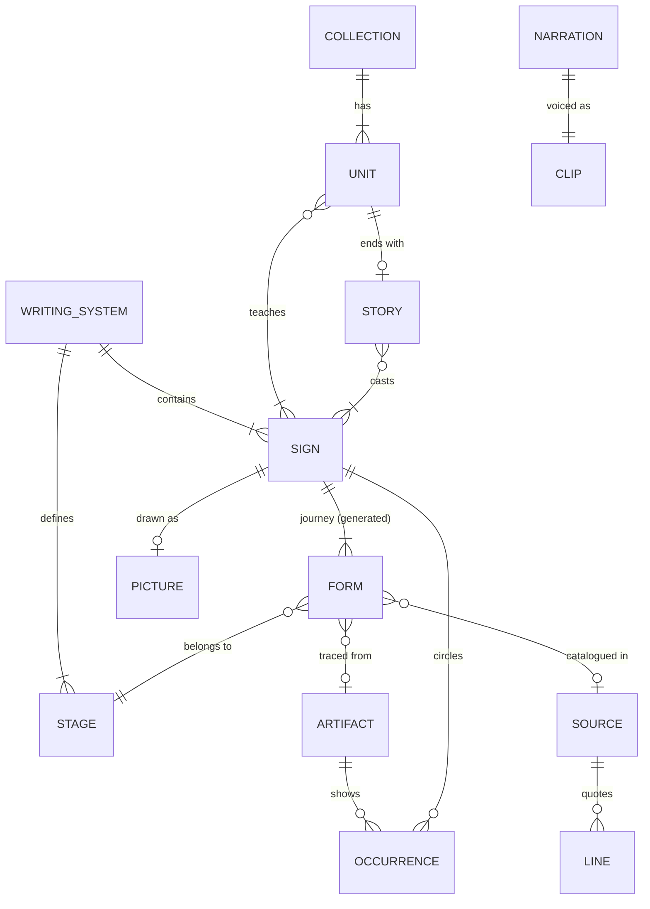
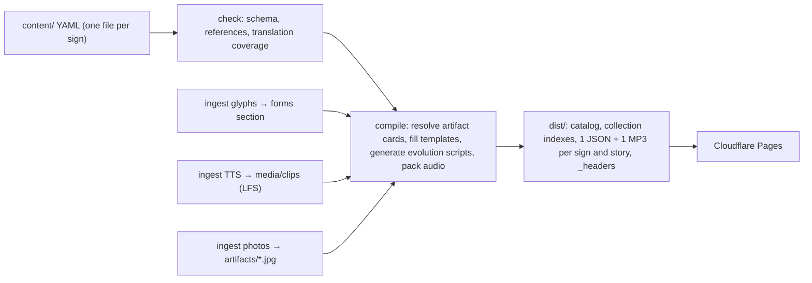

# etym.si content foundation: design spec

> [!NOTE]
> **Status:** approved on 2026-10-25, including your decisions: (1) script-agnostic model, yes; (2) Git LFS for audio masters, now enabled; (3) foundation plus migration, with Egyptian only as a test fixture; (4) **one file per character.**

## Goal

Lay a foundation that lets etym.si grow from 36 Chinese characters to **thousands of signs across several writing systems** (Chinese now; Egyptian hieroglyphs and alphabets later) and more UI languages. Growth should need **no code changes per sign**, and **Cloudflare Pages alone** should serve the whole site.

**Success criteria**
1. Adding a sign or a story only touches `content/`. No TypeScript or Python edits.
2. Adding a writing system takes content plus at most one small ingest adapter. The engine, player and screens stay untouched.
3. A bad file fails the build with `file:line` and a readable message, before anything is deployed.
4. 3,500 signs fit comfortably inside Pages' 20,000-file limit, **however many narration languages we add**.
5. Every narration line is synthesized once, ever (a content-addressed cache).
6. After the migration, today's 36 characters, 6 stories and artifact cards behave exactly as they do now (checked by golden tests).

## Decisions

| Decision | Choice |
|---|---|
| Who edits | Developers / AI agents, in git, checked at build time |
| Format | YAML for hand-written content; tools maintain clearly marked generated sections |
| Location | A top-level `content/` that outlives the prototype app |
| **One file per character** | **Source:** one YAML per sign. **Served:** one JSON + one MP3 per sign |
| Hosting | Everything on Cloudflare Pages: no R2, no Functions |
| Audio masters | One clip per line, stored in **Git LFS** (enabled) |
| Writing systems | Script-agnostic from day one: Chinese now, Egyptian etc. later |

**Approach chosen: compile to packed static bundles.** Other options were shipping normalized tables and joining them in the browser (downloads grow with every sign) or D1 + Functions (a runtime backend, quotas, content outside git). The build validates the YAML, resolves references, and generates animation scripts once. Any player (web today, native later) then only plays data.

## 1. Core model (script-agnostic)



| Entity | What it is | Key | Stored in |
|---|---|---|---|
| Writing system | Chinese characters, Egyptian hieroglyphs, and so on. Each has its own stages, reading schemes, sign-id rule and pronunciation voice | `han`, `egyptian` | `systems/<id>/system.yaml` |
| Stage | One era or form type, e.g. `han.oracle` … `han.simplified` or `egyptian.hieratic`. Stage ids are namespaced, so an alphabet letter's journey can cross systems (F1 ox head → Phoenician 𐤀 → Greek Α → Latin A) | `<system>.<stage>` | inside `system.yaml` |
| **Sign** | What kids learn: a 字, a hieroglyph, a letter. **Everything about one sign lives in one file** | `<system>/<id>`, e.g. `han/马`, `egyptian/G17` | `systems/<sys>/signs/<id>.yaml` |
| Form | One historical shape of a sign at one stage: geometry plus provenance | sign + stage + index | the generated `forms:` section of the sign file |
| Picture | The original "drawn from life" illustration (SVG, 300×300) | per sign | an inline `picture.svg` block in the sign file |
| Artifact | A real object or photo (oracle bone, ding rubbing, papyrus, Rosetta Stone). Its **occurrences** record which signs are visible on it and where (the red circles) | slug, e.g. `dayu-inscription` | `artifacts/<id>.yaml` (+ its photo) |
| Source | A catalogue, text or dataset (Heji, Shuowen, Thousand Character Classic, Gardiner's list), with optional quotable **lines** and card-text **templates** | slug | `sources/<id>.yaml` |
| Collection | A learning track ("The 36 Characters", later "Hieroglyph alphabet", "HSK 1"): units → lessons → signs, plus one story per unit | slug, e.g. `film-36` | `collections/<id>/collection.yaml` |
| Story | A hand-written animation script with narration | slug in its collection | `collections/<id>/stories/*.yaml` |
| Clip | One narration line spoken by one voice | hash of provider + voice + rate + text | `media/clips/<hash>.mp3` (LFS) + `media/manifest.json` |

**Normalization rules.** Each fact is stored in exactly one place:
- "Sign X is visible on artifact A at box B" lives **on the artifact**. Each sign's card is built from that.
- "Form F was traced from Heji 6057" lives **on the form**. It comes from Commons metadata and is never retyped.
- "Character C appears in this line of the Thousand Character Classic" is **matched automatically** against the source's lines.
- The text on a kid-facing card is a **template** on the artifact, source or stage, filled in at build time. A new sign gets correct seal, clerical and regular cards automatically. Unusual cases keep literal per-sign overrides.
- A story's unit is recorded only in `collection.yaml`.

## 2. Repository layout

```text
website/
├─ content/                         # source of truth
│  ├─ config.yaml                   # locales, voices, file budget
│  ├─ ui.yaml                       # UI strings (a new UI language is content-only)
│  ├─ _schema/*.schema.json         # GENERATED JSON Schemas, for YAML autocomplete in editors
│  ├─ systems/
│  │  ├─ han/
│  │  │  ├─ system.yaml             # stages, readings (pinyin), sign-id rule, voices, ingest adapters
│  │  │  └─ signs/马.yaml           # ONE file per character
│  │  └─ egyptian/ …                # later (for now, a test fixture proves the schema)
│  ├─ artifacts/<id>.yaml + <id>.jpg
│  ├─ sources/<id>.yaml
│  └─ collections/film-36/{collection.yaml, stories/01-sunrise-in-the-valley.yaml …}
├─ media/
│  ├─ manifest.json                 # every synthesized clip: voice, text, duration (plain git)
│  └─ clips/<hash>.mp3              # master clip per line (Git LFS); packed at build time
├─ demos/                           # today's app (Vite) + tools/ (compiler) + scripts/ (Python ingest)
└─ docs/superpowers/{specs,plans}/
```

Source file names may use CJK (`马.yaml`) so they're easy to read. Compiled URLs are always ASCII (`u9a6c`).

## 3. What the files look like

````carousel
```yaml
# content/systems/han/signs/马.yaml  (one file = everything about 马)
id: 马
text: { Hans: 马, Hant: 馬 }           # modern forms, keyed by ISO 15924 script code
readings: { pinyin: mǎ }
meaning: { en: horse, zh-Hans: 骏马, zh-Hant: 駿馬 }
fact:
  en: The ancient 马 is a horse standing up on its tail! …
  zh-Hans: 古代的“马”是一匹竖起来的马！…
  zh-Hant: 古代的「馬」是一匹豎起來的馬！…
story:                                 # beats for the Evolution Theater
  topic: { en: The Galloping Steed, zh-Hans: 迎风奔跑的骏马, zh-Hant: 迎風奔跑的駿馬 }
  hook:
    en: Clip-clop, clip-clop! A spirited horse gallops across the plain, …
    zh-Hans: 得儿驾！一匹骏马在原野上飞奔，…
    zh-Hant: 得兒駕！一匹駿馬在原野上飛奔，…
  # rotate, early, turn, closer: same shape
picture:
  rotate: 90                           # stand it up like the oracle glyph
  ambient: bob
  svg: |                               # sanitized at build time (allowlist)
    <svg xmlns="http://www.w3.org/2000/svg" viewBox="0 0 300 300">
      <g class="pic-body"> … </g>
    </svg>
journey: default                       # oracle, bronze, seal, clerical (defined in system.yaml)

# ── generated by `npm run ingest:glyphs`; do not edit below ──
forms:
  - stage: oracle
    form: 馬
    variant: oracle
    commons: File:馬-oracle.svg
    provenance: { period: shang, code: j22174, note: '' }
    box: [0, 0, 300, 300]
    paths:
      - d: M151.3 285.2c-.7-6.2 16.4-18.1 2.5-16.7 …
```
<!-- slide -->
```yaml
# content/systems/han/system.yaml (excerpt)
id: han
name: { en: Chinese characters, zh-Hans: 汉字, zh-Hant: 漢字 }
signNoun: { en: character, zh-Hans: 字, zh-Hant: 字 }
signId: '^\p{Script=Han}(-\p{Script=Han})?$'   # 马, or 发-髮 when one simplified form covers two characters
textScripts: [Hans, Hant]                       # the 简/繁 toggle
readings: { pinyin: { primary: true } }
pronounce: { voice: pron-zh, from: text.Hans }
ingest: { glyphs: commons-acc, strokes: hanzi-writer-data }
stages:
  - { id: picture, kind: picture, icon: 🖍️, color: '#f5b82e', name: …, era: … }
  - { id: oracle, kind: paths, icon: 🐢, color: '#c9824a', commonsVariants: [oracle],
      example: { artifact: heji6057 }, name: …, era: … }
  # bronze, seal, clerical …
  - { id: regular, kind: strokes, example: { source: qianziwen }, name: …, era: … }
  - { id: simplified, kind: strokes, derived: true, name: …, era: … }
```
<!-- slide -->
```yaml
# content/artifacts/dayu-inscription.yaml (excerpt)
id: dayu-inscription
kind: rubbing
stage: han.bronze
title: { en: The Da Yu ding (大盂鼎), zh-Hans: 大盂鼎铭文, zh-Hant: 大盂鼎銘文 }
aliases: [大盂鼎]                     # provenance notes that name this object
image: { file: dayu-inscription.jpg, commons: 'File:Da Yu ding inscription.jpg' }
related: [dayu-ding]
occurrences:                          # the red circles
  - sign: han/马
    phrase:
      en: in “錫車馬”, the king rewarded Yu with a chariot and horses (column 14)
      zh-Hans: 在第14行的“锡车马”（赏赐车和马）里
      zh-Hant: 在第14行的「錫車馬」（賞賜車和馬）裡
    marks:
      - box: [0.270, 0.798, 0.036, 0.050]
        label:
          en: 馬 (“horse”) right under 車 (“chariot”), column 14
          zh-Hans: 第14行“车”字正下方的“马”
          zh-Hant: 第14行「車」字正下方的「馬」
templates:
  exact:
    en: This {sign} was copied from the Da Yu ding{part}, a giant bronze cauldron …
  appears:
    en: '{tracedFrom}You can also spot {sign} circled in red on this rubbing, {phrase}!'
# ── generated by `npm run ingest:photos`; do not edit below ──
credit: { author: …, license: …, page: …, width: 861, height: 900 }
```
<!-- slide -->
```yaml
# content/collections/film-36/stories/03-casting-the-net.yaml (excerpt)
id: casting-the-net
title: { en: Casting the Net, zh-Hans: 小船去捕鱼, zh-Hant: 小船去捕魚 }
topic: { en: A fishing trip on the river, zh-Hans: 划着木船去河心撒网, zh-Hant: 划著木船去河心撒網 }
cast: [云, 燕, 刀, 舟, 鱼, 网]
script:                               # same step vocabulary as today
  - narrate:                          # = caption + spoken line (audio attached at build time)
      en: Out on the wide river, a curling white cloud — 云 — drifts lazily across the blue sky.
      zh-Hans: 宽阔的大河上空，一朵卷曲的白云——“云”，慢悠悠地飘过蓝天。
      zh-Hant: 寬闊的大河上空，一朵捲曲的白雲——「雲」，慢悠悠地飄過藍天。
  - { do: place, actor: cloud, at: [240, 120], size: 150 }
  - { do: draw, actor: cloud, glyph: { sign: 云, stage: oracle }, ms: 1400, color: '#3b6ea5' }
  - tagSay: { actor: cloud, sign: 云, dx: 120, dy: 90 }
```
<!-- slide -->
```yaml
# Egyptian test fixture: proves the schema now; real content comes later
# content/systems/egyptian/signs/G17.yaml
id: G17                               # Gardiner code
text: { Egyp: 𓅓 }
readings: { translit: m }
meaning: { en: owl, zh-Hans: 猫头鹰, zh-Hant: 貓頭鷹 }
egyptian: { kind: uniliteral, sound: m }
journey:
  - { stage: hieroglyph }
  - { stage: hieratic }
  - { stage: demotic }
```
````

## 4. Build pipeline → static API



- **Ingest** is run by a developer and uses the network. It writes into `content/` and `media/`, and the results are committed. **The build itself makes no network calls and needs no secrets.**
- **Compile** runs in Node on every build. It checks everything, then writes:

| Output | Contents | Caching |
|---|---|---|
| `catalog` (inlined into the JS bundle) | systems, stages, locales, UI strings, list of collections | hashed with the JS |
| `data/collections/<id>.<hash>.json` + `.mp3` | units, lessons, sign summaries, story list; MP3 with every pronunciation (quizzes, sticker book) | immutable |
| `data/signs/<sys>/<ascii-id>.<hash>.json` | **everything for one sign**: texts, readings, form geometry, stroke data, picture (sanitized JSON tree), filled-in artifact cards, evolution + lesson-intro scripts, audio index | immutable |
| `data/signs/<sys>/<ascii-id>.<hash>.mp3` | **all of that sign's narration**, every voice as its own byte section | immutable |
| `data/stories/<collection>/<id>.<hash>.{json,mp3}` | script + the exact glyph forms it uses; its audio | immutable |
| `_headers` | CSP, security headers, cache rules | n/a |
| `CREDITS.md` + credits data | built from forms, photos and datasets | n/a |

Today a character costs ~3 JSON files plus ~13 MP3s, and every story, picture and the 547-entry audio manifest ship inside the JS. **After the change a sign is exactly 2 files**, and the JS carries no content.

## 5. Audio: clips → one MP3 per sign (never paid for twice)

- **Clip:** one line spoken by one voice, keyed by `sha256(provider | voice | rate | text)` and stored in `media/clips/` (Git LFS).
  - Once a key is in `media/manifest.json`, that line is never synthesized again, on any machine.
  - Changing the voice or provider changes the key, so the line is re-recorded exactly once.
- **Per-sign MP3:** the build joins every clip a sign needs into one file, **one byte section per voice** (`en`, `zh`, later `es` …). The JSON carries the index: `sections: { en: [byteStart, byteLength] }` and `clips: { key: { en: [ms, dur] } }`.
  - I checked our files: edge-tts writes raw constant-bitrate MPEG-2 Layer III (24 kHz, 48 kbps, mono, no ID3/Xing). Each section is itself a valid MP3, joining is byte-exact with 24 ms frames, and no ffmpeg is needed.
  - ~240 ms of silent frames separate clips, so seeking has some slack.
- **Playback:** the player range-fetches **only the active voice's section** (`Range: bytes=…`) into a Blob URL, then seeks to clips in it. If a server ignores Range, the player slices the full response. Pause, resume and 2× (pitch preserved) work as today. A missing clip falls back to device speech.
- **Shared Mandarin:** zh-Hans and zh-Hant share one section.
- **Pronunciations** (the "mǎ" after a name tag) are copied into every section, so English mode needs only the `en` section.

## 6. File budget on Cloudflare Pages

| | Today (36 chars) | 36 chars, packed | 3,500 signs, packed |
|---|---|---|---|
| Sign files (JSON + MP3) | 629 (glyphs, strokes, loose MP3s) | 72 | 7,000 |
| Stories (JSON + MP3) | inside the JS | 12 | ~600 |
| Collections, photos, app shell | ~20 | ~25 | ~600 |
| **Total** | **~650** | **~110** | **~8,200 of 20,000** |

The total **doesn't grow when we add narration languages**, because voices are sections inside the same MP3. The build **fails** above 18,000 files or any file over 24 MiB, and prints a breakdown. Cloudflare brotli-compresses JSON at the edge. Speech MP3 at 48 kbps is already compact (Opus would break older iPads).

## 7. Git LFS and Cloudflare Pages deployment

- **Git LFS (done):** `media/clips/*.mp3` is LFS-tracked. The 547 existing MP3s on the unpushed `demos` branch were migrated into LFS, and the pre-migration history is kept on `backup/demos-pre-lfs`. The remote is `github.com/etym-si/website`; GitHub's free LFS quota is limited, so CI caches LFS objects.
- **Deploy path:** Pages' own Git builds can't be relied on to fetch LFS objects (we'll check when creating the project), so we deploy from **GitHub Actions**:
  1. checkout with LFS, with the objects cached
  2. `npm ci`, tests, `npm run build`
  3. `wrangler pages deploy dist`

  It needs two repo secrets, added when etym.si is set up: `CLOUDFLARE_API_TOKEN` and `CLOUDFLARE_ACCOUNT_ID`. If the build ever sees an LFS pointer file instead of audio, it fails with a clear message.
- **`_headers`** (generated):
  - strict CSP (`default-src 'self'`; `media-src 'self' blob:` for the range-fetched sections) plus `frame-ancestors 'none'`
  - `X-Frame-Options: DENY`, `nosniff`, `Referrer-Policy`, `Permissions-Policy`
  - `Cache-Control: immutable` on `/assets/*` and `/data/*`

  This closes the README's open `TODO(security)` about GitHub Pages not being able to send headers.
- **Node and routing:** Node is pinned to 24 (`.node-version`). Hash routing stays, so old links like `#/theater/马` keep working as an alias for `han/马`.

## 8. Extending

**Add a sign** (content only):
1. `npm run new -- han 鹤` creates `content/systems/han/signs/鹤.yaml`.
2. Fill in readings, meaning, fact and story, or have an AI agent draft them.
3. `npm run ingest:glyphs -- han/鹤` fills in the `forms:` section.
4. Optional: paste a `picture.svg`, and add the sign to a collection unit or a story.
5. `npm run tts` records only the new lines.
6. `npm run check` validates everything. Push, and CI deploys.

**Add a writing system** (e.g. Egyptian):
1. Write `system.yaml`: its stages, the Gardiner id rule, the transliteration reading, the pronunciation voice, and a self-hosted font if signs are shown as text.
2. Add a glyph ingest adapter for its source (one small module per system).
3. Add signs and a collection. The engine, player and screens don't change: hieroglyph forms are drawn exactly like oracle-bone forms.

**Add a UI language** (e.g. Spanish):
1. Add it to `config.yaml` with a fallback (`es → en`) and a voice.
2. Translate `ui.yaml` and the content strings. The build prints coverage and fills gaps from the fallback until they're translated.

## 9. Validation & errors

- **Strict schemas** (Zod, with generated JSON Schema for editor autocomplete):
  - Unknown keys are errors.
  - Stages, tones, gaits and colors (`#rrggbb`) must use allowed values.
  - Numbers are range-checked and strings are length-capped.
- **Cross-references:**
  - Every sign, stage, artifact, source and story that is referenced must exist.
  - A sign appears in at most one unit per collection.
  - Glyph selectors in stories must point to a real form.
  - Actors must be placed before they're used.
  - Mark boxes stay within 0–1, and ids match file names.
- **Assets:**
  - Pictures must pass the SVG sanitizer.
  - Photos must be present and credited.
  - Every journey stage must have a form.
  - Audio coverage: a warning locally, an error with `--strict`.
  - Any LFS pointer that wasn't fetched is reported.
- **Error format:** `content/systems/han/signs/马.yaml:14:5 story.hook.zh-Hant: missing translation`

## 10. Testing

- **Golden parity (the migration's safety net):** before anything changes, headless Chrome records today's output for all 36 characters, in both 简 and 繁. That covers the evolution scripts, the 6 story scripts, every artifact card (character × stage) and the rendered pictures. The compiled bundles must reproduce them exactly, apart from the planned renames.
- **Unit tests** with `node:test`:
  - schema accept/reject fixtures
  - the rules that pick each artifact card
  - template filling (no `{placeholders}` left over)
  - the SVG sanitizer (rejects `<script>`, `on*`, `href`, `style`, `url()`)
  - the packer (exact sections and offsets, frame alignment)
  - clip keys computed identically in Node and Python
  - the file-budget guard
- **Egyptian fixture:** a one-sign `egyptian` system compiles and plays in the Theater. This proves the pipeline isn't tied to Chinese.
- **End to end:** a Playwright smoke run on 127.0.0.1 visits home, the theater (new and legacy routes), stories 1–6, a lesson and the sticker book. It requires zero console or CSP errors and 206 responses for the section fetches.

## 11. Security

- **YAML parsing:** the `yaml` library's core schema, with no custom tags, duplicate keys rejected and the alias count capped.
- **Picture SVGs:**
  - They're sanitized at build time against an allowlist: shapes, presentation attributes and animation classes only.
  - No `style`, `href`, `<use>`, `<image>`, `<foreignObject>` or event handlers get through.
  - They're stored as a JSON tree and rebuilt with `createElementNS`, so there is still no `innerHTML` anywhere.
- **Runtime:** bundles get a light re-check before touching the DOM, and all text goes through `textContent`. `blob:` is allowed only in `media-src`, and only for audio the app fetched from its own origin.
- **Tools:** ids are pattern-checked before they become file names. Output paths must resolve inside `dist/` (a prefix check with a trailing separator).
- **Network and secrets:**
  - Ingest only talks to allowlisted hosts (Wikimedia and the TTS endpoint).
  - The build has no network access and no secrets.
  - CI secrets live in GitHub Actions secrets only.
  - A future paid TTS key comes only from an environment variable.
- **New dependencies:** dev-only `yaml`, `zod` and `@types/node`. The dependency scanner isn't running on this machine, so that check is skipped as the skill specifies.

## 12. Migration phases

0. ✅ Git LFS enabled; existing MP3 history migrated (backup branch kept).
1. Record golden snapshots of today's behavior.
2. Schemas, loader, validator and generated JSON Schemas (with the Egyptian fixture).
3. One-off migration:
   - TS data → one YAML per sign / artifact / source / story / collection, and UI strings → `ui.yaml`.
   - The 547 clips renamed to the new keys in `media/clips/`, **with no re-synthesis**.
4. The compiler: card resolution, templates, script generation, audio packing, outputs, `_headers`, credits and the budget guard. The parity tests must pass.
5. The app reads the static API and plays sections by range-fetch. Routes become namespaced, and saved progress is migrated.
6. Ingest tools read their job lists from content, so the hard-coded `FILM_ORDER`, `TRAD` and `ARTIFACTS` lists go away.
7. The GitHub Actions deploy workflow, `.node-version`, and `content/README.md` with the "Extending" recipes.
8. Full verification (unit, parity, end-to-end, Egyptian fixture) and the LAN preview.

**Not in this iteration:** real Egyptian content, new UI languages, a CMS, D1 or R2, SEO pre-rendered pages, search for huge collections, Opus audio, RTL polish, automatic simplified→traditional conversion.

## 13. Risks & open questions

1. **edge-tts licensing.** It uses Microsoft Edge's Read Aloud service, whose terms for production use are unclear. Before launch, consider Azure AI Speech (same voices, licensed). Switching is a config change, and each line is still paid for once. For scale, 3,500 signs means roughly 2.0 M English plus 0.7 M Chinese characters of narration.
2. **LFS on CI:** GitHub's LFS bandwidth quota. Mitigation: CI caches `.git/lfs` keyed on the LFS file list.
3. **Templates vs. literal text:** if a template gets too clever, fall back to literal per-sign text.
